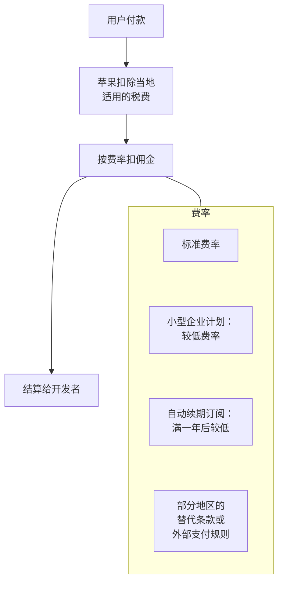
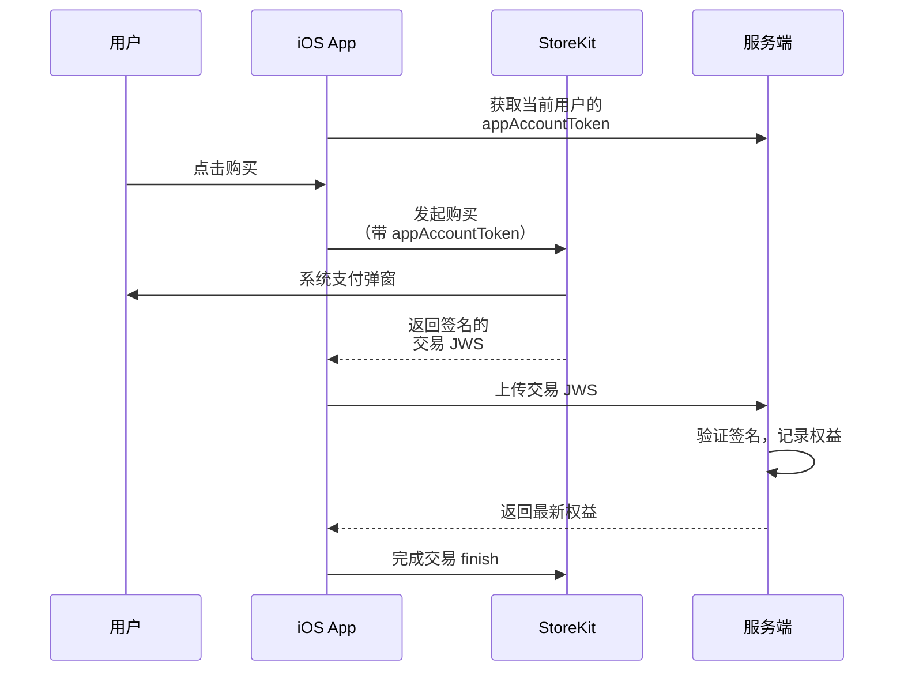
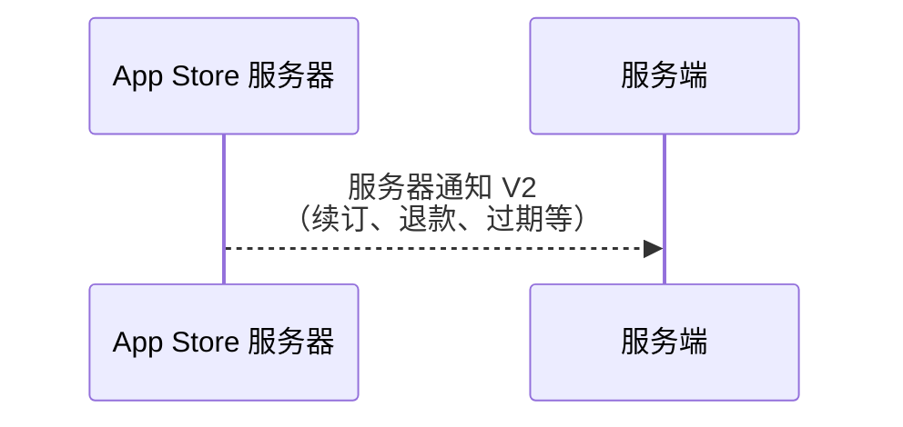

# App Store 内购

只要你的 iOS App 里卖的是**数字内容或功能**，绝大多数情况下就必须走苹果的应用内购买（In-App Purchase，IAP），不能接微信支付、支付宝或自己的网页支付。这一章讲清楚三件事：什么时候必须用 IAP、什么时候可以不用；佣金规则的框架；以及技术上怎么接、服务端怎么校验和处理订阅状态。

> [!WARNING]
> 本章按 2025 年前后的 App Store / Google Play 规则整理（「地区规则」一小节按 2026 年 11 月核对过），佣金比例和支付规则近几年变化很多，美国、欧盟、日本、韩国等地因法院判决和当地立法已有与其他地区不同的规则且还在变；具体比例、地区差异和适用条件以 Apple《App 审核指南》、App Store Connect 中的最新协议和各应用商店开发者协议为准。

## 什么时候必须用 IAP

> [!WARNING]
> 《App 审核指南》第 3.1 节的条款和外部链接规则按 2026 年 11 月 Apple 开发者网站上的《App 审核指南》整理，美国区的外链规则还在诉讼中，以 Apple 开发者网站上最新版《App 审核指南》为准。

苹果《App 审核指南》第 3.1 节规定了 App 内的付费规则。大致的分界线：

| 卖的是什么 | 支付方式 | 例子 |
|---|---|---|
| App 内使用的数字内容、功能、订阅 | **必须用 IAP** | 解锁高级功能、会员、AI 额度、电子书、虚拟道具 |
| 在 App 外消费的实物商品或线下服务 | **不能用 IAP**，用其他支付（微信支付、支付宝、Apple Pay 等） | 外卖、打车、电商、线下课程 |
| 一对一的实时人工服务 | 指南中有专门条款，视情况而定 | 在线问诊、一对一辅导 |

数字内容这一类里还有几个重要的例外：

- **多平台服务**：用户在网页或其他平台买的订阅，可以在 iOS App 里登录使用。但指南对 App 内是否也要提供 IAP、能否引导用户去外部购买，有具体要求
- **阅读器类 App**：杂志、音乐、视频、书籍这类以内容消费为主的 App，可以不在 App 内售卖，只让已购用户登录；在部分条件下还可以申请提供一个外部链接
- **企业服务**：只由你直接卖给**组织机构**、供其员工或学生使用的 App，可以让企业用户访问已购买的服务；但面向个人消费者、单个用户或家庭的销售仍必须用 IAP

最容易踩的坑是**引导外部支付**：在 App 里放「去官网购买更便宜」的按钮、链接，或者用文字提示用户去别处付款。在大多数地区这是被禁止的，会被拒审甚至下架。例外是**美国区**：按 2026 年 11 月的《App 审核指南》3.1.1(a) 和 3.1.3，美国区 App 放购买按钮、外部链接和其他引导外部购买的文字，不需要申请任何权限；欧盟、日本等地区要按当地的专门条款申请链接权限并付费，见下文[地区规则](#地区规则)。上架前核对当时的指南。

### 安卓呢

国内安卓没有统一的应用商店，各商店对数字商品的收费政策不一，有的要求接入自家支付并分成，有的不强制。以你上架的各商店最新的开发者协议为准。Google Play 在国内不可用，出海时另说，见[《出海实务》](../going-global/)。

## 佣金的框架

> [!WARNING]
> 小型企业计划的 15% 和 100 万美元门槛按 2026 年 11 月 Apple 开发者网站「App Store Small Business Program」页面整理；标准费率 30% 是多年来被广泛报道的数字，该页面没有直接写出。费率可能调整，以 Apple 开发者网站和 App Store Connect 协议中的当前说明为准。

苹果对通过 IAP 收到的钱抽取佣金，剩下的部分（扣除税费后）结算给开发者。框架上有这么几层：



小型企业计划面向年收入低于门槛的开发者，需要申请；自动续期订阅是同一用户连续付费满一年后，续订费率较低。

- **标准费率**：多年来被广泛报道的是 30%
- **小型企业计划**（App Store Small Business Program）：上一个自然年和当年的收入（proceeds，含关联开发者账号）都不超过 100 万美元的开发者，费率降到 15%。**需要主动申请**，不是自动生效；当年超过门槛后，之后的销售恢复标准费率
- **订阅的第二年起**：同一用户的自动续期订阅连续付费满一年后，续订部分适用较低费率
- **地区规则**：欧盟、美国、日本、韩国等地已经有替代支付、外部链接或不同的费率结构，条件和费用另行规定，美国、欧盟、日本三地见下一小节

对一人公司，最实际的一条是：**上架第一天就去申请小型企业计划**。

佣金还影响你的定价：如果你在网页端也卖同一个订阅，网页端价格低于 App 内是很常见的做法（因为没有佣金），但在大多数地区你**不能在 App 里告诉用户这件事**。

### 地区规则

> [!WARNING]
> 本小节按 2026 年 11 月查到的资料整理：美国部分依据 Apple《App 审核指南》现行文本和 Epic 诉 Apple 案的公开报道（第九巡回上诉法院 2025-12-11 判决、美国最高法院 2026-06-30 同意审理）；欧盟部分依据 Apple 开发者网站「Update on apps distributed in the European Union」页面；日本部分依据 Apple 开发者网站「Changes to iOS in Japan」页面。三地规则都还在变，以 Apple 开发者网站、App Store Connect 协议和当地主管机关的最新文件为准。

三个地区的规则来源不同：美国是法院禁令，欧盟是《数字市场法》（DMA），日本是《智能手机软件竞争促进法》（英文简称 MSCA）。

**美国区：外链可以放，费用还在打官司**

- 2025-04-30，加州北区联邦地区法院认定 Apple 违反了 2021 年 Epic 案的反引导禁令（anti-steering injunction），禁止 Apple 对通过 App 内链接在外部完成的购买收取佣金，也禁止限制链接和按钮的样式。Apple 随后修改了审核指南：美国区 App 放外部购买的按钮、链接、文字，**不需要申请权限**
- 2025-12-11，第九巡回上诉法院维持了藐视法庭的认定，但撤销了「完全不得收取佣金」这一项，发回地区法院重新确定：Apple 可以收一笔与协调外链真正必要的成本相当的费用，但不能按原来 27% 那样的佣金收
- 2026-06-30，美国最高法院同意审理 Apple 的上诉，范围只限于藐视法庭的认定是否成立
- 写作时（2026 年 11 月），地区法院的重审和最高法院的审理都没有结果，Apple 对外链购买能收多少钱尚未确定。在美国区接网页支付之前，先查这两件事的最新进展

**欧盟：统一的 DMA 条款（2026-10-01 起）**

Apple 在 2026-08-18 更新开发者协议，从 2026-10-01 起把欧盟的几套替代条款合并为协议附件 14，按每位开发者的选择收费：

| 方式 | 标准 | 优惠* |
|---|---|---|
| App Store 内用 Apple IAP | 26% | 15% |
| App Store 内用替代支付 | 20% | 10% |
| App 内链接到网页购买（链接后 7 天内的销售） | 15% | 10% |
| 在 App Store 之外分发（替代应用市场、网页分发）：核心技术佣金 CTC | 5% | — |

\* 优惠费率适用于小型企业计划等项目的参与者，以及满一年后的自动续期订阅。

原来按安装量收的核心技术费（Core Technology Fee，CTF）改成按销售额收的 5% 核心技术佣金（Core Technology Commission，CTC），初始获客费（Initial Acquisition Fee）和商店服务费（Store Services Fee）取消。用替代支付的开发者要自己代缴税费，并在每月结束后 15 天内向 Apple 报告交易。

**日本：MSCA（2025-12-18 全面施行）**

《智能手机软件竞争促进法》2025-12-18 全面施行，Apple 同日公布了日本区的新条款，适用于 iOS 26.2 及以后的系统，现有开发者须在 2026-03-17 前同意新版协议：

| 方式 | 标准 | 优惠* |
|---|---|---|
| App Store 佣金（IAP 或替代支付） | 21% | 10% |
| 另加：Apple IAP 支付处理费 | 5% | 5% |
| App 内链接到网页购买（链接后 7 天内的销售） | 15% | 10% |
| 在 App Store 之外分发：CTC | 5% | — |

\* 优惠费率同样适用于小型企业计划等项目的参与者和满一年后的自动续期订阅。

所以在日本区用 IAP，标准情况是 21% + 5% = 26%，小型企业计划是 10% + 5% = 15%，和欧盟数字一致，只是拆成了两项。

**对一人公司意味着什么**

以加入小型企业计划为前提，欧盟和日本区「用 IAP」和「链到网页」的费率差距只剩 0–5 个百分点，而网页支付还要再付支付渠道手续费、自己处理退款和税，大多数小产品继续用 IAP 更省事。美国区差距最大（外链购买目前不收佣金），但规则尚未落定，适合已经有网页支付和账号体系的产品先试。

### 价格档位与税

IAP 的价格不能随意填，要从苹果提供的价格点里选；苹果会根据基准价格和汇率、税率，自动生成各国家或地区的价格，你也可以对个别地区手动设置。国区价格是含税价，苹果在结算时处理相关税费，你收到的结算金额和你的收入确认、开票问题见[《财务与税务》](../opc-finance/)。

## 商品类型

在 App Store Connect 里创建的 IAP 商品分四类：

| 类型 | 说明 | 例子 |
|---|---|---|
| 消耗型 | 买了用掉，可以重复买 | AI 生成次数包、游戏金币 |
| 非消耗型 | 买一次永久拥有，可恢复购买 | 解锁专业版（买断） |
| 自动续期订阅 | 按周期自动扣费，直到用户取消 | 月度 / 年度会员 |
| 非续期订阅 | 有期限，但不自动续，需要用户再次购买 | 一季度的通行证 |

所以第 2 章讲的买断对应**非消耗型**，订阅对应**自动续期订阅**。

自动续期订阅要放在**订阅群组**里，同一群组里的不同档位（月付、年付、高级版）互斥，用户同时只能订阅其中一个，切换档位时苹果会处理升降级和按比例计算。还可以配置**推介促销优惠**（免费试用、首期优惠价）和**促销优惠**（给老用户的挽回优惠）。

## 上架国区的前提

> [!WARNING]
> App 备案、版号等要求按 2025 年前后的规定整理，可能已调整，以工业和信息化部、国家新闻出版署的最新规定和 App Store Connect 的提示为准。

在中国大陆的 App Store 分发 App，需要先完成 **App 备案**；游戏还涉及版号等专门的审批。带付费功能的 App 还要准备好隐私政策、用户协议、自动续费说明。这些流程和材料见[《国内合规实务》](../opc-compliance-cn/)。个人开发者账号在商店里显示的卖家名是开发者的真实姓名，想显示公司名要用组织账号，组织账号需要邓白氏编码等材料。

## 技术接入

### 整体流程



在这之外，App Store 服务器会把续订、退款、过期等事件主动推给你的服务端：



几个关键点：

- **StoreKit 2** 返回的交易是苹果签名的 JWS（JSON Web Signature），服务端可以离线验证签名，不需要像老的收据校验那样每次去问苹果
- **appAccountToken** 是你在购买时传入的 UUID，会写进交易里。用它把苹果的交易和你自己系统里的用户关联起来
- **一定要 finish 交易**。不 finish 的交易会在下次启动时再次推送给 App
- **App Store 服务器通知 V2**：续订、扣款失败、退款、过期这些事件发生在用户不打开 App 的时候，只能靠服务器通知知道

### 客户端：React Native / Expo

在 Expo 项目里接 IAP，常见选择有：

- 社区维护的 IAP 库（如 react-native-iap 及其衍生的 Expo 模块），直接封装 StoreKit 和 Google Play Billing
- 第三方订阅管理服务的 SDK（如 RevenueCat），它替你做服务端校验、订阅状态和跨平台统计，按收入收费

两者都依赖原生模块，**必须用 dev client 构建，不能在 Expo Go 里测试**。库的 API 在不同版本间变化较大，按当时的文档写，并确认与你的 Expo SDK 版本兼容。

自建还是用第三方服务？一人公司的取舍：

| 方案 | 优点 | 缺点 |
|---|---|---|
| 自己接 StoreKit + 自己的服务端 | 无额外费用，数据在自己手里 | 订阅状态的边界情况多，要自己处理 |
| 第三方订阅管理服务 | 省大量开发和维护时间，带分析看板 | 收入超过免费额度后按比例收费，多一个依赖 |

如果你已经有 NestJS 服务端、用户体系，又只做 iOS，自己接并不难。下面给出服务端的核心部分。

### 服务端：验证与处理通知

苹果提供官方的 Node 库 `@apple/app-store-server-library`，封装了 JWS 验证、App Store Server API 调用。下面是处理服务器通知的示意（API 以库的当前文档为准）：

```ts
import { readFileSync } from 'node:fs';
import { Environment, SignedDataVerifier, NotificationTypeV2 } from '@apple/app-store-server-library';

// 苹果根证书从 Apple PKI 页面下载，随部署一起分发
const appleRootCAs = [readFileSync('certs/AppleRootCA-G3.cer')];

const verifier = new SignedDataVerifier(
  appleRootCAs,
  true, // 在线检查证书吊销
  Environment.PRODUCTION,
  process.env.IOS_BUNDLE_ID!,
  Number(process.env.IOS_APP_APPLE_ID), // 生产环境需要 App 的 Apple ID
);

export async function handleAppStoreNotification(signedPayload: string) {
  const notification = await verifier.verifyAndDecodeNotification(signedPayload);
  const signedTx = notification.data?.signedTransactionInfo;
  if (!signedTx) return;
  const tx = await verifier.verifyAndDecodeTransaction(signedTx);

  // 用 notificationUUID 去重：同一条通知可能重复送达
  if (await alreadyProcessed(notification.notificationUUID!)) return;

  switch (notification.notificationType) {
    case NotificationTypeV2.SUBSCRIBED:
    case NotificationTypeV2.DID_RENEW:
      await grantEntitlement(tx.appAccountToken, tx.originalTransactionId, tx.expiresDate);
      break;
    case NotificationTypeV2.EXPIRED:
    case NotificationTypeV2.GRACE_PERIOD_EXPIRED:
      await revokeEntitlement(tx.originalTransactionId);
      break;
    case NotificationTypeV2.REFUND:
    case NotificationTypeV2.REVOKE:
      await revokeEntitlement(tx.originalTransactionId, { reason: 'refund' });
      break;
    case NotificationTypeV2.DID_FAIL_TO_RENEW:
      await markBillingIssue(tx.originalTransactionId); // 提醒用户更新支付方式
      break;
  }
  await markProcessed(notification.notificationUUID!);
}
```

要点：

- **用 originalTransactionId 标识一个订阅**。每次续订都会产生新的 transactionId，但 originalTransactionId 不变
- **权益以服务端记录为准**，App 启动时向服务端拿当前权益，而不是只信本地
- 通知同样会重复和乱序到达，处理要**幂等**；对状态有疑问时，用 App Store Server API 主动查询该订阅的最新状态
- 沙盒和生产环境的通知要**分开配置地址**，或者在代码里按 `environment` 字段分流

### 恢复购买

指南要求非消耗型商品和订阅提供**恢复购买**入口。用户换手机、重装 App 后点一下，就能找回已购内容。用 StoreKit 2 时可以直接读取当前有效的权益；如果你有自己的账号体系，登录后从服务端拿权益也是一种恢复方式，但仍应提供恢复按钮。

## 测试

| 环境 | 用途 |
|---|---|
| Xcode StoreKit 配置文件 | 本地测试，不需要连 App Store Connect，可以模拟续订、退款、扣款失败 |
| 沙盒测试账号 | 在 App Store Connect 创建，真机测试真实的购买流程；订阅周期被大幅压缩，便于测试续订和过期 |
| TestFlight | 测试版本里的购买走沙盒，不会真扣钱 |

上线前至少走通这几条路径：首次购买、续订、取消后过期、扣款失败进入宽限期、退款、恢复购买、换设备登录。

## 审核注意事项

付费相关的拒审原因很常见：

- 订阅页没有清楚写出**价格、周期、自动续费说明**，没有隐私政策和用户协议链接
- 没有恢复购买按钮
- App 里出现引导外部支付的按钮或文字（地区例外另论）
- 审核员无法测试付费功能：要在审核备注里说明怎么触发购买，必要时提供测试账号
- 免费试用、优惠价展示不清，让用户误以为是免费的

## 本章要点

- 在 iOS 卖 App 内使用的**数字内容和功能**，基本都要用 IAP；**实物和线下服务**不能用 IAP
- 例外有多平台服务、阅读器类 App、面向组织的企业服务，条件写在《App 审核指南》第 3.1 节
- 佣金框架：标准费率、小型企业计划（**要主动申请**）、订阅第二年起较低费率、地区替代规则；**具体比例和条件以苹果最新说明为准**
- 地区规则（2026 年 11 月）：美国区外链不需权限、费用在诉讼中未定；欧盟 2026-10-01 起 IAP 26% / 15%、外链 15% / 10%、站外分发 5% CTC；日本 2025-12-18 起佣金 21% / 10% 另加 IAP 处理费 5%
- 买断对应非消耗型，订阅对应自动续期订阅，订阅放在订阅群组里管理升降级
- StoreKit 2 交易是签名的 JWS，用 **appAccountToken** 关联用户、**originalTransactionId** 标识订阅
- 服务端处理**服务器通知 V2**，幂等、以服务端权益为准；上线前在沙盒走通续订、过期、退款、恢复购买
