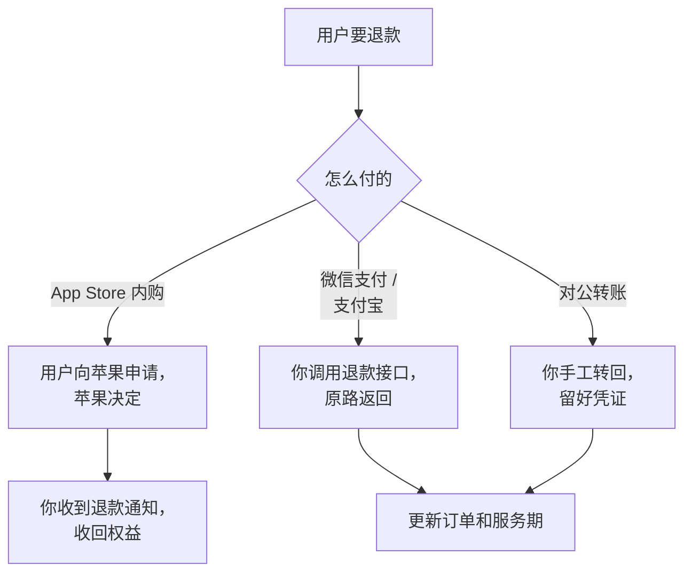
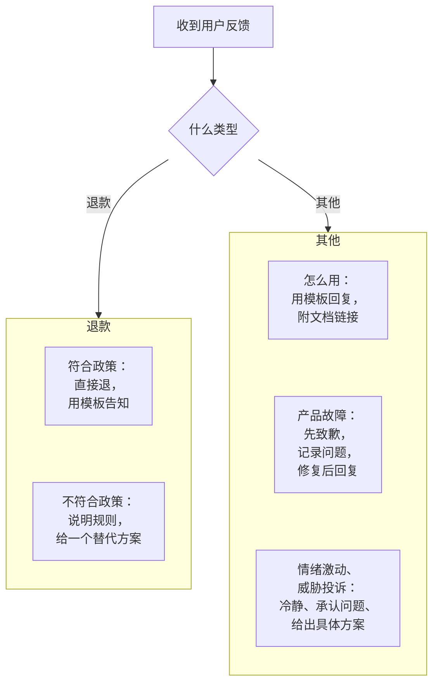

# 退款与客诉

收钱之后，迟早会遇到要退钱的用户。退款处理得好，用户会记得你讲道理，甚至会推荐给别人；处理得不好，轻则一条差评，重则被投诉到支付平台、应用商店或监管部门，影响收款账户。这一章讲怎么在**第一笔钱进来之前**把退款规则定好，各个渠道的退款机制有什么不同，以及一个人怎么把客诉处理得既有温度又不被拖垮。

本章涉及消费者权益保护相关法律的地方只讲框架。**具体条款、适用范围和监管要求会变化，以最新的法律法规和主管部门规定为准**；遇到真正的纠纷，咨询专业人士。

## 为什么要先写退款规则

没有事先写清楚的规则，每次退款都变成一次谈判：用户觉得你在刁难，你觉得用户在占便宜。而事先公开的规则有几个好处：

- **付款前用户就知道**，减少「我不知道会这样」的纠纷
- **你不用每次都做决定**，照规则办，省时间也省情绪
- **对外一致**，不会因为谁闹得凶就多退
- 支付平台和应用商店审核时，**清晰的退款说明本身就是要求之一**

## 法律框架：几个要知道的概念

> [!WARNING]
> 七日无理由退货、格式条款和自动续费的规定按 2025 年前后的《消费者权益保护法》及其实施条例、《民法典》和市场监管部门的文件整理，可能已调整，以国家法律法规数据库的条文和国家市场监督管理总局的最新规定为准。

不需要成为法律专家，但这几个概念要清楚：

| 概念 | 要点 |
|---|---|
| 七日无理由退货 | 《消费者权益保护法》规定网络购买商品一般享有七日无理由退货，但列出了例外，其中包括在线下载或已拆封的计算机软件等数字化商品；除法定例外，经营者也可以对其他不宜退货的商品在购买时经消费者确认后不适用 |
| 格式条款 | 你单方拟定的用户协议、退款政策属于格式条款，免除自己责任、排除消费者主要权利的内容可能无效，并且对限制消费者权利的条款负有提示说明义务 |
| 自动续费 | 监管对自动续费有专门要求，方向是：开通前显著提示、扣费前提醒、取消方式便捷，不得默认勾选 |
| 预付费 | 年付、充值属于预付性质，经营者停止服务时要按约定退还未消费部分 |

由此得到几条实践原则：

1. **数字商品可以不适用七日无理由退货，但要在购买时让用户明确确认**，而不是藏在协议深处
2. 退款规则写进**付款页可见的位置**，并要求用户勾选或以其他方式确认
3. 「一经售出概不退款」这种一刀切的写法，风险高且体验差，不建议
4. 如果你要停止运营，**提前通知并按比例退还预付费用**

## 设计退款政策

### 按产品类型选

| 产品类型 | 常见做法 |
|---|---|
| 买断制软件 | 购买后 N 天内无条件退款，之后不退 |
| 订阅（月付） | 不退当期，取消后当期结束不再扣费 |
| 订阅（年付） | 前 N 天全额退；之后按剩余时间比例退，或不退但保留服务到期 |
| 消耗型额度 | 未使用部分可退，已用不退 |
| To B 年费 | 按剩余天数比例退，扣除已提供的实施服务费 |

一人公司早期，**慷慨一点通常更划算**。一次干脆的退款成本是一笔订单的钱；一次纠缠的成本是你半天的时间、一条差评，以及一个本可能回来的用户。有的独立开发者干脆写「任何理由，30 天内全额退款」，把它当成降低购买顾虑的营销手段，而真正申请退款的人往往比预想的少。

### 按比例退款怎么算

To B 年付最常见的是按剩余天数比例退。hatch-counter 的规则是：**退一部分钱，到期日按退的比例减回去**。比如一张 12 个月的订单收了 990 元，退 495 元，就把这张订单加上去的天数减掉一半。

```ts
// 按退款比例减回到期日：退多少比例的钱，就减多少比例的天数
function shrinkExpiry(
  expiresAt: Date,
  orderAddedDays: number, // 这张订单当初加了多少天
  paidCents: number,
  refundCents: number,
): Date {
  if (refundCents <= 0 || refundCents > paidCents) throw new Error('退款金额不合法');
  const days = Math.round((orderAddedDays * refundCents) / paidCents);
  const next = new Date(expiresAt);
  next.setDate(next.getDate() - days);
  return next; // 早于今天意味着当场过期，确认前要告诉操作的人
}
```

这样设计的好处是**钱和服务期始终对得上**：财务上退了多少，系统里就少了多少天，不会出现退了钱还能一直用，或者收了钱日子没加的情况。减回的日期如果早于今天，门店会当场过期，所以 hatch-counter 在确认框里会把这件事写明白。

### 政策的写法

退款政策要短、具体、能直接执行：

```markdown
## 退款说明

- 开通后 7 天内，不满意可以全额退款，不问原因
- 年付超过 7 天的，按剩余天数比例退款
- 月付不退当月费用；取消后本月照常使用，下月起不再收费
- 退款原路返回，一般几个工作日内到账，具体以支付渠道为准
- 申请方式：在「设置 → 帮助」里联系客服，或发邮件到客服邮箱
```

避免模糊的词：「特殊情况可酌情处理」「合理范围内」。这些词给你留了余地，也给了用户争执的空间。

## 各渠道的退款机制

不同的收款渠道，退款由谁来做、你能控制多少，差别很大：



### App Store：苹果说了算

> [!WARNING]
> IAP 退款流程和 `CONSUMPTION_REQUEST` 的回传要求按 2025 年前后的情况整理，可能已调整，以 Apple 开发者文档（App Store Server API / Notifications）的当前版本为准。

IAP 的退款**由苹果处理，开发者不能直接给用户退款**。用户通过苹果的「报告问题」页面或 App 内调起的退款申请（StoreKit 提供在 App 内发起退款请求的接口）提交申请，苹果审核后决定是否退。

你能做的：

- **处理退款通知**：收到 `REFUND` 服务器通知后收回对应权益（第 6 章的代码）
- **提供消费信息**：苹果可能发送 `CONSUMPTION_REQUEST` 通知，询问这笔购买的使用情况，你可以在规定时间内通过 App Store Server API 回传（是否已使用、使用了多少等），供苹果参考。回传前要确认用户已同意相关数据的提供，以苹果文档的要求为准
- **引导用户**：用户找你要退款时，告诉他通过苹果申请的具体路径，不要说「我们没办法」

用户如果在 App 里看不到退款入口而找你，耐心告知路径就行。滥用退款的情况（买了用完就退）确实存在，`CONSUMPTION_REQUEST` 是你唯一能表达意见的渠道。

### 微信支付和支付宝：你来退

> [!WARNING]
> 退款时限和手续费规则按 2025 年前后的平台规则整理，可能已调整，以微信支付商户平台和支付宝开放平台的最新文档为准。

通过 API 收的钱，退款是你调用接口发起，**原路退回**用户的支付账户。要注意：

- 退款有**时间限制**，超过平台规定的期限（从交易发生起算）就无法通过接口原路退款，只能另行转账
- 退款会占用你商户账户里的**可用余额**，余额不足时退款会失败
- 已经收取的手续费在退款时是否退还，以平台当前规则为准
- 用你自己生成的**退款单号**保证幂等，重复请求不会重复退

### 对公转账：人工退，留凭证

线下收的钱线下退。退款要留好转账凭证，在系统里记录退款金额、日期、原因、经手人。hatch-counter 的后台把退款记进账单和操作日志，**退了就不能撤**，这是财务记录的基本要求。

如果当初开了发票，退款还涉及发票的冲红，这部分见[《财务与税务》](../opc-finance/)。

## 客诉：来自各个方向

用户不满时不一定先找你，可能直接找平台：

| 渠道 | 说明 | 影响 |
|---|---|---|
| 你的客服 | 微信、邮件、App 内反馈 | 最好的情况，你有完整的处理空间 |
| 应用商店评论 | 公开的差评 | 影响新用户下载转化 |
| 支付平台投诉 | 微信支付、支付宝都有消费者投诉通道 | 平台会通知商户限期处理，处理不当可能影响商户账户 |
| 第三方投诉平台 | 媒体或社会化的投诉平台 | 公开、可被搜到 |
| 监管部门 | 12315 等 | 正式程序，需要配合调查 |

### 支付平台投诉要优先处理

> [!WARNING]
> 投诉响应时限和风控规则按 2025 年前后的平台规则整理，可能已调整，以微信支付商户平台和支付宝商家中心的最新要求为准。

微信支付和支付宝都要求商户在规定时限内响应用户投诉，商户平台里有专门的投诉处理入口，也可以通过 API 接入投诉通知。**未及时处理、投诉率过高**可能触发平台的风控措施，影响收款甚至冻结资金。

建议：

- 在商户平台配置投诉通知，**第一时间知道**
- 收到投诉当天联系用户，大多数投诉在沟通后就能解决
- 对明显合理的诉求，直接按规则退款，然后在平台上完结投诉

### 自动续费是重灾区

很多投诉都来自「我不知道会自动扣钱」。预防胜于处理：

- 开通时**显著说明**会自动续费、续费金额和周期
- 扣费前**提前提醒**（App Store 订阅苹果会发邮件；自己做的订阅要自己发）
- **取消入口**放在明显的位置，取消流程不要设置障碍
- 对「忘了取消」刚扣的一笔，在规则允许的范围内**宽松处理**

## 一个人的客服流程

客服是一人公司最容易被拖垮的环节。目标是：**响应及时、标准一致、不占用大块时间**。

### 分级



### 回复模板

常见问题写好模板，存在文本替换工具或客服系统里：

```text
您好，已经为您办理退款 ¥99.00，会原路退回您的微信，一般几个工作日内到账。
您的账号仍可以使用到本期结束。

如果方便的话，想请教一下：是哪里没有达到您的预期？
您的反馈会直接影响我们接下来改什么。
```

最后一句很重要：**每一次退款都是一次免费的用户研究**。把退款原因记下来，每月看一次，常见原因就是你的产品路线图。

### 不符合政策的退款

用户要求的超出了政策：比如年付用了半年要求全退。处理原则：

1. **先共情**：承认用户的不满是真实的
2. **说明规则**：引用付款时确认过的政策，语气平和
3. **给替代方案**：按比例退剩余部分；延长服务期作为补偿；换到更便宜的档位
4. **守住底线但不争输赢**：金额不大时，有时候多退一点换一个平静的结局是值得的

### 记录

每次退款和客诉都记一笔：日期、用户、渠道、原因、处理方式、金额、耗时。几个月后你会看到：

- 哪个功能引发最多的问题
- 哪个渠道来的用户退款率高（可能是渠道和产品不匹配）
- 价格调整后退款率有没有变化（第 4 章的观察指标）

## 本章要点

- 退款规则要在**第一笔钱进来之前**写好，并在付款前让用户看到、确认
- 数字商品可以不适用七日无理由退货，但要**购买时明确确认**；一刀切「概不退款」风险高；法律细节以最新规定为准
- 早期**慷慨一点更划算**；To B 年付按剩余比例退，**钱和服务期始终对得上**
- App Store 退款由**苹果决定**，你处理退款通知、回应消费信息请求；微信支付 / 支付宝由你调用接口原路退，注意时限和余额
- **支付平台投诉要优先、限期处理**，否则可能影响收款账户；自动续费是投诉重灾区
- 一个人的客服靠分级、模板和记录；**每次退款都是一次用户研究**
