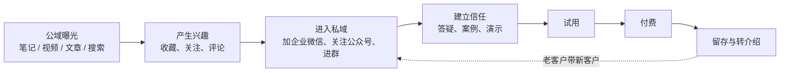

# 公域与私域

「私域」这个词在国内被讲烂了：有人把它讲成「加满五个微信号就能躺赚」，有人把它讲成「割韭菜的代名词」。对一个下班后做副业的开发者来说，它其实是个很朴素的问题：**一个对你产品感兴趣的人，下一次你还能不能找到他**。

这本书讲的是国内平台上的实操层：小红书、公众号、视频号、抖音、B 站、企业微信、小程序，每个平台怎么注册、能做什么、不能做什么、一个人最少要投入多少。平台分发的共同逻辑、内容寿命和搜索属性、公开构建，见《获客与增长》第 3 章「社交媒体」；在别人的社区做客和建自己的种子用户群的基本原则，见同书第 4 章「社区运营」；文章本身怎么写，见《文案与内容》第 4 章「内容营销」。这里不重复，只往下挖一层。

## 两个词的准确意思

| | 公域 | 私域 |
|---|---|---|
| 是什么 | 平台的流量池，平台决定谁看到你 | 你能主动、重复、低成本触达的人 |
| 典型形态 | 小红书推荐页、抖音信息流、搜索结果、公众号推荐 | 微信好友、企业微信客户、客户群、公众号关注者、小程序的老用户 |
| 你掌控什么 | 只掌控内容，不掌控分发 | 掌控触达时机和频率（在平台规则内） |
| 成本结构 | 每次曝光都要重新争取 | 一次获得，多次触达 |
| 风险 | 算法一调，流量归零 | 账号被封，关系全丢；打扰过度，用户删你 |

两条要注意的地方：

1. **私域不是「完全属于你」**。微信好友存在腾讯的服务器上，企业微信客户上限由腾讯定，公众号推送次数由腾讯定。私域只是比公域「更可控」，不是「自己的」。真正完全属于你的只有：你自己的数据库里的客户名单、手机号（用户同意的前提下）、合同。这也是为什么第 10 章会让你把关键客户信息落到 hatch-counter 自己的管理后台里，而不是只存在企业微信里
2. **关注者不等于私域**。公众号有 2000 个关注者，但你每次推送打开率 3%，那真正能触达的是 60 个人。判断私域的大小，看的是**最近 30 天你能有效对话的人数**，不是好友数

## 为什么一人公司更需要私域

大公司做私域是为了降低复购成本；一人公司做私域，理由更直接：

- **你没有投放预算**。公域流量要么花钱买，要么靠内容碰运气。好不容易碰到一个感兴趣的人，让他溜走，下一个不知道什么时候来
- **你的产品需要解释**。hatch-counter（掌柜眼）这类门店 SaaS，店主看一条 30 秒的视频不可能决定付费。他需要问问题、看演示、试用两周、遇到问题有人回。这一整段都发生在私域里
- **你本人就是最大的卖点**。「这个软件是谁做的、出问题找谁」，对小店老板非常重要。私域里的一对一关系，是你和大厂产品竞争时少数有优势的地方
- **反馈来源**。私域里的老用户是你最便宜的用户访谈对象（访谈怎么做见《产品思维》第 2 章）

## 公域到私域的链路

一个陌生人变成付费客户，大致经过这几步：

每一步都有流失。一人公司最常见的错误是**只盯着第一步**：拼命发内容涨曝光，却没设计好「从内容到加微信」那一步，或者加了微信以后不知道说什么。

各步转化率没有通用的「行业标准」，网上流传的数字（「笔记曝光到私信 1%」之类）来源不明，不要拿来当目标。你要做的是**自己记录**：每周记一次各步人数，三个月后就有自己的基线。漏斗怎么定义和计算，见《数据分析与埋点》第 5 章「漏斗分析」。

## 「导流」为什么是全书的核心难点

国内平台有一个共同点：**都不希望你把用户带走**。小红书、抖音、B 站都有明确的站外导流限制，违规轻则限流、重则封号（第 9 章详细讲）。平台的逻辑很简单：用户在平台内交易，平台能抽成、能保障消费者权益；用户被带到微信，平台什么都得不到，还可能为站外诈骗背锅。

所以整本书反复出现一个张力：

| 你想要的 | 平台允许的 |
|---|---|
| 在笔记里写微信号 | 不行，几乎所有内容平台都禁止 |
| 私信里发二维码 | 大多数平台禁止或强限制 |
| 用平台官方的留资组件、名片 | 允许，但往往要企业认证或付费 |
| 让用户主动搜你的品牌名、公众号名 | 一般允许，取决于表述方式 |
| 在微信生态内部（公众号、视频号 → 企业微信） | 相对顺畅，但也有限制，且在收紧 |

一人公司的合理策略是：**接受平台规则，用平台给的合规路径，同时让内容本身足够有辨识度，让用户愿意自己找过来**。所有「教你绕过限流」「谐音字留微信」的技巧，本书都不教，原因在第 9 章：它们的期望收益是负的。

## 私域的三个层次

不是所有私域都一样有价值。按「你能触达的深度」分三层：

| 层次 | 形态 | 触达方式 | 适合做什么 |
|---|---|---|---|
| 广播层 | 公众号关注者、视频号关注者、小红书粉丝 | 一对多推送，对方可能看不见 | 新功能发布、长文、案例 |
| 群组层 | 客户群、用户群 | 一对多，但能互动 | 答疑、通知、用户之间互相帮助 |
| 一对一层 | 企业微信 / 个人微信好友 | 单聊 | 演示、试用跟进、续费、处理问题 |

To B 产品的成交几乎都发生在一对一层；To C 产品可以更多依赖广播层。hatch-counter 是典型的 To B（卖给小店老板），所以本书的重心在企业微信和单聊上。

## 一个人能维护多大的私域

这是最实际的问题。经验上可以这样估算（以下是推演，不是统计数据）：

- 每个新加的潜在客户，第一周需要你花 15–30 分钟（自我介绍、回答问题、约演示）
- 每个试用中的客户，两周里需要 1–2 小时（演示、答疑、跟进）
- 每个付费老客户，平均每月 10–20 分钟（偶发问题、续费提醒、群里回复）

如果你每周能给私域的时间是 5 小时，那同时跟进的试用客户最好不超过 3–5 家。这个数字会直接决定你前端内容该做多少：**内容带来的线索如果远超你能跟进的量，就是浪费**。副业阶段宁可内容少一点，把每个进来的人跟好。

## 常见的误区

- **先建群，再找人**。群建好了没人，冷场比没有群更糟。先有一对一的关系，人数到了再建群（第 7 章）
- **把私域当广告位**。每天往朋友圈和群里发硬广，最后的结果是被屏蔽、被删
- **用个人微信号批量加人、用外挂群发**。这是最容易封号的做法，第 9 章讲
- **只做私域，不做公域**。私域是存量，没有公域的持续输入，存量会慢慢流失
- **把所有客户只存在微信里**。微信号出问题，客户全丢。关键客户的联系方式和状态，要记在你自己的系统里

## 本章要点

- 私域的朴素定义：**下一次你还能找到这个人**；判断大小看「最近 30 天能有效对话的人数」
- 私域不是你「拥有」的，只是比公域更可控；真正属于你的是自己系统里的客户名单
- 一人公司更需要私域，因为没有投放预算、产品需要解释、你本人就是卖点
- 链路是「公域曝光 → 兴趣 → 进入私域 → 信任 → 试用 → 付费 → 转介绍」，最容易被忽视的是「进入私域」这一步
- 国内内容平台普遍限制站外导流，策略是用平台给的合规路径，不用绕规则的技巧
- 私域分广播、群组、一对一三层；To B 的成交几乎都在一对一层
- 内容带来的线索量要和你跟进的能力匹配，副业阶段宁少勿滥
