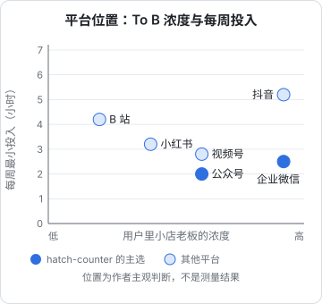
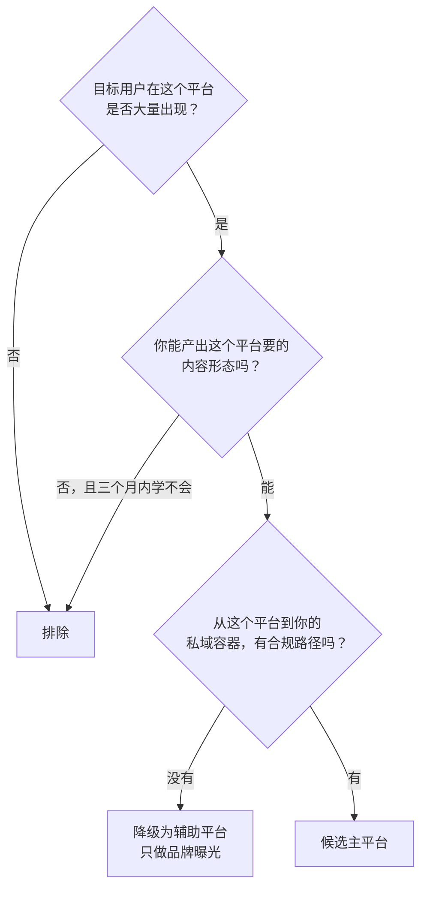

# 平台地图

国内能做内容和私域的平台很多，一个人不可能都做。这一章先把主要平台摆在一张表里对比，再给出「一人公司只选 1–2 个平台」的具体选法，以及每个平台最小可持续的投入量。

[《获客与增长》第 3 章](../growth-marketing/03-social-media.md)已经按「内容寿命」和「搜索属性」两个维度给过一张平台位置图，第 8 章讲了用 ICE 给渠道打分的通用方法。这一章换一个角度：**站在国内平台规则和一人公司精力的约束上**，看每个平台到底要你付出什么、能给你什么。

## 先分清两类平台

国内平台按在链路里的角色，可以分成两类：

| 角色 | 平台 | 作用 |
|---|---|---|
| 公域内容平台（流量从这里来） | 小红书、抖音、B 站、视频号、公众号（推荐流和搜一搜部分） | 让陌生人看到你 |
| 私域容器（人沉淀到这里） | 企业微信、个人微信、客户群、公众号（关注者部分） | 让你能重复触达 |
| 入口和工具 | 小程序、官网、App | 承接「看完内容想试试」的那一刻 |

公众号比较特殊，两头都占：推荐流和搜一搜是公域，关注者是私域。

一人公司的最小组合是：**一个公域内容平台 + 一个私域容器**。私域容器在国内几乎只有一个答案——微信生态（企业微信或个人微信），第 6 章讲怎么选。所以「选平台」的问题，主要是选**哪一个公域内容平台**。

## 平台对比总表

下表的「主体要求」「导流规则」是 2026-11 查阅各平台公开规则和报道后的概括，规则经常调整，具体以平台最新规则为准；各章会给出出处。

| 平台 | 主要用户与场景 | 内容形态 | 导流规则（概括） | 个人能做吗 / 企业主体多了什么 | 更适合 |
|---|---|---|---|---|---|
| 小红书 | 年轻用户为主，把它当搜索引擎用：「xx 推荐」「xx 怎么做」 | 图文笔记为主，视频增长中 | 严格。2025-03-12 起《交易导流违规管理细则》禁止在内容中留联系方式、二维码、外部链接，只允许官方留资组件（第 3 章） | 个人可以；企业专业号认证后才能用更多营销和留资工具，认证收审核费 | To C 为主；部分 To B（开店、创业类人群）也在 |
| 公众号 | 全年龄覆盖，长文阅读、搜一搜、转发到群 | 长图文，也能发短内容和图片 | 微信生态内部：文章里可以放企业微信二维码、小程序卡片，限制最少 | 个人只能开订阅号，个人主体一般不能微信认证；企业 / 个体户可开服务号、可认证 | To B、专业人群、需要讲清楚的产品 |
| 视频号 | 微信用户，偏熟人社交和中老年 | 短视频、直播 | 视频号主页「添加企业微信」入口已不再对新配置开放（第 4 章），但视频可挂公众号文章链接、能被转发到群 | 个人可以；企业认证一般通过同名已认证公众号完成 | 用户本来就在微信里的产品，To B 也可 |
| 抖音 | 覆盖最广，各行业从业者都在刷 | 短视频、直播 | 严格。私信、评论发联系方式有被处罚风险（第 5 章） | 个人可以；企业号（蓝 V）认证付审核费，主页可配置更多经营组件 | To C；门店老板这类行业人群也大量在 |
| B 站 | 年轻用户，学习、科技、长视频 | 中长视频、专栏 | 有导流限制，认证账号违规会被取消认证（第 5 章） | 个人可以；企业、机构认证有单独入口 | 开发者、学生、技术与工具类产品 |
| 企业微信 | 私域容器，客户是普通微信用户 | 单聊、客户群、客户朋友圈 | 本身就是私域容器；群发、朋友圈有频次上限 | 未认证企业可添加客户上限很低（官方写 100 人），认证后放开（第 6 章） | To B 首选 |
| 小程序 | 微信内的轻应用 | 工具、表单、预约、内容 | 是落地页而非内容平台 | 个人主体能选的服务类目很少、一般不能接微信支付；企业 / 个体户多得多（第 8 章） | 需要一个「点开就能用」的入口时 |

两条很实用的观察：

1. **微信生态内部的导流最顺**。公众号文章里放企业微信二维码、视频号挂公众号文章，这些都是官方鼓励的路径。从小红书、抖音往微信导，则处处受限
2. **主体决定能力上限**。很多能力只对企业或个体户开放（服务号、认证、小程序支付、企业微信认证）。副业阶段如果还没有主体，先知道哪些事做不了；主体怎么选见[《国内合规实务》第 1 章](../opc-compliance-cn/01-entity-choice.md)

## 平台位置图



这张图是作者根据平台形态和 hatch-counter 目标用户做的主观判断，用来帮助思考，不是测量结果。换成你的产品，横轴要换成「你的目标用户在这个平台的浓度」。

## 一人公司只选 1–2 个平台：选法

### 第一步：用三个问题排除



三个问题的含义：

- **用户在不在**：不是「这个平台用户多不多」，而是「你的用户在这里做什么」。店主在抖音上刷餐饮经营内容，在小红书上可能只看探店；开发者在 B 站看教程，在抖音上只是消遣。最好的验证办法是：**用你的目标用户会搜的词，在平台里搜一遍**，看搜索结果里有没有同类内容、评论区里有没有你的目标用户在提问
- **你能不能产出**：短视频要出镜或至少要配音、要剪辑；图文要会做封面图；长文要能写。一个下班后只有两小时的开发者，最容易持续的往往是图文和长文。别选一个需要你先学三个月剪辑的平台作主平台
- **能不能导进私域**：这一步决定了平台对 To B 产品的价值上限。看完内容后，用户有没有一条平台允许的路走到你这里

### 第二步：给候选平台打分

剩下的候选平台，按下面四项各打 1–5 分：

| 维度 | 问什么 | 权重 |
|---|---|---|
| 用户浓度 | 搜一遍目标关键词，结果里有多少条和你的用户相关的内容、评论 | ×2 |
| 产出成本 | 你做一条合格内容要几小时（越少分越高） | ×2 |
| 导流顺畅度 | 合规路径有几步、要不要企业认证 | ×1 |
| 内容寿命 | 一条内容能被搜到多久 | ×1 |

满分 30。分数最高的作主平台；如果第二名和第一名差距在 3 分以内，且两者的内容能「一鱼多吃」（例如公众号长文改成小红书图文），可以作辅平台。

### 第三步：只做三个月

选好以后，**三个月内不加新平台**。三个月后按第 10 章的复盘表看数据，再决定换不换、加不加。频繁换平台是一人公司做内容最大的浪费：每个平台都要冷启动，前 20 条内容往往没有起色。

### 一个算例：hatch-counter

| 平台 | 用户浓度 | 产出成本 | 导流顺畅 | 内容寿命 | 加权总分 |
|---|---|---|---|---|---|
| 公众号 | 3 | 4 | 5 | 4 | 3×2+4×2+5+4 = 23 |
| 视频号 | 3 | 2 | 3 | 2 | 6+4+3+2 = 15 |
| 抖音 | 5 | 2 | 2 | 2 | 10+4+2+2 = 18 |
| 小红书 | 2 | 3 | 2 | 4 | 4+6+2+4 = 16 |
| B 站 | 1 | 2 | 2 | 5 | 2+4+2+5 = 13 |

打分是作者对 hatch-counter 的判断，读者要按自己的产品重新打。结论是：**公众号作主平台**（长文讲清楚「小馆子怎么算账」，文章里直接放企业微信二维码），**抖音作观察中的第二平台**（用户浓度最高，但产出成本高、导流难，先少量试）。第 10 章会把这个结论展开成完整打法。

## 每个平台的最小可持续投入

「最小可持续投入」的意思是：低于这个量，平台的推荐机制和读者的记忆都留不住你；高于这个量，副业阶段坚持不了几个月。下表是作者的经验估计，不是平台规则：

| 平台 | 最小频率 | 单条耗时（熟练后） | 每周合计 | 说明 |
|---|---|---|---|---|
| 公众号 | 每两周 1 篇长文 | 3–5 小时 | 约 2 小时 | 长文可以拆成小红书、视频号素材 |
| 小红书 | 每周 2 篇图文 | 1–1.5 小时 | 约 3 小时 | 封面图用模板，正文 300–800 字 |
| 视频号 | 每周 1–2 条 | 1–2 小时 | 约 2–3 小时 | 可以用公众号内容改口播，不出镜也能做 |
| 抖音 | 每周 3 条 | 1–2 小时 | 约 4–6 小时 | 频率要求高，出镜效果明显更好 |
| B 站 | 每两周 1 条 | 6–10 小时 | 约 4 小时 | 中长视频，前期剪辑耗时最多 |
| 企业微信私域 | 每天看两次消息 | — | 约 2–3 小时 | 回复、跟进、朋友圈、群 |

一个下班后每周能挤出 8–10 小时的人，合理的组合是：**一个主内容平台（2–4 小时）+ 企业微信私域（2–3 小时）+ 余量给产品本身**。如果主平台选抖音，几乎吃掉全部时间，这时候就不要再加第二个内容平台了。

## 「一鱼多吃」要按平台规则改写

《获客与增长》第 3 章讲过一鱼多吃。在国内平台上还要多一层：**每个版本都要按该平台的导流规则改掉联系方式和引导语**。

```text
公众号版（可以直接引导）：
  文末：想试试的老板，扫下面的二维码加我企业微信，备注「试用」，我拉你开一个 14 天的试用店。

小红书版（不能留联系方式）：
  文末：这个表是我自己给几家小馆子做的，评论区说说你们店现在怎么算成本。
  （不写微信号、不放二维码、不写「私我」；有兴趣的人会搜你的账号或品牌名）

抖音版（同样不能留联系方式）：
  口播结尾：我是做餐饮记账工具的，主页有更多算账方法。
  （主页简介只写品牌名和一句话定位，联系方式走企业号官方组件）
```

同一份内容，引导语差别很大。改写的时候准备一张「每个平台能写什么」的对照表贴在手边，比每次凭记忆判断安全。

## 本章要点

- 平台分三类角色：公域内容平台、私域容器、入口；一人公司的最小组合是**一个公域内容平台 + 一个私域容器**
- 微信生态内部导流最顺；从小红书、抖音、B 站往外导流处处受限
- 很多能力只对企业或个体户开放，主体决定能力上限
- 选主平台：先用「用户在不在、能不能产出、能不能导进私域」三问排除，再按用户浓度、产出成本、导流顺畅度、内容寿命加权打分
- 选定后三个月内不加新平台
- 每周 8–10 小时的副业时间，只够一个主内容平台加企业微信私域
- 一鱼多吃时，每个版本都要按平台规则改掉联系方式和引导语
