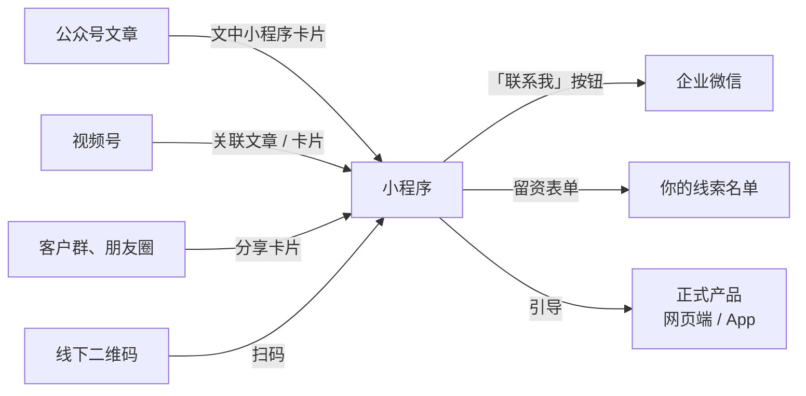

# 小程序作为入口

前面几章讲的都是「让人看到你」和「让人加上你」。小程序解决的是中间那一刻：**看完内容，想马上试一下**。用户不想下载 App、不想注册账号、不想打开电脑，他在微信里点一下就能用到一点东西。

对开发者来说，小程序是最容易「顺手做一个」的东西，也是最容易做了没人用、还要长期维护的东西。这一章讲小程序在私域链路里该扮演什么角色、个人和企业主体能做什么、对 hatch-counter 这类已经有网页端和 App 的产品值不值得做，以及最小可行的做法。

## 小程序在链路里的位置



小程序在这里有三种可能的角色：

| 角色 | 做什么 | 例子 |
|---|---|---|
| 钩子工具 | 一个小而有用的免费工具，用完了想要更多 | 保本线计算器、单品毛利计算器 |
| 留资和预约 | 收集联系方式、预约演示 | 「预约 15 分钟远程演示」表单 |
| 产品的轻量入口 | 正式产品的一部分功能 | 店主在微信里看今天的营业额 |

一人公司应该**只选一个角色**，而且优先选第一种。第三种看起来最「完整」，但它意味着你要多维护一个客户端，所有业务逻辑都要在小程序里再接一次。

## 个人主体和企业主体

小程序的主体差异比公众号更大。按官方文档（2026-11 查阅）：

| 事项 | 个人主体 | 企业 / 个体工商户 | 来源 |
|---|---|---|---|
| 可选服务类目 | 单独一份名单，明显更短 | 非个人主体名单，类目多得多 | 微信开放文档「小程序开放的服务类目」 |
| 含用户发布内容、信息发布的功能 | 常因「个人主体未开放类目」被拒 | 按类目要求提供资质 | 微信开放社区多个审核案例 |
| 微信支付 | 普通个人主体一般不能接入 | 可以 | 微信开放社区答复；以微信支付商户平台为准 |
| 微信认证 | 官方产品介绍写个人主体不能申请；社区有个人「30 元认证」的讨论，说法不一 | 可以，需付审核费、年审 | 微信开放文档「小程序产品定位及功能介绍」；社区帖子 |
| 备案数量上限 | 5 个 | 个体户 5 个，企业 50 个 | 微信开放文档「小程序备案常见问答」 |

个人主体的认证规则是这张表里最不确定的一项：官方文档的表述和开发者社区里的实际经历有出入，**以小程序后台「设置 → 基本设置 → 微信认证」的实际提示为准**。

结论很简单：**个人主体能做的小程序，基本就是不收钱、不让用户发内容的纯工具**。好在「钩子工具」恰恰就是这种。

## 备案

自 2023-09-01 起，未上架的微信小程序须完成备案才能上架；已上架的存量小程序须在 2024-03-31 前完成备案，逾期由平台清退（来源：工信部《关于开展移动互联网应用程序备案工作的通知》及微信公众平台公告的公开报道）。

备案在小程序后台直接办理，个人主体也能备案。备案和 App、网站的关系，以及主体信息变更时要同步改哪些地方，见[《国内合规实务》第 4 章](../opc-compliance-cn/04-app-filing.md)。要预留时间：备案要经过平台初审和管局审核，**不要在内容已经发出去、等着用户点的时候才开始备案**。

## 钩子工具：做什么

好的钩子工具有几个特征：

- **一次就能用完**：打开、输入几个数、得到一个结果，两分钟以内
- **结果有用、值得截图**：店主看到结果会想发给合伙人或老婆看
- **自然地引出你的正式产品**：结果页说「这个数每天都在变，掌柜眼能每天自动帮你算」
- **不需要登录**：要登录的工具，一半的人在登录页就走了

hatch-counter 可以做的钩子工具：

| 工具 | 输入 | 输出 | 引出 |
|---|---|---|---|
| 保本线计算器 | 月房租、人工、水电杂项、平均料钱占比、外卖抽成占比 | 每天至少要卖多少才不亏 | 「每天的实际营业额和保本线比一比，掌柜眼每天自动算」 |
| 单品毛利计算器 | 一道菜的售价、每种料的用量和进价 | 这道菜每份赚多少、毛利率 | 「全店几十道菜一起算，导一次收银报表就够」 |
| 开店回本测算 | 装修、转让费、设备、每月预计利润 | 多少个月回本 | 「开业以后每个月实际离回本还差多少」 |

保本线计算器的核心算法就一行（第 5 章的抖音脚本里用过同一组数）：

```typescript
// 每天的保本营业额 = 每天固定开支 ÷ (1 - 变动成本占营业额的比例)
export function breakEvenDaily(input: {
  monthlyFixed: number; // 房租 + 人工 + 水电 + 杂项，每月合计
  daysPerMonth: number; // 每月营业天数
  variableRate: number; // 料钱 + 抽成 + 包材，占营业额的比例，0~1
}): number | null {
  const { monthlyFixed, daysPerMonth, variableRate } = input;
  if (daysPerMonth <= 0 || variableRate >= 1) return null; // 卖得越多亏得越多，没有保本线
  return monthlyFixed / daysPerMonth / (1 - variableRate);
}

// 例：固定开支每天 1070（每月 30 天共 32100），变动成本占 55.7%
// breakEvenDaily({ monthlyFixed: 32100, daysPerMonth: 30, variableRate: 0.557 }) ≈ 2415
```

计算逻辑最好和正式产品用同一份口径。hatch-counter 的业务口径都写在共享包 `@counter/core` 里（保本线也在其中），小程序如果用 TypeScript 写，可以直接复用同一个函数，避免「小程序里算出来 2400、软件里算出来 2600」这种让用户困惑的情况。

## 结果页：转化发生的地方

工具本身不转化，**结果页**转化。结果页的结构：

```text
【结果】
您的店每天至少要卖 2,415 元才不亏。
（按每月 30 天营业算）

【解读】
- 如果平时一天卖 3,000，每天大约赚 260
- 料钱占比每降 1 个点，保本线降约 53 元

【下一步】（只放一个主按钮）
[ 加开发者微信，领一份每月自动算的表格 ]   ← 企业微信「联系我」按钮

次要链接：了解掌柜眼 · 分享给合伙人
```

几个要点：

- **只有一个主按钮**。同时放「加微信」「预约演示」「下载 App」「关注公众号」，用户哪个都不点
- **按钮说清楚点了能得到什么**：「领一份表格」比「联系我们」好
- **分享按钮要有**：店主经常要和合伙人、家人商量，分享卡片本身就是传播

小程序里放企业微信的「联系我」按钮：企业微信「配置客户联系『联系我』方式」接口的 `scene` 设为 1，就是「在小程序中联系」，会返回一个可以放在小程序里的按钮配置（来源：企业微信开发者中心文档，2026-11 查阅）。用不同的 `state` 区分是哪个工具带来的客户（第 6 章）。

## 留资表单

如果不用企业微信按钮，而是让用户填表留手机号：

- **只问必须的**：称呼、手机号、店的类型。多一个字段少一批人
- **说清楚用途**：「我们会在 1 个工作日内打电话约演示时间，不会用于其他用途」
- **取得同意**：手机号是个人信息，要有隐私政策并取得同意，见[《国内合规实务》第 6 章](../opc-compliance-cn/06-pipl.md)；隐私政策本身怎么写见[《合同与法律文书》](../contracts-legal/)
- **数据存在你自己的服务端**，不要只存在小程序的云开发数据库里随手一放

留资表单的转化通常比「加微信」低，但它适合不愿意加陌生人微信的用户。可以两个都提供，主按钮放加微信，表单作为次要选项。

## 订阅消息

小程序可以给用户发「订阅消息」，但要用户主动订阅。一次性订阅是用户每授权一次、你能发一条；长期订阅只对特定类目开放（以微信开放文档「订阅消息」说明为准）。对钩子工具来说，这意味着**你基本没法通过小程序持续触达用户**——这正是为什么结果页要把人导进企业微信。

## 要不要做「正式产品的小程序版」

这是开发者最容易冲动的决定。对 hatch-counter 的分析：

| 考虑 | 现状 |
|---|---|
| 店主有没有在微信里看数的需求 | 有，但移动端（安卓，iOS 在接）已经做了看数和现场几件事 |
| 维护成本 | 多一个客户端：登录、权限、多门店切换、版本兼容，每个业务改动都要跟 |
| 主体要求 | 涉及账号和经营数据，需要企业或个体户主体、对应类目 |
| 能带来的新增 | 不明确：已经是客户的人才会用，它不是获客入口 |

结论：**不做**。正式产品的小程序版是「已有客户的便利」，不是「获客入口」，而一人公司的精力应该先花在获客上。如果将来有大量客户反映「不想装 App」，再重新评估。

一个钩子工具小程序则值得做：两三个周末就能完成，之后几乎不用维护，而且能在公众号文章、客户群、线下传单里反复使用。

## 不做小程序的替代方案

如果你还没有主体、不想处理备案，或者只是想先验证：

- **官网上的一个 H5 计算器页面**：同样的工具，放在官网上。公众号文章里可以放链接（菜单和文中链接的规则以公众号后台为准），也能被搜索引擎收录
- **一份在线表格模板**：用在线文档做一个保本线计算表，分享链接。开发成本为零，缺点是体验粗糙、无法放企业微信按钮
- **公众号自动回复**：用户回复关键词（如「保本线」）自动发一份表格文件或链接

验证有效（比如一个月有 30 人以上通过计算器加了企业微信）以后，再做成小程序。

## 最小投入

| 项 | 时间 |
|---|---|
| 第一个钩子工具小程序（含备案、审核） | 两到三个周末，备案和审核另需等待 |
| 维护 | 每季度检查一次基础库和审核规范的变化，约 1 小时 |
| 推广 | 不单独推广，嵌在公众号文章、视频号、群里 |

## 本章要点

- 小程序在链路里承接「看完内容想马上试试」那一刻；一人公司只选一个角色，优先做钩子工具
- 个人主体可选类目少、一般不能接微信支付、做用户发布内容常被拒、认证规则以后台为准；个人能做的基本是不收钱、不让用户发内容的纯工具
- 2023-09-01 起新小程序须备案后上架，存量须在 2024-03-31 前备案；个人 5 个上限，企业 50 个
- 钩子工具：两分钟内用完、结果值得截图、自然引出正式产品、不用登录；计算口径和正式产品共用一份
- 转化发生在结果页：一个主按钮，说清楚点了能得到什么；企业微信「联系我」接口 `scene=1` 可以在小程序里放加微按钮
- 订阅消息需要用户主动授权，小程序本身难以持续触达，所以要把人导进企业微信
- 正式产品的小程序版是已有客户的便利，不是获客入口，早期不做；先用 H5 页面或在线表格验证
