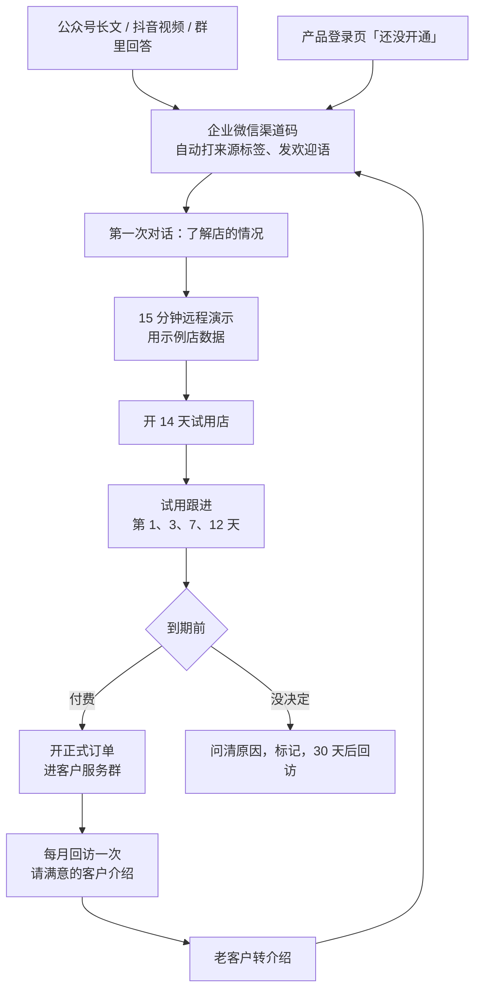
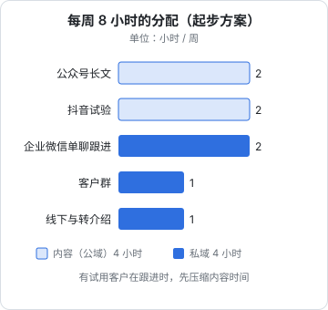

# 门店 SaaS 的私域打法

最后一章把前面九章落到 hatch-counter（品牌名掌柜眼）上：门店老板在哪些平台、什么内容能触达他们、怎么从内容走到加微信、再到试用和付费，以及一个副业开发者每周 8 小时怎么分配。

先回顾产品的几个事实，它们决定了打法：

- **卖给谁**：一家到几家店的中小餐饮门店店主
- **产品形态**：网页端（收银台旁边那台电脑）为主，安卓移动端看数和办几件现场的事，iOS 在接
- **开户方式**：没有自助注册，开户由开发者在管理后台办；登录页「还没有账号」那一步引导去加客服微信
- **试用**：一个 0 元、14 天的试用套餐，到期停用不删数据（见《定价与商业模式》第 8 章）
- **价值需要时间显现**：店主至少要导一两周收银报表、录几次进货、记上房租工资，才能看到「每天赚多少」

最后一条最关键：**这个产品不可能靠一条视频成交**。它需要一对一的引导，私域是主战场，不是配角。

## 门店老板在哪里

| 场景 | 老板在做什么 | 你能做什么 |
|---|---|---|
| 抖音 | 刷餐饮经营、开店避坑内容；自己的店也在做团购 | 做算账类短视频（第 5 章） |
| 微信公众号 | 看行业号的长文，转发到群里 | 写经营方法长文，文末加企业微信（第 4 章） |
| 微信群 | 本地商户群、供应商客户群、培训学员群、同行群 | 做客，回答经营问题（第 7 章） |
| 线下 | 商圈、批发市场、供应商、收银系统的地推和售后 | 客户回访、小型分享会、转介绍 |
| 同行口碑 | 「你们店用什么记账？」 | 让现有客户愿意介绍 |
| 小红书 | 部分新手老板、开店创业者搜攻略 | 辅助，不作主平台 |

小店老板做决定，**熟人推荐的权重远高于任何内容**。所以整个打法的终点是转介绍，内容的作用是让第一批客户找到你、并且让被推荐来的人能「查到你是靠谱的」。

## 内容：讲算账，不讲功能

老板不关心「销量导入」「配方扣库存」这些功能名，他关心的是：

| 老板的问题 | 内容选题 | 对应的产品能力 |
|---|---|---|
| 我每天到底赚没赚钱？ | 「流水 3000，为什么只赚 260」 | 记开支、按天摊、算盈亏 |
| 每天至少卖多少才不亏？ | 「保本线怎么算：一张表」 | 保本线 |
| 哪道菜在亏钱？ | 「一道菜的真实毛利，3 步算出来」 | 配方、单品分析 |
| 进货是不是被少送了、买贵了？ | 「进货单怎么核，进价怎么盯」 | 拍单入库、进价走势 |
| 库里压了多少钱？ | 「冰柜里的钱：库存为什么要盘」 | 库存与盘点 |
| 员工工资怎么算不吵架？ | 「按排班算工资的三个坑」 | 排班考勤、工资 |
| 开店投入什么时候回本？ | 「装修转让费，多少个月能回来」 | 开业投入单独算回本 |

每个选题都是一个**能单独成立的经营方法**，产品只在最后出现一次。这样的内容，老板愿意转到同行群里，而不会觉得是广告。

选题储备：上表 7 个主题 × 每个主题 3–4 个具体角度（不同店型、不同数字、不同误区），就是半年的内容。真实客户问过的问题，是最好的新选题来源。

## 渠道配置

按第 2 章的打分结果：

| 角色 | 渠道 | 投入 |
|---|---|---|
| 主内容平台 | 公众号（订阅号） | 每两周 1 篇长文，常见问题用「发表」 |
| 观察中的第二平台 | 抖音 | 先每周 1 条，跑满 12 周再决定是否加码到每周 3 条 |
| 一鱼多吃 | 视频号 | 长文改 60 秒视频，有余力再做 |
| 私域容器 | 企业微信 | 所有新线索的入口；未认证时 100 人上限，预计超出前办好主体并认证 |
| 产品内入口 | 登录页「还没开通」、官网 | 放带渠道标记的企业微信码 |
| 线下 | 客户回访、转介绍 | 每月 1–2 次，周末 |

产品本身就是一个渠道：网页端和移动端的登录页已经在引导「想开店的加客服微信」。这个入口的二维码应该换成企业微信的渠道码（例如 `app-login-help`），这样你就知道有多少人是「听说了掌柜眼、自己去下载、在登录页卡住」的——这部分人往往是转介绍来的，意向最高。

## 从内容到付费：全链路



### 第一次对话

客户扫码进来后，欢迎语已经发出（第 6 章）。他回复以后，第一次对话的目标是**了解他的店**，而不是介绍产品：

```text
您好王老板，看到您是从「保本线」那篇文章过来的。
想先问几句，好判断掌柜眼对您有没有用：
1. 店是什么类型？面馆、快餐还是炒菜馆？
2. 现在用的什么收银系统？能不能导出每天的销售报表？
3. 现在怎么记账？手写本、Excel，还是没怎么记？
```

第 2 个问题是**筛选问题**：hatch-counter 的核心流程是导入收银报表，如果店里没有收银系统或导不出报表，产品的价值会大打折扣。这时候要诚实说明，而不是硬推：

```text
您店里目前没有收银系统的话，掌柜眼的销量部分得手动录，会比较麻烦，
我不太建议您现在就用。可以先用文章里那张表手算一两个月，
哪天上了收银系统，再来找我。
```

被诚实劝退的老板，有不少会在之后回来，或者把你推荐给合适的同行。

### 演示

约 15 分钟的远程演示（微信视频、腾讯会议都可以），用示例店的数据，不用对方的数据：

```text
演示的顺序（15 分钟）：
1. 「门店概览」：这家示例店这个月每天赚多少、离保本线差多少（2 分钟）
2. 导入一份收银报表：拖进去，看到每道菜卖了几份（3 分钟）
3. 拍一张进货单：认出来、核一遍、进库存（3 分钟）
4. 记一笔房租：看盈亏怎么变（2 分钟）
5. 回答问题（5 分钟）

最后一句：
我现在帮您开一个 14 天的试用店。您今天晚上打烊后导一份报表进去，
明天我们再看看您自己店的数。
```

演示和成交的方法本身（需求发现、报价、处理异议），见《销售与 To B 成交》。

### 试用跟进

14 天试用是转化的关键窗口。一个人跟进的节奏和话术：

| 时间 | 目标 | 话术要点 |
|---|---|---|
| 第 1 天 | 完成第一次导入 | 「昨晚报表导进去了吗？有对不上的菜名，截图发我，我帮您看」 |
| 第 3 天 | 配方录入 | 「菜品和用料录了多少了？可以先录卖得最好的 10 道，用模板一次导入」 |
| 第 7 天 | 看到第一个结果 | 「这一周的数出来了，您看『赚了多少』那页，和您心里估的差多少？」 |
| 第 12 天 | 付费决定 | 「试用还有两天到期。到期只是停用，数据都在。要继续用的话，我给您开正式订单」 |

第 7 天那一句最重要：**让老板自己说出「和我想的不一样」**。这是产品价值显现的时刻。

如果第 3 天还没有完成第一次导入，基本不会转付费。这时候与其发消息，不如直接约一次远程，帮他导第一份报表。

### 没有付费的人

问清原因，用标签记下来：

| 原因 | 标签 | 下一步 |
|---|---|---|
| 没时间录 | 流失-没时间 | 30 天后回访，看有没有空 |
| 收银系统导不出 | 流失-数据源 | 记下他用的收银系统，产品支持了再联系 |
| 觉得贵 | 流失-价格 | 不打折，说明价值；定价方法见《定价与商业模式》 |
| 觉得没用 | 流失-价值 | 问清楚哪里没用，这是最有价值的反馈 |

每月看一次流失原因的分布，它告诉你产品下一步该改什么。

### 转介绍

付费客户用满一个月、在第一次月度回访里表示满意时，请他介绍：

```text
王老板，这一个月用下来，账对得还顺吧？
您认识的同行里，有没有也想算清楚账的？
您把我的名片推给他就行，他来了我一样先帮他看适不适合，不合适不会硬推。
```

给推荐人的回报，可以是延长服务期，但要提前想好规则、在后台能办（续期、赠送天数都在管理后台），并且对所有客户一致。用专门的转介绍渠道码（`referral-<客户简称>`），才能知道每位客户带来了多少人。

## 每周 8 小时怎么分



这是一个起步方案，不是固定比例。规则是：

- **跟进时间优先于内容时间**。有试用客户在跟进时，先保证跟进，内容可以晚一周
- 同时试用中的店**不超过 3–5 家**（第 1 章的估算）。超过时，暂停抖音，把时间挪给跟进
- 线下活动集中在周末，每月一次，当周的内容时间相应减少

## 前 90 天计划

| 周 | 内容 | 私域 | 产品内 |
|---|---|---|---|
| 1–2 | 开公众号；写好前 3 篇长文；抖音个人号开号 | 开企业微信（未认证）；建 5 个渠道码和欢迎语 | 登录页的客服码换成渠道码 |
| 3–6 | 公众号每两周 1 篇；抖音每周 1 条 | 跟进现有客户和朋友介绍的店，请满意的客户介绍 | — |
| 7–10 | 同上；把第一个客户案例（经同意）写成长文 | 建付费客户服务群（有 10 家以上付费店后） | 做保本线计算器 H5 页面 |
| 11–12 | 复盘 | 复盘 | 复盘 |

第 12 周复盘时要回答的问题：

- 各渠道码分别带来了多少企业微信新增？其中多少开了试用、多少付费？
- 抖音 12 周下来，评论里的经营问题多不多？带来的企业微信新增有没有超过公众号？超过了就加码，没超过就停
- 企业微信客户数离 100 人还有多远？要不要开始办主体
- 每周实际花了多少小时？哪部分超了

## 月度复盘模板

```text
# 2026-12 私域复盘

## 漏斗（本月新增）
企业微信新增：__（其中 公众号 __ / 抖音 __ / 登录页 __ / 转介绍 __ / 其他 __）
完成第一次对话：__
演示：__
开试用：__
试用中完成第一次导入：__
转付费：__

## 存量
付费门店：__   本月到期 __，续费 __
客户群：__ 人，本月客户互答 __ 次

## 时间
每周平均：内容 __ 小时，跟进 __ 小时，群 __ 小时

## 流失原因（本月）
没时间 __ / 数据源 __ / 价格 __ / 价值 __

## 下月只改一件事
（例：试用第 1 天改成直接约远程帮导第一份报表）
```

「下月只改一件事」是关键：一个人同时改三件事，到月底不知道是哪件起了作用。

## 判断标准与止损

| 情况 | 判断 |
|---|---|
| 公众号连续 3 个月，每月带来的企业微信新增少于 5 人 | 选题或文末引导有问题；先换选题方向，再不行考虑换主平台 |
| 抖音 12 周，评论里几乎没有经营问题 | 内容没触达老板，停掉 |
| 演示到试用的比例很低 | 演示内容或筛选问题需要改 |
| 试用中完成第一次导入的比例低于一半 | 产品上手门槛问题，优先改产品，不是改话术 |
| 试用转付费低，且流失原因集中在「价值」 | 产品没解决真问题，回到用户访谈（《产品思维》第 2 章） |
| 转介绍为 0 | 现有客户不够满意，先把服务做好再谈获客 |

整个阶段性的进入、退出和止损条件（什么时候可以考虑辞职全职做），见《一人公司行动手册》。

## 不做什么

- **不做小红书矩阵、不开多个抖音号**：一个人管不过来，还有导流违规风险
- **不建潜在客户群、行业交流群**：没有足够内容支撑，会变成广告群
- **不做正式产品的小程序版**（第 8 章）
- **不用个人微信批量加人、不用任何外挂**（第 9 章）
- **不在内容里承诺「提升利润 xx%」**：违反广告法，你也证明不了
- **不追求粉丝数和群人数**：只看每个环节往下走了多少人

## 本章要点

- 门店 SaaS 的价值需要一两周才能显现，不可能靠内容直接成交，私域里的一对一引导是主战场
- 老板在抖音、公众号、微信群、线下；熟人推荐的权重最高，整个打法的终点是转介绍
- 内容讲算账不讲功能：每个选题都是一个能单独成立的经营方法，产品只在最后出现一次
- 配置：公众号作主平台、抖音观察 12 周、企业微信作容器、登录页客服码换成渠道码
- 链路：渠道码 → 了解店的情况（含筛选问题）→ 15 分钟演示 → 14 天试用（第 1、3、7、12 天跟进）→ 付费 → 月度回访 → 转介绍
- 第 3 天还没完成第一次导入的，直接约远程帮他导；第 7 天让老板自己说出「和我想的不一样」
- 每周 8 小时：跟进优先于内容，同时试用不超过 3–5 家
- 每月按模板复盘，下月只改一件事；按判断标准止损
