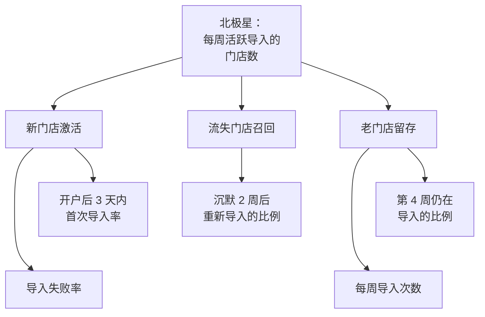
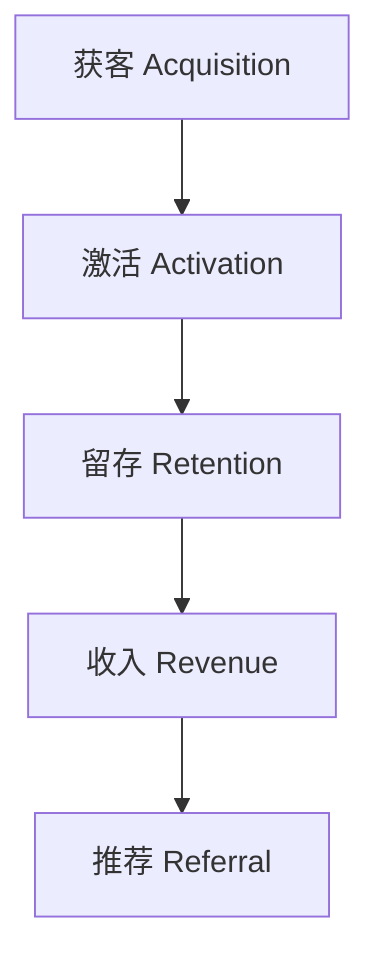

# 要看哪些指标

一人公司最缺的不是数据，而是**注意力**。没有埋点时你靠感觉做决定；埋了一堆点之后，你又容易淹没在几十张图表里，每天刷一遍「今日活跃」，然后什么都没改。这一章要解决的问题是：在动手写任何一行埋点代码之前，先想清楚**你到底要回答什么问题**，以及哪几个数字值得天天看。

## 这本书讲什么

这是一本给独立开发者的产品数据实操书。它不讲大数据平台、不讲数仓建模，只讲一个人维护一两个产品时真正用得上的那部分：

| 章节 | 回答的问题 |
|---|---|
| 1. 要看哪些指标（本章） | 该盯哪几个数？北极星指标怎么选？ |
| 2. 埋点设计 | 事件怎么命名、带什么属性、怎么写追踪计划？ |
| 3. 埋点实现 | React 网页端和 Expo App 里，用 TypeScript 怎么写得类型安全、不丢事件？ |
| 4. 留存、转化与 LTV | 留存怎么算才不自欺欺人？一个用户值多少钱？ |
| 5. 漏斗分析 | 用户卡在哪一步？ |
| 6. A/B 测试 | 改版到底有没有用？要多少样本？ |
| 7. 自托管 PostHog / Umami | 数据放自己机器上，用 Docker Compose 怎么部署？ |
| 8. 什么时候不该埋点 | 隐私、成本，以及一个「完全不埋点」的反例 |

**适合谁**：会写 TypeScript 全栈、手上有一个已上线或快上线的产品（网页、App 都行），但还没系统做过数据分析的独立开发者。数学只需要中学水平，第 4、6 章的公式都会给推导思路和算例。

**怎么读**：第 1、2 章是地基，建议按顺序读；第 3 章和第 7 章偏动手，可以边读边在自己项目里实施；第 4–6 章是分析方法，遇到具体问题再回头查也可以。

## 指标不是越多越好

先区分三类数字：

| 类别 | 例子 | 特点 |
|---|---|---|
| 虚荣指标 | 累计注册数、总下载量、PV | 只增不减，看着开心，但不告诉你该做什么 |
| 结果指标 | 月收入、付费用户数 | 真正重要，但滞后，改了东西要几周才看得出 |
| 过程指标 | 激活率、7 日留存、试用转付费率 | 可以较快反映变化，能指导下一步动作 |

判断一个指标值不值得看，用一个简单的检验：**如果这个数明天下降 20%，我会做什么不同的事？** 答不上来，它就是虚荣指标。

累计注册数永远不会下降，所以它通不过检验。「本周新注册里，24 小时内完成第一次核心动作的比例」下降 20%，你会立刻去查最近改了什么引导流程——这就是好指标。

## 北极星指标

北极星指标（North Star Metric）是**一个**最能代表「用户从产品里得到了价值」的数字。它的作用是让你在做取舍时有个统一的标尺。

好的北极星指标通常满足：

- **反映用户得到的价值**，而不是你得到的收入（收入是结果）
- **能被产品改动影响**
- **有时间窗口**：按周或按月计，而不是累计值
- **领先于收入**：它涨了，收入大概率跟着涨

拿仓库所有者自己的项目举几个例子：

| 产品 | 糟糕的北极星 | 更好的北极星 |
|---|---|---|
| 掌柜眼（门店经营管理） | 注册门店数 | 每周至少导入一次收银报表的门店数 |
| 唱片墙（私人音乐播放器） | 曲库里的歌曲总数 | 每周播放超过 30 分钟的用户数 |
| 一个付费笔记 App | 下载量 | 每周写下 3 条以上笔记的用户数 |

注意「掌柜眼」那一行：一家门店开了户却不导报表，它在账面上是客户，实际上已经流失了。导入报表是这个产品一切价值的起点——不导入就没有销量、没有库存扣减、也算不出盈亏。

## 指标树：从北极星往下拆

一个北极星指标太粗，没法直接指导动作。把它拆成几个可以单独优化的输入：

拆的原则是**加法或乘法关系**：北极星 ≈ 新激活 + 留下来的老用户 + 召回的用户。这样某个子指标变化时，你能算出它对北极星的贡献。

这棵树也决定了第 2 章要埋哪些点：树上每个叶子节点都需要一两个事件来支撑，树上没有的，先别埋。

## AARRR：一个够用的框架

增长领域常用的 AARRR 模型（也叫海盗指标）把用户生命周期分成五段：

| 阶段 | 要回答的问题 | 典型指标 |
|---|---|---|
| 获客 | 用户从哪来？ | 各渠道访客数、注册数、获客成本 |
| 激活 | 第一次用就体会到价值了吗？ | 激活率（完成「啊哈时刻」的比例） |
| 留存 | 还会回来吗？ | N 日留存、周活跃 / 月活跃 |
| 收入 | 愿意付钱吗？ | 付费转化率、ARPU、LTV |
| 推荐 | 会推荐给别人吗？ | 邀请率、自然增长占比 |

对一人公司来说，**激活和留存是最值得优先投入的两段**。原因很简单：获客要花钱或花大量时间写内容，而留存差的产品，获客越多漏得越多。很多独立开发者一上来就研究投放和 SEO，其实应该先看清楚：来了的人有没有留下来。

## 激活：找到「啊哈时刻」

激活是 AARRR 里最容易被忽略、却最能撬动的一段。「啊哈时刻」指用户第一次真正感受到产品价值的那个动作。

找它的方法是**对比留存用户和流失用户在头几天做了什么不同的事**：

1. 把 30 天后仍活跃的用户和已流失的用户分成两组
2. 列出他们在注册后头 3 天做过的动作
3. 找出「留存组做了、流失组普遍没做」的动作

例如你可能发现：注册后 24 小时内导入过至少一张收银报表的门店，第 4 周留存远高于没导入的。那「24 小时内首次导入」就是激活的定义，引导流程的唯一目标就是把用户尽快带到这一步。

要注意这是**相关**而非因果：也可能是本来就认真的店主才会第一天导入。要确认因果，得靠第 6 章的 A/B 测试（例如给一半新用户加强导入引导，看留存是否提升）。

## 一人公司的指标仪表盘

一个人精力有限，建议仪表盘只放 5–7 个数，按看的频率分层：

| 频率 | 看什么 | 为什么 |
|---|---|---|
| 每天（可选） | 关键错误数、支付失败数 | 这些是事故，不是趋势 |
| 每周 | 北极星、新用户激活率、各渠道新增 | 足以发现趋势，又不会被日波动骗 |
| 每月 | 分批次留存曲线、MRR、流失率、LTV / CAC | 变化慢，按月看才有意义 |
| 每次改版后 | 对应的漏斗、实验结果 | 回答「这次改动有没有用」 |

**不建议每天看活跃用户数**。日活受星期几、节假日影响很大，小产品的日波动常常比真实变化大得多，天天看只会制造焦虑。

## 常见的指标陷阱

**平均数骗人**。「平均每个用户每周打开 5 次」可能是 10% 的重度用户每周打开 40 次、其他人几乎不来。看分布（中位数、分位数）或者分组看。

**比例的分母变了**。付费转化率从 5% 涨到 8%，可能只是因为你停了一个低质量渠道，分母变小了，付费人数其实没变。永远同时看比例和绝对数。

**辛普森悖论**。两个渠道各自的转化率都下降了，合起来却上升了——因为流量结构变了，转化率高的渠道占比变大。分组看和合并看可能得出相反结论。

**幸存者偏差**。只调查现有用户「为什么喜欢产品」，听不到已经流失的人的声音。

**没有基准就没有判断**。「7 日留存 20%」是好是坏？和你自己上个月比，和同类产品的公开经验比。行业基准差异极大，不要拿别人的数字当标准，最可靠的基准是你自己的历史。

## 本章要点

- 指标的检验标准：**这个数下降 20%，我会做什么不同的事？**答不上来就是虚荣指标
- 选一个**北极星指标**：反映用户价值、有时间窗口、能被产品改动影响
- 把北极星拆成**指标树**，树上的叶子决定要埋哪些点
- AARRR 是够用的框架；一人公司优先投入**激活和留存**
- 「啊哈时刻」靠对比留存组和流失组找出来，因果要靠实验确认
- 仪表盘只放 5–7 个数，**按周看趋势**，别被日波动牵着走
- 警惕平均数、分母变化、辛普森悖论和幸存者偏差
