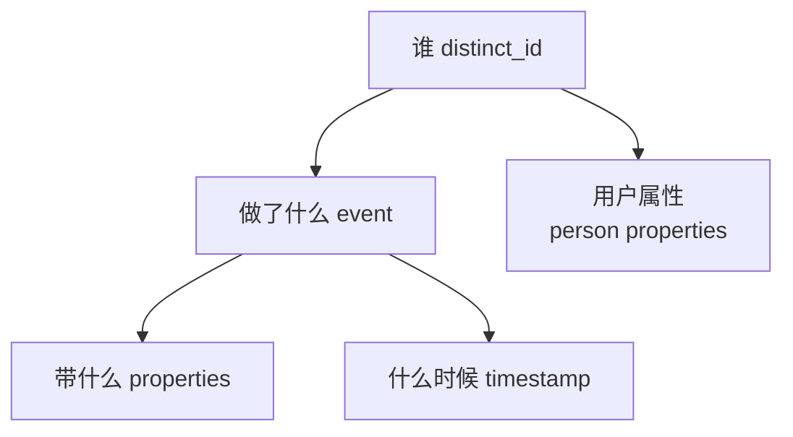
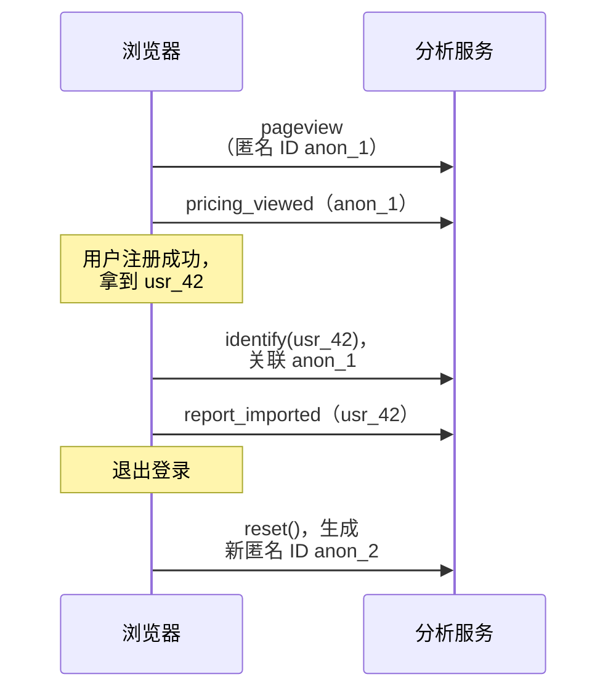

# 埋点设计

上一章用指标树决定了「要回答什么问题」。这一章把问题翻译成**事件**：用户做了什么、在什么情况下做的、带着哪些上下文。埋点设计做得好，后面写查询、画漏斗、做实验都顺；做得差，三个月后你会面对一张事件表，里面有 `click`、`Click_Button`、`btn_clicked`、`signup`、`sign_up_success` 五个名字，没人说得清它们的区别——包括你自己。

## 埋点的三种方式

| 方式 | 做法 | 优点 | 缺点 |
|---|---|---|---|
| 代码埋点 | 在业务代码里手动调用 `track('...')` | 精确、语义清楚、可带业务属性 | 要写代码，漏埋要发版才能补 |
| 全埋点（自动采集） | SDK 自动记录所有点击、页面浏览 | 零开发，可回溯 | 数据量大、语义弱（「点了第 3 个按钮」），改版后历史数据对不上 |
| 服务端埋点 | 在后端业务逻辑成功后记录 | 不受广告拦截影响、数据可信，适合支付等关键事件 | 拿不到纯前端行为 |

实践中的组合：

- **页面浏览 / 屏幕浏览**用自动采集
- **核心业务事件**（注册成功、导入完成、付费成功）在**服务端**记录，因为这些是你要拿来算收入和留存的，必须准
- **关键交互**（点了升级按钮、打开了某个功能）在前端用代码埋点

为什么核心事件要放服务端？前端事件会因为广告拦截插件、用户关掉页面、网络失败而丢失，丢失比例因用户群而异，在开发者用户群里可能相当高。用一个会丢数据的源去算收入，结果必然偏低，而且偏多少你不知道。

## 事件模型：谁、做了什么、在哪、带什么

几乎所有分析工具（PostHog、Mixpanel、Amplitude、Umami 的自定义事件）都用同一个模型：



| 部分 | 说明 | 例子 |
|---|---|---|
| distinct_id | 用户标识；登录前是匿名 ID，登录后是你的用户 ID | `usr_8f2c...` |
| event | 事件名 | `report_imported` |
| properties | 这次事件的上下文 | `{ source: 'csv', rows: 312, duration_ms: 1840 }` |
| timestamp | 发生时间 | SDK 自动填 |
| person properties | 用户本身的属性，随时间可能变 | `{ plan: 'pro', store_count: 2 }` |

区分**事件属性**和**用户属性**很重要：「这次导入了多少行」是事件属性，属于这一次；「用户当前是什么套餐」是用户属性，会被后续更新覆盖。如果你想知道「用户在付费那一刻是什么套餐」，要把套餐作为事件属性带上，而不是事后去查用户属性。

## 命名规范

选一套规范并**写下来**，比选哪一套更重要。推荐：

- **对象_动作**，动作用过去式：`report_imported`、`plan_upgraded`、`invite_sent`
- 全小写 + 下划线（snake_case）
- 事件名描述**业务上发生了什么**，不描述 UI：用 `checkout_started`，不用 `blue_button_clicked`
- 属性名同样 snake_case，布尔值用 `is_` / `has_` 开头

为什么用「对象_动作」而不是「动作_对象」？因为在分析工具的事件列表里按字母排序时，同一对象的事件会排在一起：

```text
plan_downgraded
plan_upgraded
plan_viewed
report_import_failed
report_imported
report_viewed
```

为什么不用 UI 描述？因为 UI 会改。按钮从蓝色变绿色、从首页挪到设置页，「用户开始结账」这件事没有变，事件名就不该变。UI 位置作为属性带上：`checkout_started { entry: 'pricing_page' }`。

### 成功和失败分开

对有成败的操作，分别记录：

| 事件 | 时机 |
|---|---|
| `report_import_started` | 用户选好文件点了导入 |
| `report_imported` | 导入成功 |
| `report_import_failed` | 导入失败，带 `error_code` |

只记成功会让你看不到失败率；只记点击会让你以为每次点击都成功了。

## 追踪计划（Tracking Plan）

追踪计划是一张表，列出每个事件的定义。它是埋点的**单一事实来源**：前端、后端、分析查询都以它为准。

| 事件 | 触发时机 | 来源 | 属性 | 支撑的指标 |
|---|---|---|---|---|
| `signed_up` | 注册成功（服务端写库后） | 服务端 | `method: 'sms' \| 'wechat'`、`referrer` | 获客、激活漏斗 |
| `report_imported` | 报表解析并入库成功 | 服务端 | `source: 'csv' \| 'xlsx'`、`rows`、`duration_ms` | 北极星、激活 |
| `report_import_failed` | 解析失败 | 服务端 | `source`、`error_code` | 导入失败率 |
| `invoice_photo_captured` | 拍下进货单 | App | `retake_count` | 功能使用 |
| `paywall_viewed` | 看到付费墙 | 前端 | `trigger` | 付费漏斗 |
| `plan_upgraded` | 支付回调确认 | 服务端 | `plan`、`period: 'month' \| 'year'`、`amount_cents` | 收入 |

几条经验：

- **每个事件都要能对应到指标树上的某个节点**。对应不上的事件，先不加
- **起步 10–20 个事件就够**。小产品初期事件越少越好，等有了具体问题再加
- 把追踪计划放进代码仓库，跟代码一起评审。最好的形式是**代码本身**——下一节和第 3 章会把它写成 TypeScript 类型

## 用 TypeScript 类型当追踪计划

表格会过期，类型不会。把追踪计划写成一个类型映射，事件名拼错、属性漏传都会在编译期报错：

```ts
// packages/analytics/src/events.ts
export type AnalyticsEvents = {
  signed_up: { method: 'sms' | 'wechat'; referrer?: string };
  report_import_started: { source: 'csv' | 'xlsx' };
  report_imported: { source: 'csv' | 'xlsx'; rows: number; duration_ms: number };
  report_import_failed: { source: 'csv' | 'xlsx'; error_code: string };
  invoice_photo_captured: { retake_count: number };
  paywall_viewed: { trigger: 'limit_reached' | 'settings' | 'onboarding' };
  plan_upgraded: { plan: 'pro'; period: 'month' | 'year'; amount_cents: number };
};

export type EventName = keyof AnalyticsEvents;
```

在 pnpm monorepo 里把它放在一个共享包中，网页端、App、服务端都从这里导入。这和 hatch-shelf 把书籍结构规则只写在 `@shelf/spec`、App 与 CLI 共用是同一个思路：**口径只定义一次**。

属性类型尽量用字面量联合（`'csv' | 'xlsx'`）而不是 `string`。这不只是为了类型安全：分析工具里按属性分组时，自由文本会产生无数个长尾取值，联合类型保证了取值有限、可分组。

## 身份：匿名 ID 与用户 ID

用户在注册前就会访问你的着陆页、试用功能。这时没有用户 ID，SDK 会生成一个**匿名 ID** 存在本地。注册或登录后，要把匿名 ID 和用户 ID 关联起来，否则「着陆页 → 注册」这个漏斗就断了。



规则：

- 登录 / 注册成功后调用 `identify(用户ID)`
- **退出登录时必须调用 `reset()`**，否则下一个在同一设备登录的人会被算到上一个人头上。门店场景尤其常见：店里一台电脑多人轮流用
- 用户 ID 用你数据库里的**不可变内部 ID**，不要用手机号、邮箱。手机号会换，而且是个人信息（第 8 章）

## 属性里不该放什么

- **个人信息**：手机号、姓名、地址、身份证号、精确定位。分析系统不是存这些的地方
- **自由文本**：用户输入的搜索词、笔记内容。可能含个人信息，取值也无法分组。确实需要时只记长度或分类
- **高基数 ID 当分组维度**：订单号、文件名可以作为属性存，但别指望按它分组
- **敏感业务数据**：门店的具体营收金额。如果确实要分析，用分档（`revenue_band: '1w-5w'`）而不是原值

## 埋点的版本管理

事件定义会变。原则：

- **改含义就改名**。`report_imported` 原来在前端点击时触发，后来改为服务端入库后触发，含义变了，应该新起一个名字或者至少加一个 `schema_version` 属性，否则趋势图会在改动那天出现断崖
- **只增不删**。旧事件停止发送即可，别在分析工具里删掉，历史数据还要用
- 每次改动在追踪计划里记日期

## 本章要点

- 页面浏览自动采集，**核心业务事件在服务端记录**，关键交互在前端代码埋点
- 事件模型：谁（distinct_id）、做了什么（event）、带什么（properties）；区分事件属性和用户属性
- 命名用**对象_动作 + 过去式 + snake_case**，描述业务而不是 UI；成功和失败分开记
- 追踪计划是单一事实来源，最好的形式是**共享包里的 TypeScript 类型**
- 登录时 `identify`，**退出时 `reset`**；用户 ID 用不可变内部 ID
- 属性里不放个人信息和自由文本；改了事件含义就改名
