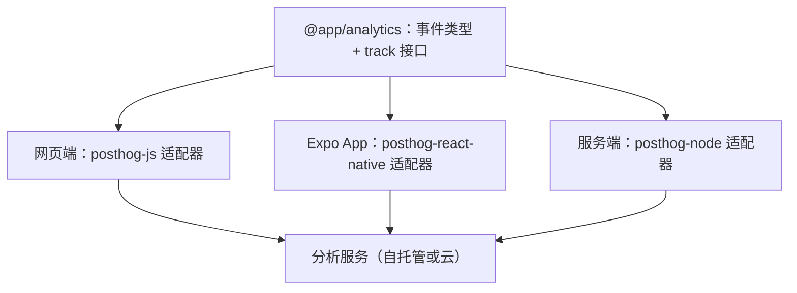

# 埋点实现：网页端、App 与服务端

上一章把追踪计划写成了 TypeScript 类型。这一章把它落地到三个地方：React 网页端、Expo App、NestJS 服务端。目标是三件事：**事件名和属性有类型检查**；**业务代码不直接依赖某个分析 SDK**，以后换工具只改一处；**开发环境、用户拒绝时不上报**。

示例用 PostHog 的 SDK，因为它同时覆盖网页、React Native 和 Node，而且可以自托管（第 7 章）。官网着陆页这类纯内容页面用更轻的 Umami，放在本章最后。

> SDK 的包名和初始化选项会随版本调整。本章代码以写作时（2026 年 11 月）PostHog 官方文档为准，动手前请对照官方文档的当前版本。

## 整体结构



共享包只定义**类型和接口**，不依赖任何 SDK；每个端写一个几十行的适配器。

## 共享包：类型安全的 track

```ts
// packages/analytics/src/index.ts
export * from './events';
import type { AnalyticsEvents, EventName } from './events';

export interface AnalyticsSink {
  capture(event: string, properties: Record<string, unknown>): void;
  identify(userId: string, traits?: Record<string, unknown>): void;
  reset(): void;
}

const noopSink: AnalyticsSink = { capture() {}, identify() {}, reset() {} };
let sink: AnalyticsSink = noopSink;

export function setAnalyticsSink(next: AnalyticsSink | null) {
  sink = next ?? noopSink;
}

export function track<E extends EventName>(event: E, properties: AnalyticsEvents[E]) {
  try {
    sink.capture(event, properties);
  } catch {
    // 埋点失败绝不能影响业务流程
  }
}

export function identify(userId: string, traits?: Record<string, unknown>) {
  try { sink.identify(userId, traits); } catch {}
}

export function resetIdentity() {
  try { sink.reset(); } catch {}
}
```

用起来是这样，拼错事件名或漏了必填属性都会编译失败：

```ts
import { track } from '@app/analytics';

track('report_imported', { source: 'csv', rows: 312, duration_ms: 1840 });

// @ts-expect-error 缺少 duration_ms
track('report_imported', { source: 'csv', rows: 312 });
```

这里有两个设计取舍值得说明：

- **默认是 noop**。没有调用 `setAnalyticsSink` 时什么都不发，所以单元测试、Storybook、开发环境天然不上报，不需要到处判断环境
- **吞掉异常**。分析 SDK 出错（初始化失败、被拦截）不应该让「导入报表」这个业务动作失败。埋点是旁路，不是主路

## React 网页端（Vite）

安装：

```bash
pnpm add posthog-js @posthog/react
```

环境变量（Vite 只暴露 `VITE_` 前缀的变量给前端；项目 key 本来就是公开的，不是密钥）：

```bash
# apps/web/.env.production
VITE_POSTHOG_KEY=phc_xxxxxxxx
VITE_POSTHOG_HOST=https://analytics.example.com
```

适配器和初始化：

```ts
// apps/web/src/analytics.ts
import posthog from 'posthog-js';
import { setAnalyticsSink } from '@app/analytics';

export function initAnalytics() {
  const key = import.meta.env.VITE_POSTHOG_KEY;
  if (!key || import.meta.env.DEV) return; // 开发环境不上报

  posthog.init(key, {
    api_host: import.meta.env.VITE_POSTHOG_HOST,
    person_profiles: 'identified_only', // 只为登录用户建档，匿名访客不建
    autocapture: false,                 // 只要页面浏览和手写事件，不要全量点击
    capture_pageview: 'history_change', // SPA 路由变化时记录页面浏览
    opt_out_capturing_by_default: true, // 用户同意前不采集（见下文）
  });

  setAnalyticsSink({
    capture: (event, props) => posthog.capture(event, props),
    identify: (id, traits) => posthog.identify(id, traits),
    reset: () => posthog.reset(),
  });

  return posthog;
}
```

```tsx
// apps/web/src/main.tsx
import { createRoot } from 'react-dom/client';
import { PostHogProvider } from '@posthog/react';
import posthog from 'posthog-js';
import { initAnalytics } from './analytics';
import { App } from './App';

initAnalytics();

createRoot(document.getElementById('root')!).render(
  <PostHogProvider client={posthog}>
    <App />
  </PostHogProvider>,
);
```

`PostHogProvider` 只在需要 Feature Flag 的 hooks（第 6 章）时才必须；只发事件的话，用 `@app/analytics` 的 `track` 就够了。

### 登录与退出

```ts
// apps/web/src/auth/session.ts
import { identify, resetIdentity } from '@app/analytics';

export function onLoggedIn(user: { id: string; plan: string }) {
  identify(user.id, { plan: user.plan }); // 只传不可变 ID 和非敏感属性
}

export function onLoggedOut() {
  resetIdentity(); // 共用电脑的场景必须调用
}
```

### 用户同意

上面初始化时设置了默认不采集。在隐私弹窗或设置页里，用户同意后再打开：

```tsx
// apps/web/src/components/ConsentBanner.tsx
import posthog from 'posthog-js';
import { useState } from 'react';

export function ConsentBanner() {
  const [decided, setDecided] = useState(
    () => posthog.has_opted_in_capturing() || posthog.has_opted_out_capturing(),
  );
  if (decided) return null;

  return (
    <div className="fixed inset-x-4 bottom-4 rounded-lg bg-white p-4 shadow">
      <p className="text-sm">我们使用匿名的使用统计来改进产品，不含你的业务数据。</p>
      <div className="mt-3 flex gap-2">
        <button onClick={() => { posthog.opt_in_capturing(); setDecided(true); }}>同意</button>
        <button onClick={() => { posthog.opt_out_capturing(); setDecided(true); }}>不同意</button>
      </div>
    </div>
  );
}
```

具体需要什么样的告知和同意，取决于产品性质和适用法规，见第 8 章和[《国内合规实务》](../opc-compliance-cn/)。

## Expo App

安装（在 App 目录下，用 `npx expo install` 拿到与当前 SDK 匹配的版本）：

```bash
npx expo install posthog-react-native expo-file-system expo-application expo-device expo-localization
```

这些依赖里有原生模块，装完要**重新构建 dev client** 才能用；Expo SDK 每个大版本都可能调整这些模块，升级 SDK 后同样要重新构建。

```tsx
// apps/mobile/src/app/_layout.tsx
import { Stack, usePathname, useGlobalSearchParams } from 'expo-router';
import { PostHogProvider, usePostHog } from 'posthog-react-native';
import { useEffect } from 'react';
import { setAnalyticsSink } from '@app/analytics';

const KEY = process.env.EXPO_PUBLIC_POSTHOG_KEY;
const HOST = process.env.EXPO_PUBLIC_POSTHOG_HOST;

function AnalyticsBridge() {
  const posthog = usePostHog();
  const pathname = usePathname();
  const params = useGlobalSearchParams();

  useEffect(() => {
    if (!posthog) return;
    setAnalyticsSink({
      capture: (event, props) => posthog.capture(event, props as any),
      identify: (id, traits) => posthog.identify(id, traits as any),
      reset: () => posthog.reset(),
    });
    return () => setAnalyticsSink(null);
  }, [posthog]);

  // expo-router 不是 react-navigation 的默认容器用法，屏幕浏览手动记录
  useEffect(() => {
    posthog?.screen(pathname, params as Record<string, string>);
  }, [posthog, pathname, params]);

  return null;
}

export default function RootLayout() {
  return (
    <PostHogProvider
      apiKey={KEY ?? 'disabled'}
      options={{
        host: HOST,
        disabled: __DEV__ || !KEY,   // 开发环境和未配置时整体关闭
        captureAppLifecycleEvents: true, // 安装、更新、打开、进入后台
        defaultOptIn: false,         // 用户同意前不发送
      }}
      autocapture={{ captureScreens: false, captureTouches: false }}
    >
      <AnalyticsBridge />
      <Stack />
    </PostHogProvider>
  );
}
```

几个移动端特有的点：

- **离线队列**：SDK 会把事件存在本地、攒一批再发（`flushAt` 控制条数），网络恢复后补发。所以 App 端的事件时间戳是**发生时间**，到达时间可能晚几小时，做「今日数据」时要意识到这一点
- **App 生命周期事件**（`Application Opened` 等）由 SDK 自动记录，算日活、留存时可以直接用，不用自己埋「打开 App」
- **路由参数可能含个人信息**：`/store/[id]` 里的 id 没问题，`/search?q=...` 就要过滤掉再传给 `screen`
- 同意开关：用户在设置页同意后调用 `posthog.optIn()`，撤回时调用 `posthog.optOut()`

## 服务端（NestJS）

核心事件在服务端记录。安装 `posthog-node`，包成一个 Nest provider：

```ts
// apps/api/src/analytics/analytics.service.ts
import { Injectable, OnModuleDestroy } from '@nestjs/common';
import { PostHog } from 'posthog-node';
import type { AnalyticsEvents, EventName } from '@app/analytics';

@Injectable()
export class AnalyticsService implements OnModuleDestroy {
  private readonly client = process.env.POSTHOG_KEY
    ? new PostHog(process.env.POSTHOG_KEY, { host: process.env.POSTHOG_HOST })
    : null;

  track<E extends EventName>(userId: string, event: E, properties: AnalyticsEvents[E]) {
    try {
      this.client?.capture({ distinctId: userId, event, properties });
    } catch {
      // 同样不影响业务
    }
  }

  async onModuleDestroy() {
    await this.client?.shutdown(); // 进程退出前把队列里的事件发完
  }
}
```

```ts
// apps/api/src/reports/reports.service.ts（节选）
const started = Date.now();
const rows = await this.importer.import(storeId, file);
this.analytics.track(user.id, 'report_imported', {
  source: file.kind,
  rows: rows.length,
  duration_ms: Date.now() - started,
});
```

**在事务提交之后再 track**。如果在事务里 track、事务随后回滚，分析系统里就多了一条从未真正发生的导入。

`onModuleDestroy` 要生效，记得在 `main.ts` 里调用 `app.enableShutdownHooks()`。Docker 停容器时发 SIGTERM，没有关闭钩子，内存队列里的事件就丢了。

## 落地页用 Umami

官网、文档站这类页面只需要「多少人来、从哪来、看了哪页」，用 PostHog 显得重。Umami 的追踪脚本很小，默认不用 Cookie，在 Vite 的 `index.html` 里加一行即可：

```html
<script defer src="https://stats.example.com/script.js"
        data-website-id="你的网站 ID"></script>
```

单页应用的路由变化会被自动记录为页面浏览。自定义事件用全局的 `umami.track`，在 TypeScript 里补一个声明：

```ts
// apps/site/src/umami.d.ts
declare global {
  interface Window {
    umami?: { track(event: string, data?: Record<string, string | number | boolean>): void };
  }
}
export {};
```

```ts
// 下载按钮
window.umami?.track('download_clicked', { platform: 'mac' });
```

用可选链调用是因为脚本可能被拦截或尚未加载，这时静默跳过即可。Umami 对事件数据有长度和属性个数限制（字符串长度、对象属性个数），以官方文档为准；保持属性少而短就不会碰到。

## 验证埋点

埋点代码最容易出的问题是「以为发了，其实没发」。每加一个事件，至少做一次端到端验证：

1. 在分析工具里打开实时事件流（PostHog 的 Activity、Umami 的 Realtime）
2. 在测试环境手动触发一次
3. 确认事件名、属性、用户 ID 都对

再加一层自动化：给 `track` 写一个记录型 sink，在单元测试里断言业务函数发出了正确的事件：

```ts
import { setAnalyticsSink } from '@app/analytics';
import { expect, test } from 'vitest';

test('导入成功时发出 report_imported', async () => {
  const calls: Array<[string, Record<string, unknown>]> = [];
  setAnalyticsSink({ capture: (e, p) => calls.push([e, p]), identify() {}, reset() {} });

  await importReport(sampleCsv);

  expect(calls).toContainEqual(['report_imported', expect.objectContaining({ source: 'csv' })]);
  setAnalyticsSink(null);
});
```

## 本章要点

- 共享包只放**事件类型和 track 接口**，各端写适配器；默认 noop，异常吞掉
- 网页端用 `posthog-js`，关闭全量自动点击，只要页面浏览和手写事件
- Expo App 用 `posthog-react-native`，需要 dev client 重建；expo-router 下**手动记录屏幕浏览**
- 核心事件在服务端用 `posthog-node` 记录，**事务提交后再 track**，进程退出前 `shutdown`
- 开发环境不上报，**用户同意前不采集**
- 落地页用 Umami 一行脚本；每个事件都要做一次端到端验证
