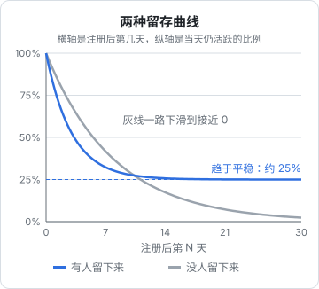
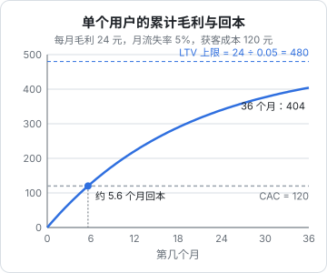

# 留存、转化与 LTV

如果只能看一个分析图，选**留存曲线**。它回答的是产品最根本的问题：用户用过之后，还会不会回来？获客、定价、增长技巧，都建立在「有人留下来」这个前提上。这一章讲留存的几种算法和各自的坑，然后讲转化率和 LTV（用户生命周期价值）——一个用户到底值多少钱，你最多能花多少钱去获得他。

## 留存的定义

留存总是相对一个**批次**（cohort）说的：同一时间段开始使用产品的一组用户。最常见的是按注册日期或注册周分批。

**第 N 日留存**：

$$
R(N) = \frac{\text{批次中在第 } N \text{ 天活跃的用户数}}{\text{批次总人数}}
$$

这里有两个需要你自己明确的定义：

1. **起点事件**：通常是注册，或者更好——激活（第 1 章的「啊哈时刻」）。用激活作起点，排除了注册完就走的人，留存曲线更能反映产品本身
2. **回访事件**：什么算「活跃」？打开 App 是最宽松的定义，完成一次核心动作（导入报表、播放一首歌）更有意义。**推荐用核心动作**，否则推送通知把人骗回来打开一下，也被算成留存

### 三种算法

| 算法 | 第 N 天算留存的条件 | 特点 |
|---|---|---|
| 经典留存（N-day） | 恰好在第 N 天活跃 | 最严格，受星期几影响大，日数据噪声大 |
| 区间留存（bracket） | 在第 N 个区间内活跃，如第 2 周（第 8–14 天）任意一天 | 平滑了日波动，适合低频产品 |
| 无界留存（unbounded / rolling） | 第 N 天**或之后任何一天**活跃 | 曲线单调递减、数字最好看；但会把「隔了很久回来一次」也算进去 |

选哪种取决于**产品的自然使用频率**：

- 每天用的（聊天、记账）：看经典日留存
- 每周用的（门店周报、周计划）：看周留存（区间留存，区间为一周）
- 每月用的（报税、账单）：看月留存

拿每周用一次的产品去算日留存，你会看到一条锯齿状、低得吓人的曲线，然后得出错误结论。

## 读留存曲线

把一个批次在各天的留存连起来，就是留存曲线：



图中两条曲线由公式画出，用来示意两种形态：蓝线是 $R(t) = 0.25 + 0.75e^{-t/3}$，灰线是 $R(t) = e^{-t/8}$。

**关键不是起点多高，而是曲线会不会变平。**

- 曲线变平（蓝线）：有一批用户找到了持续的价值，产品和这部分人是**匹配**的。剩下的问题是怎么让平台更高、怎么找到更多这样的人
- 曲线一路下滑到零（灰线）：没有任何人群离不开你，**加大获客只会更快地烧钱**。这时候应该回去改产品，而不是去做增长

前几天的陡降是正常的：很多人只是来看看。初期不必为第 1 天流失一半焦虑，要关心的是第 2–4 周之后还剩多少、还在不在降。

## 分批次看：留存矩阵

只看一条总的留存曲线会掩盖变化。把每周的新用户各算一条，排成矩阵：

| 注册周 | 人数 | 第 1 周 | 第 2 周 | 第 3 周 | 第 4 周 |
|---|---|---|---|---|---|
| 9 月第 1 周 | 120 | 42% | 30% | 26% | 24% |
| 9 月第 2 周 | 95 | 45% | 33% | 28% | 27% |
| 9 月第 3 周 | 140 | 51% | 38% | 33% | — |
| 9 月第 4 周 | 110 | 55% | 41% | — | — |

（示例数据，用来说明读法。）

读法：

- **竖着看同一列**：第 1 周留存从 42% 升到 55%，说明最近的改动（比如 9 月中改了新手引导）在起作用
- **横着看同一行**：每个批次随时间的衰减，看它在哪里变平
- **右下角的空格**：还没到时间的批次不能算，**不要把未成熟的批次混进平均值**，否则留存会被系统性地低估

小产品每周只有几十到一百多个新用户时，单个批次的百分比波动很大（120 人里 1 个人就是 0.8 个百分点）。看趋势时把几周合并，或者只在差异明显时下结论。

## 用 SQL 算留存

PostHog、Umami 的界面都能直接画留存。但理解 SQL 写法有两个好处：你能确切知道它怎么算的；服务端事件存在自己的 Postgres 里时，可以直接查。

假设有一张事件表 `events(user_id, event, ts)`：

```sql
-- 按注册周分批，计算第 1 / 7 / 30 天的经典留存
with cohort as (
  select user_id, min(ts)::date as d0
  from events
  where event = 'signed_up'
  group by user_id
),
activity as (
  select distinct user_id, ts::date as d
  from events
  where event = 'report_imported'      -- 回访事件用核心动作
)
select
  date_trunc('week', c.d0)::date                                   as cohort_week,
  count(distinct c.user_id)                                        as users,
  round(100.0 * count(distinct a.user_id) filter (where a.d - c.d0 = 1)
        / count(distinct c.user_id), 1)                            as d1,
  round(100.0 * count(distinct a.user_id) filter (where a.d - c.d0 = 7)
        / count(distinct c.user_id), 1)                            as d7,
  round(100.0 * count(distinct a.user_id) filter (where a.d - c.d0 = 30)
        / count(distinct c.user_id), 1)                            as d30
from cohort c
left join activity a on a.user_id = c.user_id
where c.d0 <= current_date - 30         -- 只保留已满 30 天的批次
group by 1
order by 1;
```

要点：

- `date - date` 在 Postgres 里得到整数天数
- 分子分母都用 `count(distinct ...)`，因为 join 之后一个用户会有多行
- `where c.d0 <= current_date - 30` 排除未成熟批次。想同时看 d1 和 d30 又不想丢掉新批次，就分开查，或者对每一列单独判断成熟度
- 要改成无界留存，把 `= 7` 换成 `>= 7`

## 转化率

转化率看似简单：

$$
\text{转化率} = \frac{\text{完成目标动作的人数}}{\text{进入这一步的人数}}
$$

但必须说清楚**时间窗口**。「试用转付费率」如果不限时间，今天注册的人还没来得及付费，最近的批次转化率永远偏低；如果按「14 天内付费」定义，就要等批次满 14 天再算。

| 常见转化 | 分子 | 分母 | 建议窗口 |
|---|---|---|---|
| 访客注册率 | 注册人数 | 着陆页独立访客 | 同一次访问或 1 天内 |
| 激活率 | 完成「啊哈时刻」的人数 | 注册人数 | 1–3 天 |
| 试用转付费 | 付费人数 | 开始试用的人数 | 试用期结束后若干天 |

同时，按第 1 章说的，**比例和绝对数一起看**。

## LTV：一个用户值多少钱

LTV（Lifetime Value，用户生命周期价值）是一个用户从开始付费到流失，给你带来的**毛利**总和。注意是毛利不是收入：要扣掉服务器、大模型 API、支付通道费这些随用户量增长的成本。

### 订阅制的简单公式

设每个付费用户每月贡献毛利 $m$（= 月均收入 × 毛利率），每月流失率为 $c$，且假设流失率不随时间变化。

一个用户第 1 个月一定付费，第 2 个月还在的概率是 $(1-c)$，第 $t$ 个月还在的概率是 $(1-c)^{t-1}$。把每个月的期望毛利加起来是一个等比数列：

$$
\text{LTV} = \sum_{t=1}^{\infty} m(1-c)^{t-1} = \frac{m}{c}
$$

顺带得到：平均付费月数 $= 1/c$。月流失 5%，平均付 20 个月。

**算例**：月费 30 元，扣除支付通道费和服务器成本后毛利率 80%，则 $m = 24$ 元；月流失 5%：

$$
\text{LTV} = \frac{24}{0.05} = 480 \text{ 元}
$$

前 $t$ 个月的累计毛利是等比数列的部分和：

$$
\text{LTV}(t) = m \cdot \frac{1 - (1-c)^t}{c}
$$

### 回本周期与 LTV / CAC

CAC（Customer Acquisition Cost）是获得一个**付费**用户的平均成本：某渠道的总花费 ÷ 从该渠道来的付费用户数。花费里要算上你自己的时间，哪怕只是粗略估算。

**回本周期**：累计毛利追上 CAC 需要几个月。令 $\text{LTV}(t) = \text{CAC}$，解得：

$$
t = \frac{\ln\left(1 - \text{CAC} \cdot c / m\right)}{\ln(1-c)}
$$



上例中 CAC = 120 元：$t = \ln(0.75) / \ln(0.95) \approx 5.6$ 个月。如果不考虑流失、直接用 120 ÷ 24 = 5 个月，会低估回本时间。

常见的经验说法是 LTV / CAC 应该在 3 以上、回本周期越短越好。对一人公司，**回本周期比 LTV / CAC 更关键**：你没有融资，现金流撑不住 18 个月的回本。

### 简单公式的局限

$m/c$ 好用，但它的假设往往不成立：

- **流失率不是常数**。新用户头几个月流失远高于老用户（正是上面留存曲线前段陡、后段平的形态），用早期流失率算会低估 LTV，用整体平均流失率又可能高估
- **小样本的流失率很不稳定**。只有 40 个付费用户时，某月流失 2 个和 4 个，算出的 LTV 差一倍
- **年付**用户在一年内流失率为零，要单独处理

更稳妥的做法是**按批次看实际累计收入**：对每个付费批次，算「平均每人截至第 $k$ 个月累计贡献了多少毛利」，画成曲线。这条曲线是实测的，不依赖任何假设；对尚未走完的部分，再用最近几个月的流失率外推。

LTV 是一个**估计**，最好给出范围而不是一个精确数字，并且每个季度重新算一次。

## 本章要点

- 留存要先定义**起点事件**和**回访事件**，回访事件推荐用核心动作
- 按产品的自然使用频率选择日留存、周留存或月留存
- 看留存曲线**会不会变平**；一路滑向零时不要加大获客
- 用**留存矩阵**按批次比较改动效果，**排除未成熟批次**
- 转化率必须带**时间窗口**
- 订阅制 LTV $= m/c$（$m$ 是月毛利不是月收入），累计毛利 $= m(1-(1-c)^t)/c$
- 一人公司优先看**回本周期**；LTV 是估计，用批次实测曲线校正
