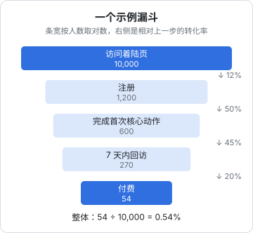
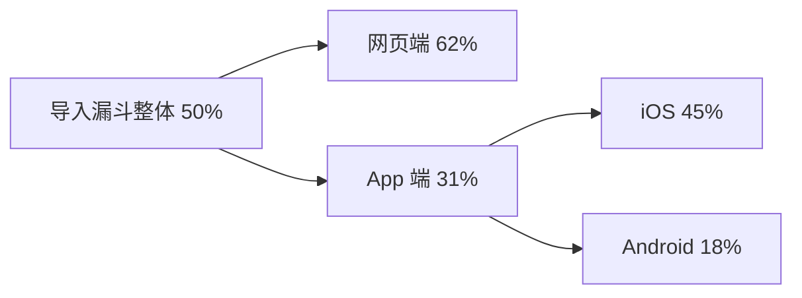

# 漏斗分析

留存告诉你「用户有没有留下来」，漏斗告诉你「用户在哪一步走掉了」。每个产品都有几条关键路径：从着陆页到注册，从注册到第一次用上核心功能，从看到付费墙到完成支付。漏斗分析就是把这些路径拆成步骤，算出每一步流失了多少人，然后决定**先修哪一步**。

## 漏斗是什么

漏斗是一组**有先后顺序**的事件，统计依次完成每一步的用户数：



（示例数据。）

每一步有两个转化率：

$$
\text{步骤转化率}_k = \frac{n_k}{n_{k-1}}, \qquad \text{整体转化率} = \frac{n_K}{n_1} = \prod_{k=2}^{K} \text{步骤转化率}_k
$$

上图里整体转化率 $= 12\% \times 50\% \times 45\% \times 20\% = 0.54\%$。整体是各步的**乘积**，这一点决定了后面怎么挑优化目标。

## 定义一个漏斗时要决定的事

同样叫「注册漏斗」，下面这些选择不同，数字可以差好几倍。在分析工具里建漏斗时逐一确认：

| 选项 | 含义 | 建议 |
|---|---|---|
| 计数单位 | 按人（唯一用户）还是按次 | 几乎总是按人 |
| 转化窗口 | 从第一步开始，多长时间内完成后续步骤才算 | 按业务定：注册流程 1 小时，激活 3 天，试用转付费 14–30 天 |
| 顺序要求 | 严格顺序 / 允许中间穿插其他事件 / 不限顺序 | 默认「按顺序，允许穿插」 |
| 起点范围 | 哪段时间进入第一步的人 | 排除还没走完转化窗口的人 |

**转化窗口**最容易被忽视。窗口太短，慢热的用户被算作流失；窗口太长，「三周后偶然回来付了费」也被算作这条路径的转化，掩盖了流程本身的问题。

## 漏斗的步骤从哪来

不要把用户可能经过的每个页面都放进漏斗。一条漏斗 3–5 步为宜，每一步应该是一个**有意义的承诺**：

- 着陆页访问 → 点击「开始使用」→ 注册成功 → 完成首次导入
- 看到付费墙 → 进入结账页 → 支付成功
- 拍进货单 → 识别完成 → 用户确认入库

最后一条是掌柜眼的拍照进货流程：视觉模型识别完成后，用户还要核对、确认才入库。如果「识别完成 → 确认入库」这一步流失很大，说明识别结果需要用户改的地方太多，用户放弃了——这是一个模型效果问题，而不是界面问题。漏斗把「识别准确率」这个技术指标和用户行为直接连了起来。

## 先修哪一步

直觉是去修转化率最低的那一步。但因为整体是乘积，更合理的问法是：**同样的努力，修哪一步让最终付费人数增加最多？**

以示例漏斗为例，假设各种改进的难度差不多：

| 改进 | 计算 | 付费人数 |
|---|---|---|
| 不改 | $10000 \times 12\% \times 50\% \times 45\% \times 20\%$ | 54 |
| 注册率 12% → 13% | $1300 \times 50\% \times 45\% \times 20\%$ | 58.5 |
| 首次核心动作后回访 45% → 55% | $600 \times 55\% \times 20\%$ | 66 |
| 回访后付费 20% → 25% | $270 \times 25\%$ | 67.5 |

提升的绝对值相同时，不同步骤的效果不同；更重要的是**提升的难度**不同。注册率从 12% 提到 13%，在着陆页上做文章可能很难；而激活后的回访，加一封恰当的提醒邮件、改一下首次使用的空态，可能就有明显效果。

实用的判断顺序：

1. 先看**越靠后的步骤**：用户已经投入了更多，流失在这里最可惜，而且改动影响的人少、风险低
2. 再看**流失特别反常**的步骤：同类步骤其他人能做到 60%，你只有 20%，多半有明显的 bug 或体验问题
3. 最后才是顶部的获客转化，它通常最难撬动，也最受外部因素影响

## 从「流失了多少」到「为什么流失」

漏斗只告诉你在哪里流失，不告诉你为什么。追问原因的几种方法：

**按属性拆分**。把同一个漏斗按渠道、设备、App 版本、套餐拆开：



一拆就发现问题集中在 Android：可能是某个文件选择器的兼容问题。拆分是漏斗分析里性价比最高的动作。

**看流失的人接下来做了什么**。PostHog 的漏斗可以直接查看「在第 k 步流失的用户」列表，再看他们的事件流：是去了帮助页？反复点了某个按钮？直接关掉了？

**看失败事件**。第 2 章坚持把成功和失败分开记，就是为了这里：`report_import_failed` 按 `error_code` 分组，往往直接指向原因。

**会话录像**。PostHog 支持会话录像，能看到流失用户在页面上的真实操作。它很有用，但也最敏感：会录到用户输入的内容。启用前务必配置好输入框遮罩，见第 8 章。

**问用户**。数据告诉你在哪里、多少人；对少数流失用户发一句「你在导入时遇到了什么问题吗？」，常常比任何图表都直接。

## 转化时间

除了「转了多少」，还要看「多久转」。把每个用户从第一步到最后一步的时长做成分布：

- 中位数很长、分布拖尾：流程中有某一步让人犹豫或需要离开去准备东西（比如去找收银报表文件）
- 有明显的双峰：可能是两类人群，一类当场完成，一类隔天回来

转化时间也决定了转化窗口该设多长：取覆盖大约九成转化的时长作为窗口，比拍脑袋定一个数合理。

## 用 SQL 算漏斗

分析工具能直接画漏斗，但下面这段 SQL 能帮你理解它的计算方式，也能用在服务端事件表上：

```sql
-- 最近 30 天注册的用户：注册 → 开始导入 → 导入成功，3 天窗口，按顺序
with s1 as (
  select user_id, min(ts) as t1
  from events
  where event = 'signed_up'
    and ts >= now() - interval '30 days'
    and ts <  now() - interval '3 days'      -- 排除窗口未走完的人
  group by user_id
),
s2 as (
  select s1.user_id, s1.t1, min(e.ts) as t2
  from s1
  join events e on e.user_id = s1.user_id
   and e.event = 'report_import_started'
   and e.ts between s1.t1 and s1.t1 + interval '3 days'
  group by s1.user_id, s1.t1
),
s3 as (
  select s2.user_id
  from s2
  join events e on e.user_id = s2.user_id
   and e.event = 'report_imported'
   and e.ts between s2.t2 and s2.t1 + interval '3 days'
  group by s2.user_id
)
select
  (select count(*) from s1) as signed_up,
  (select count(*) from s2) as import_started,
  (select count(*) from s3) as imported;
```

每一步都要求发生在上一步**之后**、且在第一步开始的窗口**之内**。这就是「按顺序、允许穿插、带窗口」的漏斗。

## 漏斗的陷阱

- **步骤之间有分支**：有些用户用微信登录跳过了「填手机号」步骤，严格漏斗会把他们算作流失。分支多的流程拆成多条漏斗
- **重复进入**：同一个用户多次进入第一步，按人计数时只算一次，按次计数时会稀释转化率。保持按人计数
- **埋点丢失**：前端事件被拦截，会表现为某一步「莫名流失」。关键步骤用服务端事件校对
- **样本太小**：每步只有几十人时，转化率的波动可能有十几个百分点。第 6 章会讲怎么判断差异是不是噪声

## 本章要点

- 整体转化率是各步转化率的**乘积**
- 建漏斗前确认：按人计数、**转化窗口**、顺序要求、排除未走完窗口的人
- 一条漏斗 3–5 步，每步是一个有意义的承诺
- 先修哪一步：比较**同等努力下最终转化的增量**，优先看靠后的和反常的步骤
- 找原因：**按属性拆分**、看流失用户的后续行为、看失败事件、会话录像、直接问
- 用转化时间分布来设定窗口；关键步骤用服务端事件校对
