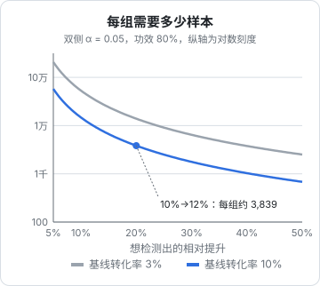

# A/B 测试

你改了付费页的文案，第二周付费人数涨了 15%。是文案起作用了，还是那周刚好有人在社区里推荐了你？前后对比回答不了这个问题，因为两周之间变的不止一件事。A/B 测试的做法是：**同一时间**把用户随机分成两组，一组看旧版、一组看新版，其他一切相同，差异就只能来自改动本身（或者随机波动）。这一章讲怎么设计实验、需要多少样本、怎么判断结果，以及一人公司样本不够时怎么办。

## 一个实验由什么组成

| 组成 | 说明 | 例子 |
|---|---|---|
| 假设 | 改什么、预期影响什么、为什么 | 「付费墙突出年付省下的金额，会提高年付占比，因为用户对月费更敏感」 |
| 主指标 | 唯一用来判定胜负的指标，事先定好 | 看到付费墙后 7 天内的付费转化率 |
| 护栏指标 | 不能变差的指标 | 退款率、整体收入、客诉数 |
| 随机单位 | 按什么分组 | 用户（几乎总是按用户，而不是按次访问） |
| 样本量 | 每组需要多少人 | 下文计算 |
| 时长 | 至少跑满完整的周 | 至少 1–2 周，覆盖工作日和周末 |

**主指标必须事先定好、只有一个**。如果先跑实验再从二十个指标里挑一个显著的，几乎总能找到一个——这叫多重比较，下文会讲。

## 随机分组

分组要满足两点：**随机**，以及**同一个用户每次看到的版本相同**。标准做法是对用户 ID 做哈希：

```ts
// packages/analytics/src/bucket.ts
// FNV-1a 32 位哈希：快、分布均匀，足够用于分桶（不用于安全场景）
function fnv1a(input: string): number {
  let h = 0x811c9dc5;
  for (let i = 0; i < input.length; i++) {
    h ^= input.charCodeAt(i);
    h = Math.imul(h, 0x01000193);
  }
  return h >>> 0;
}

export function assignVariant<V extends string>(
  experiment: string,
  userId: string,
  variants: readonly V[],
): V {
  // 带上实验名，保证不同实验之间的分组相互独立
  const bucket = fnv1a(`${experiment}:${userId}`) % variants.length;
  return variants[bucket];
}
```

```ts
// 在 AnalyticsEvents 里加一项：experiment_exposed: { experiment: string; variant: string }
const variant = assignVariant('paywall-annual-savings', user.id, ['control', 'test'] as const);
track('experiment_exposed', { experiment: 'paywall-annual-savings', variant });
```

分析时把 `experiment_exposed` 作为起点事件，按 `variant` 拆分后续的转化漏斗即可。

自己实现的好处是零依赖、完全可控；用 PostHog 的 Feature Flag 则省去了上报曝光、统计分析的工作。在 React 里：

```tsx
import { useFeatureFlagVariantKey } from '@posthog/react';

export function Paywall() {
  const variant = useFeatureFlagVariantKey('paywall-annual-savings');
  if (variant === undefined) return <PaywallSkeleton />; // 标志加载中
  return variant === 'test' ? <PaywallWithSavings /> : <PaywallClassic />;
}
```

这个 hook 在读取标志时会自动上报一次曝光事件（`$feature_flag_called`），PostHog 的实验分析据此统计每组人数。Expo App 里对应的是 `posthog-react-native` 的 `useFeatureFlag`。

**曝光要记在用户真正看到的地方**。如果在 App 启动时就读取标志，没走到付费墙的人也被算进实验，稀释了效果，需要更多样本才能检测出来。

## 需要多少样本

这是 A/B 测试里最重要、也最常被跳过的一步。比较两组转化率时，每组所需样本量的近似公式是：

$$
n = \frac{\left(z_{1-\alpha/2} + z_{1-\beta}\right)^2 \left[p_1(1-p_1) + p_2(1-p_2)\right]}{(p_2 - p_1)^2}
$$

| 符号 | 含义 | 常用取值 |
|---|---|---|
| $p_1$ | 对照组的基线转化率 | 从历史数据得到 |
| $p_2$ | 你希望能检测出的实验组转化率 | 基线 × (1 + 最小可检测提升) |
| $\alpha$ | 显著性水平：没有差异时误判为有差异的概率 | 0.05，双侧时 $z_{0.975} \approx 1.96$ |
| $1-\beta$ | 功效：真有这么大差异时能检测出来的概率 | 0.8，$z_{0.8} \approx 0.84$ |

**算例**：付费墙转化率基线 10%，希望能检测出相对提升 20%（即 12%）：

$$
n = \frac{(1.96 + 0.8416)^2 \times (0.10 \times 0.90 + 0.12 \times 0.88)}{(0.02)^2} = \frac{7.849 \times 0.1956}{0.0004} \approx 3839
$$

每组约 3,839 人，两组合计约 7,700 人**看到付费墙**。



从图里能读出两条规律：

- 样本量和提升幅度的**平方成反比**：想检测的提升缩小一半，样本量大约变成 4 倍。基线 10% 时，检测 10% 的相对提升每组要约 1.5 万人，检测 5% 要约 5.8 万人
- 基线越低，需要的样本越多：基线 3% 时检测 20% 的相对提升，每组约 1.4 万人

把公式写成函数，放进你的工具包：

```ts
// packages/analytics/src/stats.ts
export function sampleSizePerGroup(p1: number, relativeLift: number, zAlpha = 1.96, zBeta = 0.8416) {
  const p2 = p1 * (1 + relativeLift);
  const variance = p1 * (1 - p1) + p2 * (1 - p2);
  return Math.ceil(((zAlpha + zBeta) ** 2 * variance) / (p2 - p1) ** 2);
}

sampleSizePerGroup(0.1, 0.2); // 3839
```

**先算样本量，再决定要不要做实验**。如果你的付费墙每周只有 200 人看到，每组 3,839 人意味着要跑大半年——这个实验不该做，至少不该用这种方式做（见本章最后一节）。

## 判断结果：双比例 z 检验

实验跑满预定样本后，比较两组转化率。设对照组 $n_1$ 人中 $x_1$ 人转化，实验组 $n_2$ 人中 $x_2$ 人转化，$\hat p_1 = x_1/n_1$，$\hat p_2 = x_2/n_2$。合并转化率 $\hat p = (x_1+x_2)/(n_1+n_2)$，检验统计量：

$$
z = \frac{\hat p_2 - \hat p_1}{\sqrt{\hat p(1-\hat p)\left(\dfrac{1}{n_1} + \dfrac{1}{n_2}\right)}}
$$

$|z| > 1.96$ 对应双侧 $p < 0.05$。差值的 95% 置信区间：

$$
(\hat p_2 - \hat p_1) \pm 1.96\sqrt{\frac{\hat p_1(1-\hat p_1)}{n_1} + \frac{\hat p_2(1-\hat p_2)}{n_2}}
$$

**算例**：两组各 4,000 人，对照组 400 人付费（10%），实验组 470 人付费（11.75%）。

- $\hat p = 870 / 8000 = 0.10875$
- 分母 $= \sqrt{0.10875 \times 0.89125 \times (2/4000)} \approx 0.00696$
- $z = 0.0175 / 0.00696 \approx 2.51$，双侧 $p \approx 0.012$
- 差值 95% 置信区间约为 $[0.39\%, 3.11\%]$

结论：实验组显著更好，提升的绝对值大概率在 0.4 到 3.1 个百分点之间。**置信区间比 p 值更有用**：它告诉你效果可能有多大，下界接近零说明「可能只是一点点」。

```ts
// 标准正态分布的累积分布函数（Abramowitz-Stegun 7.1.26 近似，误差约 1e-7）
function normalCdf(z: number): number {
  const t = 1 / (1 + 0.3275911 * (Math.abs(z) / Math.SQRT2));
  const poly = t * (0.254829592 + t * (-0.284496736 + t * (1.421413741 + t * (-1.453152027 + t * 1.061405429))));
  const erf = 1 - poly * Math.exp(-(z * z) / 2);
  return z >= 0 ? (1 + erf) / 2 : (1 - erf) / 2;
}

export function twoProportionTest(x1: number, n1: number, x2: number, n2: number) {
  const p1 = x1 / n1;
  const p2 = x2 / n2;
  const pooled = (x1 + x2) / (n1 + n2);
  const z = (p2 - p1) / Math.sqrt(pooled * (1 - pooled) * (1 / n1 + 1 / n2));
  const pValue = 2 * (1 - normalCdf(Math.abs(z)));
  const se = Math.sqrt((p1 * (1 - p1)) / n1 + (p2 * (1 - p2)) / n2);
  return { diff: p2 - p1, z, pValue, ci95: [p2 - p1 - 1.96 * se, p2 - p1 + 1.96 * se] as const };
}

twoProportionTest(400, 4000, 470, 4000);
// { diff: 0.0175, z: ≈2.51, pValue: ≈0.012, ci95: [≈0.0039, ≈0.0311] }
```

## 最常见的错误

### 偷看（peeking）

每天看一眼结果，一旦 $p < 0.05$ 就停止实验宣布胜利。这会让误判率远高于 5%：随机波动下 p 值会上下起伏，只要看的次数够多，总有某一天会碰巧低于 0.05。

对策：**事先定好样本量，跑满再看结论**。中途可以看，但只用来发现 bug（比如某组转化率为零），不用来做决定。如果确实需要中途决策，要用专门为此设计的序贯检验方法，PostHog 等工具的实验功能会说明它用的是哪种统计方法。

### 样本比例失衡（SRM）

按 50/50 分组，结果两组是 5,200 对 4,800。这看起来差不多，但卡方检验：

$$
\chi^2 = \frac{(5200-5000)^2}{5000} + \frac{(4800-5000)^2}{5000} = 16, \quad p \approx 0.00006
$$

如此悬殊的失衡几乎不可能是随机造成的，说明分组或曝光记录有 bug：比如新版页面加载更慢，部分用户还没触发曝光就离开了。**SRM 出现时实验结果不可信**，先修 bug 再重跑。

### 多重比较

同时看 20 个指标，即使改动毫无作用，按 $\alpha = 0.05$ 平均也会有 1 个「显著」。主指标只有一个，其他指标只作为参考和护栏；如果一定要同时检验多个，用更严格的阈值（例如 Bonferroni 校正：$\alpha$ 除以检验次数）。

### 新奇效应

新设计刚上线时，老用户出于好奇多点几下，一两周后回落。实验至少跑满完整的一到两周，并且分新老用户看。

## 样本不够时怎么办

对多数一人公司产品，诚实的结论是：**大部分改动没有足够的流量做严格的 A/B 测试**。这不意味着放弃数据，而是换方法：

| 做法 | 适用 |
|---|---|
| 只测**大改动** | 检测 50% 的相对提升，所需样本只有检测 10% 时的约二十分之一。改整个定价结构、整个引导流程，而不是按钮颜色 |
| 测**更靠前、量更大**的指标 | 「点击升级按钮」比「完成付费」人数多得多，可以作为代理指标，但要确认它和付费真的相关 |
| 前后对比 + 留存矩阵 | 第 4 章的批次对比；接受它不严格，注意同期的其他变化 |
| 定性研究 | 让 5 个目标用户当面用新旧两版，观察他们卡在哪 |
| 直接上线 + 护栏 | 改动风险低、方向明确时，直接全量，盯着护栏指标，出问题回滚 |

A/B 测试是工具，不是信仰。流量小时，**做对的大决定 + 快速回滚能力**，比在小改动上追求统计显著更有价值。

## 本章要点

- 实验事先定好：假设、**唯一主指标**、护栏指标、随机单位、样本量
- 按用户 ID 哈希分组（带实验名），**曝光记在用户真正看到的地方**
- 每组样本量 $n = (z_{1-\alpha/2}+z_{1-\beta})^2[p_1(1-p_1)+p_2(1-p_2)]/(p_2-p_1)^2$；**先算样本量再决定做不做**
- 双比例 z 检验判断显著性，**看置信区间**而不只看 p 值
- 不偷看、查 SRM、避免多重比较、注意新奇效应
- 流量小：只测大改动、用代理指标、结合定性研究，或直接上线加护栏
