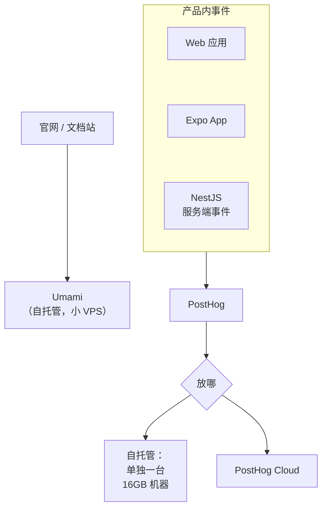
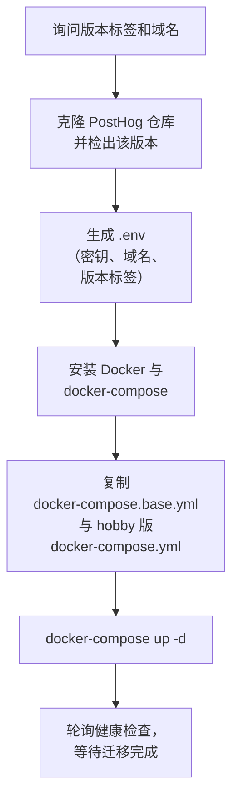

# 自托管 PostHog / Umami

前面几章的代码都把数据发到「分析服务」。这一章决定这个服务放在哪：用 SaaS，还是部署在自己的机器上。自托管的理由通常有三个：**数据留在自己手里**（合规、用户信任）、**成本可控**、**不被第三方域名拦截**。代价是你多了一个要运维的系统。这一章给出两个开源方案的 Docker Compose 部署：轻量的 Umami 和全功能的 PostHog，以及怎么在两者之间选。

> 两个项目都在快速迭代，镜像标签、环境变量和部署脚本可能变化。下面的配置一律把版本写成变量，部署前请对照各自官方文档和发布说明确认当前版本。

## 先选：Umami 还是 PostHog

| | Umami | PostHog（自托管 hobby 版） |
|---|---|---|
| 定位 | 网站流量统计（Google Analytics 的轻量替代） | 产品分析全家桶：事件、漏斗、留存、Feature Flag、实验、会话录像 |
| 组件 | 一个 Node 应用 + PostgreSQL | Web / Worker / 插件服务 + ClickHouse + Kafka + ZooKeeper + Redis + PostgreSQL + MinIO + Caddy 等 |
| 资源 | 很小的 VPS 就能跑 | 官方建议约 4 核 16GB 内存、30GB 以上磁盘 |
| 官方支持 | 自托管是主要使用方式 | 官方明确表示**自托管不提供支持**，风险自担 |
| 漏斗 / 留存 | 有基础的漏斗、留存报表 | 完整 |
| Feature Flag / 实验 | 无 | 有 |
| 适合 | 官网、博客、文档站、着陆页 | 有登录用户的 Web 应用和 App |

对一人公司，一个现实的组合是：



PostHog 放哪要算账：一台 16GB 内存的机器每月的费用，加上你维护 ClickHouse 和 Kafka 的时间，对比 PostHog Cloud 的免费额度和按量计费。PostHog 官方文档有一张帮你判断的流程图，大意是**事件量不大时 Cloud 的免费层往往更划算**。数据要不要出境则是另一个维度的问题：用户在国内、数据发往境外服务，涉及个人信息出境的合规要求，这一点见第 8 章和[《国内合规实务》](../opc-compliance-cn/)。

## 部署 Umami

Umami v3 起**只支持 PostgreSQL**（v2 时代的 MySQL 用户需要先迁移）。目录结构：

```text
/srv/umami/
├── docker-compose.yml
└── .env
```

```yaml
# /srv/umami/docker-compose.yml
name: umami

services:
  umami:
    # 版本写死在 .env 里，升级时显式改，不用 latest
    image: ghcr.io/umami-software/umami:${UMAMI_TAG:?请在 .env 中设置 UMAMI_TAG}
    restart: unless-stopped
    environment:
      DATABASE_URL: postgresql://umami:${POSTGRES_PASSWORD}@db:5432/umami
      APP_SECRET: ${APP_SECRET}
    ports:
      # 只绑本机，由宿主机上的 nginx 反代；不直接暴露到公网
      - "127.0.0.1:3000:3000"
    depends_on:
      db:
        condition: service_healthy
    healthcheck:
      test: ["CMD-SHELL", "curl -fsS http://localhost:3000/api/heartbeat || exit 1"]
      interval: 10s
      timeout: 5s
      retries: 5
    logging:
      driver: json-file
      options: { max-size: "20m", max-file: "3" }

  db:
    image: postgres:${POSTGRES_TAG:-15-alpine}
    restart: unless-stopped
    environment:
      POSTGRES_DB: umami
      POSTGRES_USER: umami
      POSTGRES_PASSWORD: ${POSTGRES_PASSWORD}
    # 不映射端口：只有 compose 内网里的 umami 能连
    volumes:
      - umami-db:/var/lib/postgresql/data
    healthcheck:
      test: ["CMD-SHELL", "pg_isready -U umami -d umami"]
      interval: 5s
      timeout: 5s
      retries: 10

volumes:
  umami-db:
```

```bash
# /srv/umami/.env —— 不入库，权限设为 600
UMAMI_TAG=从官方发布页抄一个具体版本号
POSTGRES_TAG=15-alpine
POSTGRES_PASSWORD=用下面的命令生成
APP_SECRET=用下面的命令生成
```

```bash
cd /srv/umami
openssl rand -hex 24   # 生成数据库密码，填入 POSTGRES_PASSWORD
openssl rand -hex 32   # 生成 APP_SECRET
chmod 600 .env
docker compose up -d --wait
docker compose logs -f umami
```

几个值得说明的选择：

- **`${UMAMI_TAG:?...}`**：变量没设置时 compose 直接报错退出，而不是悄悄拉一个 `latest`。生产环境的镜像版本必须是你主动选择的
- **数据库不映射端口**：这和 hatch-counter 的生产编排是同一个原则——数据库只在 compose 内网可达，要用 `psql` 就 `docker compose exec db psql -U umami umami`
- **PostgreSQL 换大版本不能只改标签**：15 的数据目录 16 读不了，要先 `pg_dump` 再导入新版本
- **镜像源**：境内服务器拉取 ghcr.io、Docker Hub 可能很慢或超时。hatch-counter 的做法是把官方镜像转存到自己的国内镜像仓库，compose 里只引用转存后的地址，换版本前先转存

首次启动后，用默认账号登录（官方文档给出的默认用户名和密码），**第一件事就是改密码**，然后添加网站，拿到网站 ID 填进第 3 章的追踪脚本。

### nginx 反代与 HTTPS

```nginx
# /etc/nginx/sites-available/stats.conf
server {
    listen 80;
    server_name stats.example.com;
    return 301 https://$host$request_uri;
}

server {
    listen 443 ssl;
    http2 on;    # nginx 1.25.1 起的写法；更老的版本写在 listen 行：listen 443 ssl http2;
    server_name stats.example.com;

    ssl_certificate     /etc/letsencrypt/live/stats.example.com/fullchain.pem;
    ssl_certificate_key /etc/letsencrypt/live/stats.example.com/privkey.pem;

    location / {
        proxy_pass http://127.0.0.1:3000;
        proxy_set_header Host              $host;
        # Umami 靠客户端 IP 做地理位置和访客去重，必须把真实 IP 传过去
        proxy_set_header X-Real-IP         $remote_addr;
        proxy_set_header X-Forwarded-For   $proxy_add_x_forwarded_for;
        proxy_set_header X-Forwarded-Proto $scheme;
    }
}
```

```bash
sudo ln -s /etc/nginx/sites-available/stats.conf /etc/nginx/sites-enabled/
sudo certbot certonly --nginx -d stats.example.com   # 首次申请证书
sudo nginx -t && sudo systemctl reload nginx
```

### 绕开广告拦截

很多拦截列表会屏蔽常见统计脚本的文件名和路径。两个办法：

- 统计服务用**自己的子域名**，而不是第三方 SaaS 域名
- Umami 支持通过环境变量改追踪脚本的文件名和上报路径（如 `TRACKER_SCRIPT_NAME`），具体变量名见官方环境变量文档

这样做的目的是让统计数据更准，而不是绕过用户的意愿：如果用户明确表达了不想被统计，应该尊重（第 8 章）。

### 备份

Umami 的数据全在 Postgres 里，每天导出一份：

```bash
#!/usr/bin/env bash
# /srv/umami/backup.sh
set -euo pipefail
cd /srv/umami
mkdir -p backups
docker compose exec -T db pg_dump -U umami umami | gzip > "backups/umami-$(date +%F).sql.gz"
find backups -name 'umami-*.sql.gz' -mtime +14 -delete   # 保留两周
```

```ini
# /etc/systemd/system/umami-backup.service
[Unit]
Description=Backup Umami database

[Service]
Type=oneshot
ExecStart=/srv/umami/backup.sh
```

```ini
# /etc/systemd/system/umami-backup.timer
[Unit]
Description=Daily Umami backup

[Timer]
OnCalendar=*-*-* 03:30:00
Persistent=true

[Install]
WantedBy=timers.target
```

```bash
sudo chmod +x /srv/umami/backup.sh
sudo systemctl daemon-reload
sudo systemctl enable --now umami-backup.timer
```

备份文件最好再同步一份到别的地方（对象存储或另一台机器），并且**定期试着恢复一次**。没恢复过的备份不算备份。

### 升级

```bash
cd /srv/umami
./backup.sh                          # 先备份
# 读一遍目标版本的发布说明，确认有没有破坏性变更
sed -i 's/^UMAMI_TAG=.*/UMAMI_TAG=新版本号/' .env
docker compose pull umami
docker compose up -d --wait
docker compose logs --tail=100 umami  # 确认数据库迁移成功
```

Umami 启动时会自动执行数据库迁移。跨大版本升级（例如 v2 到 v3）务必先读官方升级指南。

## 部署 PostHog（hobby）

PostHog 的自托管不是一份可以手写的小 compose，而是官方脚本生成的一整套编排。写作时官方提供的方式是 `deploy-hobby` 脚本（另有一个处于测试阶段的交互式安装器），要求：

- 一台 **Ubuntu** 机器，约 4 核 16GB 内存、30GB 以上磁盘
- 一个指向这台机器的域名（A 记录）
- 80 / 443 端口空闲：编排里自带 Caddy 做反代并自动申请 Let's Encrypt 证书

**建议单独一台机器**。Caddy 要占 80 / 443，和你已有的 nginx 冲突；ClickHouse 和 Kafka 也会和业务服务争内存。

### 安装

安装命令以官方自托管文档为准（脚本从 PostHog 的 GitHub 仓库下载）。运行前先把脚本下载下来读一遍——这是对任何「curl 管道到 bash」都该有的习惯：

```bash
curl -fsSL -o deploy-hobby https://raw.githubusercontent.com/posthog/posthog/HEAD/bin/deploy-hobby
less deploy-hobby          # 先读
bash deploy-hobby          # 会询问版本标签和域名
```

脚本大致做了这些事：



值得知道的两点：

- 生成的 `.env` 里有 `POSTHOG_APP_TAG`（镜像版本）、`DOMAIN` 以及若干随机生成的密钥。**这个文件要备份**，丢了密钥，已加密的数据就解不开了
- 脚本在安装开始和结束时会向 PostHog 官方发送一个匿名的安装统计事件。一个分析工具的安装脚本本身也在埋点——这很合理，但你应该知道

### 版本与升级

```bash
# 查看当前版本
grep POSTHOG_APP_TAG .env

# 常用运维命令（在脚本生成的目录里执行）
sudo -E docker-compose ps
sudo -E docker-compose logs -f web
sudo -E docker-compose restart
```

PostHog 不发布传统意义上的版本号，安全修复持续合入主分支、发布到最新镜像，官方建议**始终运行最新镜像**，并提供了 `upgrade-hobby` 脚本。这和「生产环境钉死版本」的习惯有张力，折中做法：

1. 平时钉住 `POSTHOG_APP_TAG`，不让它随意变化
2. 每月固定一天，**备份后**运行官方升级脚本，升级完检查事件是否正常入库
3. 关注 PostHog 的更新日志，有安全修复时及时升级

### 运维要点

- **磁盘**是最常见的问题：ClickHouse 和 Kafka 都会持续占用磁盘，开启会话录像后增长更快。给磁盘使用率加告警
- **会话录像**存在 MinIO（对象存储）里，体积远大于事件，按需开启并设置保留期
- 自托管实例出问题时**没有官方支持**，只能靠社区和自己。如果你不想在 ClickHouse 上花时间，这就是选 Cloud 的理由

## 让 SDK 指向自托管实例

部署好之后，第 3 章的配置只需要改 host：

```bash
# 网页端
VITE_POSTHOG_HOST=https://ph.example.com
# Expo App
EXPO_PUBLIC_POSTHOG_HOST=https://ph.example.com
# 服务端
POSTHOG_HOST=https://ph.example.com
```

这正是第 3 章坚持用适配器的回报：从 Cloud 迁到自托管、或者反过来，业务代码一行都不用改。

## 本章要点

- **Umami** 轻量，适合官网和着陆页；**PostHog** 功能全但重，官方不支持自托管
- PostHog 自托管还是用 Cloud，按事件量、机器成本、运维时间和**数据出境**要求算账
- compose 里镜像版本用变量并**强制要求设置**，数据库不映射端口，应用只绑 127.0.0.1
- 反代时把真实客户端 IP 传给统计服务；用自己的子域名减少拦截
- 每天备份、异地存放、定期试恢复；升级前先备份并读发布说明
- PostHog hobby 版**单独一台机器**，备份好 `.env`，按固定节奏升级
