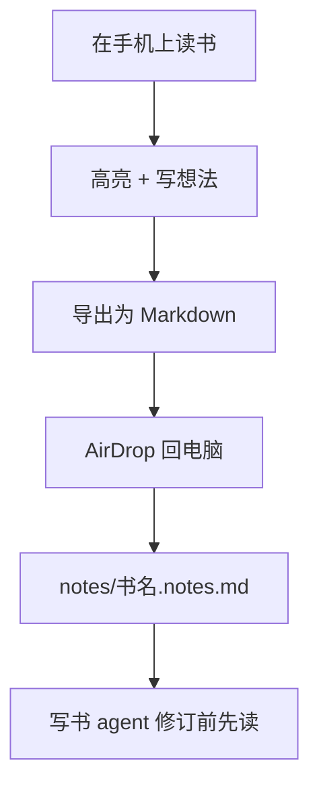
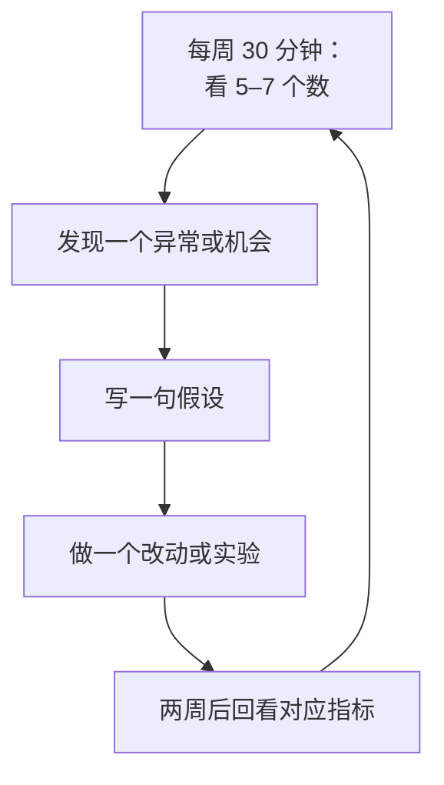
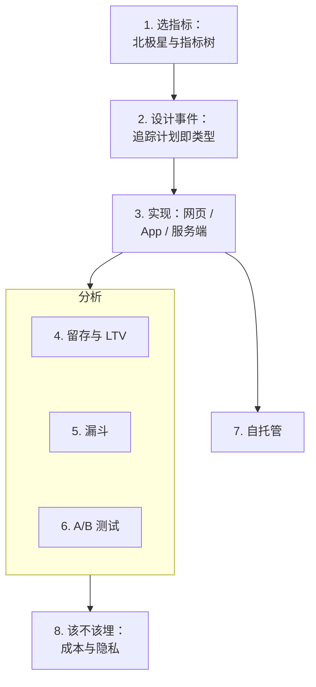

# 什么时候不该埋点

前七章讲的都是怎么埋点、怎么分析。最后一章反过来问：**什么时候不该埋**？埋点不是免费的：它要花开发时间，增加包体和请求，带来隐私责任，消耗用户的信任，还消耗你自己的注意力。这一章先算清楚埋点的成本，再用仓库所有者自己的 hatch-shelf 作为「完全不埋点」的正面反例，然后简要说说隐私合规，最后给出一人公司的数据工作节奏。

## 埋点的成本

| 成本 | 具体表现 |
|---|---|
| 开发与维护 | 追踪计划要维护，事件要验证，SDK 要升级，自托管服务要运维 |
| 性能 | 前端多一个脚本、多一批网络请求；App 多几个原生依赖、包体变大 |
| 隐私责任 | 收集了数据就要负责保管、限制访问、按期删除，还要在隐私政策里如实写明 |
| 用户信任 | 一部分用户在意自己被追踪，尤其是开发者和注重隐私的用户群 |
| 注意力 | 有了仪表盘就会想看，看了不一定会行动，反而占用做产品的时间 |

所以埋点的判断标准和第 1 章选指标是同一个：**这份数据会让我做出什么不同的决定？** 如果答案是「不会」，就别收集。

## 反例：hatch-shelf 为什么一个点都不埋

hatch-shelf 是这套书运行的那个 App：一个 iOS 离线 Markdown 书架。它在设计上就决定了**不接任何上报**：

- 设计文档的非目标里写着「App 不联网」：不做云同步、不做账号、不做热更新。除了传书页面的局域网 HTTP 服务，不发起任何网络请求
- WebView 阅读器打包成单个 HTML，带一条**禁止网络请求的 CSP**：只允许本地文件和内联资源。即使将来有人误加了一个统计脚本，它也发不出去
- 书里禁止远程图片，同样是为了离线和不联网

这不是偷懒，而是每一条「不该埋点」的理由它都占了：

| 判断条件 | hatch-shelf 的情况 |
|---|---|
| 用户少到可以直接问 | 只有一个用户：作者本人 |
| 没有要回答的问题 | 自用工具，没有增长、转化、收入要优化 |
| 产品承诺与追踪冲突 | 「离线、不联网」本身就是产品特性 |
| 数据无法支撑行动 | 一个人的使用数据没有统计意义 |
| 有更好的反馈渠道 | 见下文 |

### 不埋点，反馈从哪来

hatch-shelf 并不是没有反馈，它的反馈渠道是**读者主动导出的笔记**：



对比一下埋点能得到什么：「第 4 章平均停留 6 分钟，32% 的人没读完」。而一条笔记是：「这里的公式没解释符号含义，看不懂」。后者直接告诉你该改什么。

这条反馈链有三个埋点做不到的特点：**用户主动给出**（不涉及同意问题）、**带着原因**（不只是行为）、**完全在本地**（数据从不离开用户的设备，除非用户自己导出）。

当用户数量少到你可以认识每一个人时，**直接的定性反馈胜过任何埋点**。这条结论对很多早期的一人公司产品都成立。

## 其他不该（或不急着）埋点的情况

**产品还没上线或只有几十个用户**。这时每个用户你都可以发消息问。等用户多到你记不住每个人的名字，再上埋点。

**你已经有业务数据库**。很多关键指标根本不需要埋点 SDK。以掌柜眼为例，北极星指标「每周至少导入一次收银报表的门店数」就是对自己业务表的一条 SQL：

```sql
select date_trunc('week', created_at)::date as week,
       count(distinct store_id)            as active_stores
from report_imports            -- 业务本身就要存的导入记录
where created_at >= now() - interval '12 weeks'
group by 1
order by 1;
```

付费、续费、退款，也都在你自己的订单表里。**先把业务表用起来，埋点只补业务表里没有的行为数据**（看了哪个页面、在哪一步放弃）。

**服务端日志已经够用**。只想知道官网每天多少访问、从哪来，nginx 的访问日志就有。用日志分析工具汇总一下，不用在页面里加任何脚本。

**敏感领域**。健康、金融、未成年人、个人隐私类工具。用户对这类产品的信任门槛很高，法规要求也更严。默认不埋，确实需要时只收集最少的、匿名的、聚合的数据。

**你不会去看**。如果你知道自己三个月都不会打开分析后台，就先别接。没人看的数据只有成本。

## 隐私合规：一笔带过

在国内运营产品，处理用户个人信息要遵守《个人信息保护法》及相关规定；App 上架还会被要求提供隐私政策、列出接入的第三方 SDK。和埋点直接相关的几个原则：

- **告知与同意**：收集前要告知收集什么、用来干什么，需要同意的场景要先取得同意。第 3 章「用户同意前不采集」就是为此
- **最小必要**：只收集实现目的所必需的数据。第 2 章「属性里不放手机号、自由文本」就是这个原则的落地
- **敏感个人信息**：精确位置、生物特征、金融账户等要求更严格，埋点里不应出现
- **出境**：使用境外的分析服务，用户数据就可能出境，有专门的合规要求。这是自托管或选择境内服务的一个重要理由

具体条款、认定标准和流程会更新，**以最新的法律法规和主管部门规定为准**。完整的合规框架、隐私政策怎么写、App 备案与上架要求，见[《国内合规实务》](../opc-compliance-cn/)；面向海外用户时还有 GDPR 等要求，见[《出海实务》](../going-global/)。

### 技术上能做的最小化

无论适用哪种法规，下面这些做法都值得默认打开：

| 做法 | 怎么做 |
|---|---|
| 不收集个人信息 | 用户 ID 用内部不可变 ID；属性里不放手机号、姓名、地址、自由文本 |
| 会话录像遮罩 | 开启录像时遮罩所有输入框，必要时遮罩全部文字；涉及账务、证件的页面不录 |
| IP 处理 | 只用于粗粒度地理位置，不长期保存原始 IP（Umami 的做法即是如此，PostHog 也可配置丢弃 IP） |
| 数据保留期 | 在分析工具里设置事件和录像的保留期限，过期自动删除 |
| 同意可撤回 | 设置页提供关闭统计的开关，撤回后立即停止上报 |
| 访问控制 | 分析后台不对外公开，账号开两步验证 |

## 一人公司的数据节奏

数据工作最怕的不是没有数据，而是有了数据不行动。建议的节奏：



一份每周复盘可以只有这几行：

```text
第 45 周
北极星（每周活跃导入门店）：38 → 41
新门店激活率（3 天内首次导入）：52%（上周 47%）
异常：Android 端导入失败率 12%，集中在 xlsx
本周动作：修 xlsx 解析；激活邮件改为开户次日发送
待验证：上周改的引导流程，两周后看第 2 周留存
```

关键是最后两行：**每次看数据都要落到一个动作或一个待验证的假设**。连续几周写不出动作，说明你看的指标不对，回到第 1 章重新选。

## 全书回顾



## 本章要点

- 埋点有开发、性能、隐私、信任和注意力五种成本；**不会改变决定的数据不要收集**
- hatch-shelf 是「完全不埋点」的正确示范：用户只有一个、产品承诺离线、CSP 禁止网络请求，反馈来自**用户主动导出的笔记**
- 用户少时直接问；**先用业务数据库和服务端日志**，埋点只补行为数据
- 合规上记住告知同意、最小必要、敏感信息和数据出境，细节见《国内合规实务》
- 技术上默认做最小化：不收个人信息、录像遮罩、设保留期、同意可撤回
- 每周 30 分钟看数，**每次都落到一个动作或假设**

## 接下来读什么

这本书是导读中第四批「OPC 商业」的最后一本。数据告诉你问题在哪，解决问题还要靠其他几本：用户来得少，回头看[《获客与增长》](../growth-marketing/)和[《文案与内容》](../copywriting-content/)；付费转化低，看[《定价与商业模式》](../pricing-monetization/)；合规细节在《国内合规实务》。服务端的性能和错误监控是另一类数据，在[《可观测性与性能》](../observability-performance/)里。最后，读[《用 AI 撑起一人公司》](../ai-native-opc/)，把整套书串起来，看一个人怎么借助 AI 把研发、运营、数据这些事都撑起来。
