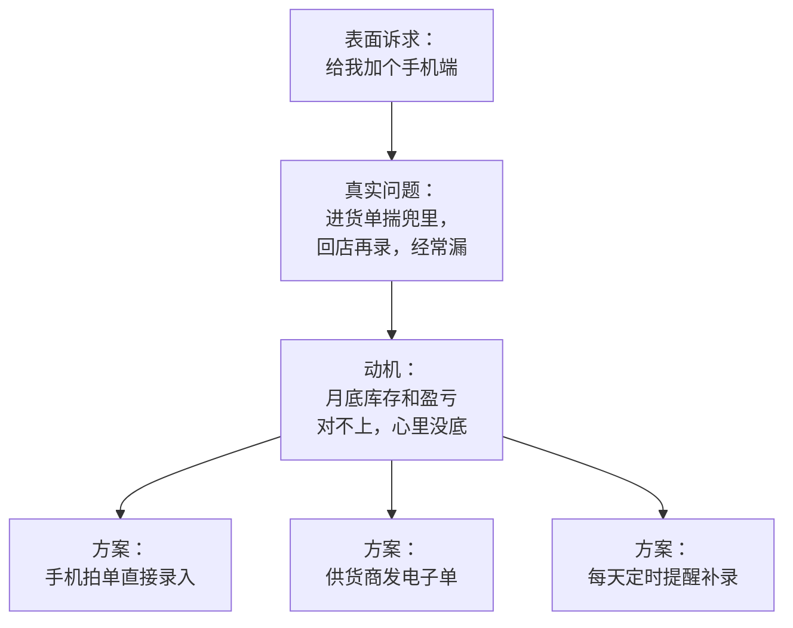

# 需求从哪来

这本书讲的是**做什么、不做什么、先做什么**。技术人写代码的能力已经够用，有了 Claude Code 这类编码 agent 之后更是如此：一个想法从描述到能跑，常常只要一两天。瓶颈于是从「做得出来吗」移到了「这东西该不该做、该做成什么样」。产品思维就是回答后一个问题的一套习惯。

## 这本书讲什么、适合谁、怎么读

**适合谁**：已经能独立把产品做出来的开发者，正在做或准备做一人公司，却经常遇到这些情况：

- 用户说想要一个功能，做完他没怎么用
- 手上的待办永远做不完，不知道先做哪个
- 产品越做越大，自己都说不清它到底是干什么的
- 交给 agent 写的功能「能跑」，但和想要的总差一点

**讲什么**：

| 章 | 回答的问题 |
|---|---|
| 1 需求从哪来 | 需求有哪些来源，怎么分辨真需求，怎么收集起来不丢 |
| 2 用户访谈 | 怎么约人、怎么问、怎么整理，才能听到真话 |
| 3 问题与方案分开 | 为什么先把问题说清楚，怎么从一个问题发散出多个方案 |
| 4 MVP 的边界 | 第一版做多少，哪些可以手工顶上，哪些底线不能省 |
| 5 优先级取舍 | 待办很多时怎么排序，怎么对用户说不 |
| 6 把需求写下来 | 一页需求和页面规格怎么写，怎么交给 agent |
| 7 路线图 | 怎么规划接下来几个月，又不被计划绑死 |
| 8 从反馈到迭代 | 上线后的反馈怎么变成下一轮改进 |
| 9 需求验证与 PMF 判断 | 落地页、预售、问卷和留存，怎么判断这个方向真的有人要 |

**和[《一人公司方法论》](../opc-playbook/)的分工**：那本书讲「选哪个方向」和「方向值不值得做」的快速验证。本书假设方向已经大致定了，讲的是在这个方向里，**一个个具体功能怎么想清楚**。两本书有交集的地方（比如访谈），本书讲得更细。

**怎么读**：按顺序读一遍，大约是一个产品从想法到迭代的顺序。之后遇到具体问题再回来翻对应章节，第 2、5、6 章的模板可以直接复制使用。

全书的案例主要来自作者自己的两个项目：

- **hatch-counter**（产品名「掌柜眼」）：给中小餐饮门店用的经营管理工具，导入收银报表算销量、拍进货单管库存、记开支算盈亏。它的仓库里有一套完整的需求与页面规格文档，是本书第 4、6、7 章的主要素材
- **hatch-shelf**：自用的 iOS 离线 Markdown 书架，你正在读的这本书就在它上面

## 需求到底是什么

「需求」这个词被用得很乱。用户说「加个导出 Excel 的按钮」，这是需求吗？严格来说不是，这是一个**方案**。需求是方案背后的东西：

> 一个**具体的人**，在一个**具体的场景**下，想做成**某件事**，但现在做起来**有困难**。

四个要素缺一个，都还不算想清楚：

| 要素 | 问自己 | 例子 |
|---|---|---|
| 谁 | 是哪一类用户？不是「所有人」 | 一家到几家店的小餐馆店主 |
| 场景 | 在什么时间、地点、状态下 | 月底要把工资明细发给代账会计 |
| 想做成什么 | 他的目标，不是你的功能 | 让会计拿到能直接算账的数据 |
| 困难 | 现在卡在哪里，代价多大 | 只能截图发过去，会计还要再敲一遍 |

hatch-counter 的路线图里有一条「工资单导出 Excel」，后面跟着一句理由：「店主要发给会计的话，现在只能截图」。这一句就把人、场景、困难都交代了。一条需求能不能写出这样一句话，是检验你有没有理解它的最快办法。

### 表面诉求、真实问题、动机

用户嘴里说出来的，通常只是最表面的一层：



越往下挖，可选的方案越多。只停在第一层，你就只有用户替你想好的那一个方案，而用户并不是设计产品的专家。第 3 章会专门讲怎么把问题和方案分开。

hatch-counter 的移动端确实做了「拍单补仓」，但它的规格文档开头写的不是「做一个拍照功能」，而是这件事要解决的问题：

> 收的单子揣兜里带回去再拍，补晚了会记错、忘了就漏了。

先有这句话，后面「拍完立刻认」「认不出的交给人定」「没交上去的照片留在手机上」这些设计才有了依据。

## 需求的几个来源

需求不会自己排着队送上门。常见的来源有下面这些，可靠程度差别很大：

| 来源 | 怎么获得 | 优点 | 要小心 |
|---|---|---|---|
| 自己的痛 | 自己就是用户，天天用 | 理解深，验证快 | 你可能是少数派；技术人的痛不一定是大众的痛 |
| 用户主动反馈 | 客服、群、评论区 | 来自真实使用 | 只代表会说话的那部分人；说的多是方案 |
| 观察使用过程 | 坐在用户旁边看他操作 | 能看到他自己没意识到的问题 | 成本高，样本少 |
| 用户访谈 | 约人聊一小时 | 能挖到背景和动机 | 问法不对就只能听到客套话（见第 2 章） |
| 使用数据 | 埋点、日志、数据库 | 客观，覆盖所有人 | 只能告诉你「发生了什么」，不能告诉你「为什么」 |
| 竞品和替代品 | 看它们在加什么、用户在骂什么 | 便宜 | 容易变成抄功能，而不是理解问题 |
| 环境变化 | 新技术、新法规、平台政策 | 可能出现全新的需求 | 容易为了用新技术而硬造需求 |

几点经验：

- **自己的痛是最好的起点，但不能是唯一来源**。hatch-shelf 完全是自用工具，作者既是开发者也是唯一用户，所以它可以只服务一个人的习惯；一旦要卖给别人，就必须走出去问
- **用户的抱怨要翻译**。抱怨里的方案可以先放一边，抱怨里的场景和情绪才是金子
- **数据和访谈互补**。数据告诉你「七成的人在第二步离开」，访谈告诉你「因为第二步要先去电脑上建档，手机上做不了」

### 最值钱的信号：变通办法

如果只能记住一条，记住这条：**用户已经在用笨办法应付的问题，最可能是真需求**。

变通办法（workaround）有很多种样子：

- 一张自己做的 Excel 表，每天手动更新
- 一个专门用来记账的微信群，自己给自己发消息
- 贴在冰箱上的纸条、写在白板上的清单
- 截图之后发给另一个人，对方再手敲一遍
- 花钱请人做一件重复的事

变通办法说明三件事：问题真实存在；用户在意到愿意花时间；现有工具没解决好。它比「如果有这个功能我一定用」可靠得多，因为前者是已经发生的行为，后者只是对未来的预测。

| 信号 | 强度 | 说明 |
|---|---|---|
| 「这个想法不错」「我会用的」 | 弱 | 礼貌性的肯定，几乎没有信息量 |
| 主动描述了最近一次遇到这个问题的经过 | 中 | 至少说明问题真实发生过 |
| 已经有变通办法，并且在持续使用 | 强 | 说明他在意，而且现有方案不够好 |
| 已经为此花钱（买工具、雇人、外包） | 很强 | 付费意愿有了现成证据 |
| 主动追问什么时候能用、能不能先试 | 很强 | 他在投入自己的时间和信誉 |

## 把需求收集起来

一个人做产品，最常见的问题不是需求太少，而是需求散落在微信、邮件、脑子里，过两周就忘了谁说过什么。需要一个**需求池**：所有想法、反馈、请求都先进这里，之后再统一整理和排序。

需求池不需要专门的工具。放在仓库里的一个 Markdown 文件、或者一个目录一条一个文件，就足够了，好处是 agent 能直接读写，能进 git 历史。

推荐每条记录这几样（下面是一条虚构的示意，「蓉香小馆」是 hatch-counter 体验数据里的示例店名）：

```markdown
## 工资单导出给会计

- 来源：蓉香小馆店主，2026-10-20 微信
- 原话：「月底工资要给会计，我现在都是截图发过去」
- 场景：月底结完工资，要把明细交给代账会计
- 现在怎么办：工资页截图，会计手敲进他自己的表
- 提过的人：3（10-20 蓉香、10-24 另一家、10-29 另一家）
- 初步判断：真问题；方案未定（导出 Excel？直接给会计开只读权限？）
- 状态：待排期
```

几个要点：

- **原话一字不改地记下来**。你的概括会不自觉地带上自己想要的方案，原话留着，之后可以回头重新理解
- **「提过的人」要计数**。同一件事被三个不相干的人提到，和被一个人提三次，意义完全不同
- **方案写成「未定」**。收集阶段只记问题，别急着承诺做法
- **定期合并**。每周花十几分钟把重复的条目合并、计数加一

### 让 agent 帮你整理

需求池积累多了之后，可以让 Claude Code 这类 agent 帮忙做体力活：

```text
读 docs/需求池/ 下所有文件。
1. 把描述同一个问题的条目归成一组，列出每组包含哪些文件、提过的人数合计
2. 每组用一句话写出「谁、在什么场景、想做成什么、卡在哪」
3. 标出只有方案、没写清问题的条目，我需要回头去问
不要提出解决方案，不要修改任何文件。
```

注意最后一句。agent 很乐于给方案，而这个阶段你要的是把问题理清楚。归组的结果要自己过一遍：agent 可能把表面相似、实际场景不同的两件事合成一组。

## 不是所有需求都要接

收集需求和接受需求是两回事。进了需求池，只表示「我知道有这件事」，不表示「我会做」。下面几类可以直接标记为不做，或者先放着：

- **不在目标用户里的人提的**：做餐饮门店工具，却收到个人记账用户的请求
- **和产品定位冲突的**：hatch-shelf 的非目标里写着「手机端只读，内容的生产在电脑端」，那么「在手机上编辑 Markdown」的请求就不接
- **只有一个人提、而且他没有变通办法的**：可能只是随口一说
- **一次性的**：只发生一次的事，手工帮他处理一下比写代码划算

第 5 章会讲怎么在要做的需求里排先后，这里只需要建立一个习惯：**收下每一条反馈，但不急着承诺任何一条**。

## 本章要点

- 需求是「谁、在什么场景、想做成什么、卡在哪」，用户说出来的往往是方案而不是需求
- 表面诉求下面还有真实问题和动机，挖得越深，可选的方案越多
- 需求来源各有偏差：自己的痛、用户反馈、观察、访谈、数据、竞品要互相印证
- 最可靠的信号是用户已经在用的变通办法，以及已经为此花的钱和时间
- 建一个需求池，原话照录、计数、方案留空、定期合并；agent 可以帮你归组，但结论要自己核
- 收下每一条反馈，不急着承诺任何一条
