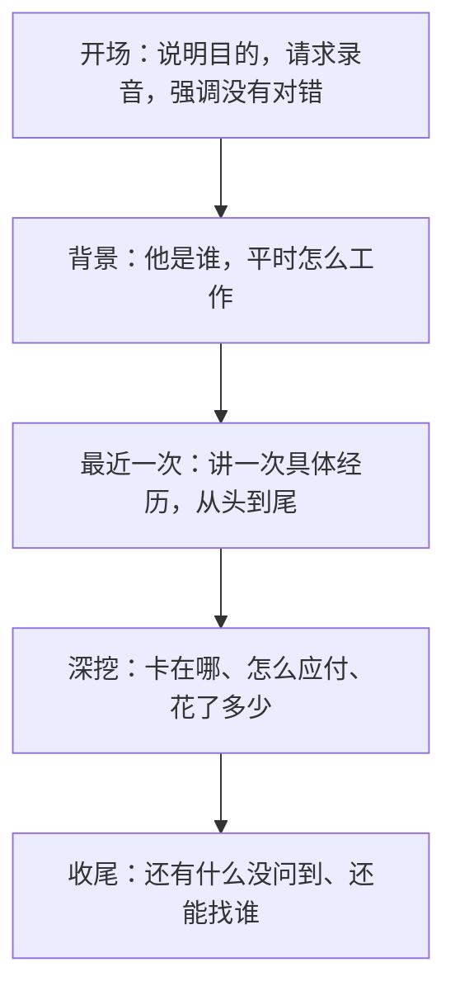
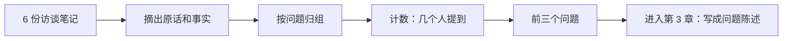

# 用户访谈

上一章说过，访谈是挖到「真实问题」和「动机」的主要手段。但访谈也是最容易做砸的：问法稍有不对，对方就会给你礼貌的、好听的、毫无用处的回答，而你还会觉得聊得很顺利。这一章讲怎么找人、怎么问、怎么记、怎么整理，让一小时的谈话真正产出信息。

[《一人公司方法论》](../opc-playbook/)讲过访谈在验证方向时的用法和核心原则「问过去，不问将来」。这里把它展开成一套可以照着做的流程。

## 为什么是访谈，不是问卷

技术人天然偏爱问卷：可以发给很多人，结果是整齐的数字。但在弄清问题阶段，问卷几乎没用：

| | 问卷 | 访谈 |
|---|---|---|
| 能回答 | 「有多少人」 | 「为什么」「怎么回事」 |
| 前提 | 你已经知道该问什么、选项有哪些 | 你还不知道自己不知道什么 |
| 追问 | 不能 | 可以顺着一句话挖下去 |
| 样本 | 越多越好 | 5 到 10 人往往就能看出规律 |
| 适合阶段 | 问题清楚以后，量化它 | 问题还模糊的时候 |

顺序是：**先访谈弄清有哪些问题，再用问卷或数据看每个问题有多普遍**。反过来做，问卷的选项只能是你自己想象出来的，答案也就跳不出你的想象。

## 找谁

### 找对的人

访谈对象要尽量接近你的目标用户，而且**最近真的遇到过这个问题**。几条筛选标准：

- **正在经历，而不是曾经经历过**：三年前开过店的人，记忆已经被美化或模糊了
- **是决策者或直接使用者**：做门店工具，店主和店长比店主的亲戚更合适
- **不是你的亲友**：亲友出于感情会说好听的，而且他们往往不在目标人群里
- **有变通办法的人优先**：他们对问题的感受最具体

### 找几个、去哪找

一个主题访谈 5 到 10 人，通常就会开始听到重复的说法。听到第三个人用几乎一样的话描述同一个麻烦时，这个问题基本可以确认；连续几个人都没提到你预想的那个问题，也是一个重要信号。

去哪找，取决于目标用户平时在哪里：

- 已有用户：直接在产品里、群里约，最容易
- 行业社群、论坛、垂直的微信群：先当一段时间成员，再开口
- 熟人转介绍：每次访谈结束时问「还有谁也遇到类似的事？」，一个人能带出下一个
- 线下：门店、展会、行业活动。对餐饮这类不常在线上的人群，线下几乎是唯一的路

### 约人的话术

邀请要短，说清楚三件事：你是谁、想聊什么、要占用多久。**不要提你要做的产品**，否则对方会进入「评价产品」模式。

```text
您好，我是做门店经营工具的独立开发者 X。
最近在了解小餐馆老板平时是怎么管进货和库存的，想请您聊 30 分钟，
主要听听您店里现在是怎么做的、哪里比较麻烦。不推销任何东西。
您这周哪天方便？电话或者我去店里都可以。
```

可以准备一点小心意（一杯咖啡、一个小红包），但不要让报酬成为对方答应的主要原因，否则来的会是为了报酬的人。

## 访谈的结构

一次 30 到 60 分钟的访谈，大致按这个顺序走：



时间大部分应该花在「最近一次」和「深挖」上。

### 开场

```text
谢谢您抽时间。今天主要是想听您讲讲店里的实际情况，
我不是来推销的，您说的没有对错，越具体越好。
我想录个音方便回头整理，只有我自己听，可以吗？
```

录音一定要先征得同意，对方拒绝就手记。不要偷偷录。

### 背景

几个轻松的问题，让对方进入状态，同时帮你理解后面的回答：

- 店开了多久、几个人、一天大概多少单
- 您自己平时主要管哪些事
- 现在店里在用哪些软件、工具

### 最近一次：访谈的核心

请对方讲**一次具体的、最近发生的**经历，而不是「一般来说」：

```text
您能讲讲上一次进货是怎么进的吗？从决定要进货那一刻开始。
```

然后跟着他的叙述往下走，像看一部慢镜头：

- 「然后呢？」
- 「那时候您在哪？手上在干什么？」
- 「这一步用的是什么？纸、手机、还是电脑？」
- 「这张单子后来去哪了？」

人在讲具体经历时，会自然地说出很多他自己不觉得是问题的问题。「单子我一般先揣兜里，晚上回去再录，有时候洗衣服才发现」这句话，你直接问「进货有什么麻烦」是问不出来的。

### 深挖

听到一个可能的麻烦时，往下追：

| 追问 | 目的 |
|---|---|
| 「这种情况多久发生一次？」 | 频率 |
| 「上次发生时，后来怎么办的？」 | 变通办法 |
| 「这件事花了您多少时间 / 钱？」 | 代价 |
| 「如果不管它，会怎样？」 | 严重程度 |
| 「您试过别的办法吗？为什么没继续用？」 | 现有方案哪里不够 |
| 「能给我看看那张表 / 那个群吗？」 | 用实物核对说法 |

最后一个特别有用。对方说「我都是用 Excel 记的」，请他打开给你看，你会看到列名、颜色标记、手写的备注，这些都是他真实的需求结构。

### 收尾

```text
关于这件事，还有什么我没问到、但您觉得重要的？
您身边还有谁也在为这个头疼，方便介绍我认识吗？
后面我做出东西来，能再找您看看吗？
```

最后一个问题是在争取「承诺」，后面会讲为什么它重要。

## 问法：好问题和坏问题

访谈里最常见的错误，是问出让对方无法说真话的问题。

| 坏问题 | 毛病 | 改成 |
|---|---|---|
| 「你会用一个拍照录进货单的 App 吗？」 | 假设性问题，人对未来的预测很不准 | 「上次进货单是怎么录的？」 |
| 「进货单录入是不是很麻烦？」 | 引导性问题，答案已经在问题里 | 「进货单收到之后，一般怎么处理？」 |
| 「你愿意每月花多少钱？」 | 问未来的付费意愿，答案没有约束力 | 「现在在这件事上花了哪些钱？」 |
| 「你觉得我这个想法怎么样？」 | 请对方评价你，只会听到客气话 | 不问，换成问他自己的经历 |
| 「你希望有哪些功能？」 | 让用户设计产品 | 「哪一步最费时间？为什么？」 |
| 「为什么你不用 XX 软件？」 | 带指责意味，对方会防御 | 「之前试过哪些工具？后来怎么样了？」 |

这些原则有一本专门的小书讲得很透彻：Rob Fitzpatrick 的 *The Mom Test*。书名的意思是：好的问题，连你妈妈都没法用善意的谎言来回答你。

### 听出三种「假数据」

访谈中要时刻分辨对方说的是哪一类：

- **赞美**：「这个好，我肯定用」。礼貌，不是数据。听到时把话题拉回他的经历
- **泛泛而谈**：「我一般……」「我总是……」「我会……」。这是他对自己的印象，不是事实。追问「上一次是什么时候？」
- **想法和功能请求**：「要是能自动对账就好了」。不要当场记成待办，追问「自动对账能帮您解决什么？上次对账遇到了什么？」

能用的是**事实**：发生过的事、具体的数字、看得见的东西、已经花的钱和时间。

### 看「承诺」，不看「喜欢」

访谈结束时，对方愿意付出什么，比他说了什么更有分量：

| 承诺类型 | 例子 |
|---|---|
| 时间 | 愿意再约一次、愿意试用并反馈 |
| 信誉 | 愿意把你介绍给同行、老板、朋友 |
| 金钱 | 愿意预付、愿意签意向 |

一次访谈下来，对方什么都不愿意给，往往说明这个问题对他没那么痛。

## 技巧和心态

- **少说话**。理想状态下对方说八成，你说两成。忍不住想解释、想讲你的方案时，咬住
- **接受沉默**。对方停下来时，别急着问下一个问题，等几秒钟，他常常会补充最有价值的那句
- **复述确认**。「我理解的是，您每次都是晚上回去才录，所以有时会漏，对吗？」让对方纠正你
- **不当场辩解**。对方说你预想的问题不存在，记下来，这正是你要的信息
- **一次一个人**。群访时大家会互相附和，最能说的人主导了结论
- **去现场看**。能去用户工作的地方就去：在后厨站一个小时，比电话聊一小时看到的多得多。hatch-counter 的规格里写着用户「站在后厨、冷库门口、菜市场里，一只手拿着东西，一只手点」「信号时有时无、手上脏或戴着手套」，这类描述只有到过现场才写得出来，而它直接决定了「按钮大、一屏一件事」这样的设计

## 记录

访谈刚结束的半小时内，趁记忆最清楚，把笔记整理成固定格式。推荐的模板（内容是虚构的示意）：

```markdown
# 访谈 2026-10-24 · 某家川菜馆店主

## 背景
- 开店 4 年，后厨 3 人，前厅 2 人
- 收银用的是某收银系统，进货和开支记在 Excel

## 原话摘录
- 「单子我一般揣兜里，晚上回去再录，有时候洗衣服才发现」
- 「月底一盘，库存跟表上差一截，也不知道差在哪」

## 观察到的事实
- Excel 有 6 列：日期、供货商、品名、数量、单价、备注
- 备注栏里大量「待补」「价格没写」

## 变通办法
- 拍照存手机相册，月底集中录（但经常忘了拍）

## 痛点（我的判断）
- 进货单录入延迟导致漏录，频率：约每周 1 到 2 次
- 盘点差异找不到原因

## 承诺
- 同意下个月再聊一次；介绍了隔壁一家烧烤店

## 意外发现
- 他并不在乎精确到克，在乎的是「大概还够用几天」
```

「意外发现」这一栏最重要。访谈如果只印证了你原来的想法，没有任何意外，要么你很幸运，要么你一直在引导对方。

### 用 agent 整理录音

如果有录音转写的文字稿，可以让 agent 帮你做初步整理。**先脱敏**：把人名、店名、电话、地址换成代号，再交给任何在线模型。

```text
下面是一次用户访谈的转写稿，受访者是小餐馆店主。
请按这个结构整理，只摘录受访者原话和他陈述的事实，不要加入你的推测：
1. 他描述的具体经历（按时间顺序）
2. 他提到的变通办法
3. 他提到的时间、金钱代价（原话）
4. 我在访谈中问出的引导性问题（帮我改进问法）

<转写稿>
...
</转写稿>
```

第 4 点很有用：让 agent 挑你的毛病，比让它总结结论更有价值。结论还是要你自己下，因为 agent 没有坐在现场，听不到语气和犹豫。

## 从多次访谈到结论

做完五六次之后，把所有笔记里的「原话」和「事实」摊开，做一次归纳：

1. **把每条原话写成一张卡片**（一行一条也行）
2. **把说同一件事的卡片归成一组**，给每组起一个用户视角的名字，比如「单子收到后来不及录」
3. **数一数每组有几个人提到**，而不是几张卡片
4. **按「几个人提到 × 痛的程度」排出前三个问题**



归出来的问题，会进入下一章：把它们写成清楚的问题陈述，再去想方案。

## 本章要点

- 访谈用来弄清「为什么」，问卷用来量化「有多少」，顺序是先访谈后问卷
- 找最近真的遇到过问题的目标用户，避开亲友，5 到 10 人通常能看出规律
- 访谈的核心是让对方讲「最近一次」的具体经历，再追问频率、变通办法和代价
- 不问假设性、引导性问题，不请对方评价你的想法
- 赞美、泛泛而谈、功能请求都是假数据；事实和承诺才算数
- 少说多听、接受沉默、能去现场就去现场
- 访谈后立刻按模板整理，重点记「意外发现」；录音稿脱敏后可以交给 agent 初步整理
