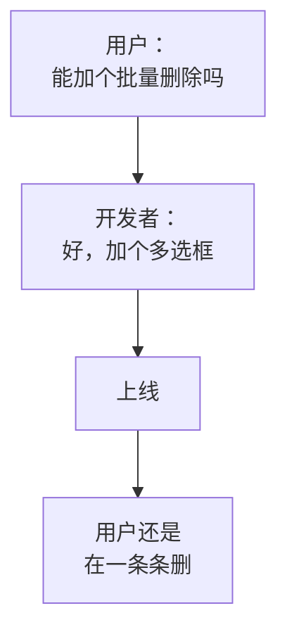
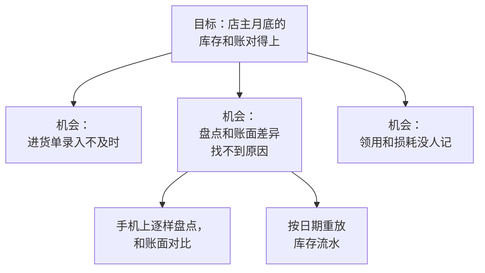
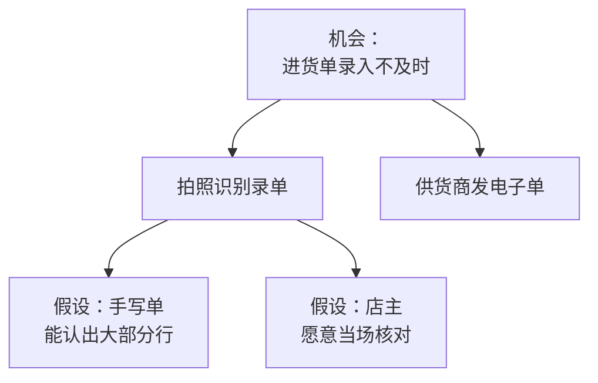

# 问题与方案分开

技术人看到一个问题，脑子里几乎同时就冒出了解法，甚至已经在想用哪个库。这是优势，也是陷阱：第一个想到的方案很少是最好的，而一旦开始写代码，就很难再回头怀疑它。这一章讲怎么刻意地把「问题是什么」和「怎么解决」分成两步，以及分开之后怎么得到更好的方案。

## 为什么要分开

先看一个常见的过程：



用户真正的问题是「导入时选错了文件，产生了一堆错误数据」。批量删除只是他能想到的补救办法。如果当初问一句为什么，更好的方案可能是「撤销整批导入」，甚至是「导入前先预览，确认了再写入」，那批错误数据根本不会产生。

把问题和方案混在一起，会带来几个后果：

- **只有一个方案可选**。方案是用户或你脑子里第一个冒出来的，没有比较
- **无法判断方案好坏**。没有写清楚的问题，就没有标准说一个方案「解决了」还是「没解决」
- **方案失败时不知道该改什么**。是问题理解错了，还是方案选错了？混在一起时分不清
- **交给 agent 也一样**。你给 Claude Code 一个方案，它会忠实地实现这个方案；你给它一个问题，它还能帮你想别的办法

## 写一份问题陈述

把问题写成一段固定结构的话，是分开两者最直接的办法。推荐的模板：

```text
【谁】一家到几家店的小餐馆店主
【场景】供货商早上送货，店主在后厨或门口收货，手上拿着纸质送货单
【想做成】把这批货记进库存和开支
【现在怎么做】单子揣兜里，晚上或月底回电脑前再录
【卡在哪】回去时已经忘了、单子丢了或洗烂了；补晚了数量记错
【代价】月底库存和盈亏对不上，找不到差在哪；店主对数字失去信任
【怎么算解决了】收到货当天、在收货的地方就能把单子录完
```

注意这段话里**没有出现任何功能**。没有「App」「拍照」「OCR」。最后一行「怎么算解决了」尤其重要，它是后面评价所有方案的标准。

几个检查点：

| 检查 | 不合格的写法 | 合格的写法 |
|---|---|---|
| 「谁」够具体吗 | 用户 | 一家到几家店的小餐馆店主 |
| 有没有偷偷带方案 | 店主需要一个手机录单功能 | 店主收货时离电脑很远 |
| 代价说清了吗 | 很不方便 | 每月一两次漏录，月底对不上 |
| 能判断解决了没有吗 | 体验更好 | 收货当天在现场录完 |

### 另一种写法：工作故事

还有一种常见的写法，来自「待办任务」（Jobs to Be Done）的思路，把用户看作是「雇佣」产品来完成一项任务：

```text
当【场景】时，我想要【动机】，以便【期望的结果】。

当我在门口收下供货商的送货单时，
我想要马上把这批货记下来，
以便月底库存和账对得上，不用再回忆这批货是哪天来的。
```

它比传统的「作为一个用户，我想要某个功能」好在：开头是场景而不是角色，中间是动机而不是功能。同一个角色在不同场景下需求完全不同：店主晚上坐在电脑前对账时，要的是宽表和筛选；早上站在门口收货时，要的是单手几下点完。

## 往下挖：问到什么时候停

「五个为什么」是常用的追问方法：对一个现象连续问为什么，直到碰到根本原因。用在产品上：

```text
店主想要批量删除销量记录。
  为什么？因为有一批记录是错的。
  为什么错？因为导入时选错了日期的报表。
  为什么会选错？因为文件名都是「营业汇总.xlsx」，只能靠下载时间区分。
  为什么只能靠下载时间？因为收银系统导出时不带日期。
```

到这里，可能的方案已经有了好几层：批量删除、撤销整批导入、导入时读出报表里的日期并提示、重复日期时提醒。

问到哪里停？两个标准：

- **再往下就超出你能影响的范围了**。「收银系统导出时不带日期」你改不了，就停在上一层
- **再往下就离开了产品，变成人生问题了**。「为什么要赚钱」不用问

## 一个问题，多个方案

问题写清楚之后，强迫自己**至少想出三个方案**，并且其中一个是「不写代码」的。

以前面的「收货时录单」为例：

| 方案 | 做法 | 成本 | 风险 |
|---|---|---|---|
| A 不写代码 | 让店主收货时拍照存相册，每天固定时间提醒他回电脑录 | 几乎为零 | 只是推迟问题，依赖自觉 |
| B 简单表单 | 手机上一个表单，逐行手填品名、数量、金额 | 低 | 单子十几行，站着填很痛苦 |
| C 拍照识别 | 拍送货单，用视觉模型认出每一行，人核对后录入 | 中，有模型调用成本 | 认错时要有兜底，手写单识别率不稳 |
| D 改变上游 | 让供货商直接发电子单或表格，导入即可 | 低，但要说服供货商 | 大多数小供货商做不到 |

拿最后一行「怎么算解决了：收到货当天、在收货的地方就能录完」逐个对照：A 不满足，B 勉强满足但没人愿意用，D 对部分供货商有效。hatch-counter 最终的做法是 C 为主、D 为辅：规格里写着「只发表格的那家灰着，表格回电脑上读」，也就是同时承认了 D 这条路的存在。

### 机会和方案的树

当问题不止一个时，可以把它们组织成一棵树：顶上是你想达成的结果，下面是几个「机会」（用户的问题或需求），每个机会下挂几个候选方案，每个方案下再挂要验证的假设。Teresa Torres 在《持续发现》（*Continuous Discovery Habits*）里把它叫作「机会-方案树」：



第一个机会「进货单录入不及时」再往下展开，是方案和方案背后的假设：



这棵树的好处是：看着它，你能随时回答「我为什么在做这个功能」，以及「如果这个方案不行，还有哪些备选」。

## 方案背后的假设

每个方案都建立在一些假设上。方案失败，通常是某个假设不成立。把它们列出来，找出**最危险的那个**（最不确定、一旦错了代价最大的），先去验证：

| 方案 C 的假设 | 有多不确定 | 错了的代价 | 怎么验证 |
|---|---|---|---|
| 视觉模型能认出手写送货单的大部分行 | 高 | 整个方案不成立 | 收集十几张真实单据，先用脚本跑一遍 |
| 店主愿意在现场花一两分钟核对 | 中 | 认错的行直接进库存 | 访谈中观察收货时的状态 |
| 模型调用成本在可接受范围 | 中 | 单位经济算不过来 | 按每天单据量估算 |
| 店主信任自动识别的结果 | 中 | 他会回去重新手录一遍 | 识别结果给他看原图对照，观察反应 |

第一个假设最危险，而且验证成本很低：不用写 App，写一个脚本、拿十几张真单子跑一遍就知道了。这就是「先测最危险的假设」。

## 两个案例

### 重复提交：同一个问题，两种方案

hatch-counter 的移动端在菜市场、冷库这类信号不好的地方用。问题陈述可以写成：

```text
【谁】在信号差的地方用手机记账的店主
【场景】点了「记一笔」，转圈很久，超时了
【现在怎么做】再点一次
【卡在哪】其实第一次已经到了服务端，只是回包丢了，于是记成两笔
【代价】账上多出一笔，店主很久以后才发现
【怎么算解决了】不管点几次、网多差，同一次提交只记一笔
```

第一个想到的方案通常是「按钮点了就变灰」。拿最后一行对照就会发现不够：它挡得住手抖连点，挡不住「请求到了服务端、回包丢在半路、用户重新进页面再点一次」。hatch-counter 的现行文档里正是这么写的：

> 「按钮点了就灰」只挡得住手抖，挡不住请求到了服务端、回包丢在半路。

最终方案是每次提交带一个请求号，同一次提交重试时沿用同一个号，服务端认得出来只记一笔。这个方案比「按钮变灰」复杂得多，但只有写清了「怎么算解决了」，才能说服自己这个复杂度是必要的。

### 门店到期：同一个事实，用户怎么理解

另一个例子：门店服务到期后怎么办？最直接的方案是到期就不让登录。但从用户的角度想：店主打开 App，看到「登录失败」，他的第一反应是「系统坏了」，然后打电话给你。

hatch-counter 的做法是到期照样能登录，在业务操作时才拦住，并且说清楚是到期了、数据都还在。它的总纲里有一条原则：「出了岔子先说『账还在』」。这里的问题不是「怎么阻止到期用户使用」，而是「怎么让到期的店主明白发生了什么、知道下一步做什么」。问题换个说法，方案就完全不同。

## 把问题交给 agent，而不是方案

用 Claude Code 写功能时，同样的道理也适用。对比两种说法：

```text
给记账页的提交按钮加一个 loading 状态，点击后禁用，请求完成后恢复。
```

```text
问题：店主在信号差的地方点「记一笔」，超时后再点一次，
服务端可能已经收到了第一次，结果记成两笔。
要求：不管重试几次，同一次提交只记一笔。
先读 apps/api 里现有的写接口是怎么做的，提出两到三个方案并比较，
等我选定后再动手。
```

第一种，agent 会很好地完成一个不解决问题的功能。第二种，它有机会发现服务端已有的幂等机制，或者提出你没想到的方案。**你写给 agent 的，应该是问题陈述加上「怎么算解决了」，而不是实现步骤**，至少在方案还没定的时候是这样。

## 本章要点

- 第一个想到的方案很少是最好的；问题和方案混在一起，就没有比较、没有标准
- 用固定模板写问题陈述：谁、场景、想做成什么、现在怎么做、卡在哪、代价、怎么算解决了
- 工作故事「当……我想要……以便……」把场景放在角色前面
- 用连续追问挖到根本原因，碰到自己影响不了的那一层就停
- 每个问题至少想三个方案，其中一个不写代码；用「怎么算解决了」逐个对照
- 列出方案背后的假设，先验证最不确定、代价最大的那个
- 交给 agent 时给问题和验收标准，而不是实现步骤
