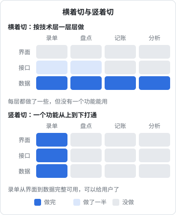

# MVP 的边界

问题想清楚、方案选好之后，下一个问题是：第一版做多少？做少了，用户用不起来，得不到有效反馈；做多了，几个月过去还没上线，而且做了一堆没人用的东西。这一章讲怎么给第一版（以及之后的每一版）划出清楚的边界，以及怎么守住它。

## MVP 是什么、不是什么

MVP 是 Minimum Viable Product 的缩写，通常译作「最小可行产品」。这个词被用得太多，以至于意思变得模糊。拆开看两个词：

- **最小**：为了学到你最想学的东西，所需要的最少的功能
- **可行**：用户真的能用它完成那件事，并且得到价值

很多人只记住了「最小」，做出来一个半成品：每个功能都有一点，但没有一件事能完整做完。用户试了一下发现用不起来，你得到的反馈是「不好用」，却分不清是问题不存在、方案不对，还是只是做得太粗糙。

| MVP 不是 | MVP 是 |
|---|---|
| 所有功能的简陋版本 | 少数功能的可用版本 |
| 一个不能用的原型 | 一个能让真实用户完成一件事的产品 |
| 「先上线再说」的借口 | 一个为了验证特定假设而设计的实验 |
| 一次性的 | 每一版都可以有自己的「最小可行」范围 |

一个检验办法：**说出这一版要验证的那一个假设**。比如「小餐馆店主愿意在收货现场花一两分钟拍单核对」。所有不服务于这个假设的功能，都可以往后放。

## 竖着切，不要横着切

划定范围最常见的错误，是按技术层横着切：先把数据库设计完，再写完所有接口，最后做界面。几个月下来，每一层都有，但没有一个功能能从头到尾跑通。

正确的切法是竖着切：选一两个功能，从界面到数据一路打通，让用户能真正用起来。



竖切的好处：

- **每一刀切完都能给用户用**，反馈来得早
- **能尽早暴露集成问题**：界面、接口、数据之间的对不上，在第一个功能里就会撞见
- **范围可以随时调整**：第二刀切哪个功能，可以根据第一刀的反馈再决定

## 找出核心路径

划边界的第一步，是画出用户从进门到拿到价值的**最短路径**。路径上的每一步都必须有，路径外的都可以先没有。

以 hatch-counter 的「拍单补仓」为例，核心路径是：


围绕这条路径，可以把想到的功能分成三类：

| 类别 | 判断标准 | 例子 |
|---|---|---|
| 必须有 | 缺了它，核心路径走不通 | 拍照、识别、核对、录入 |
| 必须有的兜底 | 缺了它，核心路径出错时用户会受损 | 认不出来时能手动改、能删一行、名字对不上时让人选 |
| 可以以后 | 让路径更顺，但没有也能走完 | 一周送货表、比价标签、看原图放大 |

第二类常常被忽略。「必须有的兜底」不是锦上添花，而是「可行」的那一半：识别一定会出错，没有改错的办法，用户就只能放弃整张单。

### 手工顶上

核心路径以外的很多环节，第一版可以由你手工完成，而不是写代码：

| 环节 | 写代码的版本 | 手工的版本 |
|---|---|---|
| 注册开户 | 自助注册、短信验证、实名 | 用户加你微信，你在后台建账号 |
| 收款续费 | 接入支付、订单、自动续期 | 线下转账，你在后台改到期日 |
| 数据初始化 | 导入向导、模板、校验 | 用户把 Excel 发给你，你帮他导 |
| 客服 | 工单系统 | 一个微信群 |

hatch-counter 就是这么做的：开户只能从管理后台来，登录页写的是「开户由我们代办」，收款是线下转账、财务在后台确认。在线付款续期一直在路线图上，但没有急着做。

手工的好处不只是省开发时间。每次手工开户，都是一次和用户直接说话的机会；你会知道他从哪里听说你、为什么想用、第一次用时卡在哪。等手工处理的量大到占用你太多时间了，再把它自动化，这时你也已经很清楚自动化应该长什么样。

《一人公司方法论》把「手工服务」当作一种验证手段；这里是同一个思路用在范围上：**能手工顶上的环节，就不进第一版的代码**。

## 不能省的底线

「最小」不等于什么都可以省。有些东西省了，损失的是用户的信任，而信任一旦丢了很难挽回。

| 可以省 | 不能省 |
|---|---|
| 设置项、个性化 | 数据正确：算错一次钱，用户就不再信任所有数字 |
| 多语言、多主题 | 不丢数据：用户辛苦录入的东西不能消失 |
| 漂亮的动画 | 能撤销或改错：尤其是涉及钱和库存的操作 |
| 批量操作、快捷键 | 隐私和安全：密码、令牌、用户数据的基本保护 |
| 完整的帮助文档 | 出错时说人话：告诉用户发生了什么、数据还在不在、下一步怎么办 |
| 覆盖所有边缘情况 | 不会让用户卡死在某个状态里出不来 |

hatch-counter 的移动端总纲里有几条原则，几乎都在右边这一列：

- 「交东西不怕重点、不怕断网」：每次提交带请求号，重试只记一笔；交不上去时填的、拍的都留着
- 「办完说清记到了哪儿，给撤销」：人在现场看不到电脑，只说「记好了」他会再记一遍
- 「取不到不清屏」：已有数据时，这回没取到只在顶上提示，旧数照摆

这些都不是「功能」，用户也不会因为它们而选择你的产品，但缺了它们，用户会因此离开。

## 写下「不做什么」

边界的另一半，是明确写出这一版**不做**什么。光说「做什么」，范围会悄悄长大；写下「不做什么」，才有东西可以守。

hatch-shelf 的设计文档第一节就是「目标与非目标」：

> 不做编辑器：手机端只读，内容的生产在电脑端

这一句挡掉了一整类需求。之后每当冒出「要是能在手机上改个错别字就好了」的念头，都可以回来看这一句：当初为什么决定不做？理由还成立吗？

写非目标时，最好附上理由，这样将来理由不成立时，你知道可以重新考虑：

```markdown
## 非目标（当前阶段）

- 不做云同步：App 不联网，没有服务端要维护。
  重新考虑的条件：有第二台设备要同步阅读进度
- 不上架 App Store：自用，用开发者账号自装即可。
  重新考虑的条件：打算给别人用
```

### 用规则划边界，而不是一条条判断

当同类的需求很多时，与其一条条讨论，不如定一条规则。hatch-counter 在决定「哪些事放上手机」时，用的就是三条判准：

> 事情发生在离电脑远的地方；一次一条、几下点完；错了看得见、撤得掉。三条都占的才放，不按网页端一页一页搬。

有了这条规则，「手机上能不能改配方」「能不能导入报表」就不用每次都讨论了：改配方不是现场的事，导入要对着整张表逐行核，都不满足，回电脑上做。规则也写清了原因：「这些不是现场的事，手机上办容易错、错了不好收拾」。

## 每一版都有完成标准

MVP 不只是第一版的事。之后每一个版本、每一个里程碑，都应该有清楚的「做到什么程度算完成」。

hatch-shelf 的里程碑表，每一行都有一列「完成标准」：

| 阶段 | 完成标准 |
|---|---|
| M1 阅读器 | 能完整阅读示例书，退出后再进入能恢复进度 |
| M2 导入管线 + AirDrop | AirDrop 一个 zip 后，书出现在书架上；同 id 再次导入为更新 |
| M4 CLI | 一条命令完成从写书到手机可读 |

好的完成标准有几个特点：

- **从用户能观察到的行为来写**，而不是「完成了某某模块」
- **能一句话判断对错**，不需要讨论
- **只写这一版必须达到的**，达到了就停，剩下的进下一版

## 守住边界

范围最容易在两种时候膨胀：做着做着觉得「顺手加一下」；用户说了一句「要是能……就好了」。

几个守边界的办法：

- **新想法先进需求池，不进当前版本**。第 1 章的需求池就是干这个的
- **问「它服务于这一版要验证的假设吗」**。不服务，就往后放
- **给推迟的事写上触发条件**。hatch-counter 的路线图里有一条「套餐单独一页分析」，后面写着「等真有套餐占了小半营收的店再做」；另一条「手机上改单条」写着「做不做看现场办事那几件的用量再定」。推迟不是拒绝，而是等一个明确的信号
- **警惕「agent 写起来很快」**。有了编码 agent，加一个功能可能只要半小时，于是门槛变得很低。但写代码从来不是主要成本：每多一个功能，就多一份要测试的路径、要回答的客服问题、要在下次改动时考虑的兼容性。第 5 章会细算这笔账

## 本章要点

- MVP 是为验证一个特定假设而做的、用户真能用起来的最小产品，不是所有功能的简陋版
- 竖着切：一两个功能从界面到数据打通，而不是按技术层横着做
- 画出核心路径，分成「必须有」「必须有的兜底」「可以以后」；兜底是「可行」的一半
- 开户、收款、初始化、客服这类环节，第一版能手工顶上就手工
- 可以省设置项、动画、多语言；不能省数据正确、不丢数据、能撤销、出错说人话
- 写下非目标并附理由和重新考虑的条件；同类需求多时用规则划边界
- 每个版本都要有从用户行为写的完成标准；推迟的事写上触发条件
