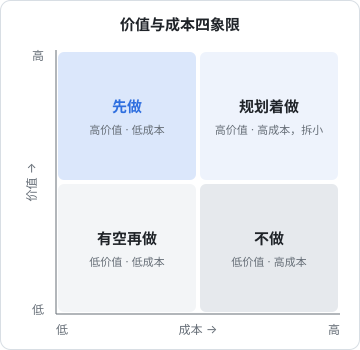
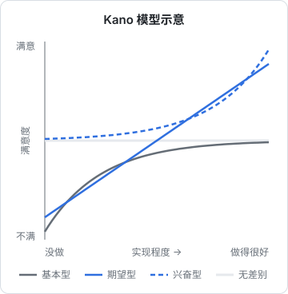

# 优先级取舍

需求池里的条目永远比你能做的多。一个人做产品，每选择做一件事，就意味着这段时间不做其他所有事。这一章讲几种排优先级的方法、它们各自适合什么情况，以及排序时最容易算错的那笔账：成本。最后讲怎么对用户说不。

## 一个人更需要排序

在公司里，排错了优先级，代价由团队分摊，还有其他人可能纠正你。一个人做时：

- **机会成本是全部**。你做 A 的这两周，B、C、D 全都停着
- **没有人会挑战你**。你喜欢做的、技术上有意思的事，很容易排到前面
- **注意力是最稀缺的资源**。同时推进五件事，每件都推不动

所以排序的目的不只是找出「最重要的」，更是**有理由地放下其他的**。

## 先分类，再排序

需求池里的东西性质不同，放在一起比较没有意义。先分成几类：

| 类别 | 例子 | 特点 |
|---|---|---|
| 线上问题 | 数据算错、页面崩溃、某个手机上打不开 | 影响现有用户的信任，通常插队 |
| 改进现有功能 | 核单时提醒「这张像是录过了」 | 用户已经在用，改进容易被感知 |
| 新功能 | 工资单导出、套餐分析 | 可能带来新用户或新价值，不确定性高 |
| 增长和收入 | 在线续费、官网申请试用 | 不直接服务现有用户，但决定能不能活下去 |
| 技术债和运维 | 加告警、备份、升级依赖 | 不做时没感觉，出事时很要命 |

一个实用的做法是给每类预留一个大致的时间比例，比如每周固定留一块时间给运维和技术债，剩下的再在其他几类里排。比例按产品阶段定：刚上线时线上问题多，比例要高；稳定以后可以多分给增长。这比把所有条目放在一起排更容易执行，也能避免技术债被永远排在最后。

## 价值和成本

最简单的排序工具是一张二维图：横轴是成本，纵轴是价值。



四个象限的处理方式：

- **先做**（高价值、低成本）：通常不多，找到了就马上做
- **规划着做**（高价值、高成本）：值得做，但要拆小，分几步走
- **有空再做**（低价值、低成本）：容易让人沉迷，因为做起来很爽；适合在状态不好时当作调剂，别占用整块时间
- **不做**（低价值、高成本）：明确划掉

这张图的难点不在于画，而在于诚实地估计每个点的位置。下面两种方法帮你把「价值」估得更有依据。

## RICE 打分

RICE 是一种打分公式，由 Intercom 的产品团队提出并推广。它把价值拆成三个因素，再除以成本：

$$
\text{RICE 分数} = \frac{\text{Reach} \times \text{Impact} \times \text{Confidence}}{\text{Effort}}
$$

| 因素 | 含义 | 怎么估 |
|---|---|---|
| Reach 覆盖 | 一段时间内（比如一个季度）会影响到多少用户或门店 | 用数据估，不要拍脑袋 |
| Impact 影响 | 对每个受影响的用户，影响有多大 | 常用一个档位：3 很大、2 大、1 中、0.5 小、0.25 很小 |
| Confidence 把握 | 你对上面两个估计有多大把握 | 100% 有数据、80% 有一些证据、50% 主要靠猜 |
| Effort 成本 | 要花多少时间 | 人周或人天，一人公司就是你自己的时间 |

下面用 hatch-counter 路线图上的几条做个演示。**数字都是为了演示而假设的**，不是真实数据：

| 条目 | R（店/季度） | I | C | E（周） | 分数 |
|---|---|---|---|---|---|
| 工资单导出 Excel | 20 | 1 | 80% | 0.5 | 32 |
| 网页端核单提醒「像是录过了」 | 40 | 1 | 50% | 1 | 20 |
| 在线付款续期 | 30 | 0.5 | 80% | 3 | 4 |
| 套餐单独一页分析 | 3 | 2 | 50% | 2 | 1.5 |

以第一行为例：$20 \times 1 \times 0.8 \div 0.5 = 32$。

RICE 的价值不在于那个分数精确，而在于**强迫你把直觉拆开**：

- 套餐分析听起来很有价值，拆开一看，真正有大量套餐的店很少，覆盖面小
- 「把握」这一项会惩罚靠猜的条目，逼你先去找证据
- 分数接近的条目，不用纠结，随便选一个；分数差很多的，才说明真有差别

### 一人公司版的简化

一个人用的时候，RICE 可以再简化。不必每条都算，只对排在前十的候选算一遍；Reach 和 Effort 尽量用数据（用户数、过去类似功能花的时间），Impact 和 Confidence 坦然承认是估计。比起精确，更重要的是**每季度用同一把尺子量一遍**，看看排序有没有变化。

## 用户怎么感知：Kano 模型

RICE 衡量的是「多大」，但不同类型的功能，用户的感受方式完全不同。日本学者狩野纪昭在 1980 年代提出的 Kano 模型，把功能按「做得好不好」和「用户满不满意」之间的关系分成几类：



| 类型 | 没有时 | 有了时 | hatch-counter 里的例子 |
|---|---|---|---|
| 基本型 | 非常不满 | 理所当然，不会加分 | 数据算对、提交不重复、断网不丢 |
| 期望型 | 不满 | 越好越满意 | 识别准确率、页面打开速度 |
| 兴奋型 | 不会不满，用户没想到 | 惊喜 | 拍完单后显示每样「原来多少、补进多少」 |
| 无差别 | 无所谓 | 无所谓 | 用户不关心的设置项 |

对排序的启示：

- **基本型必须先做到及格**，但做到及格之后，继续投入几乎没有回报。这就是上一章「不能省的底线」
- **期望型是主战场**，大部分迭代都在这里，适合用 RICE 排
- **兴奋型适合少量点缀**，它是用户口口相传的理由，但前提是基本型已经没问题。基本型有缺陷时做兴奋型，用户只会觉得你分不清轻重
- **类型会随时间变化**：今天的兴奋型，会随着竞品跟进变成明天的期望型

## 成本不只是写代码的时间

有了编码 agent 之后，「写代码要几天」这个估计越来越不准确，也越来越不重要。一个功能真正的成本，大部分发生在写完以后：

| 成本 | 说明 |
|---|---|
| 想清楚 | 问题陈述、方案比较、规格，这部分 agent 帮不了多少 |
| 写和测 | agent 大幅压缩了这一块 |
| 维护 | 每次改动别的地方，都要考虑它会不会被影响 |
| 客服 | 每个功能都会带来新的问题：「这个按钮是干什么的」「为什么这里显示的数和那里不一样」 |
| 复杂度 | 界面多一个入口，用户就多一分困惑；代码多一条路径，bug 就多一个藏身之处 |
| 撤不回 | 功能一旦有人在用，再删就很难了 |

hatch-counter 路线图里有一条「收口没带版本号的老客户端」：为了兼容老版本，服务端还留着七条老接口和几个老开关，要等老客户端的用户都升级了才能删。这就是「撤不回」的成本：一个功能上线时只花了几天，但它的影子会留很久。

所以估计 Effort 时，**把维护和客服的成本也算进去**。一个经验是：会被所有用户看到的功能、涉及钱和数据的功能，乘一个系数；只给少数人用的、可以随时关掉的，系数小一点。

## 几个实用的排序规则

除了打分，还有几个简单的规则在实践中很好用：

- **先修信任，再加功能**。数据算错、提交重复、页面崩溃，优先于任何新功能
- **先服务愿意付钱的人**。免费用户提的需求和付费用户提的，权重不同
- **多人独立提到的优先**。第 1 章需求池里的「提过的人」计数，在这里派上用场
- **能删就删**。排序时也看看有没有可以拿掉的功能；删掉一个没人用的功能，等于给所有其他功能减负
- **一次只推进一件大事**。规划着做的那一象限，同时只开一个

### MoSCoW：给一个版本定范围

当你要为某个版本或某个月划范围时，可以用 MoSCoW 把候选分成四档：

| 档 | 含义 |
|---|---|
| Must | 这一版没有它就不发布 |
| Should | 很重要，但没有它也能发布 |
| Could | 有时间就做 |
| Won't | 这一版明确不做（不是永远不做） |

关键是 Won't 那一档要写出来。它和上一章的「非目标」是一回事：写下来，才守得住。

## 怎么对用户说不

排序的结果，必然是对很多请求说「不」或者「不是现在」。说不本身不会失去用户，**说不的方式**才会。

几条原则：

- **先表示听懂了**。复述他的问题，而不是他的方案：「您是想月底把工资明细交给会计，不用再截图对吧」
- **说清现状和理由**，不要只说「不做」
- **给替代办法**，哪怕是手工的：「这个月您先把工资页导给我，我帮您转成表格」
- **说明什么情况下会做**，并且真的记下来：「如果更多店主有这个需要，我会排上」
- **不给虚假的承诺**。「下个版本就有」说出口了，没做到，比一开始就说「暂时不做」伤害大得多

一个回复模板：

```text
谢谢您说得这么具体。我理解您的情况是：月底要把工资明细交给代账会计，
现在只能截图，会计还要再敲一遍，挺费事的。

这个功能目前还没排进计划，因为最近在先解决数据准确和录单方面的问题。
这个月您可以先把需要的那几个月告诉我，我手工帮您导一份表格发过去。

我已经记下来了，如果后面有更多店主需要，会优先考虑。到时候第一个告诉您。
```

最后一句「到时候第一个告诉您」，要在需求池里记下他的名字，真的做到。第 8 章会讲怎么把这个回路闭上。

## 本章要点

- 一个人做时机会成本是全部，排序的目的是有理由地放下其他事
- 先按性质分类（线上问题、改进、新功能、增长、技术债），给每类留时间，再在类内排
- 价值-成本四象限：先做低垂果实，大事拆小规划着做，明确划掉低价值高成本的
- RICE 把价值拆成覆盖、影响、把握，价值在于拆开直觉，而不是分数精确
- Kano：基本型做到及格即可，期望型是主战场，兴奋型少量点缀
- 成本主要发生在写完之后：维护、客服、复杂度、撤不回；agent 只压缩了写代码那一段
- 说不时复述问题、讲清理由、给替代办法、说明什么情况下会做，不给虚假承诺
