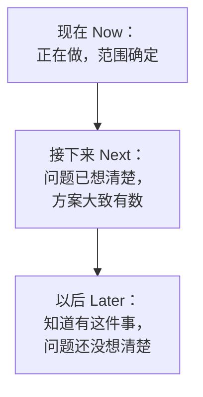
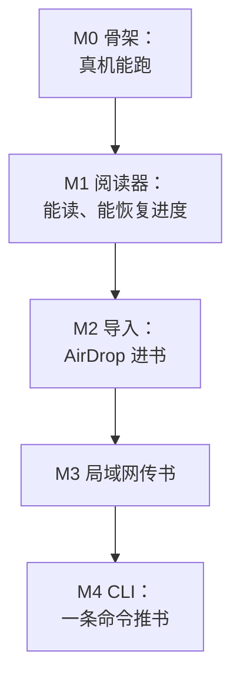

# 路线图

前面几章讲的都是单个需求怎么想清楚、怎么排序。路线图把视角拉远：接下来几个月，产品往哪里走、先解决哪几类问题。对一个人的产品来说，路线图不是给老板看的汇报材料，而是帮你自己在每天的琐事里不迷失方向的工具。这一章讲路线图该写成什么样、怎么维护，以及要不要公开。

## 路线图不是什么

很多人一听路线图，脑子里浮现的是一张甘特图：横轴是日期，每个功能一根条，精确到哪一周开始、哪一周上线。对一人公司来说，这种路线图几乎一定会失效：

| 甘特式路线图 | 问题 |
|---|---|
| 精确到周的日期 | 一个线上事故、一次生病，后面全部顺延，很快就没人看了 |
| 以功能为单位 | 锁死了方案，没给第 3 章的「多个方案」留余地 |
| 越远越详细 | 半年后要做的事，现在根本不可能想清楚 |
| 像一份承诺 | 一旦给用户看过，改动就变成了「食言」 |

一个人的路线图应该反过来：**越近越具体，越远越模糊；以问题为单位，而不是以功能为单位；表达的是方向和顺序，不是日期。**

## Now / Next / Later

最常用、也最适合一人公司的形式，是把路线图分成三栏：



| 栏 | 时间感 | 写到什么程度 | 数量 |
|---|---|---|---|
| 现在 | 这几周 | 有一页需求，甚至有页面规格 | 一两件，不超过三件 |
| 接下来 | 未来一两个月 | 有问题陈述，有候选方案 | 几件 |
| 以后 | 更远 | 一句话，说清是什么问题 | 不限 |

这三栏是流动的：「现在」做完了，从「接下来」挑一件补上；「接下来」里的某件事想清楚了，从「以后」挪上来。每次挪动时，回到第 5 章的方法重新排一遍。

它和日期的关系是松的：你可以说「现在」这一栏大概是这个月的事，但不承诺具体哪天。

## 以问题为单位

路线图上的每一行，最好是一个**要解决的问题**，而不是一个**要做的功能**。比较一下：

| 以功能为单位 | 以问题为单位 |
|---|---|
| 做在线支付 | 店主续期要来回转账确认，到期了才想起来 |
| 加工资导出 | 店主月底给会计交工资明细只能截图 |
| 做告警 | 线上出问题时，我总是从用户那里第一个听说 |

右边一列留出了方案的余地：续期的问题，可能是在线支付，也可能先做一个到期前的提醒；告警的问题，可能是接一套监控，也可能先做一个简单的健康检查脚本。路线图定的是方向，方案到了「现在」那一栏再定。

## 看一份真实的路线图

hatch-counter 的 `docs/参考/路线图.md` 是一个不错的样本。它的结构有几个值得借鉴的地方。

### 按「谁用得上」分组

它没有按时间分，也没有按技术模块分，而是按受益的人分成三组：

- **店主那边**：店主直接感受得到的改进
- **运营**：开户、收款、续期这些「我们」这一侧的事
- **发版和线上**：发布流程、兼容性、监控、备份

这样分的好处是：排优先级时，能一眼看出最近是不是太偏向某一边。连续几个月都在做「发版和线上」，店主那边就什么都没感受到；一直只做店主的功能，运营和线上的债会越积越多。第 5 章说的「先分类再排序」，在路线图上就体现为这种分组。

### 一件一行，带着现状和理由

每一条都是一行，加粗的标题后面跟着一两句话，说清**现在是什么样、差在哪**，再链到详细的文档：

```markdown
- [ ] **工资单导出 Excel**：店主要发给会计的话，现在只能截图。
- [ ] **店主在线付款续期**：订单、收款确认、到期提醒都在后台，
  钱是线下转账、由财务在后台确认收款（见「管理后台」那一页「客户账单和到期日」）。
- [ ] **线上**：加告警；备份只有云盘快照……
```

这一两句话很关键。没有它，路线图就是一串名词，过两个月你自己都想不起来某一条为什么在这里。

### 写上触发条件

前面几章已经提过两条：

```markdown
- [ ] **套餐单独一页分析**：……等真有套餐占了小半营收的店再做。
- [ ] **手机上改单条**：……做不做看现场办事那几件的用量再定。
```

这是路线图里最有价值的一种写法：**不是「以后再说」，而是「等到什么信号出现再做」**。它把一个模糊的「以后」变成了一个可以检查的条件。每次回顾路线图时，看一眼条件有没有满足就行，不用每次都重新争论一遍。

触发条件可以是：

- 用户数或使用量达到某个水平（「现场办事每周用量超过……」）
- 某类反馈累计到几次
- 某个外部条件变化（「等平台政策明确后」「等老版本用户都升级后」）
- 某个前置工作完成（「得先有一个按权限过滤的搜索接口」）

### 已完成的不留在路线图上

它的开头写着：「已经做了的现在长什么样，见现行那几页」。做完的条目从路线图上删掉，现状写进描述现状的文档。路线图只回答「接下来做什么」，不兼任更新日志。

## 里程碑

Now / Next / Later 适合持续迭代的阶段。在产品从零到一的阶段，或者要做一件需要几周的大事时，**里程碑**更合适：把大目标切成几段，每段有明确的完成标准。

hatch-shelf 的设计文档里有一张里程碑表，从 M0 骨架到 M7 笔记。它有两个特点值得学：

- **每一段都能独立交付价值**：M1 完成后就能读示例书，M2 完成后就能 AirDrop 导入，不是做到最后一段才第一次能用。这是第 4 章「竖着切」在时间轴上的体现
- **完成标准从用户行为写**：「AirDrop 一个 zip 后，书出现在书架上」，而不是「完成导入模块」



里程碑的顺序本身就是优先级：先让最核心的价值跑通，再加上让它更方便的通道。

## 和节奏对上

路线图要和你的时间节奏对上，才会真的被使用。[《一人公司方法论》](../opc-playbook/)讲过周节奏和季度目标，这里只说路线图在其中的位置：

| 频率 | 和路线图有关的动作 |
|---|---|
| 每天 | 只看「现在」那一栏，做其中一件 |
| 每周 | 整理需求池；看「现在」那一栏的进展，必要时调整范围 |
| 每月 | 从「接下来」挑下一件；看看「以后」里有没有该挪上来的；检查触发条件 |
| 每季度 | 重新审视整份路线图：分组是否平衡、方向是否还对、有没有该整条删掉的 |

每季度那一次，值得留出整块时间，并且问自己几个问题：

- 过去一个季度做完的事，有没有真正解决当初写下的问题？（第 8 章会讲怎么判断）
- 有没有在路线图上待了很久、一直没挪动的条目？它是该做还是该删？
- 三组之间的投入是否失衡？

## 要不要公开

很多独立开发者会公开路线图，甚至让用户投票。这样做有利有弊：

| 好处 | 代价 |
|---|---|
| 用户知道你在持续投入，增加信任 | 写上去的东西会被当成承诺 |
| 减少重复的功能请求：「已经在计划里了」 | 竞品能看到你的方向 |
| 用户投票提供需求热度的信号 | 投票会放大声音大的少数人，不代表付费用户 |
| 公开构建本身是一种营销 | 维护公开版本要额外花时间 |

一个折中的做法是**公开一个粗粒度的版本**：只公开「现在」和「接下来」，每条写成用户能理解的问题（「续期更方便」），不写日期，不写技术细节；内部版本保留完整的「以后」、触发条件和理由。投票结果只作为需求池「提过的人」计数的补充，不直接决定顺序。

## 放在仓库里，让 agent 帮你维护

路线图和需求池、规格一样，最好是仓库里的一个 Markdown 文件：

- 能进 git，随时看得到它是怎么演变的
- 用 `- [ ]` 列表，做完一条勾掉或者删掉
- 链到需求池条目、规格文档、现行文档
- agent 能直接读写

可以定期让 agent 帮你做检查：

```text
读 docs/路线图.md、docs/需求池/ 和最近一个月的提交记录。
1. 路线图上哪些条目看起来已经做完了（列出对应的提交），我来确认后删掉
2. 需求池里哪些问题被 3 个以上的人提到、但不在路线图上
3. 路线图上带触发条件的条目，根据你能看到的信息，条件是否可能已经满足
只列出来，不要修改文件。
```

和前面一样，让它列、你来定。

## 本章要点

- 一个人的路线图越近越具体、越远越模糊；以问题为单位，表达方向和顺序而不是日期
- Now / Next / Later 三栏：现在一两件、有规格；接下来有问题陈述；以后一句话
- 每条写成要解决的问题，留出方案的余地；附上现状和理由
- 按「谁用得上」分组，能看出投入是否失衡
- 推迟的事写触发条件，把「以后再说」变成可检查的信号
- 做完的从路线图删掉，现状写进描述现状的文档
- 从零到一阶段用里程碑：每段独立交付价值、完成标准从用户行为写
- 公开路线图只公开粗粒度版本，投票只作参考；内部版本放仓库，让 agent 帮你核对
