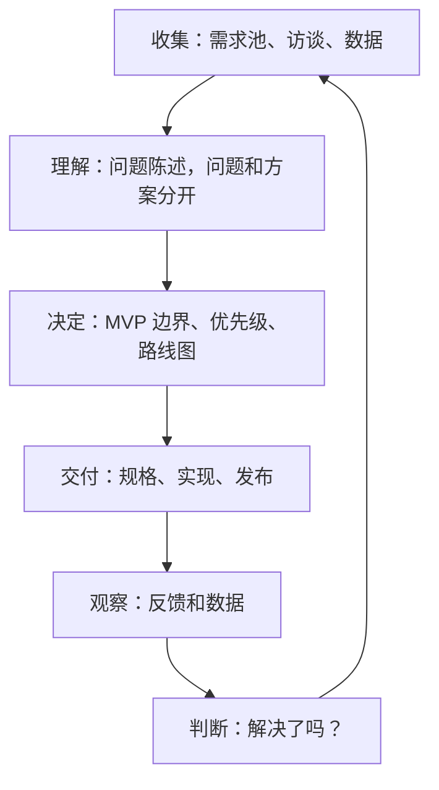
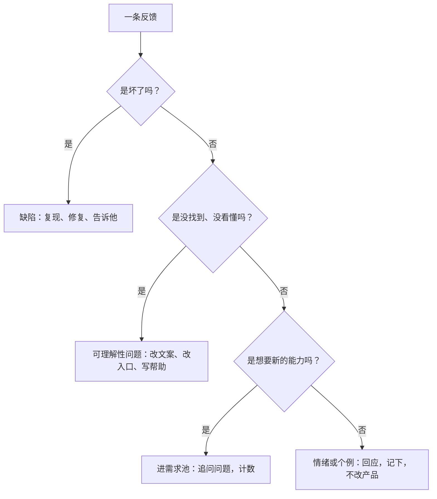
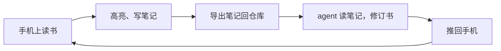

# 从反馈到迭代

功能上线不是结束，而是第一次拿到真实答案的开始：它解决了当初写下的问题吗？用户怎么用它？有没有带来新的问题？这一章讲反馈从哪里来、怎么分辨和处理、怎么判断一个功能成没成，以及怎么把这一切串成一个持续转动的循环。

## 迭代是一个循环

前面七章的内容，可以串成一个圈：



这个圈转得越快、每一圈越小，产品就越不容易走偏。一个人做产品的优势之一，正是这个圈可以转得很快：没有评审会，没有排期冲突，早上听到的反馈下午就可以修好发出去。但快的前提是每一步都不跳过，尤其是最后的「判断」。

## 反馈从哪来

上线以后，反馈会从很多地方冒出来：

| 渠道 | 特点 | 注意 |
|---|---|---|
| 客服和用户群 | 最直接，带情绪 | 只代表愿意开口的人 |
| 应用商店评论 | 公开，影响新用户 | 差评多来自遇到问题的人，好评的人很少写 |
| 报错和崩溃记录 | 客观，不需要用户开口 | 只告诉你哪里坏了，不告诉你哪里不好用 |
| 使用数据 | 覆盖所有人 | 只告诉你发生了什么，不告诉你为什么 |
| 主动回访 | 能问到沉默的用户 | 成本高，要约 |
| 自己用 | 最快 | 你不是典型用户 |

最容易被忽略的是**沉默的用户**：试了一下就不用了的人，什么都不会说。他们只出现在数据里（留存曲线往下掉），要找到他们只能靠主动回访。

hatch-counter 的管理后台里有几页是专门用来「听」的：

- **报错事件**：撞得最多的是哪几句错、影响了几家店，按错误码和那一句话聚合
- **运营分析**：规模、活跃、上手漏斗、功能热度、问题趋势
- **铺开情况**：新版本铺到了多少台设备、谁被挡在了最低版本线外

这些不是用户主动提的反馈，但比用户说的更完整。报错事件尤其有用：一个用户撞到错误后可能什么都不说，但聚合起来你会看到「这句错一周撞了几十次、涉及好几家店」。

## 反馈不等于需求

用户的反馈和第 1 章讲的需求一样，大多数是方案、情绪或者误解，需要翻译。拿到一条反馈，先判断它是哪一类：



第二类最容易被误判。用户说「你们没有某某功能」，有时候功能其实有，只是他没找到；这时要改的不是加功能，而是入口和文案。如果同一个「没找到」反复出现，就说明入口放错了地方。

hatch-counter 移动端的做法提供了一个思路：网页端才有的功能，手机上碰到了，原地一句话指路（「配方在电脑上配」）。这类指路话术，往往就是从「用户说找不到」的反馈里长出来的。

### 记录反馈

反馈也进需求池，但多记几样。下面是一条虚构的示意记录：

```markdown
## 2026-10-30 · 某店店长 · 微信群

- 原话：「拍了单子说没认出来，我拍了三次都不行」
- 类型：缺陷？可理解性？（待查）
- 上下文：安卓，移动端 0.x 版本，晚上后厨灯光
- 处理：要了原图；发现单子是反光的热敏纸
- 结论：可理解性问题。取景页提示加一句「避开反光」，进需求池观察
- 已回复：是，10-30
```

最后一行「已回复」很重要，下面会讲。

## 用数据看功能有没有被用

用户说什么，和用户做什么，常常不一样。判断一个功能成没成，最终要看行为。

hatch-counter 的移动端在写请求上都带了一个标识客户端的请求头，可以按来源数出每样操作每周用了几次；还有一张记录「刚办的」操作的表，本身就是一份现成的流水。它的现行文档里明确写着：

> 写入口用得多不多有数可查

这正是第 7 章那个触发条件「手机上改单条，做不做看现场办事那几件的用量再定」的依据：先把已经上线的几件事的用量数出来，再决定要不要往手机上加更多写入口。

上线一个功能之前，最好先想好**怎么判断它成了**：

| 功能 | 当初的问题 | 成了的信号 | 没成的信号 |
|---|---|---|---|
| 拍单补仓 | 进货单录入不及时，经常漏 | 用的门店里，录单日期和送货日期越来越接近 | 用了一两次就回到电脑上录 |
| 工资导出 | 给会计只能截图 | 每月结完工资后有导出 | 导出后又来问能不能改列 |
| 核单重复提醒 | 同一张单录了两次 | 「是同一张，不录了」被点到 | 提醒出现后用户总是点「接着录」（可能误报太多） |

注意最后一列。只看「成了」很容易自我感觉良好，**事先写下「没成」长什么样**，才能诚实地判断。

具体的埋点怎么设计、留存和漏斗怎么算、怎么做 A/B 测试，[《数据分析与埋点》](../product-analytics/)会详细讲。这里只需要建立一个习惯：**每个功能上线前，写下一个能用数据检验的判断标准**。

## 把回路闭上

用户提了反馈，你修好了、做出来了，然后呢？大多数开发者会默默发布，用户永远不知道他的话起了作用。

闭上回路，就是**回头告诉提反馈的那个人**。接着上面那条示意记录：

```text
您上周说拍热敏纸的送货单总是认不出来，我查了是反光的问题。
新版本在取景时加了避开反光的提示。
您更新后再试试，有问题随时告诉我。谢谢您把原图发给我，帮了大忙。
```

这样做的回报远超它的成本：

- **他会继续给你反馈**，因为他知道说了有用
- **他会更宽容**，下次出问题时，他知道你会处理
- **他会替你说话**。「这个开发者很靠谱，提了问题真的会改」是一人公司最好的口碑

需求池里记下「提过的人」的名字，就是为了这一刻。第 5 章说「到时候第一个告诉您」，在这里兑现。

批量的回路也可以闭。hatch-counter 的做法是：提交信息按 app 路径收进各自的更新日志，发版时把这一版的日志自动发进用户群。每次发版，所有人都能看到「这一版改了什么」，提过相关反馈的人自然会认出自己的话。提交信息写的是「改完之后是什么样」而不是「改了哪个文件」，所以直接就能给用户看。

## 小步发布

迭代的循环要转得快，每一圈就要小。几条经验：

- **一次发布只改一件主要的事**。同时改了五处，出了问题不知道是哪一处，数据变好了也不知道是哪一处的功劳
- **先给一部分人用**。愿意尝鲜的老用户、自己的几家熟店，先用一周没问题再全量
- **能关掉**。新功能最好有个开关，出了问题先关掉再慢慢修
- **兼容旧版本**。移动端的用户不会立刻升级，服务端要同时接住新旧客户端。hatch-counter 的「铺开情况」页就是用来看新版铺到了多少、旧版还剩多少，等旧版归零才收口老接口

[《部署与 CI/CD》](../deploy-release/)讲了发布流程本身的技术细节，这里强调的是产品上的含义：**发布的粒度决定了你能学到多少**。

## 什么时候该砍掉一个功能

迭代不只是加和改，也包括删。一个功能上线一段时间后，如果出现下面的情况，就该认真考虑删掉它：

- 用量一直很低，而且没有在增长
- 它带来的客服问题比它带来的价值多
- 它让别的功能变得更难改
- 当初的问题已经被别的方式解决了

删功能比加功能难：总有少数人在用，删了会有人抱怨。几个降低阻力的办法：

- **先隐藏入口，观察一段时间**，看有没有人来找
- **提前告知**，给出替代办法
- **私下联系还在用的那几个人**，了解他们用它解决什么问题，也许有更好的办法

第 5 章说过，删掉一个没人用的功能，等于给所有其他功能减负。对一个人维护的产品，这一点尤其重要。

## 自用产品的反馈回路

如果你自己就是用户，回路可以做得非常紧。hatch-shelf 是一个例子：



读者在手机上标出没讲清楚的地方、写下疑问，导出成 `notes/<书 id>.notes.md` 放回仓库。写书的规范里规定：修订一本书之前，如果存在对应的笔记文件，先读一遍，读者标出的疑问是修订的优先事项。

这个设计的精神可以搬到任何产品上：**让反馈以结构化的形式、自动地回到你做决策的地方**。反馈散落在微信聊天记录里，和反馈以文件形式出现在仓库里、agent 能直接读到，两者被处理的概率完全不同。

## 复盘

每完成一个较大的功能，或者每个季度，花半小时做一次复盘。可以用一个简单的模板（内容是示意，数据留空）：

```markdown
# 复盘：拍单补仓（上线后一个月）

## 当初的问题
进货单录入不及时，经常漏录，月底库存对不上。

## 当初写下的判断标准
- 成了：录单日期和送货日期越来越接近
- 没成：用了一两次就回电脑录

## 实际情况
- 数据：……
- 反馈：……

## 哪些假设对了，哪些错了
- 对：店主愿意在现场核对
- 错：以为手写单最难认，实际最难的是反光的热敏纸

## 下一步
- 继续 / 调整 / 停止：……
- 进路线图的条目：……
```

「哪些假设错了」是复盘里最有价值的部分。它会反过来修正你下一次做第 3 章的假设清单时的直觉。

## 本章要点

- 收集、理解、决定、交付、观察、判断，构成一个循环；一个人的优势是能转得快，前提是不跳过判断
- 反馈来自客服、评论、报错、数据、回访、自用；沉默的用户只出现在数据里
- 先分类：坏了、没看懂、想要新能力、情绪个例；「没找到」反复出现说明入口错了
- 上线前写下「成了」和「没成」各长什么样，用行为数据检验
- 回头告诉提反馈的人，这是一人公司最便宜也最有效的口碑来源；发版日志可以批量闭环
- 小步发布、先给一部分人、能关掉、兼容旧版本
- 用量低、客服多、拖累别的功能的，要敢于删掉
- 让反馈以结构化形式自动回到你做决策的地方；定期复盘，重点看哪些假设错了

## 接下来读什么

这本书讲的是「做什么」。接下来几本补上把产品卖出去、活下去的其他部分：

- [《写给开发者的设计课》](../design-for-devs/)：规格里写的页面，怎么做得不难看、好用
- [《定价与商业模式》](../pricing-monetization/)：想清楚做什么之后，怎么收钱、收多少
- [《获客与增长》](../growth-marketing/)、[《文案与内容》](../copywriting-content/)：怎么让对的人知道你的产品
- [《数据分析与埋点》](../product-analytics/)：本书第 8 章「用数据判断成没成」的完整方法

按书架导读的第四批顺序，下一本建议读[《定价与商业模式》](../pricing-monetization/)。
