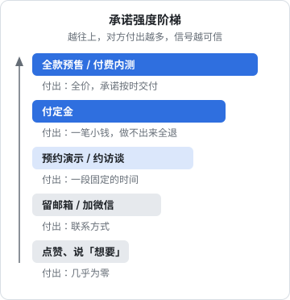
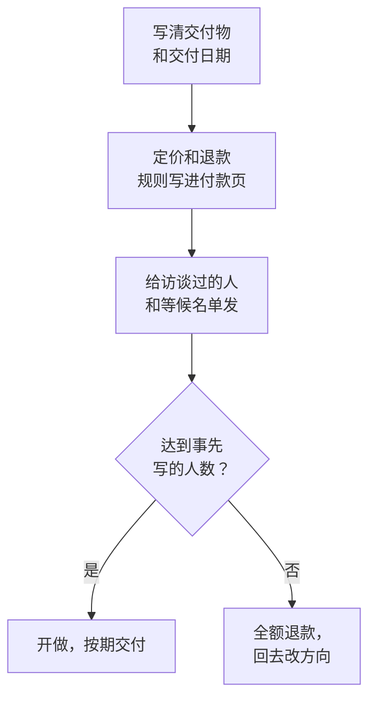

# 需求验证与 PMF 判断

前面八章大多在回答「这个功能该不该做、做成什么样」。这一章退后一步，回答一个更大的问题：**这个产品方向本身，有没有人真的要**。它分成两段：写大量代码之前，用落地页和预售看有没有人愿意付出；上线以后，用问卷和留存看产品是不是已经离不开。

如果你还没开始做，可以在读完[第 4 章](04-mvp-boundary.md)之后直接跳到这一章的前半段；如果产品已经有人在用，后半段和[第 8 章](08-feedback-to-iteration.md)是配套的：第 8 章判断单个功能成没成，这一章判断整个产品成没成。

## PMF 是什么

PMF 是 Product/Market Fit 的缩写，常译作「产品与市场匹配」。这个说法流行开来，通常追溯到投资人 Marc Andreessen 2007 年 6 月的博客文章《The only thing that matters》，他的定义是：在一个好的市场里，有一个能满足这个市场的产品。

这个定义很难直接拿来判断。实际工作里，人们用几类**可观察的信号**去逼近它：

| 阶段 | 看什么 | 本章小节 |
|---|---|---|
| 还没做 | 不认识你的人愿不愿意留下联系方式、愿不愿意付钱 | 落地页测试、预售 |
| 刚有人用 | 用户失去它会不会「非常失望」 | Sean Ellis 问卷 |
| 用了一段时间 | 留存曲线会不会走平 | 留存曲线走平 |

三类信号测的东西不同，**不能互相替代**：落地页测的是「这个说法打不打动人」，预售测的是「愿不愿意为承诺掏钱」，问卷和留存测的是「做出来的东西是不是真离不开」。

[《一人公司方法论》的快速验证](../opc-playbook/03-fast-validation.md#验证阶梯)给出了从桌面调研到 MVP 的整条阶梯，本章只把其中落地页、预售两级展开，再补上线后的判断方法。

## 承诺强度阶梯

[第 2 章](02-user-interviews.md#看承诺不看喜欢)说过，访谈结束时要看对方愿意付出什么。验证阶段的所有手段，都可以按「对方付出了多少」排成一个阶梯：

这张图只表示先后顺序，不代表具体的比例或换算关系。用法有两条：

- **每一级都会筛掉一大批人**。一百个点赞里，可能只有一小部分会留联系方式，留了联系方式的人里愿意付定金的更少。层与层之间掉多少没有通用比例，要在你自己的渠道里量出来
- **能往上一级测，就别停在下一级**。一个方向如果只拿到了点赞和「想要」，等于还没验证

## 落地页测试

落地页测试的做法是：产品还没做出来（或者只做了一部分），先写一页说清楚它解决什么问题、给谁用，再放一个行动按钮，看有多少人愿意点下去、留下东西。

### 怎么设计

一个用来验证的落地页，和正式上线的着陆页有几点不同：

| 要素 | 验证用的写法 |
|---|---|
| 目标 | 只测一个假设，比如「小餐馆店主愿意为拍单录库存留联系方式」 |
| 首屏 | 用第 1 章需求池里用户的原话描述问题，而不是功能列表 |
| 行动按钮 | 只有一个，对应阶梯上的某一级：留联系方式、预约演示、付定金 |
| 价格 | 能写就写一个真实的价格或区间，测出来的才接近真实意愿 |
| 流量来源 | 每个渠道带不同的来源参数，分开统计 |
| 诚实 | 写明「还在开发中，预计某月开放」，不假装产品已经存在 |

文案本身怎么写（首屏三句话、功能翻译成好处、五秒测试），见[《文案与内容》的着陆页一章](../copywriting-content/03-landing-page.md)。最小实现和个人信息、备案的注意事项，见[《一人公司方法论》的着陆页与等候名单](../opc-playbook/03-fast-validation.md#着陆页与等候名单)。

如果想测的是价格，可以用「假门测试」：放一个「立即购买」按钮，点下去提示「即将上线，留下联系方式」，统计点击率。具体做法和怎么避免让用户觉得被耍，见[《定价与商业模式》的价格实验](../pricing-monetization/04-price-experiments.md#最真实的信号付钱)。

### 看什么转化

落地页最值得看的是**从看到页面到完成行动按钮**的比例，按渠道分开算：

$$
\text{转化率} = \frac{\text{完成行动的人数}}{\text{打开页面的独立访客数}}
$$

几个要点：

- **只数不认识你的人**。朋友、同事、你自己群里的熟人，转化率天然偏高，要单独标出或剔除
- **分渠道看**。在三个餐饮老板群里发帖，和在技术社区发帖，来的是两种人；混在一起算出来的数字，哪一类人都代表不了
- **不要去套别人的「行业平均转化率」**。网上流传的各种基准，产品、渠道、按钮类型都和你不同，本书不给这样的数字。更可靠的做法是事先写下你自己的成功和失败标准，格式见[《一人公司方法论》的事先写好成功标准](../opc-playbook/03-fast-validation.md#事先写好成功标准)
- **数量太少时先别算比例**。几十个访客里有几个人留了联系方式，比例的误差非常大，见下文[样本很小时怎么读](#样本很小时怎么读)。这时候更有用的是逐个联系留下联系方式的人，约一次第 2 章那样的访谈

## 预售

预售是阶梯上最强的一级：产品还没完成，先收钱。它测的不是「感兴趣」，而是「愿意为一个还没兑现的承诺掏钱」。

### 怎么做

几个具体做法：

- **交付物写到能验收**。不是「一个更好用的库存工具」，而是「手机拍送货单，一分钟内录进库存，支持某某几类单据」。和[第 6 章的一页需求](06-writing-specs.md#一页需求)一样，写清楚「不做」什么
- **给一个明确的交付日期**，并留出余量。做不到的日期，比没有日期更伤信任
- **数量设上限**。「首批 20 家」既是营造稀缺，也是保护你自己：一个人同时服务不了太多付了钱、等着交付的人
- **定金还是全款**。定金门槛低，适合还没见过你的人；全款信号更强，适合访谈过、已经认可问题的人。To B 场景可以直接是「付一个月试点费」

### 退款承诺

预售的前提是**承诺做不出来就全额退款**，并且真的做到：

- 把退款条件写在付款页可见的位置：什么情况下退、退多少、多久退到
- 到期交付不了，主动退，不要等用户来要
- 交付后用户不满意怎么处理，也要事先写清楚（全退、按比例退，还是不退）

退款政策的写法、各收款渠道怎么退，见[《定价与商业模式》的退款与客诉](../pricing-monetization/07-refunds-disputes.md#设计退款政策)。

### 国内收款的注意点

> [!WARNING]
> 本节涉及的收款资质、预付款退还和平台规则，按 2026 年 11 月能查到的公开信息整理，依据有限且可能调整，以国家法律法规数据库中《消费者权益保护法》及其实施条例的现行条文、中国人民银行和所用支付平台、知识付费平台的最新规则为准。

- **预收款有法定的退还义务**。《消费者权益保护法》对以预收款方式提供商品或服务有专门规定：没有按约定提供的，要按消费者的要求履行约定或者退回预付款。2024 年发布的《消费者权益保护法实施条例》对预付式消费作了进一步规定，包括要与消费者约定预付款的退还方式。预售时说「做不出来全额退」，不只是信用问题
- **个人收款码不宜大量用于经营收款**。支付平台对个人收款码用于经营活动有专门规则，频繁收款可能被限制或要求升级为商户。正规做法是用个体工商户或公司主体开通商户号，见[《定价与商业模式》的支付接入（国内）](../pricing-monetization/05-payments-china.md#资质主体是第一道门槛)
- **知识付费、社群平台有各自的规则**。通过这些平台卖「付费内测」时，平台对退款、提现周期、虚拟商品的规定可能和你的承诺冲突，开卖前先读平台规则
- **App 内的预售受应用商店规则约束**。iOS 里卖数字内容通常要走苹果的内购，见[《定价与商业模式》的 App Store 内购](../pricing-monetization/06-app-store-iap.md)
- **预售收入要记账**。收到的钱在税务上怎么处理，见[《财务与税务》](../opc-finance/)

很多技术人怕预售「显得不专业」。但如果说服不了十个人提前付钱，产品做完以后大概率也说服不了。

## Sean Ellis「非常失望」问卷

产品上线、有了一批真实用户之后，最常被引用的 PMF 判断方法，是增长营销人 Sean Ellis 提出的一道问卷题，常被称为「Sean Ellis 测试」或「40% 规则」。

### 原题和出处

Sean Ellis 在 2009 年 5 月 18 日的博客文章《Free Customer Development Help – Survey.io》（发在他的博客 startup-marketing.com 上）里公开了这份问卷。他说其中最重要的一题是：

> How would you feel if you could no longer use [product]?
>
> 如果以后不能再用 [产品]，你会有什么感受？

选项是四个：

| 原文选项 | 中文 |
|---|---|
| Very disappointed | 非常失望 |
| Somewhat disappointed | 有点失望 |
| Not disappointed (it isn't really that useful) | 不失望（它其实没那么有用） |
| N/A – I no longer use [product] | 不适用，我已经不用了 |

同一篇文章给出的判断是：如果超过 40% 的用户选「非常失望」，就很有机会在这个「必需品」上建立一门成功的生意；如果大多数人只是「有点失望」，说明它只是「有了更好」，这时应该压低开销、继续打磨核心体验。2010 年 3 月 1 日的另一篇文章《Optimization Mistakes That Kill Startups》里，他把这条标准用在了另一个决定上：随机调查的用户里至少 40% 会「非常失望」之前，不要开始优化注册和转化流程。

### 40% 是怎么来的

Ellis 自己的这两篇文章都只给了 40% 这个数，没有说明它是怎么得出的。常被引用的来源说明，来自 Superhuman 创始人 Rahul Vohra 2018 年 11 月 12 日发表在 First Round Review 上的文章《How Superhuman Built an Engine to Find Product/Market Fit》：Ellis 用这份问卷对比了将近一百家初创公司，发现增长吃力的公司几乎都低于 40%，增长强劲的几乎都高于 40%。

> [!NOTE]
> 这个「将近一百家」的说法是 Vohra 转述的，本书没有找到 Ellis 本人公开的原始数据或计算方法；Ellis 与 Morgan Brown 合著的《Hacking Growth》（2017）也讲过这道题，但本书写作时没能核对原书原文。所以 40% 更适合当作一条**经验线**，而不是统计上严格推出来的门槛。Ellis 在 2026 年 9 月的一篇文章里也称它为自己「多年前设定的基准」，并说问卷是判断 PMF 是否存在的一个**捷径**。

### 问谁

问卷的结论好不好用，几乎全看问了谁。Ellis 2009 年的原文建议发给**随机抽取**的、同时满足下面三条的用户：

1. 体验过产品的核心功能
2. 至少用过两次
3. 最近两周内用过

Vohra 的文章沿用了这套条件，写作「最近两周内至少用过两次」。Ellis 2026 年 9 月的文章表述为最近几周内用过、已经进入激活状态的用户。

这些条件的意思是：只注册没用过的人、很久以前流失的人，都回答不了「失去它会怎样」，问了只会把比例拉低，也会把它拉得没有意义。反过来，**只挑你最熟、最活跃的几个用户问**，比例会虚高。

样本数量方面，Vohra 的经验是大约 40 份回答起，结果开始有方向性的参考价值。Ellis 2009 年的原文没有给出最低样本数。

### 怎么用这个结果

光看一个总比例，信息量有限。Superhuman 那篇文章里的用法更有启发：

- 起点是 22%，远低于 40%
- 先按第一题分组，看「非常失望」的人是谁（他们发现是创始人、管理者、高管、商务拓展这几类），只保留这些人群后，比例升到 33%
- 「有点失望」的人再按「你从产品得到的主要好处」分开：主要好处和「非常失望」那批人一致的，认真看他们说缺什么；不一致的，礼貌地放下
- 路线图大约一半用来加强「非常失望」的人喜欢的地方，一半用来解决「有点失望」的那部分人卡住的地方
- 持续给新用户发问卷，按周、月、季度跟踪这个比例；三个季度后升到 58%

Superhuman 当时的四道题是：失去它的感受（上面那题）、你觉得什么样的人最能从中受益、你从中得到的主要好处是什么、我们怎么改进对你更好。对一人公司来说，后三道开放题往往比那个百分比更有用：它们直接告诉你**谁是你的核心用户、他们在用你的产品解决什么问题**，也就是[第 1 章](01-where-needs-come-from.md#需求到底是什么)「谁、在什么场景、想做成什么」的答案。

## 留存曲线走平

问卷是人说的，留存是人做的。判断 PMF 最终要回到行为：**一批用户的留存曲线，前期下降以后会不会走平**。

- 走平：有一部分人找到了持续的价值，产品和这部分人是匹配的，接下来的问题是让平台更高、找到更多这样的人
- 一路下滑到零：没有哪类人离不开你，这时加大获客只会更快地烧钱，应该回去改产品

留存的三种算法、曲线怎么读、按批次看的留存矩阵和 SQL，见[《数据分析与埋点》的读留存曲线](../product-analytics/04-retention-ltv.md#读留存曲线)。这里只补两点和本章有关的：

- **问卷和留存要对照看**。问卷比例高、留存却一路下滑，可能是问到的人不够随机，或者某一类用户喜欢它、而大多数新用户根本没走到激活那一步；Ellis 2026 年 9 月的文章讨论的正是这种两者对不上的情况，他建议去找是哪个人群、哪个用途或哪段上手体验出了问题
- **按人群拆开看**。整体曲线不走平，拆开以后某一类用户的曲线可能是平的。这和上面 Superhuman 按人群分组是同一个思路：PMF 往往先在一小群人身上出现

## 样本很小时怎么读

一人公司在这个阶段，样本常常只有个位数到几十人：落地页几十个访客、问卷十几份回答、一个批次二三十个新用户。这时候任何比例都要连同它的误差一起看。

### 比例的置信区间

一个比例 $\hat p = k/n$ 只是对真实比例的估计。$n$ 小的时候，常用的 Wilson 区间比「加减两个标准误」的正态近似更稳妥：

$$
\frac{\hat p + \dfrac{z^2}{2n} \pm z\sqrt{\dfrac{\hat p(1-\hat p)}{n} + \dfrac{z^2}{4n^2}}}{1 + \dfrac{z^2}{n}}
$$

95% 置信水平取 $z \approx 1.96$。按这个公式算几个例子：

| 回答「非常失望」 | 样本比例 | 95% Wilson 区间 |
|---|---|---|
| 8 / 20 | 40% | 约 21.9% – 61.3% |
| 16 / 40 | 40% | 约 26.4% – 55.4% |
| 40 / 100 | 40% | 约 30.9% – 49.8% |

同样是 40%，20 个人时真实比例可能低到两成出头、也可能高到六成；到 100 个人，区间仍然有将近 19 个百分点宽。所以**几十份回答时，38% 和 42% 没有区别**，不要拿它和 40% 这条线较真。区间的推导和代码实现见[《LLM 评测》的数据集一章](../llm-evals/02-datasets.md)；为什么小流量做不了严格的 A/B 测试、可以换什么方法，见[《数据分析与埋点》的样本不够时怎么办](../product-analytics/06-ab-testing.md#样本不够时怎么办)。

### 定性信号

数字靠不住的时候，下面这些信号更值得看，它们大多是第 1、2 章讲过的「已经发生的行为」：

- **有人追着问**：没上线就问什么时候能用，用了就问能不能多开几个账号
- **有人主动介绍**：没让他推荐，他自己把同行拉进来
- **有人为它改了习惯**：不再用原来的 Excel、不再在群里给自己发消息
- **停了会有人来找**：服务出问题半天，就有人来问怎么了
- **回答「非常失望」的理由很具体**：说得出失去它以后要退回到哪个笨办法、多花多少时间

反过来，比例看起来不错，但说不出具体理由、没人追问、停了也没人发现，就要怀疑问卷问错了人。

## 什么时候算够了

没有一条线能告诉你「PMF 到了」。比较稳妥的判断是几类信号同时指向一个方向：

- 不认识你的人从你能持续使用的渠道来，愿意付钱，而不只是留联系方式
- 近期活跃用户里，回答「非常失望」的比例接近或超过 40%，并且样本不是只有个位数
- 至少有一类用户的留存曲线走平了
- 你说得出这类用户是谁、他们为什么离不开

做到前一条，值得投入去做 MVP；做到后几条，才值得把精力从改产品转向获客，见[《获客与增长》](../growth-marketing/)。

## 本章要点

- PMF 很难直接测，靠几类信号逼近：没做之前看落地页和预售，有人用以后看问卷和留存，它们测的东西不同，不能互相替代
- 按对方付出排成承诺强度阶梯：点赞 < 留联系方式 < 预约 < 付定金 < 全款预售；能往上测就别停在下一级
- 落地页只测一个假设、只放一个按钮、写真实价格、分渠道统计、只数陌生人；不要套别人的平均转化率
- 预售要写清交付物、日期、名额和退款规则；国内收款注意预付款退还义务、收款资质和平台规则
- Sean Ellis 问卷原题是「不能再用会有什么感受」，40% 选「非常失望」是经验线；只问随机抽取的、体验过核心功能、至少用过两次、最近两周用过的用户
- 用问卷的开放题找出核心人群和主要好处，比那个百分比更有用
- 留存曲线走平才说明有人离不开；问卷和留存对不上时按人群拆开看
- 样本只有几十人时，比例的置信区间很宽，8/20 的 95% Wilson 区间约 22%–61%；多看追问、主动介绍、改变习惯这类定性信号

## 接下来读什么

这本书讲的是「做什么」。接下来几本补上把产品卖出去、活下去的其他部分：

- [《写给开发者的设计课》](../design-for-devs/)：规格里写的页面，怎么做得不难看、好用
- [《定价与商业模式》](../pricing-monetization/)：想清楚做什么之后，怎么收钱、收多少
- [《获客与增长》](../growth-marketing/)、[《文案与内容》](../copywriting-content/)：怎么让对的人知道你的产品
- [《数据分析与埋点》](../product-analytics/)：本书第 8 章「用数据判断成没成」和第 9 章留存曲线的完整方法

按书架导读的第四批顺序，下一本建议读[《定价与商业模式》](../pricing-monetization/)。
