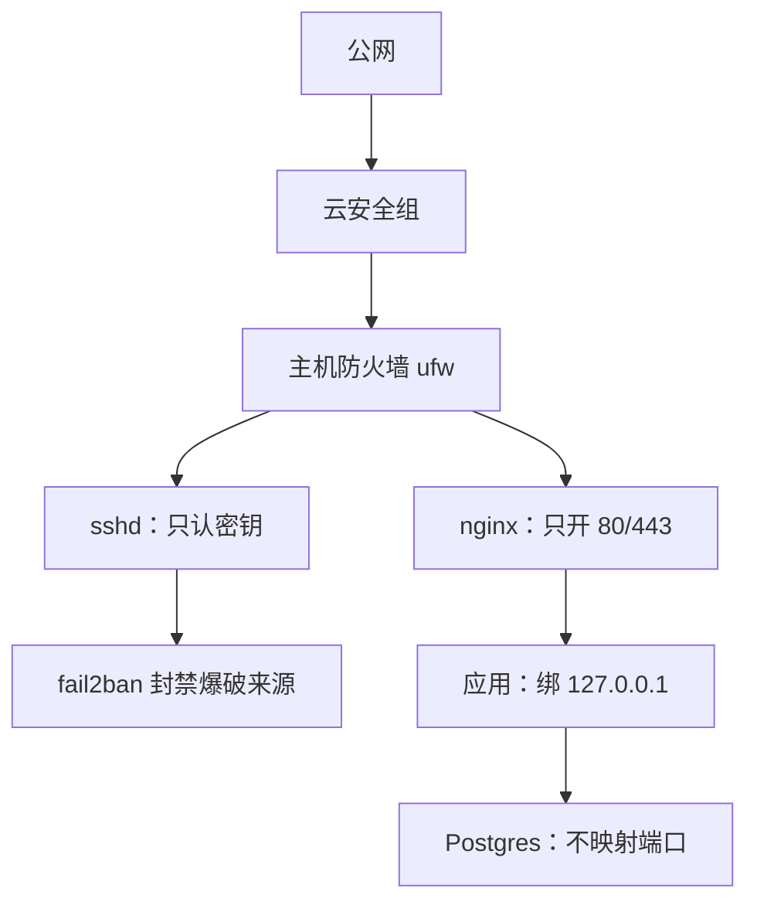
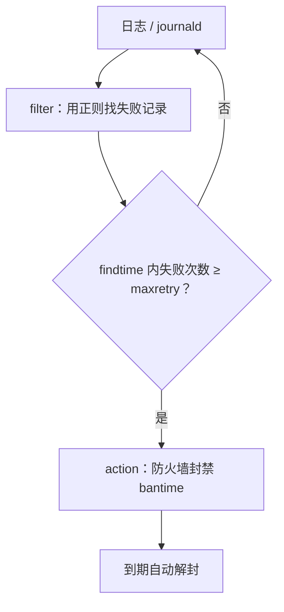

# 服务器加固

一台连着公网的 VPS，开机几分钟就会有人来敲 22 端口。新机器上该做的几步，前面几本书已经讲过了：建部署用户、关密码登录、开防火墙、装自动安全更新。本章接着往下走。先想清楚一个人要防的到底是什么，再把 SSH、防火墙、fail2ban、补丁和云账号这几处收紧，最后整理成一份可以定期复查的加固清单。

## 关于这本书

### 讲什么

这是运维系列的最后一本。前面几本解决的是「怎么把服务送上线」：

- [《Linux 系统与命令行》](../linux-essentials/)：权限、systemd、journald、排障工具箱
- [《容器技术》](../docker-containers/)：Dockerfile、Compose、容器安全
- [《Nginx 与反向代理》](../nginx-gateway/)：反代、HTTPS、限流、长连接
- [《部署与 CI/CD》](../deploy-release/)：VPS 初始化、部署脚本、零停机、回滚

这本书解决「上线之后怎么让它一直好好活着」：服务器加固、备份与容灾演练、出事时怎么响应、事后怎么复盘、用 SLO 决定可靠性做到什么程度、管住每个月的账单、一个人怎么安排值班。最后一章把全书收成一份按天、周、月、季度执行的检查清单。

### 适合谁

已经有一个跑在 VPS 上的服务（典型形态是 Docker Compose + 宿主机 nginx + systemd），没有运维同事，所有事都得自己扛的独立开发者。前面四本书讲过的东西本书只用一句话带过，并指明出处。

### 怎么读

第 1、2 章是「出事之前」，越早做越好；第 3、4 章是「出事之时和之后」，建议在平静的时候读完，再把其中的模板抄进自己的仓库；第 5–7 章是决策框架，帮你决定可靠性、成本和个人时间怎么分配；第 8 章是清单，读完全书后打印出来照着做。

## 一个人要防的是什么

加固之前先列威胁。安全建议多到做不完，一个人的时间又有限，只有知道自己防什么，才能挑出值得做的那几项。

| 威胁 | 现实程度 | 典型后果 | 主要防线 |
|---|---|---|---|
| 自动化扫描、撞库、爆破 | 每天都在发生 | 弱口令被猜中，机器被拿去挖矿 | 只用密钥登录、少开端口、fail2ban |
| 已知漏洞被批量利用 | 常见，漏洞公开后几天内 | 服务被打穿 | 及时打补丁、少装东西 |
| 误把内部端口暴露到公网 | 非常常见 | 数据库被删库勒索 | 端口审计、绑 127.0.0.1 |
| 密钥泄露（仓库、日志、截图） | 常见 | 云账号被盗刷、数据被拖 | 密钥不落仓库、按用途拆钥匙 |
| 云账号被盗 | 少见但致命 | 机器、快照、备份一起没 | 两步验证、子账号 |
| 针对你的定向攻击 | 小产品很少见 | 视对手而定 | 不在本书范围 |

可以看出，**绝大多数风险来自自动化攻击和你自己的疏忽**，而不是黑客专门盯上你。所以一个人的加固策略很朴素：缩小攻击面、堵住批量攻击、防住自己手滑，再保证出事后能从备份里爬起来（第 2 章）。



每一层都假设外面那层会失效。安全组忘了改，还有 ufw；ufw 被 Docker 绕过，服务本来就只绑本机。

## SSH：从「能用」到「收紧」

[《部署与 CI/CD》第 1 章](../deploy-release/01-vps-setup.md)已经关了密码登录、禁了 root 密码登录。下面是在它基础上值得补的几项。

### 补充的 sshd 配置

在同一个 `/etc/ssh/sshd_config.d/10-hardening.conf` 里追加（文件名为什么要以 `10-` 开头，见[《Linux 系统与命令行》第 2 章](../linux-essentials/02-filesystem-permissions.md)）：

```text
# 只允许部署用户登录，其他账号哪怕有公钥也进不来
AllowUsers deploy

# 每个连接最多试 3 把钥匙、20 秒内必须完成认证
MaxAuthTries 3
LoginGraceTime 20

# 键盘交互认证也关掉，它在某些 PAM 配置下等于密码登录
KbdInteractiveAuthentication no

# 用不上的功能都关
X11Forwarding no
AllowAgentForwarding no

# 断网后残留的会话 10 分钟内清掉
ClientAliveInterval 300
ClientAliveCountMax 2
```

```bash
sudo sshd -t && sudo systemctl reload ssh
sudo sshd -T | grep -Ei 'allowusers|maxauthtries|passwordauth|kbdinteractive'
```

`AllowTcpForwarding` 没有关，因为它有正经用途：hatch-counter 在域名备案下来之前，就是靠 `ssh -N -L 3000:127.0.0.1:3000 <主机别名>` 把服务端的端口转到本机联调的。关掉之前先想想自己有没有用到。

和之前一样：**保留一个已登录的会话，新开窗口确认能登录，再退出**。

### 要不要改 22 端口

改端口能让日志里的爆破记录少掉一大半，但它不增加任何真实的安全性，扫描器扫一遍全端口也就几分钟。它的代价是每个客户端、每个脚本、安全组都要跟着改。

另外要注意，Ubuntu 22.10 起 ssh 默认由 systemd 的 `ssh.socket` 按需拉起，端口由 socket 单元决定，只改 `sshd_config` 里的 `Port` 并 reload 不一定生效，需要 `systemctl daemon-reload` 后重启 `ssh.socket`。具体以你所用版本的 Ubuntu 文档为准。

建议：**不改**。只用密钥登录加 fail2ban，爆破就已经没有意义了；日志嫌吵，可以用 fail2ban 封掉。

### 更进一步：管理入口不对公网

如果愿意多花一个小时，可以让 22 端口根本不对公网开放：

- **WireGuard / Tailscale 这类组网工具**：你的电脑和服务器加入同一个私有网络，安全组只对这个网段放行 22
- **云厂商的堡垒机或「会话管理」功能**：通过控制台或 CLI 登录，不需要开放 22

代价是多了一个依赖：组网服务挂了、电脑丢了，你可能也进不去。所以必须确认**云控制台的 VNC 救援入口**能用，并把这条路写进第 3 章的应急手册。一个人维护一两台机器时，「只用密钥 + fail2ban」已经够了，这一步属于有余力再做。

### 私钥本身的安全

服务器端收得再紧，私钥在笔记本上被偷走就全白费了：

- 用 `ed25519` 密钥，**给私钥设密码**，配合 macOS 钥匙串或 `ssh-agent` 免得每次输入
- 有硬件安全密钥（支持 FIDO2 的 U 盘式密钥）的话，可以生成 `ed25519-sk` 类型的密钥，私钥离不开那个硬件，每次登录要触碰一下。需要客户端和服务端都是 OpenSSH 8.2 或更新的版本
- 每台电脑一把钥匙，在 `authorized_keys` 里用注释标明是哪台。换电脑、丢电脑时删掉对应那一行即可
- CI 用的部署密钥单独一把，只放在 CI 的 secret 里（[《部署与 CI/CD》第 3 章](../deploy-release/03-env-secrets.md)讲过「一个消费方一把钥匙」）

```bash
# 生成一把带注释的密钥，注释写清楚是哪台设备
ssh-keygen -t ed25519 -C "macbook-2026"

# 定期看一眼服务器上都信任了哪些钥匙
sudo cat /home/deploy/.ssh/authorized_keys | awk '{print $1, $NF}'
```

## fail2ban：把爆破来源关在门外

fail2ban 的原理很简单：盯着日志，同一个 IP 在一段时间内失败太多次，就调用防火墙把它封一阵子。



### 安装和基础配置

```bash
sudo apt install -y fail2ban
```

不要改 `jail.conf`，升级时会被覆盖。在 `jail.local` 或 `jail.d/` 下写自己的覆盖：

```ini
# /etc/fail2ban/jail.d/10-local.conf
[DEFAULT]
# 自己常用的出口 IP 加进白名单，免得把自己封了（家里宽带 IP 会变，别依赖它）
ignoreip = 127.0.0.1/8 ::1
bantime  = 1h
findtime = 10m
maxretry = 5
# 同一个 IP 反复被封，封禁时间逐次加倍
bantime.increment = true
bantime.maxtime   = 1w

[sshd]
enabled = true
# 直接读 journald，不依赖 /var/log/auth.log 是否存在
backend = systemd
maxretry = 3
```

```bash
sudo systemctl enable --now fail2ban
sudo fail2ban-client status          # 启用了哪些 jail
sudo fail2ban-client status sshd     # 当前封了谁、累计封过多少
```

### 把自己封了怎么办

只要你只用密钥登录，正常情况下不会触发失败计数。真被封了（比如本机 ssh-agent 里塞了太多钥匙，挨个试导致失败），换一个网络（手机热点）登录，然后：

```bash
sudo fail2ban-client set sshd unbanip <你的 IP>
```

本机这边，`~/.ssh/config` 里给这台主机加上 `IdentitiesOnly yes` 并指定 `IdentityFile`，就不会挨个试钥匙了。

### 给 nginx 也加几个 jail

fail2ban 自带了一些 nginx 的过滤器。和[《Nginx 与反向代理》第 5 章](../nginx-gateway/05-rate-limit.md)的限流配合，可以把反复触发限流的 IP 升级成直接封禁：

```ini
# /etc/fail2ban/jail.d/20-nginx.conf
[nginx-limit-req]
enabled  = true
port     = http,https
logpath  = /var/log/nginx/error.log
maxretry = 10
findtime = 5m
bantime  = 30m

[nginx-http-auth]
enabled = true
port    = http,https
logpath = /var/log/nginx/error.log
```

- `nginx-limit-req` 匹配的是 error log 里 `limiting requests` 那一行，所以前提是你已经配了 `limit_req`
- 封禁是在宿主机的 INPUT 链上做的。nginx 装在宿主机上时没问题；如果 nginx 跑在容器里且发布了端口，流量走的是 FORWARD 链，默认的封禁动作拦不住它，需要额外配置。这也是本系列一直建议 nginx 装在宿主机上的原因之一

### fail2ban 不能做什么

它只能对付「同一个 IP 反复失败」这种模式。分布式的慢速爆破、合法请求组成的 CC 攻击、应用层漏洞，它都管不了。前两种交给 CDN 和 nginx 限流，最后一种只能靠打补丁和代码本身。

## 端口审计：你以为开了什么，和实际开了什么

Docker 发布端口会绕过 ufw（原理见[《容器技术》Docker 会绕过防火墙](../docker-containers/05-network-storage.md#docker-会绕过防火墙)）。光知道不够，要**定期检查**，因为某次改 compose 时顺手写一句 `ports: "5432:5432"` 是很容易发生的事。

```bash
# 机器上：谁在监听，监听在哪个地址
sudo ss -tulpn | awk 'NR==1 || $5 !~ /^(127\.0\.0\.1|\[::1\]):/'
```

这条命令过滤掉只监听本机的端口，剩下的就是对外的。理想的输出只有 22、80、443。

只看机器内部还不够，要**从外面**确认一遍。在本机（不是服务器上）用 nmap 扫自己的服务器：

```bash
# 本机跑：扫常见的 1000 个端口
nmap -Pn <服务器公网 IP>

# 专门看几个最危险的端口
nmap -Pn -p 3000,5432,6379,2375,9200 <服务器公网 IP>
```

只扫你自己的服务器。结果里除了 22/80/443 都应该是 `filtered` 或 `closed`。2375 是 Docker API 的明文端口，它一旦对外开放，等于把 root 权限交给了任何人。

## 补丁：自动更新之后还剩什么

《部署与 CI/CD》第 1 章装了 `unattended-upgrades`，安全更新会自动装上。但有两件事它不管。

### 内核和库更新后要重启

内核、glibc、OpenSSL 这类更新装上之后，正在跑的进程用的还是旧版本，要重启服务甚至重启机器才生效。Ubuntu 用一个标记文件告诉你需要重启：

```bash
# 存在这个文件就说明需要重启，第二个文件列出是哪些包要求的
[ -f /var/run/reboot-required ] && cat /var/run/reboot-required.pkgs
```

两种处理方式：

| 方式 | 做法 | 适合 |
|---|---|---|
| 自动重启 | 让 unattended-upgrades 在凌晨自动重启 | 容器都配了 `restart: unless-stopped`、重启后能自己恢复，且你验证过 |
| 手动重启 | 每周检查一次标记，挑低峰时段手动重启 | 重启后需要人看一眼的服务 |

自动重启的配置：

```text
// /etc/apt/apt.conf.d/52unattended-upgrades-local
Unattended-Upgrade::Automatic-Reboot "true";
Unattended-Upgrade::Automatic-Reboot-Time "04:00";
```

apt 的配置文件按文件名顺序读取，后读的覆盖先读的，所以用一个排在 `50unattended-upgrades` 之后的文件写覆盖，升级时不会冲突。开启之前**手动重启一次**，确认所有服务都能自己起来：Docker 开机自启、容器自动拉起、nginx 正常、上线代理之类的 systemd 服务也在。

### 自动更新管不到的软件

`unattended-upgrades` 只管 apt 装的包。下面这些要自己留意：

- **容器镜像**：基础镜像（`node:22-alpine`、`postgres:16-alpine`）里的漏洞，要靠重新构建和更新 tag 修复。见[《容器技术》第 8 章](../docker-containers/08-security.md)的扫描
- **Docker 本身**：如果用官方脚本装的，它添加了 Docker 的 apt 源，会随 `apt upgrade` 更新，但默认不在 unattended-upgrades 的允许列表里
- **应用依赖**：npm 包的漏洞，靠 `pnpm audit` 和 Dependabot / Renovate 之类的工具
- **系统大版本**：Ubuntu LTS 的标准支持期有年限，到期前要规划升级或换机。把到期日写进第 8 章的年度清单

## sudo 和账号

- 机器上**只有你需要的账号**。`awk -F: '$7 !~ /(nologin|false)$/' /etc/passwd` 列出所有能登录的账号，认不出来的要查清楚
- 部署用户在 `docker` 组里就等于有 root 权限（《容器技术》第 8 章），不需要再给免密 sudo
- 密钥文件 `*.env` 的权限设成 600，属主是部署用户：`chmod 600 /srv/myapp/*.env`
- 应用进程不以 root 运行：容器里用非 root 用户（[《容器技术》第 3 章](../docker-containers/03-dockerfile.md)），systemd 服务写 `User=`（[《Linux 系统与命令行》第 4 章](../linux-essentials/04-systemd.md)）

## 云账号：真正的「root」

一台服务器被入侵，损失的是这台机器；**云账号被盗，损失的是所有机器、所有快照和所有备份**。很多人把服务器守得很严，云账号却还是一个密码。

| 做什么 | 为什么 |
|---|---|
| 主账号开启两步验证（最好用硬件密钥或验证器 App，而不是短信） | 密码泄露时还有一道门 |
| 日常操作用子账号（RAM / IAM 用户），主账号的 AccessKey 不创建 | 主账号的钥匙权限无边界 |
| 每把 AccessKey 只给一项用途的最小权限 | hatch-counter 给服务端的钥匙只能操作那一个图片桶 |
| 开启操作审计，至少保留默认的审计日志 | 出事后能查是谁、什么时候、做了什么 |
| 设置账单告警（第 6 章） | 钥匙泄露后被盗刷，账单是最早的信号 |
| 域名注册商、DNS、GitHub、邮箱同样开启两步验证 | 这些账号任何一个被盗，都能把流量劫走或重置其他账号密码 |

邮箱尤其重要：几乎所有服务都能用邮箱重置密码，它是所有账号的总钥匙。

## 加固检查清单

做完一遍，以后每个季度对照复查（第 8 章会把它并入季度清单）：

- [ ] `sshd -T` 确认：密码登录关闭、root 不能用密码登录、`AllowUsers` 只有部署用户
- [ ] `authorized_keys` 里每一行都认得出是哪台设备，没有已经淘汰的电脑
- [ ] fail2ban 在运行，`sshd` jail 启用
- [ ] `ss -tulpn` 对外只有 22/80/443；本机 nmap 扫描结果一致
- [ ] 安全组和 ufw 规则与上一条一致，没有临时放开忘了关的
- [ ] `/var/run/reboot-required` 不存在，或者已排期重启
- [ ] 基础镜像在最近一个月内重新构建过
- [ ] 云主账号、域名、DNS、GitHub、邮箱都开了两步验证
- [ ] 云控制台的 VNC 救援入口能用（被锁在外面时的最后一条路）

## 本章要点

- 一个人要防的主要是**自动化攻击和自己的疏忽**，加固策略是缩小攻击面、堵住批量攻击、防住手滑
- SSH 在关闭密码登录之后，再加 `AllowUsers`、`MaxAuthTries`、关掉不用的转发；改端口性价比低，可以不改
- fail2ban 盯日志封禁反复失败的 IP；用 `jail.d/` 写覆盖，sshd 用 systemd 后端，nginx 可配合限流加 jail
- **定期做端口审计**，机器内用 `ss`，机器外用 `nmap`，两边都只该看到 22/80/443
- 自动安全更新之后还要处理**重启**、容器镜像和系统大版本这几件事
- 云账号和邮箱才是真正的 root，必须开两步验证、用最小权限的子账号和钥匙

## 动手练习

以下练习都会改系统配置，请在一次性容器或虚拟机里做，不要在线上机器上试。

1. **让 sshd 自己说出生效的配置**：`docker run --rm -it ubuntu:24.04 bash` 进容器，`apt update && apt install -y openssh-server`，`mkdir -p /run/sshd && ssh-keygen -A`，然后把本章「补充的 sshd 配置」写进 `/etc/ssh/sshd_config.d/10-hardening.conf`，再故意加一行拼错的 `MaxAuthTrys 3`。

   验证：`sshd -t` 报错并指出那一行；删掉拼错的行后 `sshd -t` 无输出，`sshd -T | grep -Ei 'allowusers|maxauthtries'` 显示 `allowusers deploy` 和 `maxauthtries 3`。

   参考答案：`sshd -t` 只做语法检查，`sshd -T` 打印合并所有文件后的最终值。改完先 `-t` 再 reload，能避免一个拼写错误让 sshd 起不来、把自己锁在门外。

2. **用 fail2ban-regex 检验过滤器**：同样在一次性容器里 `apt install -y fail2ban`，写一个 `/tmp/auth.log`，内容是三行形如 `Nov  4 10:00:01 web sshd[1234]: Failed password for invalid user admin from 203.0.113.5 port 52100 ssh2` 的记录（秒数和端口可以不同），再加一行 `Accepted publickey for deploy from 198.51.100.7 port 52200 ssh2`（同样带时间和 `sshd[...]` 前缀），运行 `fail2ban-regex /tmp/auth.log sshd`。

   验证：输出的统计里匹配行数是 3，匹配到的地址是 `203.0.113.5`，`Accepted` 那一行没被算进去。

   参考答案：fail2ban 只认过滤器正则匹配到的失败记录；成功登录不计数，所以只用密钥正常登录不会把自己封掉。新写 jail 前先用 `fail2ban-regex` 对着真实日志跑一遍，确认过滤器真的能匹配。

3. **复现「Docker 绕过防火墙」**：在一台一次性的 Linux 虚拟机上装好 Docker，`ufw default deny incoming && ufw allow 22 && ufw enable`，然后 `docker run -d --name r1 -p 6379:6379 redis:7-alpine`，用本章 `ss -tulpn | awk ...` 那条命令看对外端口，再从另一台机器 `nmap -Pn -p 6379 <虚拟机 IP>`。之后改成 `-p 127.0.0.1:6379:6379` 重来一次。

   验证：第一次 `ss` 结果里出现 `0.0.0.0:6379`，nmap 显示 `6379/tcp open`，尽管 ufw 没放行它；第二次 `ss` 结果里不再有 6379，nmap 显示 `closed` 或 `filtered`。

   参考答案：Docker 发布端口时直接写 iptables 的 NAT 和 FORWARD 规则，流量不经过 ufw 管的 INPUT 链。根本的办法是服务只绑 127.0.0.1，并且定期从机器外面扫一遍。
