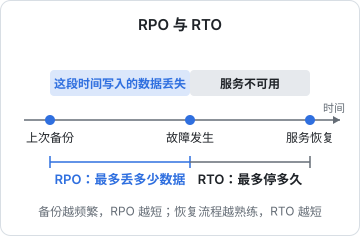
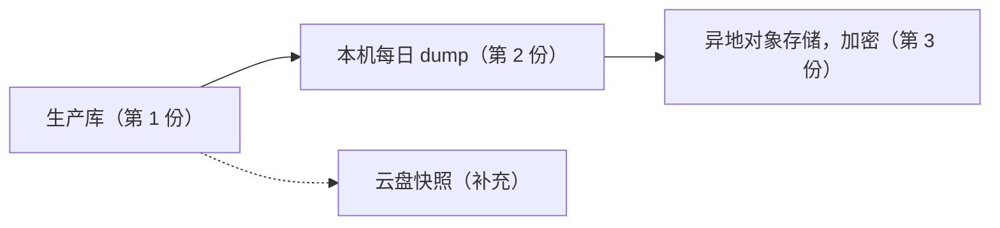
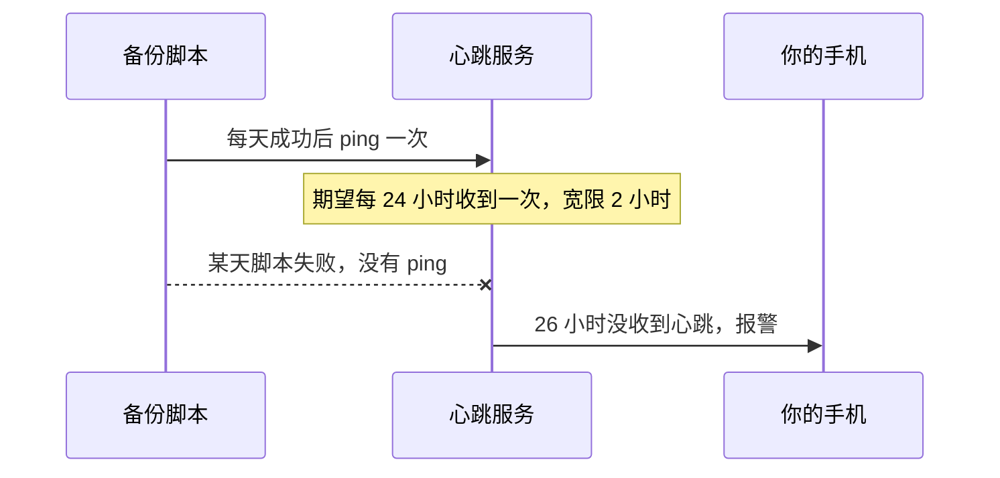

# 备份与容灾演练

「有备份」和「能恢复」是两回事。很多人直到要恢复的那一刻才发现：备份脚本三个月前就开始静默失败了，备份文件和数据库在同一块盘上，或者备份文件在，却没人记得恢复命令怎么写。本章先用 RPO / RTO 说清楚备份要达到什么目标，再盘点一个典型服务要备份哪些东西，然后搭一套异地、加密、失败会报警的备份，最后讲怎么做恢复演练，让「能恢复」变成定期验证过的事实。

## 先定目标：RPO 和 RTO

讨论备份方案之前，先回答两个问题：

- **RPO**（Recovery Point Objective，恢复点目标）：出事时**最多能丢多长时间的数据**。每天凌晨备份一次，最坏情况就是丢掉将近 24 小时的数据
- **RTO**（Recovery Time Objective，恢复时间目标）：从出事到恢复服务，**最多能停多久**



这两个数字决定了方案的形态和成本：

| 目标 | 需要的手段 | 成本 |
|---|---|---|
| RPO 24 小时 | 每天一次逻辑备份（`pg_dump`） | 几行脚本 |
| RPO 几分钟 | 持续归档 WAL，按时间点恢复（PITR） | 要专门维护，或者用托管数据库 |
| RTO 几小时 | 有文档、演练过的手工恢复流程 | 每季度演练一次的时间 |
| RTO 几分钟 | 热备、自动故障转移 | 至少两台机器，复杂度翻倍 |

一人公司的早期产品，**RPO 24 小时、RTO 4 小时**通常是合理的起点：每天备份一次，出事后半天内能在一台新机器上恢复。先老老实实做到这个程度，再根据用户的实际要求往上提。PITR 和主从复制在[《PostgreSQL 运维》](../database-ops/)里展开，本章只讲通用的部分。

把你的目标写进仓库的运维文档里。写下来之后，「每天备份一次够不够」就不再是一个凭感觉的问题，而是「用户能不能接受丢一天的数据」。

## 要备份什么

只备份数据库是最常见的遗漏。设想机器整个没了，你要在一台新机器上把服务原样恢复，需要哪些东西：

| 类别 | 例子 | 在哪 | 怎么备份 |
|---|---|---|---|
| 业务数据 | Postgres 里的全部表 | 容器卷 | 每天 `pg_dump`，异地存放 |
| 用户上传的文件 | 单据照片、头像 | 对象存储或本地目录 | 对象存储开版本控制；本地目录要同步到异地 |
| 机器上的配置 | compose 文件、nginx 配置、部署脚本 | 仓库 | 本来就在 git 里 |
| 密钥 | `*.env`、证书私钥、签名密钥 | 只在机器上 | 加密后存进密码管理器 |
| 外部配置 | DNS 记录、安全组、云存储桶的权限 | 云控制台 | 导出或截图存档，有余力用 IaC |
| 「怎么恢复」的知识 | 恢复步骤、各账号在哪 | 你的脑子里 | 写成文档，放在服务器之外 |

几个容易出问题的地方：

- **密钥**：hatch-counter 的 `api.env` 是在机器上用 `openssl rand` 生成的，不进 git（[《部署与 CI/CD》第 3 章](../deploy-release/03-env-secrets.md)）。机器没了，这些值也就没了。数据库密码可以重设，但**签发令牌的密钥丢了，所有用户都会被登出**；安卓签名密钥丢了，就再也发不了同一个应用的更新。这类东西必须另存一份到密码管理器
- **证书**：Let's Encrypt 证书丢了可以重新申请，不用备份；但要注意签发频率限制，恢复时别反复申请
- **最后一行**：恢复文档如果只放在那台服务器上，机器挂了就看不到了。放在仓库里，再在密码管理器里放一份

## 3-2-1 原则

经典的 3-2-1 原则：**3 份数据副本，存在 2 种不同介质上，其中 1 份在异地**。放到一台 VPS 的场景里：



- 本机的 dump 用来快速恢复「我误删了一张表」这种小事故
- 异地那份用来应对「整台机器、整个可用区都没了」
- **快照不算异地备份**。它和机器在同一个云账号里，账号被盗或欠费停机时一起没了。快照恢复的是整块盘，也没法只捞回一张表

### 案例：只有快照，是一个「知道的风险」

hatch-counter 现在的备份只有云盘自动快照这一层。它的部署文档把代价照实写了下来：快照只能整盘回滚，退不了「昨天下午我把一张表改坏了」，也捞不出单独一家店的数据。之所以暂时这么做，是因为自建 Postgres 只是过渡形态，正式运营时要迁到托管数据库，到时候备份由托管服务接手；为一个迟早要拆掉的形态养一套备份、一把额外的密钥和每月的演练，不值得。

文档里补了一条操作纪律：**手动改库之前，先去控制台手动创建一次快照**。另外，快照配好后拿它建了一块新盘挂上，确认能看到库文件。

这个案例想说明的不是「快照就够了」，而是：**备份方案可以简陋，但必须是有意识的选择**，把代价写下来，并给出什么时候补上。「知道的风险」和「忘了的风险」差别很大。

## 搭一套异地加密备份

下面用 restic 把 Postgres 的 dump 送到 S3 兼容的对象存储（Cloudflare R2、阿里云 OSS、各家的 S3 兼容存储都可以）。选 restic 的理由：

- 客户端加密，对象存储那边看到的只是密文
- 去重和增量，每天备份不会让存储线性增长
- 自带保留策略（`forget`）和完整性校验（`check`）

### 准备

```bash
sudo apt install -y restic
restic version
```

在对象存储上建一个**专用的桶**，再建一把只能访问这个桶的钥匙。把配置写进一个只有 root 能读的文件：

```bash
# /etc/restic/env，权限 600
export RESTIC_REPOSITORY="s3:https://<对象存储的 S3 端点>/<桶名>"
export RESTIC_PASSWORD_FILE="/etc/restic/password"
export AWS_ACCESS_KEY_ID="<只能访问这个桶的钥匙>"
export AWS_SECRET_ACCESS_KEY="<对应的密钥>"
```

```bash
sudo install -d -m 700 /etc/restic
openssl rand -base64 32 | sudo tee /etc/restic/password >/dev/null
sudo chmod 600 /etc/restic/password /etc/restic/env

sudo bash -c 'source /etc/restic/env && restic init'
```

**`/etc/restic/password` 必须另存一份到密码管理器**。restic 的加密没有后门，这个密码丢了，备份就是一堆打不开的密文。机器没了而密码只在机器上，等于没有备份。

### 备份脚本

在[《Linux 系统与命令行》第 8 章](../linux-essentials/08-shell-scripting.md)那个本地备份脚本的基础上，加上异地和报警：

```bash
#!/usr/bin/env bash
#
# 每天备份 Postgres 到异地对象存储。由 offsite-backup.timer 调用

set -euo pipefail
umask 077
source /etc/restic/env

cd /srv/myapp

# 1. dump 到本地临时文件，失败就整个脚本失败，不会产生半截快照
dump=/var/tmp/pg-$(date +%F).dump
trap 'rm -f "$dump"' EXIT
docker compose exec -T postgres pg_dump -U app -Fc app > "$dump"

# 2. 太小说明出问题了（比如连错了库），宁可失败也不存一个空备份
size=$(stat -c %s "$dump")
if (( size < 100000 )); then
  echo "dump 只有 ${size} 字节，疑似异常，放弃本次备份" >&2
  exit 1
fi

# 3. 送到异地，打上标签方便筛选
restic backup "$dump" --tag pg --host prod

# 4. 保留策略：最近 7 天每天一份、4 周每周一份、6 个月每月一份
restic forget --tag pg --keep-daily 7 --keep-weekly 4 --keep-monthly 6 --prune

# 5. 成功了才发心跳（见下一节）
curl -fsS -m 10 --retry 3 "$BACKUP_PING_URL" >/dev/null

echo "异地备份完成：$(numfmt --to=iec "$size")"
```

- `-Fc` 是 pg_dump 的自定义格式，恢复时用 `pg_restore`，可以只恢复某张表。它默认会压缩输出，而压缩过的数据前后两天几乎没有相同的块，restic 的去重基本失效。库大了以后可以改成 `-Fc -Z 0` 输出不压缩的格式，让 restic 去重，再由 restic 自己压缩（较新的 restic 仓库格式支持压缩，以你所装版本的文档为准）
- 先落盘再上传，而不是用管道直接喂给 restic：管道里 `pg_dump` 中途失败时，restic 可能已经存下了一份不完整的快照
- 大小阈值按你的库的实际大小定，目的是挡住「备份了一个空库」这种最隐蔽的失败
- `BACKUP_PING_URL` 也写进 `/etc/restic/env`

用 systemd timer 每天跑（timer 的写法见[《Linux 系统与命令行》第 4 章](../linux-essentials/04-systemd.md)）：

```ini
# /etc/systemd/system/offsite-backup.service
[Unit]
Description=Offsite backup to object storage

[Service]
Type=oneshot
ExecStart=/srv/myapp/offsite-backup.sh
```

```ini
# /etc/systemd/system/offsite-backup.timer
[Unit]
Description=Daily offsite backup

[Timer]
OnCalendar=*-*-* 03:30
RandomizedDelaySec=15m
Persistent=true

[Install]
WantedBy=timers.target
```

```bash
sudo systemctl daemon-reload
sudo systemctl enable --now offsite-backup.timer
sudo systemctl start offsite-backup.service   # 先手动跑一次
journalctl -u offsite-backup -n 20
```

### 防止备份被一起删掉

服务器被入侵后，攻击者能读到 `/etc/restic/env`，也就能删掉桶里的备份。勒索软件就是这么干的。restic 在 S3 上工作时需要删除自己的锁文件，所以不能简单地给它一把「只写不删」的钥匙。可行的做法：

- 在桶上**开启版本控制**，并配置生命周期规则，让被删除或覆盖的旧版本再保留一段时间（比如 30 天）
- 如果对象存储支持**对象锁定**（WORM），可以对备份桶开启
- 定期从**另一台机器**（比如你的电脑）用不同的凭据执行 `restic snapshots`，确认历史还在

各家对象存储对版本控制和对象锁定的支持程度不同，以对应服务的文档为准。

## 让备份的失败被看见

备份最危险的失败方式是**静默失败**：脚本出错了，但没有人知道。解决办法是反过来想：不是「失败时发通知」，而是「**成功时发心跳，太久没收到心跳就报警**」。这种模式叫 dead man's switch。



为什么不在脚本里失败时发通知？因为很多失败根本走不到发通知那一步：timer 没启用、机器关了、磁盘满了导致脚本起不来。心跳模式能覆盖所有这些情况。

Healthchecks.io 这类服务就是做这件事的，也有可以自己部署的开源版本。注意不要把心跳服务部署在被监控的同一台机器上。第 7 章讲值班时，会把所有这类报警汇总到同一个通知渠道。

## 恢复演练

**从没恢复过的备份不算备份。** 演练的目的有三个：确认备份文件真能用；确认恢复步骤写对了；知道恢复实际要多久，也就是你真实的 RTO。

### 三个级别

| 级别 | 做什么 | 频率 | 耗时 |
|---|---|---|---|
| 校验 | `restic check` 抽查数据完整性，`restic snapshots` 确认最新快照的时间 | 每周（可以自动） | 几分钟 |
| 恢复到临时库 | 把最新备份恢复到一个临时 Postgres 里，跑几条查询核对 | 每月 | 半小时 |
| 整机重建 | 开一台全新的机器，只看文档，把整个服务恢复起来 | 每半年或每年 | 半天 |

### 恢复到临时库

这一级可以写成脚本，在本机或服务器上跑：

```bash
#!/usr/bin/env bash
# 把最新的异地备份恢复到一个临时 Postgres 容器里，核对后删除
set -euo pipefail
source /etc/restic/env

work=$(mktemp -d)
trap 'docker rm -f restore-test >/dev/null 2>&1 || true; rm -rf "$work"' EXIT

# 取出最新一份 dump（restore 会按原路径还原到 target 下面）
restic restore latest --tag pg --target "$work"
dump=$(find "$work" -name 'pg-*.dump' | head -n 1)
echo "恢复的文件：$dump"

# 起一个临时库，版本和生产一致
docker run -d --name restore-test -e POSTGRES_PASSWORD=test postgres:16-alpine >/dev/null
until docker exec restore-test pg_isready -U postgres >/dev/null 2>&1; do sleep 1; done

docker exec restore-test createdb -U postgres app
# --no-owner：临时库里没有生产的那些角色
docker exec -i restore-test pg_restore -U postgres -d app --no-owner < "$dump"

# 核对：表的数量和最近的数据
docker exec restore-test psql -U postgres -d app -c \
  "select count(*) as tables from information_schema.tables where table_schema='public';"
```

最后一步的核对要按你的业务写。比如查一下最近一条订单的时间，确认它和备份时间吻合，而不只是「表都在」。

国内服务器拉不到 Docker Hub 时，把 `postgres:16-alpine` 换成你转存到自己镜像仓库里的那一份（[《容器技术》第 7 章](../docker-containers/07-registry.md)）。

### 整机重建演练

这是最有价值、也最常被跳过的演练。规则只有一条：**只看文档，不凭记忆**。

1. 开一台新的按量计费机器（演练完就释放，花不了多少钱）
2. 打开你的恢复文档，从第一步开始照做
3. 每遇到一处「文档没写、我凭记忆补上了」的地方，就停下来记录
4. 计时，从开机器到服务能正常访问（可以用本机 hosts 文件指过去测试，不改正式 DNS）
5. 演练结束后补全文档，释放机器

第一次演练通常会发现一长串问题：某个密钥文档里没提、某个包忘了装、某一步顺序不对。这些问题在平时发现，只是改一下文档；在真正出事时发现，就是凌晨三点对着空白终端发呆。

hatch-counter 的部署文档每一步末尾都有一句「应该看到」，这种写法天然适合演练：每一步都能判断有没有做对。

### 演练记录

每次演练记一笔，放在仓库里：

```markdown
## 2026-11 恢复演练

- 级别：恢复到临时库
- 备份时间：2026-11-02 03:41
- 耗时：12 分钟
- 结果：通过，最近一条订单时间 03:38，与备份时间吻合
- 发现的问题：restic 版本过旧，不支持某参数，已更新文档
```

记录能告诉你两件事：演练有没有在按计划做，以及 RTO 有没有随数据增长变慢。

## 本章要点

- 先定 **RPO**（能丢多少数据）和 **RTO**（能停多久），一人公司早期从「每天备份、半天内恢复」起步
- 备份对象不只是数据库：还有上传文件、**密钥**、外部配置和恢复文档本身
- 遵循 3-2-1：本机一份应对小事故，异地加密一份应对整机丢失；**快照不算异地备份**
- 用 restic 做加密、去重的异地备份，**加密密码另存进密码管理器**；桶开版本控制，防止备份被一起删除
- 用**心跳**而不是失败通知来发现备份的静默失败
- 恢复演练分三级：每周校验、每月恢复到临时库、每半年到一年整机重建；**只看文档，不凭记忆**
