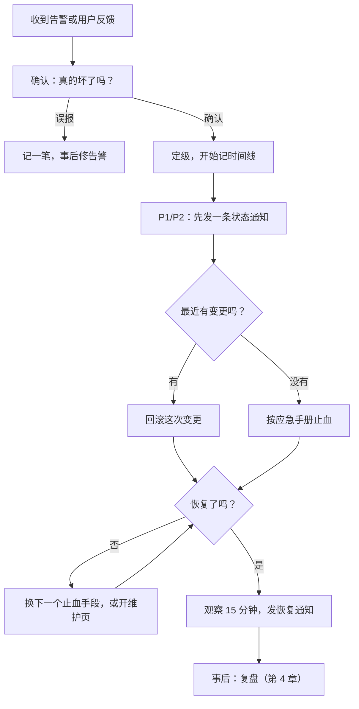

# 事故响应流程

事故总是在最不方便的时候来：你在吃饭，在睡觉，在外地。一个人处理事故时最大的敌人不是技术难度，而是慌：手忙脚乱地改配置，在生产库上敲命令，把一个 10 分钟能恢复的问题拖成两小时，甚至造成第二次事故。本章给出一套事先想好的流程：怎么判断严重程度、头几分钟做什么、为什么先止血再找原因、怎么跟用户沟通，以及怎么把这些写成出事时照着做的应急手册。

## 什么算事故

**事故**是指用户正在受到影响、或者马上会受到影响，需要你放下手头的事立即处理的情况。不是每个 bug 都是事故。先给自己定一个分级，出事时第一件事就是对号入座：

| 级别 | 定义 | 例子 | 响应 |
|---|---|---|---|
| P1 | 核心功能对所有或大部分用户不可用，或者数据正在丢失、泄露 | 全站 502；证书过期；数据库被删 | 立即处理，半夜也起来 |
| P2 | 核心功能部分不可用，或者有明显降级但有绕行办法 | 图片上传失败，但记账正常；某个地区访问很慢 | 醒着的时候尽快处理 |
| P3 | 非核心功能故障，或者影响很少的用户 | 某个报表导出报错；一个用户反馈登录问题 | 排进工作计划 |

分级的意义在于**事先**决定好什么情况值得打断睡眠和假期。凌晨三点被叫醒时，你不该再花脑力去想「这个要不要现在处理」。第 7 章讲值班时，告警会按这个级别路由。

两类情况无论影响面多小，都按 P1 处理：**数据正在丢失或损坏**，以及**安全事件**（疑似被入侵、密钥泄露）。这两类拖得越久，损失越不可逆。

## 头几分钟



### 1. 确认

先花一分钟确认问题是真的，而且是你这边的：

```bash
# 从外部看：能不能访问，返回什么
curl -sS -o /dev/null -w '%{http_code} %{time_total}s\n' https://<你的域名>/v1/health

# 登上机器：容器状态、最近日志
docker compose ps
docker compose logs --since 10m api | tail -50
```

如果只有一个用户反馈，先排除他自己的网络问题；如果外部探测报警但你访问正常，看看是不是探测点所在地区的网络问题。确认的标准是：**你自己复现了，或者有客观的指标证明**。

### 2. 开始记时间线

从确认的那一刻起，就在一个文本文件或备忘录里记时间线。每做一个动作、看到一个现象，记一行：

```text
03:12 收到告警：健康检查连续 3 次失败
03:14 确认：curl 返回 502，docker compose ps 显示 api 在反复重启
03:15 日志：connection refused postgres:5432
03:16 postgres 容器状态 unhealthy，日志 No space left on device
03:18 df -h：/ 100%
03:20 清理 docker 旧镜像，释放 6G
03:22 postgres 恢复 healthy，api 恢复
03:25 外部探测恢复，发恢复通知
```

这看起来是在浪费宝贵的处理时间，其实不是：

- 你在慌乱中会忘记自己试过什么，时间线防止你重复操作或者漏掉一步
- 复盘（第 4 章）完全依赖它，事后凭记忆重建时间线是不可靠的
- 需要跟用户或者合作方解释时，直接就有材料

不必写得漂亮，几个字加时间就够了。

### 3. 先止血，再找原因

这是事故响应中最重要的一条原则：**首要目标是恢复服务，不是找到根因**。

工程师的本能是想弄明白为什么，但在用户受影响的时候，每多花一分钟分析，就多一分钟的停机。大部分事故都能在不知道根因的情况下先止血：

| 止血手段 | 什么时候用 | 参考 |
|---|---|---|
| 回滚到上一版 | 问题出现在一次发版之后 | [《部署与 CI/CD》第 7 章](../deploy-release/07-rollback.md) |
| 关掉功能开关 | 问题出在某个新功能上 | 同上 |
| 重启服务 | 内存泄漏、连接池耗尽、进程卡死 | `docker compose restart api` |
| 释放资源 | 磁盘满、内存满 | [《Linux 系统与命令行》](../linux-essentials/)第 7、9 章 |
| 开维护页 | 需要停写数据，或者需要时间修复 | [《部署与 CI/CD》第 2 章](../deploy-release/02-deploy-scripts.md) |
| 封禁来源 | 被刷、被攻击 | [《Nginx 与反向代理》第 5 章](../nginx-gateway/05-rate-limit.md)，第 1 章的 fail2ban |
| 切换外部依赖 | 第三方服务挂了，有备用服务商 | 应用里预留的配置 |

**「最近有没有变更」是最有价值的问题。** 线上事故绝大多数由变更引起：发版、改配置、改数据库、证书或依赖的变化。如果事故开始前不久刚发过版，不要先分析，直接回滚；回滚后恢复了，就有充足的时间慢慢查。

重启会丢掉现场。如果时间允许，重启前花 30 秒保存证据：

```bash
docker compose logs --since 30m api > /tmp/incident-$(date +%H%M).log
docker stats --no-stream > /tmp/incident-stats-$(date +%H%M).txt
```

### 4. 不要在事故中做的事

- **不要在生产库上随手写 `UPDATE` / `DELETE`**。确实需要改数据，先手动建一次快照或备份，写好语句先用 `SELECT` 跑一遍看影响的行数，在事务里执行
- **不要一次改多处**。改一处、看结果、记时间线，再决定下一步。同时改三处，恢复了也不知道是哪个起作用，没恢复更不知道是不是又引入了新问题
- **不要在恢复后立刻发修复版本**。止血之后服务已经稳定，根因修复走正常的开发、测试、发版流程，不要在疲惫中赶着上线
- **不要让 agent 在生产环境自由发挥**。见下文

## 和用户沟通

一个人做产品，沟通往往比修复本身更影响用户的信任。用户能接受服务偶尔出问题，难以接受的是**不知道发生了什么**。

### 什么时候发

- P1 确认后 **10 分钟内**发第一条，哪怕你还什么都不知道
- 处理中每 30 分钟更新一次，即使没有进展也说「仍在处理」
- 恢复后发一条恢复通知
- 影响较大的事故，事后发一份简短的说明

### 发到哪

提前定好渠道，出事时不用现想：

- 产品内的公告栏或者横幅（如果服务本身挂了，这个渠道也就没了）
- 用户群（企业微信群、微信群、Discord、Telegram 等）
- 一个独立的状态页，**不要和主服务部署在同一台机器上**
- 对 B 端客户，直接联系对方的负责人

### 模板

提前写好，出事时填空。语气要诚实、具体，不推卸责任：

```text
【服务异常】
目前 XX 功能无法正常使用（例：无法登录 / 图片上传失败），我们已在处理。
已有的数据不受影响。预计 XX 点前给出下一次进展。
给你带来不便，非常抱歉。
```

```text
【已恢复】
XX 功能已于 HH:MM 恢复正常，影响时段为 HH:MM–HH:MM。
原因是 XX（一句话，用户能理解的说法）。
期间提交的 XX 数据（如有影响，说明怎么处理）。
我们会采取 XX 措施避免再次发生。
```

注意第一条模板里的「已有的数据不受影响」：**只有你确认过才能写**。不确定就不要写，写错了比不写伤害更大。

## 应急手册

上面讲的都是通用流程。具体到你的系统，还需要一份「症状 → 原因 → 处理」的**应急手册**（runbook），放在仓库里，出事时直接查。

hatch-counter 的部署文档里有一节「出事了」，就是一份很好的应急手册。它是一张表，每一行是一个具体的症状：

| 症状 | 多半是 | 怎么办 |
|---|---|---|
| `curl localhost:3000/v1/health` 回 503 | 服务端起来了，但连不上库 | `docker compose ps` 看 postgres 健不健康，再看它的日志 |
| 全站都是「正在维护」，可没人在部署 | 上次部署炸在半路，维护标记留着没摘（这是有意的） | 确认健康检查是 200 之后，删掉维护标记文件 |
| 域名打不开 / 证书报错 | 解析没生效，或者 nginx 没 reload | `dig +short <域名>`、`sudo nginx -t` |

（表格节选自 hatch-counter 的部署文档，域名等细节已省略。）

这份手册好在几个地方：

- **按症状索引**。出事时你知道的是症状，不是原因
- **每条都来自真实踩过的坑**，不是想象出来的
- **给出具体命令**，而不是「检查数据库连接」这种空话
- 表格下面附了一组常用命令，复制即用

### 应急手册应该包含什么

| 部分 | 内容 |
|---|---|
| 入口信息 | 怎么登上机器；VNC 救援入口在控制台哪里；各云账号、DNS、对象存储的位置（不写密码，写在密码管理器里的条目名） |
| 系统地图 | 一张图：请求从哪进来，经过哪些组件，数据存在哪 |
| 常用命令 | 看状态、看日志、重启、回滚、开关维护页 |
| 症状表 | 上面那种「症状 → 原因 → 处理」的表格，每次事故后补一行 |
| 恢复流程 | 指向第 2 章的恢复文档 |
| 外部联系方式 | 云厂商工单入口、域名注册商、关键第三方服务的状态页 |
| 沟通模板 | 上一节的模板和发布渠道 |

手册放两个地方：仓库里一份，**服务器之外能离线看到的地方**再放一份（比如导出成 PDF 放在手机上）。机器登不上的时候，你最需要它。

## 安全事件的特殊处理

怀疑被入侵（陌生进程占满 CPU、陌生的 ssh 登录记录、云账单突然暴涨）时，流程有些不同：

1. **先切断，再调查**：在安全组上只放行你自己的 IP，或者直接停掉对外服务。不要先在机器上到处看，攻击者可能还在线
2. **轮换所有密钥**：云 AccessKey、数据库密码、令牌签名密钥、ssh 密钥。从**另一台干净的机器**上操作，假设这台服务器上的一切都已泄露
3. **保留证据**：在云控制台给系统盘打快照，供事后分析
4. **重建而不是清理**：你无法确定攻击者留下了什么后门，最可靠的做法是开一台新机器，按恢复文档重建，从入侵发生之前的备份恢复数据
5. **评估是否需要告知用户**。涉及个人信息泄露时，可能还有法定的报告义务，具体以所在地主管部门的最新规定为准

这正是第 2 章强调整机重建演练的原因之一：重建演练过，安全事件时的选择就很简单。

## 事故中用 agent

编码 agent 在事故中很有用：读日志找线索、解释陌生的报错、生成排查命令、对照代码找出某个错误从哪抛出来。但事故是最需要控制风险的场景，用法要收窄：

- **让它读，不让它写**。把日志、命令输出贴给它分析；需要执行的命令由它提出、你确认后自己执行
- **不要把生产环境的密钥、用户数据贴进对话**。贴日志前扫一眼有没有令牌、手机号
- **不让它直连生产机器做破坏性操作**。即使你平时给了它较高的权限，事故中也降回来。疲惫的你很容易对它的提议直接点「同意」

[《个人 Agent 工作流》](../personal-agent-workflow/)讲过把危险动作做窄、做成可逆的思路，在事故中尤其适用。

## 本章要点

- 事先定好 **P1 / P2 / P3** 分级，出事时直接对号入座；数据丢失和安全事件一律按 P1
- 头几分钟：**确认 → 定级 → 记时间线 → 发通知 → 止血**
- **先止血，再找原因**；最近有变更就先回滚，这是最快的止血手段
- 事故中不随手改生产数据、不一次改多处、不赶着发修复版本
- 用户沟通要早、要诚实，提前准备好**模板和渠道**，状态页不与主服务同机
- 写一份按症状索引的**应急手册**，放在服务器之外也能看到的地方，每次事故后补充
- 安全事件：先切断、轮换密钥、保留证据、**重建而不是清理**

## 动手练习

1. **给事故定级**：按本章的分级表，给下面四件事各定一个级别并写出第一个动作：A. 晚上 11 点，外部探测报警，全站 502，一小时前刚发过版；B. 一位用户说导出 CSV 报错，其他人没反馈；C. 图片上传全部失败，但记账、查询正常；D. 日志里看到一条陌生 IP 的 ssh 登录成功记录。

   验证：对照本章「什么算事故」和「先止血，再找原因」，每一项都能说出依据。

   参考答案：A 是 P1，最近有变更，直接回滚，不先分析；B 是 P3，排进工作计划；C 是 P2，有绕行办法，醒着时尽快处理；D 影响面看似为零，但属于安全事件，一律按 P1：先在安全组上切断，再从另一台干净的机器轮换密钥。

2. **在一次性容器里演一次磁盘满**：起一个数据目录很小的库 `docker run -d --name pgfull --tmpfs /var/lib/postgresql/data:size=100m -e POSTGRES_PASSWORD=t postgres:16-alpine`，等它就绪后用 `docker exec pgfull sh -c 'dd if=/dev/zero of=/var/lib/postgresql/data/filler bs=1M'` 把剩余空间填满，再执行 `docker exec pgfull psql -U postgres -c 'create table t as select generate_series(1,1000000)'`。全程照本章格式记时间线，然后止血。

   验证：建表失败，报错里有 `No space left on device`；删掉 `filler` 后同一条语句成功。你手上有一份五六行、带时间的记录。

   参考答案：止血是 `docker exec pgfull rm /var/lib/postgresql/data/filler`，先恢复再追问「谁写满的」。练完 `docker rm -f pgfull`。重点不在命令，而在一边操作一边记时间线，体会它在复盘时有多省事。

3. **补一行应急手册**：给第 2 题的现象写一行「症状 → 多半是 → 怎么办」，要求症状是你出事时第一眼能看到的东西，处理里给出可以直接复制的命令。

   验证：把这一行给一个没看过这道题的人，他只看这一行就能定位到磁盘问题并知道先跑什么。

   参考答案：例如「api 反复重启，日志里 `connection refused postgres:5432`」→「postgres 起不来，常见原因是磁盘满」→「`df -h` 看根分区；满了先 `docker image prune -a` 释放空间，再 `docker compose ps` 确认 postgres 恢复 healthy」。症状写现象而不写原因，因为出事时你只知道现象。
