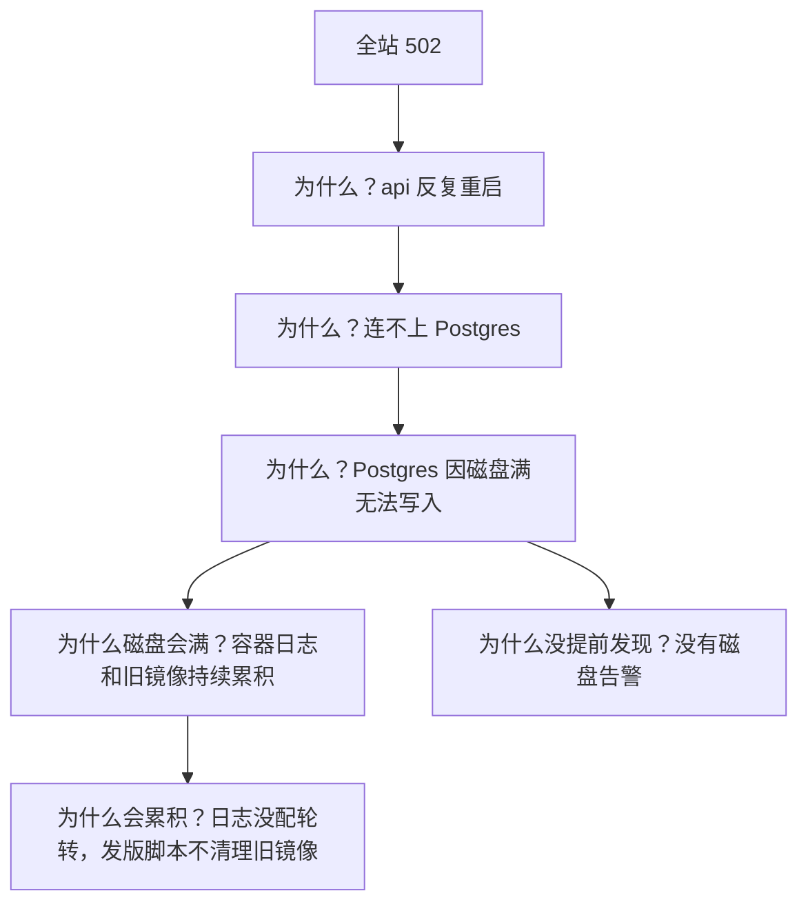

# 复盘

服务恢复之后，最容易做的事是长出一口气，然后去睡觉，第二天接着写新功能。这样做的结果是同一类事故反复发生，每次都以为是「运气不好」。复盘（postmortem）就是把一次事故变成系统的改进：弄清楚发生了什么、为什么没有更早发现、为什么恢复花了这么久，然后落实几条具体的改进。本章讲一个人怎么做复盘：什么时候做、用什么模板、怎么找原因、怎么让改进项真的落地，最后给一份完整的示例。

## 为什么一个人也要复盘

团队做复盘，一部分目的是在成员之间同步信息。一个人似乎不需要：发生了什么，你都知道。但复盘真正的价值不在于同步，而在于三件事：

- **强迫你在情绪平复后重新想一遍**。事故当时你只想着恢复，很多细节和关联只有事后冷静下来才看得见
- **把教训变成具体的改动**。「以后注意磁盘空间」不算改进；「加一个磁盘 80% 的告警，并给 Docker 日志配上轮转」才算
- **留下记录**。半年后同样的症状出现，搜一下就能找到上次的处理过程。积累多了，这些记录会告诉你系统最脆弱的地方在哪

另外，一个人做复盘还有一个特殊的好处：**它是你和未来的自己之间的交接文档**。半年后的你和现在的你，对这个系统的了解差别很大。

## 什么时候做

- 所有 P1 事故
- 用户能感知到的 P2 事故
- **险些酿成事故的情况**（near miss）：比如差点在生产库上执行了错误的迁移，最后关头发现了。这类事件没有造成损失，却暴露了同样的漏洞，复盘成本很低，收益很高

时机是**恢复后 1–3 天内**。当天太累，也可能还有余波；拖过一周细节就忘了。不需要很长时间，一般事故半小时到一小时足够。

## 不追责：对过去的自己也一样

团队复盘有一条核心原则叫**不追责**（blameless）：不问「谁的错」，而问「系统哪里让这个错误有机会发生、又没有被拦住」。

一个人做复盘时，这条原则同样重要，只是对象变成了过去的自己。「我太粗心了」「下次我会小心」是最常见、也最没用的复盘结论。人在疲惫、赶时间、被打断时一定会犯错，这是常态而不是例外。好的系统应该让错误**难以发生**，或者发生了也**能被拦住、影响有限**。

把「我」换成「系统」来问：

| 追责式的问法 | 系统式的问法 |
|---|---|
| 我为什么没检查磁盘？ | 磁盘满之前，为什么没有任何告警？ |
| 我为什么在生产库上敲错了命令？ | 为什么修数据需要在生产库上手敲命令？有没有更安全的通道？ |
| 我为什么发版前没测？ | 为什么一个没通过测试的版本能被发上线？ |
| 我为什么忘了续证书？ | 为什么证书续期依赖我记得？ |

## 模板

在仓库里建一个目录（比如 `docs/postmortems/`），每次事故一个文件，用同一个模板：

```markdown
# 2026-11-02 磁盘写满导致全站不可用

## 概要
- 级别：P1
- 影响时段：03:05–03:25（20 分钟）
- 影响：所有用户无法访问，期间的写入请求全部失败，无数据丢失
- 发现方式：外部健康检查告警

## 时间线
（直接从事故中记的时间线整理过来）

## 原因
（发生了什么，以及为什么会发生。见下一节的方法）

## 做得好的地方
## 做得不好的地方
## 运气成分
（哪些地方是侥幸没有更糟）

## 改进项
| 改进 | 类型 | 状态 |
|---|---|---|
```

「运气成分」这一节很多人会跳过，但它往往最有价值。比如「这次刚好在我醒着的时候发生」「刚好前一天手动打过快照」，每一条都是一个尚未修补的漏洞。

## 找原因

### 五个为什么，以及它的局限

最常用的方法是连续问「为什么」，直到问到可以改动的地方：



这个例子已经显示出「五个为什么」的局限：**原因往往不是一条链，而是一棵树**。磁盘满是一个原因，没有告警是另一个原因，它们独立存在，各自都值得修。强行只追一条链，会漏掉其余的分支。

### 从三个角度找

更实用的做法是固定从三个角度去问，每个角度各自得出改进项：

| 角度 | 问题 | 改进的方向 |
|---|---|---|
| 发生 | 为什么会出问题？ | 预防：让这类问题不再发生 |
| 发现 | 为什么没有更早发现？用户先发现的，还是告警先发现的？ | 检测：告警、监控、健康检查 |
| 恢复 | 为什么恢复花了这么久？哪一步最慢？ | 缓解：应急手册、自动化、回滚能力 |

很多时候，第二、三个角度的改进比第一个更有价值。你不可能预防所有问题，但可以让每个问题都**更早被发现、更快被恢复**。如果一个问题 1 分钟发现、2 分钟恢复，它发生的频率就不那么重要了。

### 区分根因和触发条件

「凌晨的定时任务产生了大量日志」是**触发条件**，「日志无上限累积、磁盘没有告警」才是**根本原因**。触发条件每次都可能不同，今天是日志，明天是一次大的数据导入，后天是一个上传接口被刷。只修触发条件，同类事故会换个样子再来。

## 改进项：让它真的落地

复盘写得再好，改进项没做就等于没写。几条经验：

**每一项都要具体、可验证。** 「加强监控」不是改进项；「加一个磁盘使用率超过 80% 的告警，推送到手机」是。判断标准：做完之后，你能明确说出「这一项完成了」。

**按类型分配，优先做检测和缓解。** 预防类的改动往往要动代码、动架构，周期长；检测和缓解类的往往一两个小时就能做完，立刻见效。

**数量要少。** 一次复盘列出十几项改进，最后一项都做不完。挑最有价值的 2–4 项，其余的记下来，以后再说。

**放进你平时用的任务列表。** 改进项和功能开发放在同一个地方，排进计划。单独放在复盘文档里的改进项，基本不会再被打开。

**定期回顾。** 每月看一次所有复盘的改进项状态（第 8 章的月度清单里有这一项）。

改进项的效果可以按层次排序，越靠前越可靠：

| 层次 | 例子 | 可靠程度 |
|---|---|---|
| 消除 | 不再自建数据库，改用托管服务 | 最高：这类问题不再存在 |
| 自动化 | 发版脚本自动清理旧镜像；证书自动续期 | 高：不依赖人 |
| 检测 | 磁盘告警、证书到期告警 | 中：问题会发生，但能提前知道 |
| 流程 | 发版前对照检查清单 | 较低：依赖人去执行 |
| 「注意」 | 下次小心 | 无效 |

## 示例：一次磁盘写满的复盘

下面是一份完整的示例。事故是虚构的，但每个环节都是 Docker Compose 部署里常见的情况。值得一提的是，hatch-counter 的生产编排里给每个容器都配了日志上限，注释写的正是「不配的话磁盘会被日志慢慢吃满，而磁盘满了之后 Postgres 的表现是最难查的那一类」；它的部署文档也把「没有磁盘告警」列为最该先补的一项。

```markdown
# 2026-10-18 磁盘写满导致全站不可用

## 概要
- 级别：P1
- 影响时段：03:05–03:25（20 分钟）
- 影响：所有用户无法访问；期间写入失败，客户端提示重试；无数据丢失
- 发现方式：外部健康检查告警（03:08）

## 时间线
- 03:05 Postgres 写入失败，api 健康检查开始失败，进入重启循环
- 03:08 外部探测连续三次失败，手机收到告警
- 03:12 登上机器，docker compose ps 看到 api 在重启
- 03:15 api 日志：连不上数据库；postgres 日志：No space left on device
- 03:18 df -h：系统盘 100%
- 03:19 docker system df：旧镜像占 6.1G，容器日志占 3.4G
- 03:20 docker image prune -a --filter until=168h，释放 6G
- 03:22 postgres 恢复 healthy，api 恢复
- 03:25 外部探测恢复，在用户群发恢复通知
- 03:40 观察无异常，结束

## 原因
发生：每次发版拉新镜像，旧镜像从不清理，三个月累积 6G；
新加的 worker 容器没有配置日志上限，一个重试死循环两天内写了 3G 日志。
发现：没有磁盘使用率告警，磁盘从 80% 到 100% 用了两天，期间无任何提示。
恢复：较快。耗时主要在定位，postgres 的报错没有直接出现在 api 日志里。

## 做得好的地方
- 外部健康检查 3 分钟内发现问题
- 时间线记录完整
- 先清理释放空间恢复服务，没有在磁盘满的状态下重启 postgres

## 做得不好的地方
- 新增容器时漏了日志配置，compose 文件里没有统一的默认值
- 应急手册里没有「磁盘满」这一条，现场想的命令

## 运气成分
- 发生时刚好没有在跑迁移，否则可能留下半完成的迁移
- worker 的死循环本身是一个 bug，这次是被磁盘满间接暴露的

## 改进项
| 改进 | 类型 | 状态 |
|---|---|---|
| 磁盘使用率 > 80% 告警，推送手机 | 检测 | 已完成 |
| compose 用 x-logging 锚点给所有服务统一日志上限 | 自动化 | 已完成 |
| deploy.sh 发版成功后清理 7 天前的未使用镜像 | 自动化 | 已完成 |
| 应急手册加「磁盘满」一行 | 缓解 | 已完成 |
| 修复 worker 重试死循环，加最大重试次数 | 预防 | 进行中 |
```

示例里提到的 compose 统一日志配置，写法如下：

```yaml
x-logging: &default-logging
  driver: json-file
  options: { max-size: "20m", max-file: "3" }

services:
  postgres:
    logging: *default-logging
  api:
    logging: *default-logging
  worker:
    logging: *default-logging
```

用 YAML 锚点之后，新增服务时只需要写一行 `logging: *default-logging`，漏掉的概率小得多。更彻底的做法是在 `/etc/docker/daemon.json` 里设置全局默认的 `log-opts`，这样连这一行都不用写；注意它只对之后新建的容器生效。

## 复盘的积累

复盘文档攒到十几份之后，回头看一遍，通常会发现规律：

- 某个组件反复出现（比如总是数据库、总是证书）：说明它值得投入更多，或者换成托管服务
- 发现方式总是「用户告诉我的」：说明监控有盲区，这正是[《可观测性与性能》](../observability-performance/)要解决的问题
- 触发条件总是「发版」：说明发布流程需要加强，回到[《部署与 CI/CD》](../deploy-release/)

这些规律是决定下一步把运维时间花在哪里的最好依据，比任何最佳实践清单都更贴合你的系统。

## 本章要点

- 一个人也要复盘：在情绪平复后重想一遍、把教训变成具体改动、留下给未来自己的记录
- P1、用户可感知的 P2、**险些发生的事故**都值得复盘，时机是恢复后 1–3 天
- **不追责**，对过去的自己也一样：把「我为什么犯错」换成「系统为什么让错误发生、又没拦住」
- 原因是一棵树而不是一条链；固定从**发生、发现、恢复**三个角度找，分别对应预防、检测、缓解
- 区分**触发条件**和**根本原因**，只修触发条件，事故会换个样子再来
- 改进项要具体、可验证、数量少，放进日常任务列表；按「消除 > 自动化 > 检测 > 流程」的可靠程度选择
