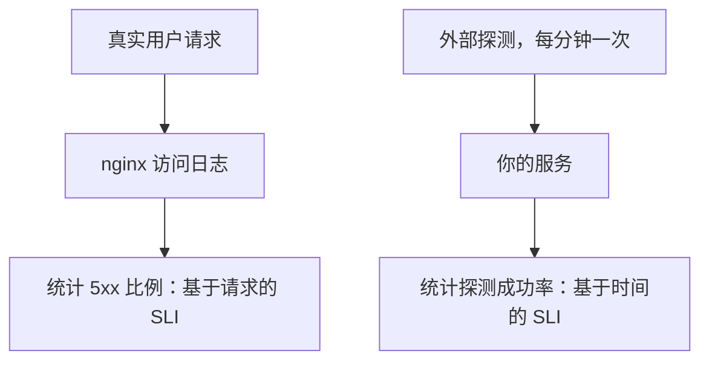
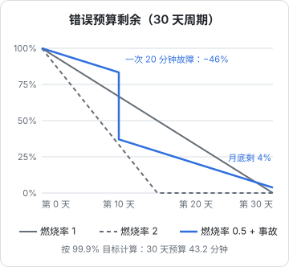

# SLO 与错误预算

「服务要多可靠」这个问题，很多人的答案是「越可靠越好」。但可靠性是有成本的：每多一个 9，需要的冗余、监控、值班投入都会成倍增加，而一个人的时间是固定的。SLO（服务等级目标）就是用一个数字回答「可靠到什么程度就够了」，错误预算则把这个数字变成决策工具：什么时候可以放心发新功能，什么时候该停下来修稳定性。本章讲怎么为一人产品选指标、定目标、算预算，以及怎么据此设计告警。

## 三个容易混的词

| 词 | 全称 | 是什么 | 例子 |
|---|---|---|---|
| SLI | Service Level Indicator，服务等级指标 | 一个**测量值**，衡量服务好不好 | 过去 30 天里成功请求的比例 |
| SLO | Service Level Objective，服务等级目标 | 你给 SLI 定的**目标** | 成功率 ≥ 99.9% |
| SLA | Service Level Agreement，服务等级协议 | 写进合同、**达不到要赔偿**的承诺 | 可用性低于 99.5% 时退还当月 10% 费用 |

关系是：SLI 是尺子，SLO 是你对自己的要求，SLA 是你对客户的承诺。**SLA 一定要比 SLO 宽松**，留出余地；大多数一人产品根本不需要 SLA，除非 B 端客户要求写进合同。

## 先算清楚几个 9 意味着什么

可用性目标用百分比表示，换算成允许的不可用时间，直觉就清楚了。以 30 天为周期（30 × 24 × 60 = 43200 分钟）：

| 目标 | 30 天内允许的不可用时间 | 意味着什么 |
|---|---|---|
| 99% | 432 分钟（7.2 小时） | 一次严重事故加几次小故障 |
| 99.5% | 216 分钟（3.6 小时） | 一次半夜发生、早上才处理的事故就差不多用完 |
| 99.9% | 43.2 分钟 | 一次回滚及时的发版事故 |
| 99.95% | 21.6 分钟 | 几乎不允许任何人工介入的故障 |
| 99.99% | 4.32 分钟 | 需要自动故障转移，人根本来不及处理 |

看这张表要有一个清醒的认识：**一个人、一台 VPS，现实的上限在 99.5%–99.9% 之间**。

- 你需要睡觉。夜里发生的故障，从告警到你清醒地登上机器，十几分钟很正常
- 单机架构下，云厂商的一次宿主机维护或故障，你什么都做不了
- 每次发版如果有几秒的 502（[《部署与 CI/CD》第 4 章](../deploy-release/04-zero-downtime.md)），一个月发几十次也会累积

承诺 99.99% 不会让服务更可靠，只会让你天天焦虑，或者让这个数字失去意义。

## 选 SLI：衡量用户的体验

SLI 要从**用户的角度**选，而不是从机器的角度。CPU 使用率 90% 不是问题，只要用户的请求都成功、都够快；CPU 只有 10% 但数据库连不上，用户的体验就是坏的。

一人产品最常用的两类 SLI：

| 类型 | 定义 | 怎么测 |
|---|---|---|
| 可用性 | 成功请求数 ÷ 总请求数 | nginx 访问日志里 5xx 的比例；或外部探测成功的比例 |
| 延迟 | 在某个时间内完成的请求比例 | nginx 日志里 `request_time` < 某个阈值的比例 |

几个具体的建议：

- **只看关键路径**。不是所有接口都同等重要。hatch-counter 这类门店管理系统，登录、记账、查看概览是核心；导出一份历史报表慢一点，没人会在意。可以只统计核心接口，或者按重要性分组
- **延迟用「比例」而不是「平均值」**。「95% 的请求在 500ms 内完成」比「平均延迟 200ms」有意义得多：平均值会被大量快请求掩盖少数很慢的请求
- **4xx 一般不算失败**。用户输错密码返回 401、请求不存在的资源返回 404，是正常行为；但如果你的服务因为 bug 错误地返回 4xx，要单独留意
- **起步时一个可用性 SLI 就够了**。不要一开始就定一堆指标

### 两种测量方式



| | 基于日志（请求） | 基于外部探测（时间） |
|---|---|---|
| 反映什么 | 真实用户实际遇到的情况 | 从外部看服务通不通 |
| 优点 | 准确反映用户体验 | 夜里没人用时也能发现故障；能发现 DNS、证书、网络问题 |
| 缺点 | 服务完全不通时，日志里什么都没有；流量小时波动大 | 只测了一两个接口 |
| 实现难度 | 要解析日志或者接入指标系统 | 用现成的拨测服务，几分钟就能配好 |

建议**两种都要，从外部探测开始**。外部探测几乎零成本，能抓住最严重的故障；日志统计等有余力时再做。具体的指标采集、存储和看板，在[《可观测性与性能》](../observability-performance/)里展开。

## 错误预算

SLO 定了 99.9%，就意味着你**允许** 0.1% 的失败。这 0.1% 就是**错误预算**：30 天周期里，相当于 43.2 分钟的完全不可用，或者 0.1% 的请求失败。

错误预算改变了思考可靠性的方式：它不是要追求零故障，而是**一笔可以花的额度**。

- 预算充足时：放心发新功能，做有风险的迁移，尝试新的架构
- 预算快用完时：暂停有风险的变更，把时间花在稳定性上
- 预算用超了：本周期剩下的时间只修稳定性问题

对团队来说，这是开发和运维之间的协议。对一个人来说，它解决的是一个更实际的问题：**你什么时候该停下来修基础设施，而不是继续写功能？** 没有错误预算，这个决定全凭感觉，结果往往是一直写功能，直到出了大事故。

### 写一份错误预算策略

一人产品的策略可以很短，关键是**事先**写下来：

```markdown
## 错误预算策略

- SLO：核心接口成功率 30 天滚动 ≥ 99.5%（预算 216 分钟 / 0.5% 请求）
- 预算剩余 > 50%：正常开发和发版
- 预算剩余 20%–50%：发版前必须跑完整测试，避免周五和夜间发版
- 预算剩余 < 20%：暂停新功能发版，只发稳定性修复
- 预算耗尽：直到滚动窗口恢复到 SLO 以上，只做稳定性工作；所有事故都要复盘
- 例外：安全修复不受限制
```

数字可以按自己的情况调，但要在平静的时候定好。事故后再定，容易定得过严或过松。

## 燃烧率与告警

有了错误预算，就可以用它来设计告警，而不是用「CPU > 80%」这种和用户体验无关的阈值。

**燃烧率**（burn rate）是预算消耗的速度。燃烧率为 1，意味着按这个速度，预算恰好在周期结束时用完；燃烧率为 2，15 天就会用完。



图中最右边那条阶梯线说明了一件事：在 99.9% 的目标下，一次 20 分钟的全站故障就会消耗 20 ÷ 43.2 ≈ 46% 的月度预算。这正是前面说「一个人现实的上限是 99.5%–99.9%」的原因。

### 按燃烧率告警

Google 的《SRE 工作手册》（The Site Reliability Workbook）推荐用多个时间窗口的燃烧率告警。下面是其中常被引用的一组参数，对一个人同样适用：

| 条件 | 燃烧率 | 含义 | 处理方式 |
|---|---|---|---|
| 1 小时内消耗了 2% 的预算 | 14.4 | 严重故障正在发生 | 立即通知（叫醒） |
| 6 小时内消耗了 5% 的预算 | 6 | 持续性的明显问题 | 立即通知 |
| 3 天内消耗了 10% 的预算 | 1 | 慢性问题，按这个速度月底会超 | 工作时间处理 |

燃烧率可以从窗口和消耗比例算出来。以第一行为例，30 天是 720 小时：

$$
\text{燃烧率} = \frac{\text{消耗的预算比例} \times \text{周期长度}}{\text{窗口长度}} = \frac{2\% \times 720\text{h}}{1\text{h}} = 14.4
$$

这种告警的好处：

- **和用户体验直接挂钩**，触发了就说明用户真的受影响了
- **自动区分轻重**：短时间的剧烈故障和长时间的轻微问题，都能被抓到，并且紧急程度不同
- **减少误报**：一次偶发的错误不会触发，持续的问题才会

实际落地时，常见的做法是同时要求一个长窗口和一个短窗口都超过阈值（比如 1 小时和 5 分钟），这样故障恢复后告警能很快解除。具体参数以《SRE 工作手册》原文为准。

### 流量小的时候

燃烧率告警有一个前提：流量足够大，比例才有统计意义。一个每小时只有几十个请求的产品，两个请求失败就是好几个百分点，告警会非常吵。

流量小的时候，更实用的组合是：

- **外部探测**：每 1–5 分钟探测一次核心接口，连续失败 2–3 次就告警。这本质上是基于时间的 SLI
- **错误日志计数**：5 分钟内 5xx 超过某个绝对数量（比如 10 个）就告警
- **月度回顾**：每月统计一次实际的可用性，和 SLO 比较

等流量大到每小时有上千个请求，再切换到燃烧率告警。

## 实际可用性的回顾

每个月花十分钟回顾一次，放进第 8 章的月度清单：

```bash
# 从 nginx 访问日志粗算上个月的 5xx 比例（默认 combined 格式，状态码在第 9 列）
# 日志轮转后多个文件要一起算，zcat -f 能同时处理压缩和未压缩的文件
zcat -f /var/log/nginx/access.log* \
  | awk '{ total++; if ($9 ~ /^5/) err++ } END { printf "总请求 %d，5xx %d，成功率 %.3f%%\n", total, err, (1-err/total)*100 }'
```

这只是粗略的统计：包含了所有接口和机器人流量，也受日志保留天数限制。但它足够回答最重要的问题：**这个月的实际可用性有没有达到 SLO**。

回顾时问自己：

- 达标了吗？没达标的话，主要消耗在哪几次事故上？对应的复盘改进做了吗？
- 远远超标（比如目标 99.5%，实际 99.99%）？说明目标定得太松，或者你在可靠性上投入过多，可以更大胆地发版
- 用户的抱怨和数字吻合吗？数字很好看但用户在抱怨，说明 SLI 选错了

## 本章要点

- **SLI** 是测量值，**SLO** 是对自己的目标，**SLA** 是对客户的承诺；SLA 要比 SLO 宽松，多数一人产品不需要 SLA
- 99.9% 意味着每 30 天只有 43.2 分钟的不可用；**一个人一台 VPS，现实上限在 99.5%–99.9%**
- SLI 从用户角度选：关键路径的成功率和延迟比例；起步时一个可用性 SLI 加外部探测就够
- **错误预算**是允许失败的额度，用来决定什么时候发功能、什么时候修稳定性；策略要事先写下来
- 流量够大时按**燃烧率**告警，区分急性和慢性问题；流量小时用外部探测和错误计数
- 每月回顾实际可用性，和 SLO、用户反馈对照，调整目标或投入
