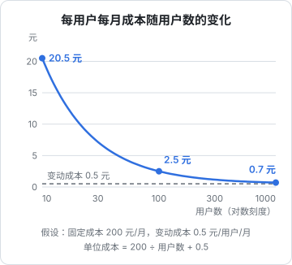

# 成本控制

一人公司的基础设施账单通常不大，但有两种情况会让它变成大问题：一是每个月都有一笔笔「不知道是什么」的小钱慢慢累积；二是某一天突然出现一笔失控的大账单，原因是密钥泄露被盗刷、某个功能被刷、或者一个死循环在调用付费 API。本章讲怎么建立成本清单、算清单位成本、给失控的成本装上刹车，以及怎么在「花钱买托管服务」和「花时间自己维护」之间做取舍。

本章不给任何具体的价格。云服务、对象存储、大模型 API 的价格变化很快，各家差别也很大，做决策时以各服务商官网的最新价格为准。

## 成本清单

第一步是知道钱花在哪。很多人说不清自己每个月在基础设施上花了多少，因为账单分散在七八个地方：云服务器、域名、对象存储、CDN、短信、大模型 API、邮件服务、各种 SaaS 订阅。

建一张表，放在你记账或者写运维文档的地方：

| 项目 | 服务商 | 计费方式 | 类型 | 月均 | 续费日 | 谁在用 |
|---|---|---|---|---|---|---|
| 云服务器 | 某云 | 包年 | 固定 | | 每年 X 月 | 全部服务 |
| 域名 | 某注册商 | 包年 | 固定 | | 每年 X 月 | 全部 |
| 对象存储 | 某云 | 按量（存储 + 流量 + 请求） | 变动 | | — | 用户上传的图片 |
| 短信 | 某云 | 按条 | 变动 | | — | 登录验证码 |
| 大模型 API | 某服务商 | 按 token | 变动 | | — | 单据识别 |
| 镜像仓库 | 某云 | 个人版 | 固定 | | — | CI 推镜像 |
| 拨测 / 告警 | 某 SaaS | 订阅 | 固定 | | 每月 X 日 | 监控 |

几个要点：

- **「续费日」这一列很重要**。域名和证书过期是最低级、也最常见的事故之一。域名开启自动续费，并确认绑定的支付方式没有过期
- **「谁在用」这一列帮你清理**。半年前试过的某个服务还在扣费，是独立开发者的常见情况
- 每月对一次账，花不了十分钟（第 8 章月度清单）

## 固定成本和变动成本

把成本分成两类，它们的管理方式完全不同：

- **固定成本**：和用户数量无关，比如服务器、域名、订阅。它决定了你的**盈亏平衡点**
- **变动成本**：随使用量增长，比如对象存储流量、短信、大模型 API。它决定了你的**毛利**，也是**失控风险**的来源

### 单位成本

更有用的视角是**每个用户（或每个付费客户、每次核心操作）的成本**：

$$
\text{单位成本} = \frac{\text{固定成本}}{\text{用户数}} + \text{每用户的变动成本}
$$



这条曲线说明了两件事：

- **早期，固定成本是主要矛盾**。用户少的时候，每个用户分摊的服务器费用很高。这个阶段省钱的重点是别买过大的机器、别订一堆用不上的服务
- **规模起来后，变动成本是主要矛盾**。单位成本会趋近每用户的变动成本，它直接决定你的毛利能不能撑住定价。如果每用户变动成本高于你的定价，用户越多亏得越多

对加了 AI 功能的产品，后者尤其要警惕。hatch-counter 用视觉模型识别进货单，识别服务的费用由产品方承担（服务端统一配置服务商的 key）。这意味着每识别一张单据就有一笔变动成本，它必须在定价里算进去，并且要防止被滥用。定价怎么定在[《定价与商业模式》](../pricing-monetization/)里讨论；本章关心的是先把这笔成本算清楚、管住。

## 给失控的成本装刹车

固定成本最多是「花多了」，变动成本才会「失控」。几种典型的失控场景：

| 场景 | 怎么发生 | 刹车 |
|---|---|---|
| 密钥泄露 | AccessKey 被提交到公开仓库，被拿去开机器挖矿 | 最小权限的钥匙、账单告警、密钥扫描 |
| 接口被刷 | 短信验证码接口被人用来轰炸别人的手机 | 限流、图形验证、每号码每日上限 |
| 死循环 | 重试逻辑出 bug，无限调用付费 API | 最大重试次数、每日用量上限 |
| 流量暴涨 | 文件被盗链、被爬虫大量下载 | 防盗链、签名 URL、CDN 和流量上限 |
| 用户滥用 | 某个用户用脚本批量调用 AI 功能 | 每用户配额 |

### 第一道：账单告警和预算

几乎所有云服务商都提供**预算告警**：当月消费达到某个金额时发通知。这是最便宜、最该做的一件事：

- 设置一个比平时月账单略高的告警线（比如平时的 1.5 倍），再设一个明显异常的告警线（比如 3 倍）
- 告警发到你会第一时间看到的渠道，和第 7 章的其他告警放在一起
- 大模型 API 服务商一般也支持设置用量上限或者告警，**一定要设**

注意，大部分云厂商的预算功能**只告警不拦截**，账单达到告警线后服务照常运行、照常计费。告警只是让你更早知道，真正的拦截需要下面几道。

### 第二道：在应用里设上限

最可靠的刹车是在自己的代码里：

```ts
// 每个门店每天最多识别 N 张单据，超过就拒绝，而不是继续烧钱
const DAILY_OCR_LIMIT = 50;

async function recognizeReceipt(storeId: string, image: Buffer) {
  const used = await countTodayOcr(storeId);
  if (used >= DAILY_OCR_LIMIT) {
    throw new QuotaExceededError('今天的单据识别次数已用完，明天再试，或联系我们提高额度');
  }
  await recordOcrUsage(storeId);
  return callVisionModel(image);
}
```

- 按用户（或门店、或 API key）计数，不要只有全局上限：全局上限会让一个滥用者把所有用户的额度用完
- 再加一道**全局的每日熔断**：今天整个服务的调用量超过平时的若干倍，就暂停这个功能并通知你。它防的是你自己代码的 bug
- 报错文案要写人话，告诉用户发生了什么、怎么办

短信验证码的防刷尤其要做：同一号码的发送间隔、每日上限，同一 IP 的上限。短信轰炸既烧钱，也可能让你的短信签名被服务商封掉。nginx 层的限流见[《Nginx 与反向代理》第 5 章](../nginx-gateway/05-rate-limit.md)。

### 第三道：服务商侧的硬上限

有些服务支持真正的硬上限：

- 部分大模型 API 平台可以设置每月的消费上限，达到后拒绝请求
- 预付费模式本身就是一种上限：余额用完就停
- Serverless 平台通常有各种调用量和资源限制，免费额度用完后的行为（停止服务还是转为按量付费）要事先确认

hatch-recordwall 的曲库是放在 Cloudflare R2 前面的一个 Worker，凭令牌存取音频。这种「对象存储前面挡一个鉴权层」的结构本身就是一种成本控制：没有令牌拿不到文件，盗链和爬虫无从下手。Cloudflare 各项服务的计费方式和免费额度在[《云与边缘》](../cloud-and-edge/)里讨论。

## 常见的隐性成本

几类账单里容易被忽略的项目：

- **出网流量**：很多云服务器和对象存储，入网免费、出网按量计费。用户下载大文件、视频、安装包，流量费可能超过服务器本身。大文件考虑放到出网费用低的存储或者 CDN 后面
- **对象存储的请求次数**：除了存储容量和流量，读写请求也按次计费。大量小文件的频繁读写会让这一项变得显著
- **快照和备份**：自动快照会一直累积，旧快照不删就一直计费。第 2 章的 restic 保留策略同理
- **闲置资源**：演练开的临时机器忘了释放、测试用的数据库实例、没绑定的公网 IP。每月对账时专门找一遍
- **公网 IP 和带宽**：按固定带宽还是按流量计费，取决于你的流量模式，两种都值得算一下
- **日志服务**：如果用了云厂商的日志服务，日志量大时费用增长很快。先在本地 journald 和文件里留着，需要时再上云

## 时间也是成本

一个人做产品，最贵的资源不是服务器，而是你的时间。很多「省钱」的决定，其实是用你的时间换钱，而且换得并不划算。

### 自建还是托管

以数据库为例：

| | 自建（compose 里跑 Postgres） | 托管数据库 |
|---|---|---|
| 账单 | 只占服务器的一部分资源 | 单独计费，通常贵出不少 |
| 备份 | 自己写脚本、自己监控、自己演练（第 2 章） | 勾选即可，通常带 PITR |
| 升级 | 自己做大版本升级 | 控制台操作 |
| 故障 | 你半夜起来处理 | 服务商处理，有 SLA |
| 灵活性 | 完全掌控 | 受限于服务商支持的版本和扩展 |

hatch-counter 的选择很有代表性：早期在 compose 里自建 Postgres，备份只靠快照，并且明确写下「正式运营时库要挪到托管数据库上去」。理由正是时间成本：为一个过渡形态养一套备份、密钥、保留策略和每月演练，不值得；而正式运营后，托管服务的费用比自己维护的时间便宜。

做这类决定时，可以粗算一下：

- 自建每月要花多少小时维护（包括备份监控、演练、升级、处理故障的期望时间）
- 你的一小时值多少钱（可以按你期望的时薪，或者按这一小时能用来做的产品工作的价值）
- 两者相乘，和托管服务的差价比较

大多数情况下，**收入起来之后，把数据库、对象存储、邮件发送这类「不是你的核心竞争力」的东西交给托管服务**，是合算的。早期收入为零的时候，自建省下的每一块钱也确实重要，这时候关键是**知道自己欠了什么**，像 hatch-counter 那样把风险写下来。

### 别为想象中的规模付费

另一种常见的浪费是为还不存在的流量做准备：一开始就上多台机器、负载均衡、Kubernetes 集群、托管的消息队列。这些不仅贵，还会大幅增加运维负担。

一台配置合适的 VPS 能支撑的用户量，通常远超一个早期产品的实际需要。等监控显示资源真的紧张了再扩容，容量怎么评估见[《可观测性与性能》](../observability-performance/)；什么时候值得上 Kubernetes，见[《Kubernetes 入门到实战》](../kubernetes/)的最后一章。

## 每月十分钟的成本回顾

放进第 8 章的月度清单：

1. 打开各服务商的账单页，和上个月比较，有没有明显增长
2. 增长的项目，能不能用业务增长解释（用户多了、上传多了）
3. 有没有不认识的扣费项目，或者已经不用的服务还在扣费
4. 闲置资源：临时机器、旧快照、未绑定的 IP
5. 下个月有没有到期续费的项目，支付方式是否有效
6. 更新成本清单表格里的月均数字

如果变动成本增长得比用户增长快，说明单位成本在上升，要找原因：是某个功能的用量模式变了，还是有人在滥用。

## 本章要点

- 先建一张**成本清单**：服务商、计费方式、固定还是变动、续费日、谁在用
- 区分**固定成本**（决定盈亏平衡点）和**变动成本**（决定毛利和失控风险），算出**单位成本**
- 失控成本装三道刹车：**账单告警**（只告警不拦截）、**应用内配额和熔断**、**服务商侧硬上限**
- 留意出网流量、请求次数、快照累积、闲置资源这些隐性成本
- **时间也是成本**：非核心能力在收入起来后交给托管服务；早期自建要把欠下的风险写下来
- 不为想象中的规模付费；每月花十分钟对账
