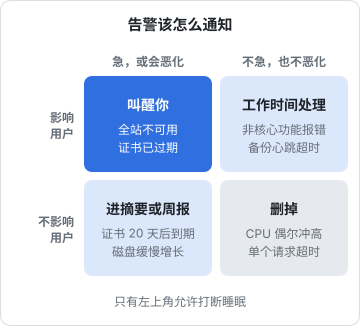

# 一个人的值班制度

团队的值班是轮换的：这周你，下周他，值完班可以安心休息。一个人没有轮换，**你就是永远在值班的那个人**。如果不加设计，结果只有两种：要么手机一响就心惊肉跳，长期处于半警觉状态，最后筋疲力尽；要么慢慢对告警麻木，真出事时反而错过。本章讲怎么设计一套一个人也能长期坚持的值班制度：告警怎么分级、什么值得叫醒你、怎么减少需要人介入的情况、出门旅行时怎么办，以及如果你真的联系不上，服务怎么办。

## 值班的目标

一个人的值班要同时满足两个互相冲突的目标：

- **真正的问题不被错过**：用户受影响时，你能在合理的时间内知道并处理
- **你的生活不被打扰**：大部分时间你不需要想着服务器，可以睡整觉、可以出门、可以休假

解决这个冲突的关键不是更努力，而是让**需要你立刻介入的事情尽可能少**，并且每一次打扰都是值得的。

## 告警分级：什么值得叫醒你

很多人的告警系统是这样的：CPU 高了发一条，内存高了发一条，某个请求报错发一条，全部推到同一个群里。一天几十条，几天后你就不看了。

好的告警只回答一个问题：**这件事需要人现在去处理吗？** 按影响和紧迫程度分到四个格子里：



| 类别 | 例子 | 通知方式 |
|---|---|---|
| 叫醒 | 全站不可用；证书已过期；燃烧率 14.4（第 5 章）；数据库连不上 | 手机推送 + 声音，夜里也响 |
| 工作时间处理 | 某个非核心功能报错增多；备份心跳超时；磁盘 80% | 推送，但静音时段不响 |
| 周报 | 证书 20 天后到期；需要重启以应用内核更新；镜像有新的安全更新 | 汇总成每日或每周摘要 |
| 删掉 | CPU 偶尔冲高到 90%；单个请求超时；与用户体验无关的指标 | 不通知，只在看板上 |

几条原则：

- **告警要对症状，而不是对原因**。「用户请求失败」是症状，「CPU 高」是可能的原因。对症状告警，原因再多也能抓到；对原因告警，会漏掉没想到的原因，还会在原因出现但不影响用户时误报
- **每条「叫醒」告警都要有对应的处理办法**，写在第 3 章的应急手册里。如果一条告警响了你也不知道该做什么，它就不该叫醒你
- **备份心跳超时属于「工作时间处理」**。备份失败一次不影响用户，第二天白天修就行。但要确保白天真的会去修

### 定期清理告警

每次被告警打扰后，问自己：

- 这次告警需要我处理吗？不需要的话，调高阈值或者降级
- 我处理的方式是不是每次都一样？一样的话，能不能自动化（下一节）
- 有没有用户先于告警发现的问题？有的话，说明缺了一条告警

一个健康的状态是：**「叫醒」类告警每个月不超过一两次，而且每次都是真问题**。如果每周都被叫醒，说明系统需要投入稳定性工作了，回到第 5 章的错误预算策略。

## 通知渠道

| 渠道 | 适合 | 注意 |
|---|---|---|
| 手机 App 推送 | 叫醒类 | 需要能穿透系统的勿扰模式，部分告警 App 支持「紧急通知」 |
| 电话 / 短信 | 叫醒类的兜底 | 部分监控服务提供，通常收费 |
| 企业微信 / 飞书 / 钉钉 / Telegram 机器人 | 工作时间处理、周报 | 群里消息多时容易被淹没，告警最好单独一个群 |
| 邮件 | 周报、摘要 | 不要用于紧急告警 |

几个实际的配置建议：

- 在手机的勿扰模式里，**只给叫醒类告警的来源开白名单**，其他一律静音。这样你可以安心开勿扰睡觉
- 告警消息本身要包含足够的信息：哪个服务、什么症状、从什么时候开始、应急手册的哪一条。半夜醒来看到一条「Alert: check failed」，还得登上去才知道是什么
- **监控服务不要部署在被监控的机器上**。机器挂了，监控也跟着挂，你什么都收不到。用外部的拨测服务，或者在另一台机器、另一个云上部署
- 测试告警通道。配好之后故意触发一次，确认手机真的会响；之后每季度测一次（第 8 章）

## 减少需要人介入的事

值班负担 = 需要介入的次数 × 每次的成本。前面讲的是降低误报，这一节讲减少真问题里需要人介入的部分。

### 让系统自己恢复

很多故障，处理方法就是重启。既然如此，就让系统自己重启：

- 容器配 `restart: unless-stopped`，进程崩溃后自动拉起
- 配置有意义的健康检查（[《容器技术》第 3 章](../docker-containers/03-dockerfile.md)），让编排能识别「进程在但已经不工作了」的状态
- systemd 服务配 `Restart=on-failure`，并设置合理的启动频率限制（[《Linux 系统与命令行》第 4 章](../linux-essentials/04-systemd.md)）
- 发版脚本健康检查失败时自动回滚（[《部署与 CI/CD》第 2 章](../deploy-release/02-deploy-scripts.md)的 `deploy.sh` 就是这么做的）

注意：Docker 的 `restart` 策略只在容器进程退出时生效，容器健康检查变成 `unhealthy` 时，单机的 Docker Compose **不会**自动重启它。要么让应用在不健康时自己退出，要么写一个简单的守护脚本处理。这也是为什么「进程反复重启」本身应该是一条告警：自动恢复掩盖了问题，你要知道它在发生。

### 消灭定时炸弹

有一类事故是完全可以预见的：证书过期、域名过期、磁盘慢慢写满、系统停止支持。它们的共同点是**提前很久就能知道**，只要有人去看。

| 定时炸弹 | 自动化 | 兜底的监控 |
|---|---|---|
| 证书过期 | certbot 自动续期（[《Nginx 与反向代理》第 3 章](../nginx-gateway/03-https-acme.md)） | 外部拨测检查证书剩余天数，< 14 天告警 |
| 域名过期 | 注册商开自动续费 | 日历提醒，到期前一个月 |
| 磁盘写满 | 日志轮转、定期清理旧镜像 | 磁盘 > 80% 告警 |
| 支付方式过期 | — | 云账号余额或欠费告警 |
| 系统支持到期 | — | 年度清单 |

自动化和监控**两样都要**。自动化会静默失败（续期脚本出错、DNS 变了导致验证失败），监控是确认自动化真的在工作。

## 你不在的时候

### 出门前

短途出门（一天以内、有网络）不需要特别准备，带上手机即可。较长的旅行、去信号不好的地方、或者真正的休假，按清单准备：

- **出发前 3 天冻结发版**。大部分事故由变更引起，不发版就消除了最大的风险源。只允许紧急安全修复
- 检查所有「定时炸弹」：证书、域名、磁盘、余额，确保在你回来之前都不会到期
- 确认最近一次备份成功，最好跑一次恢复到临时库的演练
- 手机上能登录服务器：装好 SSH 客户端，导入一把**专用的、可随时吊销的**密钥
- 应急手册导出一份放在手机上
- 有用户群的话，提前告知「X 日到 X 日响应会变慢」

### 降低期望，而不是降低可靠性

一个人做产品，不可能 7×24 小时即时响应。与其假装可以，不如**诚实地告诉用户你的响应承诺**：

- 在产品的帮助页或服务条款里写明支持时间，比如「工作日 9:00–21:00，紧急问题会尽快处理」
- 付费用户如果需要更高的响应等级，那是一个可以单独定价的服务，而不是默认承诺
- 第 5 章的 SLO 也要把这一点算进去：如果你夜里不处理 P2，夜里的 P2 就会一直消耗预算直到早上

### 如果你联系不上

最后一个问题，也是很多独立开发者回避的问题：**如果你因为生病、意外，几周甚至更长时间无法处理任何事，服务怎么办？用户的数据怎么办？**

这个问题叫「巴士因子」（bus factor）：项目里有多少人被巴士撞了，项目就会停摆。一个人的项目，巴士因子是 1。

你没法把它变成 2，但可以做一些准备：

- **一份给信任的人的交接文档**。不需要他懂技术，只需要告诉他：服务跑在哪、每月扣费的账户是哪个、用户群在哪、如果要停服应该怎么通知用户
- **关键账号的访问方式**。放在密码管理器里，并使用密码管理器提供的紧急访问功能（多数主流密码管理器都有，指定一个联系人，在你一段时间不响应后可以获得访问权限）。具体以所用产品的功能为准
- **服务能自己跑多久**。如果你几个月不管，会先坏掉的是什么？证书（自动续期了吗）、域名（自动续费了吗）、余额（够扣几个月）、磁盘（多久会满）。尽量让这个时间足够长
- **用户的数据能导出**。产品里提供数据导出功能，最坏的情况下，用户至少能把自己的数据带走

这些准备一次做好，每年复查一次（第 8 章年度清单）。它们不只是为了意外，也让你在休长假时更安心。

## 值班也要可持续

最后，几条关于你自己的建议：

- **夜里被叫醒处理完之后，第二天要补休**，而不是硬撑着继续开发。疲惫时写的代码和做的决定，往往是下一次事故的起因
- **每次被叫醒都值得一次简短的复盘**（第 4 章），哪怕只是问一句「能不能让这件事下次不用叫醒我」
- **把值班负担当作一个指标来看**。每月统计一下被打扰的次数和处理时长。数字在上升，就该停下来做稳定性工作，而不是继续加功能

一人公司能长期运转的前提是你本人能长期运转。一套让你天天提心吊胆的值班制度，再可靠也是失败的。

## 本章要点

- 一个人永远在值班，目标是**真问题不错过、生活不被打扰**，关键在于让需要立刻介入的事尽可能少
- 告警按「影响用户吗」「能等吗」分四类：叫醒、工作时间处理、周报、删掉；**对症状告警，不对原因告警**
- 叫醒类告警每月一两次为宜，每条都要有应急手册里的处理办法；监控服务不与被监控的机器同机
- 用自动重启、健康检查、自动回滚减少人工介入；证书、域名、磁盘这类**定时炸弹**要自动化加监控两手准备
- 出门前冻结发版、检查定时炸弹；诚实告知用户响应时间
- 正视巴士因子：交接文档、紧急访问、服务能自己跑多久、用户数据可导出

## 动手练习

1. **给告警分格子**：把下面六条告警分到叫醒、工作时间处理、周报、删掉四类里：A. 外部探测连续 3 次失败；B. 某台机器 CPU 5 分钟内冲到 95% 后回落，请求成功率正常；C. 备份心跳 26 小时没收到；D. 证书剩余 18 天；E. 证书已过期；F. 磁盘使用率 85%。

   验证：每条都能用「影响用户吗」「能等吗」两个问题说出理由。

   参考答案：A、E 叫醒（影响用户且不能等）；C、F 工作时间处理（现在不影响用户，但会恶化，白天要真的去修）；D 进周报（自动续期本该在处理，这里是兜底提醒）；B 删掉，只留在看板上，因为它是原因而不是症状，用户没受影响。

2. **验证「unhealthy 不会自动重启」**：在本机跑两个容器：`docker run -d --name sick --restart unless-stopped --health-cmd false --health-interval 2s --health-retries 1 alpine:3.20 sleep infinity` 和 `docker run -d --name crash --restart unless-stopped alpine:3.20 sh -c 'sleep 3; exit 1'`。等半分钟，分别看 `docker ps` 和 `docker inspect -f '{{.RestartCount}}' <名字>`。

   验证：`sick` 在 `docker ps` 里显示 `(unhealthy)`，但 RestartCount 一直是 `0`；`crash` 的 RestartCount 在增长。练完 `docker rm -f sick crash`。

   参考答案：restart 策略只看进程有没有退出，不看健康检查。所以要么让应用在不健康时自己退出，要么另写守护脚本；同时「进程反复重启」本身应该是一条告警。

3. **写一个证书到期检查**：用 openssl 检查你自己的域名（或任意一个公开的 HTTPS 站点）的证书 14 天内是否到期，再把阈值改成 400 天看另一个分支。

   ```bash
   host=example.com
   echo | openssl s_client -connect "$host:443" -servername "$host" 2>/dev/null \
     | openssl x509 -noout -enddate -checkend $((14*86400))
   echo "exit=$?"
   ```

   验证：正常的证书打印 `notAfter=...`、`Certificate will not expire` 和 `exit=0`；阈值改成 `$((400*86400))` 后打印 `Certificate will expire`、`exit=1`（公开证书有效期不会超过 400 天）。

   参考答案：靠退出码就能接进任何拨测或 cron 告警。它是证书自动续期的兜底监控：自动化会静默失败，所以两样都要。
