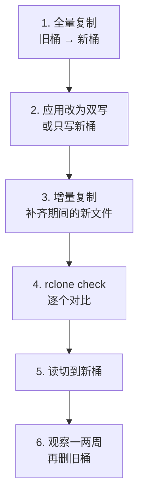

# 对象存储与用户文件

第 2 章的备份围绕数据库展开：每天一份 dump，送到异地。但很多产品还有另一类数据：用户上传的头像、单据照片、录音、附件。它们通常放在对象存储里，数据库只存一个键。这类数据量大、不可再生（用户手机上的原图早就删了），而且受删除请求和法律义务的约束，备份和清理的办法都和数据库不一样。

对象存储本身怎么选、三种访问控制方式、预签名 URL 怎么签，在[《云与边缘》第 3 章](../cloud-and-edge/03-object-storage.md)讲过。本章只讲运维：上线以后，这一桶文件怎么备份、怎么自动清理、怎么搬家、怎么按用户的要求删干净，以及预签名 URL 出问题时怎么办。

## 用户文件和数据库有什么不同

| | 数据库 | 用户文件 |
|---|---|---|
| 体量 | 几十 MB 到几 GB，每天整份 dump 不费事 | 几十 GB 起，每天整份复制不现实 |
| 写入方式 | 行级修改 | 整个对象写入，很少修改 |
| 丢了能不能补 | 有备份就能回到某一时刻 | 用户那头的原件多半已经没了 |
| 一致性 | 事务保证 | 数据库里的键和桶里的对象**没有事务把它们绑在一起** |

最后一行是用户文件特有的麻烦。上传成功但写数据库失败，桶里就多一个没人引用的孤儿对象；删记录时没删对象，或者删对象时数据库回滚了，就有指向空气的键。前者只是浪费钱，后者是用户看到的「图片加载失败」。

一个让后面所有事情都变简单的约定：**对象写入后不再覆盖**。键用随机 ID 或内容哈希生成（`u/<userId>/receipts/<uuid>.jpg`），用户「换一张图」就是写一个新键、改数据库指向、再删旧键。这样桶里唯一的破坏性操作只剩删除，备份只需要关心「别删错」，不用关心「被覆盖成了什么」。

## 备份：版本化不等于异地

> [!WARNING]
> 本节各厂商的能力按 2026 年 11 月的官方文档整理：Cloudflare R2 的 S3 API 兼容页把 `PutBucketVersioning`、`PutObjectLockConfiguration` 列为未实现，R2 另有「桶锁」（bucket locks）保留规则；AWS S3 支持版本控制和对象锁定（Object Lock）；阿里云 OSS、腾讯云 COS 也提供版本控制。各家支持程度会变化，以对应服务的官方文档为准。

用户文件面对的风险和数据库一样分三类，对策各不相同：

| 风险 | 例子 | 对策 |
|---|---|---|
| 误删、误覆盖 | 清理脚本的前缀写错；生命周期规则配错 | 版本控制或保留规则：删掉的东西还能找回来一段时间 |
| 凭证泄露、账号出事 | 服务器被入侵，攻击者拿着密钥清空桶；账号被封、欠费停服 | 另一个账号、最好是另一家厂商的副本，用不同的凭据 |
| 引用不一致 | 孤儿对象、指向空气的键 | 定期对账 |

**版本控制**让每次覆盖和删除都留下旧版本，配合生命周期规则让旧版本保留 30 天后过期。在 S3 上开启：

```bash
aws s3api put-bucket-versioning --bucket my-uploads \
  --versioning-configuration Status=Enabled
```

R2 不支持版本控制，对应的是**桶锁**：在保留期内对象不能被删除或覆盖，规则可以按前缀设，并且优先于生命周期规则。用户文件不是只增不删的（用户有权要求删除，见后文），所以不要对整个桶加长期锁；适合加锁的是备份、审计日志这类本来就不该删的前缀：

```bash
# backups/ 前缀下的对象 30 天内不能被删除或覆盖
pnpm exec wrangler r2 bucket lock add my-uploads keep-backups backups/ --retention-days 30
```

版本控制和桶锁都还在**同一个账号**里。攻击者拿到的如果是账号级的令牌，或者账号本身出了问题，它们一起没了。所以还要有第二份：用 rclone 每天把桶增量复制到另一家的桶，复制用的凭据只放在执行复制的那台机器上，不放在应用服务器上。

```bash
# 每天跑一次：把 R2 上的用户文件同步到 OSS 上的备份桶
# 源端删掉的、被覆盖的文件不会丢，而是挪进按日期命名的归档目录
rclone sync r2:my-uploads oss:my-uploads-replica/current \
  --backup-dir "oss:my-uploads-replica/deleted/$(date +%F)" \
  --max-delete 200 \
  --fast-list --transfers 8
```

- 用 `sync` 加 `--backup-dir`，而不是单纯的 `copy`：副本和源保持一致（用户删除的文件也会从 `current/` 移走），但被删的文件先进归档目录，再由副本桶上的生命周期规则在 30 天后清掉
- `--max-delete` 是保险丝：源桶被清空时，一次同步最多只删 200 个文件就报错停下，而不是把副本也清空。阈值按你每天正常的删除量放宽几倍
- 这个任务的成功与否要像第 2 章的备份一样发心跳；`rclone` 失败时退出码非零

**对账**每周跑一次，就够发现大部分不一致：

```bash
# 桶里所有键
rclone lsf r2:my-uploads --recursive --files-only | sort > /tmp/bucket.txt
# 数据库引用的所有键
psql "$DATABASE_URL" -Atc "SELECT file_key FROM attachments ORDER BY 1" | sort > /tmp/db.txt

comm -23 /tmp/bucket.txt /tmp/db.txt > /tmp/orphans.txt   # 桶里有、库里没有：孤儿
comm -13 /tmp/bucket.txt /tmp/db.txt > /tmp/missing.txt   # 库里有、桶里没有：坏链接
wc -l /tmp/orphans.txt /tmp/missing.txt
```

`missing` 不为零要当事故查；`orphans` 里刚上传不到一天的可能是正在进行中的上传，别急着删，超过一周的再交给清理任务。

## 生命周期规则：让桶自己打扫

生命周期规则按前缀和时间自动删除或转存对象，是对象存储里最省心、也最危险的功能：它在后台安静地执行，配错了也不会报错。

适合交给规则的：

- **临时前缀**：`tmp/`（客户端直传后等待处理的文件）7 天后删除
- **未完成的分片上传**：上传到一半中断的分片不显示在列表里，却一直计费。所有桶都加一条「7 天后中止未完成的分片上传」
- **旧版本和归档**：开了版本控制的桶，非当前版本 30 天后过期；上面 rclone 副本里的 `deleted/` 30 天后删除
- **冷数据转低频**：一年前的附件很少有人看，可以转到低频存储，但要算上取回费（[《云与边缘》第 3 章](../cloud-and-edge/03-object-storage.md#大文件与生命周期)）

R2 上用 wrangler 加规则：

```bash
pnpm exec wrangler r2 bucket lifecycle add my-uploads tmp-7d tmp/ --expire-days 7
pnpm exec wrangler r2 bucket lifecycle add my-uploads abort-mpu "" --abort-multipart-days 7
pnpm exec wrangler r2 bucket lifecycle list my-uploads
```

S3 上用 JSON 描述同样的事，旧版本的过期也写在这里：

```json
{
  "Rules": [
    { "ID": "tmp-7d", "Status": "Enabled", "Filter": { "Prefix": "tmp/" },
      "Expiration": { "Days": 7 } },
    { "ID": "abort-mpu", "Status": "Enabled", "Filter": { "Prefix": "" },
      "AbortIncompleteMultipartUpload": { "DaysAfterInitiation": 7 } },
    { "ID": "old-versions", "Status": "Enabled", "Filter": { "Prefix": "" },
      "NoncurrentVersionExpiration": { "NoncurrentDays": 30 } }
  ]
}
```

> [!CAUTION]
> 前缀为空表示**整个桶**。「中止分片上传」和「旧版本过期」可以对整桶生效，但带 `Expiration` 的删除规则绝不能留空前缀，否则 N 天后桶里所有对象都会被删掉。加规则前先 `list` 一遍现有规则，加完再 `list` 确认前缀没写错。

## 用 rclone 搬家

从国内云搬到海外、从 S3 搬到 R2，或者只是换个账号，最稳的工具是 rclone：它同时支持几十种存储，按键逐个对比，断了可以重跑。先配两个远端（`rclone config` 交互式生成，也可以直接写配置文件）：

```ini
# ~/.config/rclone/rclone.conf，权限 600
[oss]
type = s3
provider = Alibaba
endpoint = oss-cn-hangzhou.aliyuncs.com
access_key_id = <只读密钥>
secret_access_key = <只读密钥>

[r2]
type = s3
provider = Cloudflare
endpoint = https://<账号 ID>.r2.cloudflarestorage.com
access_key_id = <写入密钥>
secret_access_key = <写入密钥>
```

源端用**只读**密钥：迁移脚本写反了方向，也不会伤到源数据。迁移按这个顺序走，旧桶在整个过程中始终完整：



```bash
# 1. 先演习，看会传多少；再真跑。可以中断后重跑，已传过的会跳过
rclone copy oss:old-bucket r2:new-bucket --dry-run
rclone copy oss:old-bucket r2:new-bucket --transfers 16 --checkers 32 --progress

# 3. 切换写入后再跑一次，补上第 1 步之后的新文件
rclone copy oss:old-bucket r2:new-bucket --transfers 16

# 4. 对比两边：缺的、多的、不一致的都会列出来
rclone check oss:old-bucket r2:new-bucket --one-way --missing-on-dst missing.txt
```

几个容易踩的坑：

- **迁移用 `copy`，不用 `sync`**。`sync` 会删除目标端多出来的文件，迁移期间新桶上如果已有新写入的文件，方向一搞错就是删数据
- **分片上传的对象 ETag 不是 MD5**，跨厂商时 rclone 可能只能按大小和修改时间对比。对完整性要求高的，`rclone check --download` 会真的下载两边逐字节比较，慢，但可靠
- **出网费**：从 S3、OSS 往外搬，流量按出网计费，几百 GB 就是一笔可观的钱，先按[第 6 章](06-cost-control.md)估一下
- **元数据**：`Content-Type`、`Cache-Control` 一般会被保留，自定义元数据和访问控制设置不一定，迁移后抽查几个对象的响应头
- **客户端里写死的地址**：如果 App 里存的是完整 URL 而不是键，读切换就要发版。这也是数据库只存键、地址由服务端拼出来的好处

## 删除请求：真的删干净

> [!WARNING]
> 本节涉及的删除义务按《个人信息保护法》第四十七条（2026 年 11 月对照最高人民检察院门户网刊载的法律文本）和欧盟 GDPR 第 17 条（删除权）的框架整理，具体情形、例外和响应时限以法规原文和主管部门的最新规定为准，法律框架见[《国内合规实务》](../opc-compliance-cn/06-pipl.md#个人的权利落到功能上)和[《出海实务》](../going-global/05-gdpr-privacy.md#数据主体的权利)。

用户注销账号、要求删除自己的数据时，数据库里的行好删，难的是文件：它们分散在桶里、版本里、副本里、备份里。工程上要回答的是：**删的时候删哪些，删不掉的怎么处理**。

**键按用户组织**是最重要的一步。键以 `u/<userId>/` 开头，删一个用户的全部文件就是删一个前缀；如果键是 `receipts/2026/10/<uuid>.jpg` 这种按时间组织的，就只能先从数据库查出这个用户的所有键，再逐个删，漏掉一个就是残留。

一次删除任务按这个顺序执行：

1. 数据库里把该用户标记为删除中，停止一切新的处理
2. 查出所有键，逐个删除对象（或者按前缀删除）；每删一批记一次进度，失败可以从断点继续
3. 删除数据库记录
4. 写一条删除日志：谁、什么时候、删了多少个对象。**日志里只写用户 ID 和数量，不写文件名和内容**

删不掉的副本要有说法：

| 在哪 | 怎么处理 |
|---|---|
| 版本控制里的旧版本 | 删除时连同版本一起删（S3 要指定 `VersionId` 删除），或者依靠 30 天的过期规则 |
| rclone 副本 | 下一次同步时移入 `deleted/`，30 天后被生命周期规则清掉 |
| 数据库备份 | 无法从一份 dump 里单独删掉一个人。个保法第四十七条对「删除在技术上难以实现」的情形，要求停止除存储和必要安全保护之外的处理；在隐私政策里写明备份的保留期，到期自然过期 |
| 从备份恢复时 | 恢复出来的数据里会「复活」已删除的用户。保留一份**删除名单**（只存用户 ID 和删除时间），恢复后先按名单再执行一次删除 |

最后一行最容易被忘掉。删除名单本身也要定期清理：最老的一份备份过期之后，比它更早的删除记录就没有用处了。

## 预签名 URL：过期与泄露

> [!WARNING]
> 有效期上限和支持的操作按 2026 年 11 月 Cloudflare R2 的 Presigned URLs 文档整理（1 秒到 7 天；支持 GET、HEAD、PUT、DELETE，不支持 HTML 表单的 POST 上传）。其他厂商的规则以各自文档为准。

预签名 URL 本质上是一张**不记名的票**：谁拿到，谁就能在过期前执行签名时指定的那个操作，次数不限。它出问题的方式有三种。

**一、有效期太长。** 签名时最长可以签到 7 天，但需要那么长的场景很少。下载链接 5–15 分钟足够（App 拿到后立即使用）；上传链接给到 5 分钟。需要长期访问的内容，说明它本来就该走网关或公开读。

**二、URL 被记录、被转发。** 签名就在查询参数里（`X-Amz-Signature=...`），所以完整 URL 出现在哪里，权限就到了哪里：

- 应用和 nginx 的访问日志：服务端返回签名 URL 的那个接口，响应体别打日志；代理到存储的请求，日志里把查询串去掉
- 错误监控：前端加载失败时上报的资源地址带着签名，在上报前处理掉查询参数
- 用户自己转发：把下载链接复制给别人。有效期短是唯一的约束；真正私密的内容走网关，每次请求都验身份

**三、上传链接被滥用。** 拿到一个 PUT 链接，可以往那个键里传任意大小、任意内容的文件。键由服务端决定、`Content-Type` 签进签名里（[《云与边缘》第 3 章](../cloud-and-edge/03-object-storage.md#预签名-url-的写法)）只解决一部分问题。R2 不支持带大小限制的 POST 表单上传，所以上传完成后要有一步检查：客户端通知服务端「传完了」，服务端用 `HEAD` 看大小、读文件头判断真实类型，不合格的直接删掉，合格的才从 `tmp/` 移到正式前缀并写数据库。`tmp/` 上的 7 天过期规则兜住那些「签了却从没通知」的上传。

**泄露了怎么办。** 单个预签名 URL 无法撤销。能做的只有作废签名用的那把访问密钥：它签出去的所有 URL 立刻一起失效，服务端换上新密钥继续签。这要求两件事事先做好：签名用的密钥只用来签名、权限只到这一个桶；新密钥能在几分钟内换上去（[第 3 章的应急手册](03-incident-response.md#应急手册)里写一条）。

## 本章要点

- 用户文件体量大、不可再生、和数据库之间没有事务；约定**对象写入后不再覆盖**，键用随机 ID，让删除成为唯一的破坏性操作
- 版本控制或桶锁防误删，另一账号另一厂商的副本防凭证泄露和账号出事，每周对账查孤儿和坏链接
- rclone 做副本用 `sync --backup-dir --max-delete`，做迁移用 `copy` 加 `check`，旧桶在观察期结束前不删
- 生命周期规则清理临时文件、未完成的分片上传和旧版本；带删除动作的规则绝不留空前缀
- 键按用户组织，删除才能删干净；备份删不掉的写进隐私政策，恢复后按删除名单重放
- 预签名 URL 是不记名的票：有效期尽量短、不进日志、上传后服务端复检；泄露时作废签名密钥

## 动手练习

下面的练习只用本机目录，不需要云账号。先安装 rclone（`brew install rclone` 或按官网的安装脚本），rclone 可以直接把本地路径当作存储使用。

1. **看 `--backup-dir` 怎么保住被删的文件**：准备源目录和副本目录。

   ```bash
   mkdir -p ~/rc-lab/src ~/rc-lab/replica && cd ~/rc-lab
   for i in 1 2 3; do echo "file $i" > src/f$i.txt; done
   rclone sync src replica/current
   rm src/f2.txt && echo "changed" > src/f3.txt
   rclone sync src replica/current --backup-dir "replica/deleted/$(date +%F)"
   find replica -type f | sort
   ```

   验证：`replica/current/` 下只剩 `f1.txt` 和改过的 `f3.txt`；`replica/deleted/<今天>/` 下有 `f2.txt` 和改动前的 `f3.txt`。

   参考答案：`--backup-dir` 让同步时被删除和被覆盖的文件都先移进归档目录，副本和源保持一致，但历史还在。云上用法相同，只是再给归档前缀配一条 30 天的过期规则。

2. **让 `--max-delete` 拦住一次误清空**：接着上一题，模拟源被清空，再同步一次。

   ```bash
   rm src/*
   rclone sync src replica/current --max-delete 1 --backup-dir "replica/deleted/$(date +%F)-2"; echo "exit=$?"
   ls replica/current
   ```

   验证：命令报错退出（`exit` 不为 0），日志里提到超过了删除上限；`replica/current/` 里仍至少保留一个文件。

   参考答案：源桶被攻击者清空、或者脚本把源路径写错成空目录时，没有这道保险丝，副本会被同步成空的。阈值设成正常每日删除量的几倍，超过就宁可失败、发告警，让人来判断。

3. **对账找出孤儿和坏链接**：用两个文本文件模拟「桶里的键」和「数据库里的键」。

   ```bash
   printf 'u/1/a.jpg\nu/1/b.jpg\nu/2/c.jpg\n' | sort > bucket.txt
   printf 'u/1/a.jpg\nu/2/c.jpg\nu/2/d.jpg\n' | sort > db.txt
   echo "孤儿："; comm -23 bucket.txt db.txt
   echo "坏链接："; comm -13 bucket.txt db.txt
   ```

   验证：孤儿是 `u/1/b.jpg`，坏链接是 `u/2/d.jpg`。

   参考答案：`comm` 要求两边都已排序。孤儿只浪费存储，可以交给清理任务（跳过最近一天的）；坏链接意味着用户会看到加载失败，要当事故查：是删对象时数据库回滚了，还是上传根本没成功就写了库。

4. **设计一次删除**：你的应用把单据照片存在 `receipts/<年>/<月>/<uuid>.jpg`，数据库每天 dump 一份保留 30 天，R2 每天同步到 OSS 副本。一位用户注销账号，写出你的删除步骤，并说明 30 天内如果需要从备份恢复数据库，怎么避免这位用户的数据复活。

   验证：答案里包含「先从数据库查出该用户的所有键」「副本靠同步和过期清理」「删除名单」三点。

   参考答案：键不按用户组织，只能先查出所有键再逐个删，删完再删数据库记录并记删除日志；OSS 副本在下次同步时把这些文件移进 `deleted/`，30 天后过期；数据库备份里删不掉，隐私政策写明保留 30 天，同时保留一份只含用户 ID 和时间的删除名单，恢复后先按名单重做删除。长期看，把新上传的键改成 `u/<userId>/receipts/...`，以后的删除就是删一个前缀。
