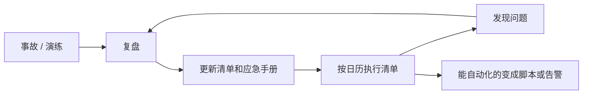

# 运维检查清单

前面七章讲的都是「应该做什么」，但运维的难点从来不在知道，而在**持续地做**。一件事每季度做一次，三个季度之后你多半会忘；一件事靠记忆做，总有一次会漏掉一步。本章把全书的内容收成几份按频率组织的检查清单，并给出一个把例行检查自动化的脚本。建议把这些清单抄进自己的仓库，按自己的系统增删，然后在日历上设好提醒。

## 清单为什么有用

清单的价值不在于告诉你不知道的事，而在于**防止你忘记知道的事**。人在疲惫、赶时间、被打断的时候，最容易跳过「显然不会有问题」的步骤，而事故恰恰经常出在这些步骤上。

好的清单有几个特点：

- **短**：每份清单控制在 10 项左右，超过了就拆分或者删掉不重要的
- **可验证**：每一项都能明确判断「做了 / 没做」「正常 / 不正常」，给出具体的命令或者看哪里
- **能自动化的就自动化**：清单上留下的应该是必须人来判断的事
- **会演进**：每次复盘（第 4 章）发现漏洞，就往清单里加一项；某一项长期没意义，就删掉



## 自动化的每日检查

每天的检查不应该靠人。下面这个脚本把最常见的几项检查放在一起，每天由 timer 跑一次，有问题就推送到你的告警渠道。它不替代真正的监控系统，但在你还没搭监控的时候，能抓住大部分「定时炸弹」。

```bash
#!/usr/bin/env bash
#
# 每日例行检查：有问题时把汇总推送到告警渠道，没问题时只写日志
# 由 ops-check.timer 每天调用；告警地址等配置在 /etc/ops-check.env

set -uo pipefail          # 故意不用 -e：一项检查失败不能让后面的检查不跑
source /etc/ops-check.env  # DOMAINS、APP_DIR、NOTIFY_URL、BACKUP_MAX_AGE_HOURS

problems=()
warn() { problems+=("$1"); }

# 1. 磁盘：任何挂载点超过 80%
while read -r use mount; do
  pct=${use%\%}
  (( pct >= 80 )) && warn "磁盘 ${mount} 已用 ${use}"
done < <(df -P -x tmpfs -x devtmpfs -x overlay | awk 'NR>1 {print $5, $6}')

# 2. 证书：剩余天数少于 14 天
for d in $DOMAINS; do
  end=$(echo | openssl s_client -servername "$d" -connect "$d:443" 2>/dev/null \
        | openssl x509 -noout -enddate 2>/dev/null | cut -d= -f2)
  if [[ -z "$end" ]]; then
    warn "证书：${d} 取不到证书"
    continue
  fi
  days=$(( ( $(date -d "$end" +%s) - $(date +%s) ) / 86400 ))
  (( days < 14 )) && warn "证书：${d} 还剩 ${days} 天"
done

# 3. 需要重启
[[ -f /var/run/reboot-required ]] && warn "需要重启：$(tr '\n' ' ' < /var/run/reboot-required.pkgs)"

# 4. systemd 里失败的单元
failed=$(systemctl --failed --no-legend --plain | awk '{print $1}' | tr '\n' ' ')
[[ -n "$failed" ]] && warn "失败的 systemd 单元：${failed}"

# 5. 容器：不健康，或者最近在反复重启
cd "$APP_DIR"
for c in $(docker compose ps -q); do
  name=$(docker inspect -f '{{.Name}}' "$c")
  health=$(docker inspect -f '{{if .State.Health}}{{.State.Health.Status}}{{end}}' "$c")
  restarts=$(docker inspect -f '{{.RestartCount}}' "$c")
  [[ "$health" == "unhealthy" ]] && warn "容器 ${name} 不健康"
  (( restarts > 3 )) && warn "容器 ${name} 已重启 ${restarts} 次"
done

# 6. 备份：最新的异地快照是否太旧
if source /etc/restic/env 2>/dev/null; then
  last=$(restic snapshots --tag pg --latest 1 --json 2>/dev/null \
         | python3 -c 'import json,sys; s=json.load(sys.stdin); print(s[-1]["time"] if s else "")')
  if [[ -z "$last" ]]; then
    warn "备份：取不到异地快照列表"
  else
    age=$(( ( $(date +%s) - $(date -d "$last" +%s) ) / 3600 ))
    (( age > BACKUP_MAX_AGE_HOURS )) && warn "备份：最新异地快照是 ${age} 小时前"
  fi
fi

# 汇总
if (( ${#problems[@]} == 0 )); then
  echo "例行检查通过"
  exit 0
fi

msg="$(hostname) 例行检查发现 ${#problems[@]} 个问题："
for p in "${problems[@]}"; do msg+=$'\n'"- $p"; done
echo "$msg"
# 推送格式按你用的机器人或告警服务调整，这里以接收纯文本 POST 的 webhook 为例
curl -fsS -m 10 -X POST --data-binary "$msg" "$NOTIFY_URL" >/dev/null || echo "推送失败" >&2
exit 1
```

几点说明：

- 故意不用 `set -e`，每一项检查独立，一项出错不影响其他项。这和《Linux 系统与命令行》第 8 章推荐的严格模式不同，是有意为之
- 证书检查是从机器上连自己的域名，能发现「续期了但 nginx 没 reload」这类问题。但它发现不了 DNS 或者网络层面的问题，所以外部拨测仍然需要
- `RestartCount` 是容器创建以来的累计重启次数，重新创建容器（比如发版）后会归零。阈值按你的发版频率调整
- `date -d` 是 GNU date 的写法，在服务器（Linux）上可用，在 macOS 上不行
- 不同告警渠道的 webhook 格式不同（企业微信、飞书、Telegram 都要求特定的 JSON），最后一段按实际情况改

配置文件和 timer：

```bash
# /etc/ops-check.env，权限 600
DOMAINS="example.com api.example.com"
APP_DIR="/srv/myapp"
NOTIFY_URL="<你的告警 webhook>"
BACKUP_MAX_AGE_HOURS=30
```

```ini
# /etc/systemd/system/ops-check.timer
[Unit]
Description=Daily ops check

[Timer]
OnCalendar=*-*-* 09:00
Persistent=true

[Install]
WantedBy=timers.target
```

对应的 `ops-check.service` 写法和第 2 章的备份服务一样，`Type=oneshot`，`ExecStart` 指向脚本。检查放在早上九点而不是半夜：这些都是「工作时间处理」类的问题（第 7 章），推送在你开始工作时到达正好。

这个脚本本身也可能静默失败。给它也加一个心跳（第 2 章），或者至少每周看一眼 `journalctl -u ops-check` 确认它每天都在跑。

## 每周

每周固定一个时间，十五分钟以内：

- [ ] 看一眼本周的告警记录：有没有误报需要调整，有没有被忽略的
- [ ] `journalctl -u ops-check -u offsite-backup --since -7d` 确认例行检查和备份每天都在跑
- [ ] `restic check` 校验备份仓库（可以自动化，见第 2 章）
- [ ] 需要重启的话，挑低峰时段重启，重启后确认所有服务正常
- [ ] 有没有用户反馈的问题还没处理
- [ ] 有没有本周的事故还没写复盘

## 每月

每月第一个工作日，半小时到一小时：

- [ ] **恢复演练**：把最新备份恢复到临时库并核对（第 2 章）
- [ ] **可用性回顾**：统计上月实际可用性，对照 SLO 和错误预算策略（第 5 章）
- [ ] **成本回顾**：对账、找闲置资源、更新成本清单（第 6 章）
- [ ] **复盘改进项**：所有未完成的改进项过一遍，该排期的排期，没意义的关掉（第 4 章）
- [ ] **依赖和镜像**：处理 Dependabot / Renovate 的更新；基础镜像重新构建并发版（《容器技术》第 8 章）
- [ ] **磁盘趋势**：`df -h` 和上月比较，按增长速度估算多久会满
- [ ] **值班负担**：本月被叫醒几次、处理了多久（第 7 章）

## 每季度

- [ ] **加固复查**：对照第 1 章末尾的加固清单逐项检查，包括本机 nmap 扫描
- [ ] **账号复查**：服务器上的账号、`authorized_keys`、云子账号和 AccessKey、CI 里的 secret，删掉不再使用的
- [ ] **告警通道测试**：故意触发一次叫醒类告警，确认手机真的会响
- [ ] **应急手册复查**：通读一遍，命令还能用吗？新增的服务写进去了吗？
- [ ] **救援入口**：确认云控制台的 VNC 登录还能用
- [ ] **密钥轮换**：按自己的策略轮换数据库密码、API key 等（至少确认有能力轮换，知道每把钥匙在哪里用）

## 每年

- [ ] **整机重建演练**：只看文档，在新机器上恢复整个服务（第 2 章）
- [ ] **系统生命周期**：Ubuntu LTS、Postgres、Node 等的支持期限，到期前一年规划升级
- [ ] **续费**：域名、证书（如果是付费证书）、包年的服务器和服务，确认自动续费和支付方式
- [ ] **巴士因子**：交接文档、紧急访问设置、用户数据导出功能是否仍然有效（第 7 章）
- [ ] **SLO 和策略**：过去一年的数据下，SLO 定得合理吗？错误预算策略需要调整吗？
- [ ] **架构回顾**：翻一遍全年的复盘，哪个组件问题最多？是否到了把它换成托管服务的时候（第 6 章）

## 按事件触发的清单

除了按时间执行的清单，还有几份在特定事件发生时使用。

### 上线一个新服务前

- [ ] 健康检查接口真的检查依赖（数据库连接等），而不只是返回 200
- [ ] 端口只绑本机，`ss` 和 nmap 确认
- [ ] 容器配了日志上限和重启策略
- [ ] 数据纳入备份，恢复过一次
- [ ] 外部拨测已添加，告警会推送到手机
- [ ] 应急手册里加了这个服务：怎么看日志、怎么重启、怎么回滚
- [ ] 变动成本有配额和上限（第 6 章）

### 出门或休假前

见第 7 章「你不在的时候」：冻结发版、检查定时炸弹、确认备份、手机能登录、应急手册在手机上、告知用户。

### 事故之后

- [ ] 恢复后观察至少 15 分钟，确认稳定
- [ ] 发恢复通知（第 3 章的模板）
- [ ] 保存时间线和现场证据
- [ ] 1–3 天内写复盘（第 4 章）
- [ ] 应急手册补上这次的症状和处理方法
- [ ] 改进项进入任务列表

### 换一台机器

- [ ] 按《部署与 CI/CD》第 1 章初始化，再按本书第 1 章加固
- [ ] 按恢复文档部署服务，从最新备份恢复数据
- [ ] 新旧机器并行一段时间，用本机 hosts 验证新机器
- [ ] 切换 DNS，等 TTL 过期后确认流量全部到新机器
- [ ] 旧机器保留一周再释放，释放前打最后一次快照
- [ ] 更新 ssh 配置、拨测地址、成本清单

## 让清单真的被执行

清单写好之后最大的风险是不被执行。几个办法：

- **在日历上设重复提醒**，具体到哪一天、哪个时段，而不是「每月某个时候」
- **把清单放在仓库里**，每次执行时复制一份带日期的副本，逐项勾选，留下记录。这和第 2 章的演练记录是同一个思路
- **交给 agent 辅助执行**。编码 agent 很擅长「对照清单逐项检查，把命令输出整理成报告」这类工作。让它运行只读的检查命令、汇总结果，判断和修改仍然由你来做
- **执行太累的清单要精简**。如果某份清单你总是拖着不做，说明它太长了，删掉价值最低的几项

## 写在最后

运维系列到这里就结束了。回顾一下这五本书的分工：《Linux 系统与命令行》给了你登上服务器的底气，《容器技术》和《Nginx 与反向代理》搭起了服务本身，《部署与 CI/CD》把代码稳稳送上线，这本书则讲上线之后怎么让它一直好好活着。

运维没有做完的一天。但它也不需要占满你的时间：前面这些清单，如果自动化做得好，每周十五分钟、每月一小时、每年一天，就足以让一个人的服务比很多团队的更稳。剩下的时间，用来做产品。

## 本章要点

- 清单防止的是**忘记知道的事**；要短、可验证、能自动化的自动化、随复盘演进
- 每日检查交给脚本：磁盘、证书、重启标记、失败单元、容器健康、备份时效，有问题才推送
- 按周、月、季度、年组织例行清单，再加上线前、出门前、事故后、换机器四份事件清单
- 用日历提醒、仓库里的执行记录和 agent 辅助，让清单真的被执行；太累的清单要精简

## 接下来读什么

按书架导读的运维路线，接下来建议读《可观测性与性能》：本书反复提到的外部拨测、燃烧率告警、错误日志计数，在那里会系统地展开成日志、指标、追踪和告警的完整方案，后半本还会讲压测和容量规划。然后读《PostgreSQL 运维》，补上本书刻意留白的那块：数据库本身的 PITR、复制、连接池和大版本升级。

如果想把服务器的配置和这些检查也变成代码，换机器时不再依赖文档和记忆，可以接着读《基础设施即代码》。准备上线第一个付费产品的话，导读推荐把本书和《应用安全》《国内合规实务》一起读。
