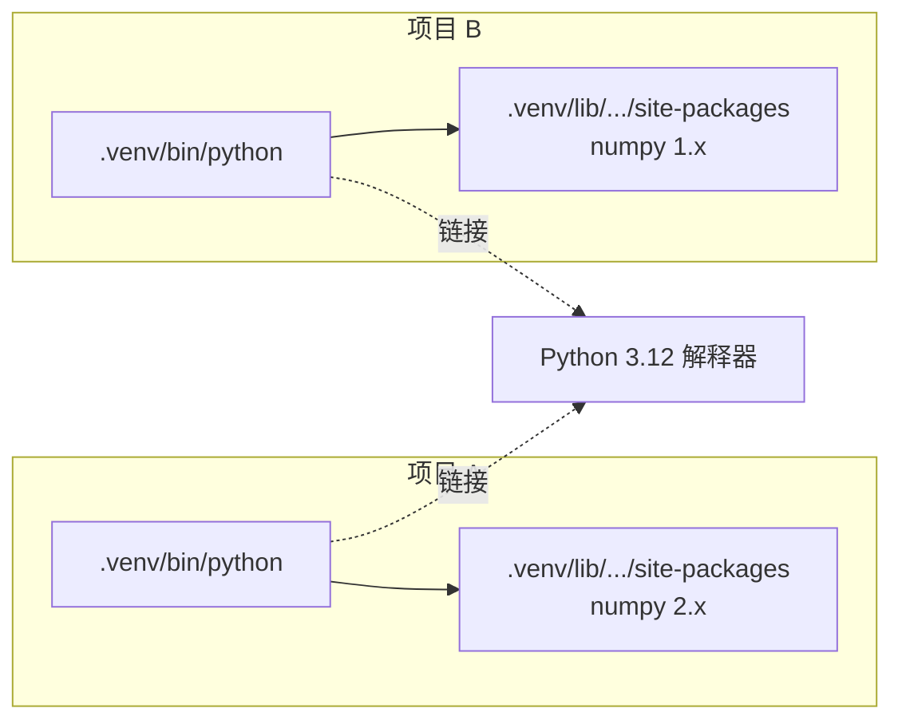
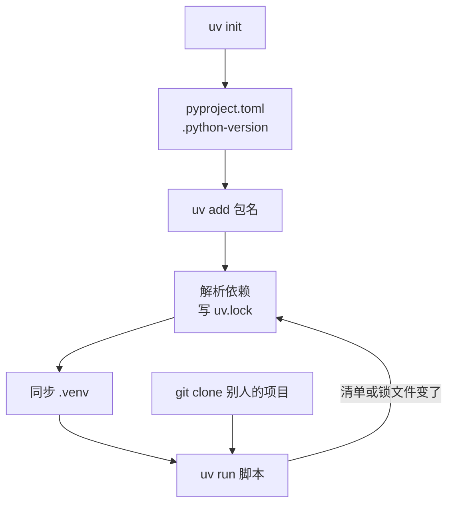

# uv 与环境管理

从 JS 生态过来的人，对 Python 最大的困惑往往不是语法，而是「装个包怎么这么乱」：系统自带的 Python、Homebrew 装的 Python、`pip`、`pip3`、`venv`、`virtualenv`、`pyenv`、`conda`、`poetry`、`requirements.txt`、`setup.py`……网上教程各用各的，照着做常常把环境搞坏。

这一章先讲清楚 Python 的依赖为什么难管（虚拟环境到底解决什么问题），再用 **uv** 一套工具把这些事全部收拢。uv 之于 Python，大致相当于 pnpm + nvm + npx 合在一起，而且非常快。本书后面所有例子都用 uv 运行。

## 为什么 Python 需要虚拟环境

Node 的模块解析是「从当前目录往上找 `node_modules`」，每个项目天然隔离。Python 不是：`import numpy` 时，解释器在一个全局的搜索路径列表（`sys.path`）里找，默认指向**这个解释器自己的** `site-packages` 目录。如果所有项目共用系统 Python，A 项目要 NumPy 1.x、B 项目要 NumPy 2.x，就只能二选一。

**虚拟环境**（virtual environment，venv）的做法是：在项目里建一个 `.venv` 目录，放一个指向某个 Python 解释器的链接和一个独立的 `site-packages`。用 `.venv` 里的 Python 运行代码时，`import` 只会看到这个项目装的包。



所以 `.venv` 就是 Python 版的 `node_modules`：项目私有、可以随时删掉重建、不进 Git。区别在于它还绑定了一个具体的解释器版本。

老办法是手动 `python -m venv .venv`、`source .venv/bin/activate`、`pip install`，再手写 `requirements.txt`，没有可靠的锁文件。uv 把这些全自动化了：你几乎不需要手动「激活」虚拟环境。

## 和 pnpm 的对照

| 要做的事 | pnpm / Node | uv |
|---|---|---|
| 装运行时 | nvm / fnm / Volta | `uv python install 3.12` |
| 固定项目的运行时版本 | `.nvmrc` / `engines` | `.python-version`（`uv python pin 3.12`） |
| 新建项目 | `pnpm init` | `uv init` |
| 清单文件 | `package.json` | `pyproject.toml` |
| 锁文件 | `pnpm-lock.yaml` | `uv.lock` |
| 依赖目录 | `node_modules/` | `.venv/` |
| 加依赖 | `pnpm add zod` | `uv add pydantic` |
| 加开发依赖 | `pnpm add -D vitest` | `uv add --dev pytest` |
| 删依赖 | `pnpm remove zod` | `uv remove pydantic` |
| 按锁文件安装 | `pnpm install --frozen-lockfile` | `uv sync --locked` |
| 运行脚本 | `pnpm exec tsx main.ts` | `uv run main.py` |
| 临时跑一个 CLI | `pnpx` / `npx` | `uvx`（即 `uv tool run`） |
| 全局装 CLI | `pnpm add -g` | `uv tool install` |
| 看依赖树 | `pnpm why` / `pnpm list` | `uv tree` |
| 包注册表 | npmjs.com | PyPI |

## 安装 uv

uv 是一个独立的二进制程序，不依赖系统里有没有 Python。在 macOS 上可以用 Homebrew：

```bash
brew install uv
uv --version
```

也可以用官网提供的安装脚本，安装方式以 uv 官方文档为准。装好之后，用 uv 自带的命令升级（Homebrew 装的就用 `brew upgrade uv`）：

```bash
uv self update
```

### 让 uv 管 Python 本身

macOS 自带的 `python3` 往往是旧版本（写作时本机系统自带的还是 3.9），不要碰它。让 uv 下载独立的 Python：

```bash
uv python install 3.12      # 下载并安装 CPython 3.12
uv python list              # 列出可用和已安装的版本
```

其实大部分时候连这一步都不用做：项目要求的 Python 版本本机没有时，`uv run` / `uv sync` 会自动下载。

## 新建一个项目

```bash
mkdir hello-ai && cd hello-ai
uv init --no-package --python 3.12
```

生成的文件：

| 文件 | 作用 |
|---|---|
| `pyproject.toml` | 项目清单，相当于 `package.json` |
| `.python-version` | 内容是 `3.12`，uv 据此选择解释器 |
| `main.py` | 示例入口 |
| `README.md`、`.gitignore` | 顾名思义；`.gitignore` 里已经排除了 `.venv` |

`uv init` 有几种模式，而且**默认行为在不同版本之间变过**。写作时用的 uv 0.12 默认生成的是可打包的 `src/` 布局（带 `[build-system]`），加 `--no-package` 才是上面这种只有 `main.py` 的「应用」模式。具体以 `uv init --help` 为准：

| 选项 | 生成什么 | 适合 |
|---|---|---|
| `--no-package` | 平铺的 `main.py`，不能被 `pip install` | 脚本、实验、notebook 项目 |
| `--package` | `src/<name>/__init__.py` + 构建配置 + `[project.scripts]` | 要做成命令行工具或可安装的包（第 8 章） |
| `--lib` | `src/` 布局的库 | 给别人 `import` 的库 |
| `--script x.py` | 单个带内联依赖声明的脚本 | 一次性脚本（见本章后文） |

### pyproject.toml

```toml
[project]
name = "hello-ai"
version = "0.1.0"
description = "Add your description here"
readme = "README.md"
requires-python = ">=3.12"
dependencies = []
```

`pyproject.toml` 是 Python 社区的标准清单格式（PEP 621），不是 uv 私有的。用 TOML 而不是 JSON，好处是能写注释。和 `package.json` 一样，它既描述项目元数据，也给各种工具放配置（`[tool.ruff]`、`[tool.pytest.ini_options]` 等）。

## 依赖管理

```bash
uv add numpy pandas pydantic        # 加运行时依赖
uv add "httpx>=0.28"                # 带版本约束
uv add --dev pytest ruff            # 加开发依赖
uv remove pandas
```

执行 `uv add` 时 uv 会做三件事：改 `pyproject.toml`、重新解析并写 `uv.lock`、把包装进 `.venv`。加完之后的清单大致是：

```toml
[project]
name = "hello-ai"
version = "0.1.0"
requires-python = ">=3.12"
dependencies = [
    "numpy>=2.5.4",
    "pydantic>=2.14.2",
]

[dependency-groups]
dev = [
    "pytest>=9.2.0",
    "ruff>=0.17.3",
]
```

几点和 npm 不同：

- uv 默认写的是 `>=当前版本` 这种下限约束，没有 `^`。真正锁住版本的是 `uv.lock`
- 开发依赖放在 `[dependency-groups]` 里（PEP 735 标准），对应 `devDependencies`
- `uv.lock` 是跨平台的：同一份锁文件同时记录了 macOS、Linux、Windows 下各自该装什么，CI 和 Docker 里直接用
- Python 的包名和导入名不一定一样：`uv add pillow` 之后是 `import PIL`，`uv add scikit-learn` 之后是 `import sklearn`。查包的官方文档最稳妥

### 运行代码：uv run

```bash
uv run main.py                 # 用项目的 .venv 跑脚本
uv run python                  # 进项目环境的交互式解释器
uv run pytest                  # 跑 .venv 里装的命令
uv run --with rich main.py     # 临时多带一个包运行，不写进 pyproject
```

`uv run` 每次执行前都会检查 `pyproject.toml`、`uv.lock`、`.venv` 三者是否一致，不一致就先同步，所以你改完依赖或者刚 clone 下来的项目，直接 `uv run` 就行，不需要先「install」。这个检查很快，感觉不到。

需要手动同步时用 `uv sync`：

```bash
uv sync                  # 按锁文件把 .venv 装到一致的状态（多余的包会被删掉）
uv sync --locked         # 锁文件和 pyproject 不一致就报错，用于 CI
uv sync --no-dev         # 不装开发依赖，用于生产镜像
```

### 升级依赖

```bash
uv lock --upgrade-package pydantic   # 只升级一个包（在约束范围内）
uv lock --upgrade                    # 全部升级到约束允许的最新版
uv tree --outdated                   # 看哪些包有新版本
```

### 编辑器和激活

VS Code / Cursor 的 Python 扩展会自动发现项目里的 `.venv`；如果没有，在命令面板里选「Python: Select Interpreter」，指向 `.venv/bin/python`。

如果你想在终端里直接敲 `python`、`pytest` 而不加 `uv run`，可以手动激活：

```bash
source .venv/bin/activate     # 之后 python 指向项目环境
deactivate                    # 退出
```

但养成 `uv run` 的习惯更好：命令在哪个环境里跑一目了然，也不会忘了切换。

## 单文件脚本：内联依赖

写一次性的小脚本（抓个网页、转个格式）不值得建一个项目。PEP 723 允许把依赖声明直接写在脚本顶部的注释里，uv 会为它建一个临时环境：

```bash
uv init --script fetch.py --python 3.12
uv add --script fetch.py httpx
```

生成的脚本头部：

```python
# /// script
# requires-python = ">=3.12"
# dependencies = [
#     "httpx>=0.28.1",
# ]
# ///
import httpx

def main() -> None:
    r = httpx.get("https://example.com")
    print(r.status_code, len(r.text))

if __name__ == "__main__":
    main()
```

```bash
uv run fetch.py
```

这个文件发给别人，对方只要装了 uv，一条命令就能跑，不需要任何说明文档。这在 Node 生态里没有直接对应的东西，非常适合放在仓库的 `scripts/` 目录里。

## 命令行工具：uvx 与 uv tool

很多 Python 工具是以 CLI 形式发布的。临时跑一次用 `uvx`（相当于 `npx`）：

```bash
uvx ruff check .              # 跑 ruff，不装进项目
uvx --from jupyterlab jupyter lab    # 包名和命令名不同时用 --from
```

常用的工具可以装成全局命令，每个工具有自己独立的环境，互不干扰：

```bash
uv tool install ruff
uv tool list
uv tool upgrade --all
```

`uv tool install .` 还能把你自己写的项目装成全局命令，第 8 章会用到。

## 开发工具：ruff 与 pytest

Python 社区现在的主流组合：

| 角色 | TS 生态 | Python |
|---|---|---|
| Lint | ESLint | ruff（`ruff check`） |
| 格式化 | Prettier | ruff（`ruff format`），Black 兼容 |
| 类型检查 | tsc | pyright / mypy（第 3 章） |
| 测试 | Vitest / Jest | pytest |

ruff 和 uv 出自同一家公司（Astral），也是 Rust 写的，一个工具同时做 lint 和格式化。配置写进 `pyproject.toml`：

```toml
[tool.ruff]
line-length = 100
target-version = "py312"

[tool.ruff.lint]
# E/F：pycodestyle 与 pyflakes 基础规则；I：import 排序；UP：升级到新语法；B：常见 bug
select = ["E", "F", "I", "UP", "B"]
```

```bash
uv run ruff check --fix .
uv run ruff format .
uv run pytest -q
```

uv 0.12 也有 `uv format`（内部调用 ruff）以及 `uv check`、`uv audit` 等较新的子命令，它们的行为还在演进，本书仍以直接调用 ruff、pytest 为主。

pytest 的约定是：文件名 `test_*.py`，函数名 `test_*`，断言直接用 `assert`：

```python
# test_math.py
def add(a: int, b: int) -> int:
    return a + b

def test_add() -> None:
    assert add(1, 2) == 3
```

## 在 CI 和 Docker 里用 uv

CI 里的要点只有一个：**用 `--locked`**，确保装的就是锁文件里的版本，锁文件过期时直接失败而不是悄悄重新解析。

```bash
uv sync --locked
uv run ruff check .
uv run pytest
```

Docker 镜像的写法和 pnpm 项目的分层思路一样：先只拷清单和锁文件装依赖，利用层缓存，再拷源码。

```dockerfile
FROM python:3.12-slim
# 从 uv 官方镜像里拷出二进制；生产环境建议把 latest 换成固定版本
COPY --from=ghcr.io/astral-sh/uv:latest /uv /usr/local/bin/uv

WORKDIR /app
ENV UV_LINK_MODE=copy
COPY pyproject.toml uv.lock ./
RUN uv sync --locked --no-dev --no-install-project
COPY . .
RUN uv sync --locked --no-dev

CMD ["uv", "run", "--no-sync", "main.py"]
```

`--no-install-project` 让第一次 `sync` 只装第三方依赖、不装项目本身，这样改源码不会让依赖层的缓存失效。部署细节可以对照《容器技术》里 Node 镜像的写法。

## 一张图看 uv 的工作流



## 常见问题

| 现象 | 原因 | 处理 |
|---|---|---|
| `ModuleNotFoundError: No module named 'numpy'` | 用了系统 Python 而不是项目环境 | 用 `uv run` 跑；检查编辑器选的解释器 |
| `pip install` 报 externally-managed-environment | 系统或 Homebrew 的 Python 禁止往全局装包 | 不要往全局装，用 `uv add` 或 `uv tool install` |
| 包装上了但 `import` 名字不对 | 包名和导入名不同 | 看包的文档，例如 `pillow` → `PIL` |
| CI 里装的版本和本地不一样 | 没有提交 `uv.lock` 或没用 `--locked` | 提交锁文件，CI 用 `uv sync --locked` |
| 想用 GPU 版 PyTorch | PyTorch 按 CUDA 版本分了不同的包索引 | 按 uv 文档里 PyTorch 一节配置索引，《动手学深度学习》会讲 |

## 本章要点

- Python 用虚拟环境隔离项目依赖，`.venv` 就是 Python 版的 `node_modules`
- uv 一个工具管 Python 版本、虚拟环境、依赖、锁文件、CLI 工具，常用命令和 pnpm 基本一一对应
- 清单是标准的 `pyproject.toml`，锁文件 `uv.lock` 跨平台，必须提交
- 日常只需要 `uv add` 和 `uv run`，`uv run` 会自动保持环境同步
- 一次性脚本用 PEP 723 内联依赖，`uv run script.py` 即可运行
- lint 和格式化用 ruff，测试用 pytest；CI 和 Docker 里用 `uv sync --locked`
