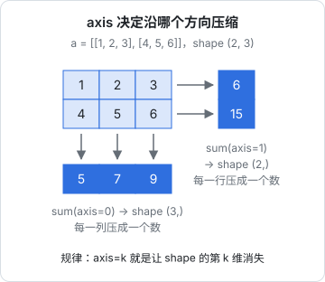
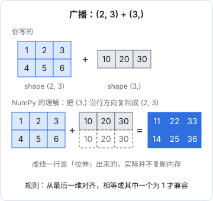

# NumPy

打开任何一段 AI 相关的 Python 代码，几乎都能看到 `import numpy as np`。NumPy 提供的是一种数据结构：**多维数组**（`ndarray`），外加一整套在数组上做数学运算的函数。embedding 是一维数组，一批 embedding 是二维数组，一张图片是三维数组，神经网络的权重是一堆矩阵。PyTorch 的张量（tensor）在 API 上几乎就是「能放到 GPU 上、能自动求导的 NumPy 数组」，学会 NumPy，读 PyTorch 代码就成功了一半。

这一章讲 NumPy 的核心概念：为什么要用数组而不是列表，形状（shape）和轴（axis），索引与切片，广播（broadcasting），以及几个在 AI 里天天用到的操作：点积、矩阵乘法、softmax、余弦相似度。

## 为什么不用列表

JS 里处理一百万个数，你会写 `for` 循环或者 `reduce`，V8 的 JIT 会把它编译得很快。Python 不行：CPython 是解释执行的，每个数字都是一个独立的堆对象，循环里的每一步都要做类型检查、引用计数。

NumPy 数组是一块**连续内存**里存放的同类型数值（类似 JS 的 `Float64Array`），所有运算都在 C 写的底层循环里完成。区别有多大，量一下就知道：

```python
import timeit
import numpy as np

xs = list(range(1_000_000))
arr = np.arange(1_000_000, dtype=np.float64)

t_py = timeit.timeit(lambda: sum(x * x for x in xs), number=10) / 10
t_np = timeit.timeit(lambda: (arr * arr).sum(), number=10) / 10
print(f"纯 Python: {t_py * 1000:.1f} ms")
print(f"NumPy:     {t_np * 1000:.2f} ms")
print(f"快了约 {t_py / t_np:.0f} 倍")
```

在写作用的 Apple 芯片 Mac 上多跑几次，纯 Python 每次要二三十毫秒，NumPy 只要零点几毫秒，相差几十到上百倍。具体倍数因机器而异，但结论是稳定的：

> 在 NumPy 里，**写循环是反模式**。能用整个数组的运算表达的，就不要逐个元素遍历。这种写法叫**向量化**（vectorization）。

## ndarray 的三个属性

```python
import numpy as np

a = np.array([[1, 2, 3],
              [4, 5, 6]])
print(a.shape)   # (2, 3)   2 行 3 列
print(a.ndim)    # 2        维数
print(a.dtype)   # int64    元素类型，整个数组只有一种
print(a.size)    # 6        元素总数
```

| 概念 | 含义 | 类比 |
|---|---|---|
| `shape` | 每个维度的长度，是一个 tuple | 嵌套数组每一层的 `length` |
| `ndim` | 维度个数，等于 `len(shape)` | 嵌套几层 |
| `dtype` | 元素类型：`int64`、`float32`、`float64`、`bool`… | `Int32Array` / `Float32Array` 的区别 |

AI 里常见的形状，读代码时先看形状，基本就能猜到数据是什么：

| 形状 | 通常表示 |
|---|---|
| `(768,)` | 一个 768 维的 embedding 向量 |
| `(1000, 768)` | 1000 条文本的 embedding |
| `(224, 224, 3)` | 一张 224×224 的 RGB 图片 |
| `(32, 128, 768)` | 一个 batch：32 条序列、每条 128 个 token、每个 token 768 维 |

### 创建数组

```python
import numpy as np

print(np.zeros((2, 3)))              # 全 0
print(np.ones(4))                    # 全 1
print(np.arange(0, 10, 2))           # [0 2 4 6 8]，类似 range
print(np.linspace(0, 1, 5))          # [0.   0.25 0.5  0.75 1.  ]，等分点
print(np.eye(3))                     # 3×3 单位矩阵

rng = np.random.default_rng(seed=42) # 随机数生成器，固定种子可复现
print(rng.normal(size=(2, 3)))       # 标准正态分布
print(rng.integers(0, 10, size=5))   # 整数

x = np.arange(12)
print(x.reshape(3, 4))               # 改变形状，元素总数不变
print(x.reshape(3, -1).shape)        # (3, 4)，-1 表示「自动算」
```

随机数要用 `np.random.default_rng()` 生成的 `Generator`，老代码里的 `np.random.seed()` + `np.random.rand()` 是旧接口。

### dtype 与内存

```python
import numpy as np

a = np.zeros((1000, 768), dtype=np.float64)
b = a.astype(np.float32)
print(a.nbytes, b.nbytes)   # 6144000 3072000
```

`float64` 每个数 8 字节，`float32` 4 字节。深度学习里默认用 `float32`，甚至更低精度的 `float16`、`bfloat16`；大模型「量化」的本质，就是用更少的位数存权重。存 embedding 时用 `float32` 通常就够了，内存直接减半。

## 逐元素运算

数组之间的 `+ - * /`、比较运算、数学函数，都是**逐元素**的：

```python
import numpy as np

a = np.array([1.0, 2.0, 3.0])
b = np.array([10.0, 20.0, 30.0])
print(a + b)          # [11. 22. 33.]
print(a * b)          # [10. 40. 90.]   逐元素乘，不是矩阵乘
print(a ** 2)         # [1. 4. 9.]
print(np.exp(a))      # 每个元素求 e^x
print(np.sqrt(b))
print(a > 1.5)        # [False  True  True]   得到布尔数组
```

注意 `*` 是逐元素乘。矩阵乘法用 `@`，后面讲。

## 轴（axis）

聚合函数（`sum`、`mean`、`max`、`argmax`…）都有一个 `axis` 参数，决定「沿着哪个方向压缩」：

```python
import numpy as np

a = np.array([[1, 2, 3],
              [4, 5, 6]])
print(a.sum())              # 21           全部求和
print(a.sum(axis=0))        # [5 7 9]      沿第 0 轴（行方向）压缩，得到每列的和
print(a.sum(axis=1))        # [ 6 15]      沿第 1 轴（列方向）压缩，得到每行的和
print(a.mean(axis=1, keepdims=True))   # [[2.] [5.]]  保留维度，形状 (2, 1)
print(a.argmax(axis=1))     # [2 2]        每行最大值的下标
```



记忆方法：**`axis=k` 就是让 shape 里的第 k 个数消失**。shape `(2, 3)` 的数组，`sum(axis=0)` 得到 shape `(3,)`，`sum(axis=1)` 得到 shape `(2,)`。高维时同理，`(32, 128, 768)` 沿 `axis=1` 求平均，就是把每条序列的 128 个 token 向量平均成一个，得到 `(32, 768)`：这正是把 token embedding 汇总成句子 embedding 的常见做法（mean pooling）。

`keepdims=True` 让被压缩的那一维保留为长度 1，方便接下来和原数组做广播运算。

## 索引与切片

第 1 章的列表切片在 NumPy 里推广到了多维，每个维度用逗号隔开：

```python
import numpy as np

a = np.arange(12).reshape(3, 4)
# [[ 0  1  2  3]
#  [ 4  5  6  7]
#  [ 8  9 10 11]]
print(a[1, 2])        # 6        第 1 行第 2 列（不是 a[1][2]，虽然那样也行）
print(a[0])           # [0 1 2 3]  第 0 行
print(a[:, 1])        # [1 5 9]    所有行的第 1 列
print(a[:2, 1:3])     # [[1 2] [5 6]]
print(a[-1, ::-1])    # [11 10  9  8]
```

### 布尔掩码与花式索引

```python
import numpy as np

scores = np.array([0.91, 0.42, 0.77, 0.15, 0.88])
mask = scores > 0.5
print(mask)                   # [ True False  True False  True]
print(scores[mask])           # [0.91 0.77 0.88]   类似 filter
print(np.where(scores > 0.5, "keep", "drop"))       # 逐元素三元表达式

idx = np.array([4, 0])
print(scores[idx])            # [0.88 0.91]  用下标数组取，叫花式索引

scores[scores < 0.5] = 0.0    # 条件赋值
print(scores)
```

### 视图与副本

这是 NumPy 最大的坑：**切片返回的是视图**（view），和原数组共享内存。

```python
import numpy as np

a = np.arange(5)
b = a[1:4]        # 视图
b[0] = 100
print(a)          # [  0 100   2   3   4]   原数组被改了

c = a[1:4].copy() # 明确要副本
c[0] = -1
print(a)          # 不受影响
```

规则：普通切片（`a[1:4]`、`a[:, 0]`）是视图；布尔掩码和花式索引（`a[mask]`、`a[[0, 2]]`）返回副本。拿不准时用 `np.shares_memory(a, b)` 检查，或者直接 `.copy()`。JS 的 `TypedArray.prototype.subarray` 也是共享内存的，可以拿它来类比。

## 广播

形状不同的数组怎么做运算？NumPy 的规则叫**广播**（broadcasting）：

1. 从**最后一维**开始，两两对齐比较
2. 两个维度相等，或者其中一个是 1，就兼容；长度为 1 的那个会被「拉伸」成另一个的长度
3. 维数不够的一方在前面补 1

```python
import numpy as np

x = np.array([[1, 2, 3],
              [4, 5, 6]])            # (2, 3)
print(x + 10)                        # 标量广播到每个元素
print(x + np.array([10, 20, 30]))    # (3,) 被拉伸成 (2, 3)，每行都加
print(x + np.array([[100], [200]]))  # (2, 1) 被拉伸成 (2, 3)，每列都加

col_mean = x.mean(axis=0)            # (3,)
print(x - col_mean)                  # 每列减去自己的均值：数据标准化的第一步
```



「拉伸」只是概念上的，NumPy 不会真的复制数据。广播让大量「对每一行做同样的事」的操作不需要写循环。

形状对不上时会报错：

```python
import numpy as np

x = np.ones((2, 3))
try:
    x + np.ones(2)                   # 最后一维 3 和 2 不兼容
except ValueError as e:
    print(e)                         # operands could not be broadcast together with shapes (2,3) (2,)
```

调试 NumPy 和 PyTorch 代码时，九成的问题都是形状问题。养成习惯：不确定时 `print(x.shape)`。

## 线性代数：点积与矩阵乘法

```python
import numpy as np

a = np.array([1.0, 2.0, 3.0])
b = np.array([4.0, 5.0, 6.0])
print(a @ b)                 # 32.0   点积：1*4 + 2*5 + 3*6

W = np.array([[1.0, 0.0, -1.0],
              [2.0, 1.0,  0.0]])     # (2, 3)
print(W @ a)                 # [-2.  4.]   (2, 3) @ (3,) -> (2,)

X = np.ones((4, 3))          # 4 个样本，每个 3 维
print((X @ W.T).shape)       # (4, 2)      (4, 3) @ (3, 2) -> (4, 2)
```

矩阵乘法 `(m, k) @ (k, n) -> (m, n)`：前一个的列数必须等于后一个的行数。神经网络里的一个全连接层，本质就是 `X @ W.T + b`：一次矩阵乘法加一次广播。矩阵乘法的几何意义可以看《AI 数学直觉》。

## AI 里天天用的三个操作

### softmax

模型最后一层输出的是一组任意实数（logits），softmax 把它们变成和为 1 的概率分布：

$$
\text{softmax}(z)_i = \frac{e^{z_i}}{\sum_j e^{z_j}}
$$

```python
import numpy as np

def softmax(z: np.ndarray, axis: int = -1) -> np.ndarray:
    z = z - z.max(axis=axis, keepdims=True)    # 减去最大值，防止 exp 溢出，结果不变
    e = np.exp(z)
    return e / e.sum(axis=axis, keepdims=True)

logits = np.array([2.0, 1.0, 0.1])
p = softmax(logits)
print(p.round(3), p.sum())          # [0.659 0.242 0.099] 1.0

print(softmax(np.array([1000.0, 999.0])).round(3))   # [0.731 0.269]，不减最大值会得到 nan

for t in (0.5, 1.0, 2.0):           # 温度：先除以 T 再 softmax
    print(t, softmax(logits / t).round(3))
```

`axis=-1` 表示最后一维，`keepdims=True` 让最大值和总和保持可广播的形状，这样同一个函数能处理一个向量，也能处理 `(batch, vocab)` 的一整批。最后那个循环就是 API 里 `temperature` 参数的原理，《大模型原理科普》第 7 章画过它的效果。

### 余弦相似度与语义搜索

embedding 之间的相似度通常用余弦相似度：两个向量夹角的余弦，越接近 1 越相似。把向量先归一化成长度 1，余弦相似度就是点积；一个查询对一批文档，就是一次矩阵乘法：

```python
import numpy as np

rng = np.random.default_rng(0)
docs = rng.normal(size=(1000, 384)).astype(np.float32)   # 假装是 1000 篇文档的 embedding
query = docs[42] + 0.1 * rng.normal(size=384).astype(np.float32)  # 一个和第 42 篇很像的查询

def normalize(x: np.ndarray) -> np.ndarray:
    return x / np.linalg.norm(x, axis=-1, keepdims=True)

scores = normalize(docs) @ normalize(query)    # (1000, 384) @ (384,) -> (1000,)
top3 = np.argsort(scores)[::-1][:3]            # 从大到小排，取前 3 个下标
print(top3, scores[top3].round(3))             # 第一个应该是 42
```

这几行就是一个最小的「向量检索」：真实系统里 embedding 由模型生成、文档数以百万计，会换成 pgvector 之类的向量库做近似检索，但计算的本质一模一样。《RAG 与知识系统》会接着讲。

数据量大时，`np.argpartition(-scores, k)[:k]` 只找出前 k 个而不对全部排序，会更快。

### 统计与归一化

```python
import numpy as np

x = np.array([[170.0, 65.0],
              [160.0, 50.0],
              [180.0, 80.0]])            # 3 个样本，2 个特征（身高、体重）
mu = x.mean(axis=0)
sigma = x.std(axis=0)
z = (x - mu) / sigma                     # 标准化：每个特征变成均值 0、标准差 1
print(z.round(2))
print(z.mean(axis=0).round(6), z.std(axis=0))
```

特征尺度差别很大时（身高一百多、体重几十），先标准化再训练是常规操作。神经网络里的 LayerNorm 做的也是同一件事，只不过是沿最后一维对每个 token 做。

## 和 PyTorch 的关系

```python
import numpy as np

a = np.arange(6, dtype=np.float32).reshape(2, 3)
print(a.T.shape, a.sum(axis=0), a @ a.T)
```

同样的代码换成 PyTorch，大致是 `torch.arange(6, dtype=torch.float32).reshape(2, 3)`、`a.T`、`a.sum(dim=0)`、`a @ a.T`。主要区别：

| NumPy | PyTorch | 说明 |
|---|---|---|
| `np.ndarray` | `torch.Tensor` | |
| `axis=` | `dim=` | 很多函数两个名字都接受 |
| 只在 CPU | `.to("cuda")` / `.to("mps")` | Apple 芯片用 `mps` |
| 无 | `requires_grad=True` | 自动求导 |
| `np.asarray(t)` / `t.numpy()` | `torch.from_numpy(a)` | 两者可以零拷贝互转（CPU 上） |

形状、广播、索引、`@`、`axis/dim` 的规则完全一致，这一章的内容在《动手学深度学习》里会原样用上。

## 本章要点

- NumPy 数组是连续内存里的同类型数值，向量化运算比 Python 循环快一两个数量级；**别写循环**
- 读代码先看 `shape`；`dtype` 决定精度和内存，AI 里多用 `float32`
- `axis=k` 让 shape 的第 k 维消失；`keepdims=True` 保留它以便广播
- 切片是视图、改了会影响原数组；掩码和花式索引返回副本
- 广播从最后一维对齐，相等或为 1 才兼容；形状错误是最常见的 bug
- `@` 是矩阵乘法，`*` 是逐元素乘；softmax 要先减最大值，余弦相似度就是归一化后的点积
- PyTorch 张量的 API 基本照搬 NumPy，学会这一章就能读懂大部分张量代码
