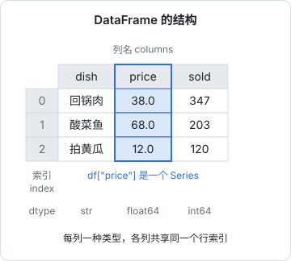
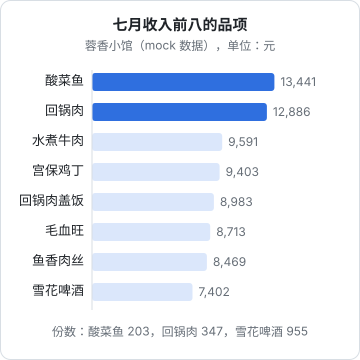

# Pandas

NumPy 处理的是同类型数值组成的数组；而现实里的数据大多是**表格**：一列日期、一列订单号、一列菜名、一列金额，每列类型不同，还带着缺失值和脏数据。Pandas 就是 Python 里处理表格的标准工具，你可以把它理解成「内存里的一张可编程 Excel 表」，或者「不用建库就能跑的 SQL」。

在 AI 工作里，Pandas 出现在所有和数据打交道的环节：整理训练集和评测集、分析模型的评测结果、清洗爬来的语料、统计 API 用量和成本。这一章用一份真实结构的数据走一遍完整流程：hatch-counter 的 mock 数据里，一家虚构川菜馆七月份从收银系统导出的「品项销售明细」Excel 表。

## 两个核心结构

| 结构 | 是什么 | 类比 |
|---|---|---|
| `Series` | 一列带标签的数据，底层是一个 NumPy 数组加一个索引 | 一个 `Map<label, value>`，但能整体做运算 |
| `DataFrame` | 多个共享同一个索引的 Series 组成的表 | 数据库里的一张表、Excel 的一个工作表 |



```python
import pandas as pd

df = pd.DataFrame({
    "dish": ["回锅肉", "酸菜鱼", "拍黄瓜"],
    "category": ["热菜", "热菜", "凉菜"],
    "price": [38.0, 68.0, 12.0],
    "sold": [347, 203, 120],
})
print(df)
print(df.dtypes)
print(df["price"])            # 取一列，得到 Series
print(type(df["price"]))
print(df["price"] * df["sold"])   # 列之间逐元素运算，和 NumPy 一样
```

和 NumPy 的关键区别是**索引**（index）：每一行有一个标签（默认是 0、1、2…），运算时 Pandas 按标签对齐，而不是按位置。

## 读入数据

Pandas 能直接读 CSV、Excel、JSON、Parquet、SQL 查询结果：

| 格式 | 读 | 写 | 备注 |
|---|---|---|---|
| CSV | `pd.read_csv` | `df.to_csv` | 最通用 |
| Excel | `pd.read_excel` | `df.to_excel` | 需要 `uv add openpyxl` |
| JSON / JSONL | `pd.read_json(lines=True)` | `df.to_json(orient="records", lines=True)` | JSONL 是评测集、微调数据的常用格式 |
| Parquet | `pd.read_parquet` | `df.to_parquet` | 列式压缩，大数据首选，需要 `uv add pyarrow` |
| SQL | `pd.read_sql(query, conn)` | `df.to_sql` | 配合 SQLAlchemy 或数据库驱动 |

收银系统导出的 Excel，前三行是标题和导出信息，第四行才是表头，最后还有一行「合计」。这在真实世界的报表里很常见：

```python
import pandas as pd

pd.set_option("display.unicode.east_asian_width", True)   # 中文列对齐

SALES = "mock-data/01-七月/收银报表/美团收银_品项销售明细_20260701-20260731.xlsx"
raw = pd.read_excel(SALES, header=3, dtype={"订单号": str})
print(raw.shape)
print(raw.tail(2)[["门店名称", "品项名称", "销售数量", "品项收入(元)"]])
```

```text
(9675, 17)
      门店名称 品项名称  销售数量  品项收入(元)
9673  蓉香小馆     餐具         2          2.00
9674      合计      NaN     16345     204875.93
```

两个参数值得注意：

- `header=3`：第 4 行（下标 3）是表头，前面的行跳过
- `dtype={"订单号": str}`：订单号看起来是数字，但它是标识符，不能当数字处理（会丢前导零、变成科学计数法）。读入时就指定为字符串，这和 TS 里「ID 用 string 不用 number」是一个道理

最后一行「合计」不是数据，留着会让所有求和翻倍。先把它去掉，再整理列：

```python
df = raw[raw["门店名称"] != "合计"].copy()
df["营业日期"] = pd.to_datetime(df["营业日期"])
cols = ["营业日期", "订单号", "订单来源", "品项名称", "菜品大类", "销售数量", "品项收入(元)"]
df = df[cols].rename(columns={"品项收入(元)": "收入"})
print(df.head(3))
df.info()
```

```text
    营业日期         订单号  订单来源      品项名称 菜品大类  销售数量   收入
0 2026-07-01  2607010000036  美团外卖    回锅肉盖饭     盖饭         1  19.36
1 2026-07-01  2607010000036  美团外卖        打包盒     其他         1   1.76
2 2026-07-01  2607010000011      堂食  鱼香肉丝盖饭     盖饭         1  17.60
<class 'pandas.DataFrame'>
RangeIndex: 9674 entries, 0 to 9673
Data columns (total 7 columns):
 #   Column    Non-Null Count  Dtype
---  ------    --------------  -----
 0   营业日期  9674 non-null   datetime64[us]
 1   订单号    9674 non-null   str
 2   订单来源  9674 non-null   str
 3   品项名称  9674 non-null   str
 4   菜品大类  9674 non-null   str
 5   销售数量  9674 non-null   int64
 6   收入      9674 non-null   float64
...
```

拿到一份新数据，先看 `shape`、`head()`、`info()`、`describe()`，确认行数、类型和缺失情况，再动手分析。这一步相当于写代码前先看接口定义。

## 选择与过滤

| 要做的事 | 写法 | SQL 类比 |
|---|---|---|
| 取一列 | `df["收入"]` | `SELECT 收入` |
| 取多列 | `df[["品项名称", "收入"]]` | `SELECT 品项名称, 收入` |
| 按条件过滤行 | `df[df["收入"] > 100]` | `WHERE 收入 > 100` |
| 多个条件 | `df[(df["订单来源"] == "堂食") & (df["收入"] > 100)]` | `AND` |
| 在集合里 | `df[df["菜品大类"].isin(["热菜", "凉菜"])]` | `IN (...)` |
| 按标签取行和列 | `df.loc[行条件, ["列1", "列2"]]` | |
| 按位置取 | `df.iloc[0:5, 0:3]` | `LIMIT 5` |
| 字符串匹配 | `df[df["品项名称"].str.contains("鱼")]` | `LIKE '%鱼%'` |

多个条件要用 `&`、`|`、`~`，每个条件**必须加括号**，不能用 Python 的 `and` / `or`，这是新手最常见的报错。

### 不要链式赋值

Pandas 3 默认启用了写时复制（Copy-on-Write），过滤得到的结果在行为上总是一个副本。下面这种写法什么也不会改，还会给出 `ChainedAssignmentError` 警告：

```python
df[df["订单来源"] == "美团外卖"]["收入"] = 0      # 错误：改的是临时副本
```

要修改原表，用 `.loc` 一步到位：

```python
df.loc[df["订单来源"] == "美团外卖", "备注"] = "外卖"   # 正确
```

旧教程里常见的 `SettingWithCopyWarning` 就是这个问题在 Pandas 2 及以前的表现。

## 分组聚合

`groupby` 是 Pandas 最常用的操作，对应 SQL 的 `GROUP BY`。先看总量：

```python
print(len(df), df["订单号"].nunique(), round(df["收入"].sum(), 2))
print(df["订单来源"].value_counts())
```

```text
9674 1838 204875.93
订单来源
堂食        8803
美团外卖     871
Name: count, dtype: int64
```

9674 行明细、1838 张订单，收入合计和导出文件里的「合计」行一致，说明清洗没出错。**拿聚合结果和源数据的合计对一遍**，是数据处理里最便宜也最有效的自检。

然后看哪些菜最赚钱。餐具、打包盒属于「其他」大类，不算菜，先排除：

```python
dishes = df[df["菜品大类"] != "其他"]
top = (
    dishes.groupby("品项名称")
    .agg(份数=("销售数量", "sum"), 收入=("收入", "sum"))
    .sort_values("收入", ascending=False)
    .head(8)
)
print(top)
```

```text
            份数      收入
品项名称
酸菜鱼       203  13440.88
回锅肉       347  12886.18
水煮牛肉     170   9590.88
宫保鸡丁     269   9402.84
回锅肉盖饭   421   8983.04
毛血旺       154   8712.76
鱼香肉丝     272   8468.80
雪花啤酒     955   7401.76
```



`agg` 里的 `新列名=("源列", "聚合函数")` 叫命名聚合，一次算多个指标。整个表达式用括号包起来分行写，是 Pandas 的惯用风格，读起来像 SQL 管道。

### 先聚合到订单，再算客单价

明细表的一行是「一张订单里的一个品项」。想算客单价，要先按订单汇总，再按来源求平均：

```python
orders = df.groupby(["订单号", "订单来源"], as_index=False)["收入"].sum()
print(orders.groupby("订单来源")["收入"].agg(["count", "mean"]).round(2))
```

```text
          count    mean
订单来源
堂食       1541  124.16
美团外卖    297   45.60
```

如果直接对明细行求平均，得到的是「每个品项的平均收入」，不是客单价。**分析前先想清楚一行代表什么**（数据的粒度），这比任何 API 都重要。

## 时间序列

日期列转成 `datetime` 之后，可以按天、按周、按星期几聚合：

```python
daily = df.groupby("营业日期")["收入"].sum()
print(daily.describe().round(0))

weekday = daily.groupby(daily.index.day_of_week).mean().round(0)
weekday.index = ["一", "二", "三", "四", "五", "六", "日"]
print(weekday)

print(daily.resample("W-SUN").sum().round(0))   # 按周汇总，每周以周日结束
```

```text
count      31.0
mean     6609.0
std      1348.0
min      4021.0
...
max      8722.0
一    5710.0
二    6696.0
三    6496.0
四    6521.0
五    7046.0
六    6778.0
日    6955.0
营业日期
2026-07-05    23140.0
2026-07-12    43220.0
2026-07-19    48930.0
2026-07-26    53428.0
2026-08-02    36158.0
```

日均营收约 6600 元，周一最淡。按周汇总的第一周和最后一周只有几天（7 月 1 日是周三），不能直接和中间的整周比较。`resample` 是时间序列专用的分组，`"D"`、`"W-SUN"`、`"MS"`（月初）这些字符串叫频率别名。

## 透视表

想看「每个大类在堂食和外卖各卖了多少」，用 `pivot_table`，效果和 Excel 的数据透视表一样：

```python
pivot = df.pivot_table(
    index="菜品大类", columns="订单来源", values="收入",
    aggfunc="sum", fill_value=0,
).round(0)
print(pivot.sort_values("堂食", ascending=False).head(5))
```

```text
订单来源      堂食  美团外卖
菜品大类
热菜      115055.0    7206.0
酒水饮料   16401.0     455.0
盖饭       13453.0    4441.0
凉菜       12485.0       0.0
套餐        8483.0       0.0
```

外卖的收入集中在热菜和盖饭，凉菜、套餐没有上外卖。

## 合并：按配方算食材用量

hatch-counter 的核心逻辑之一，是按配方把卖出去的菜换算成消耗了多少食材，再从库存里扣掉。用 Pandas 可以几行完成这个计算。配方表的「菜品」列用了 Excel 合并单元格，读进来后同一道菜只有第一行有名字：

```python
recipe = pd.read_excel("mock-data/00-开店建档/3 配方表.xlsx")
print(recipe.head(4))
recipe["菜品"] = recipe["菜品"].ffill()   # 用上一行的值向下填充

qty = dishes.groupby("品项名称", as_index=False)["销售数量"].sum()
use = qty.merge(recipe, left_on="品项名称", right_on="菜品", how="inner")
use["用量"] = use["销售数量"] * use["每份用量"]
need = (
    use.groupby(["食材", "单位"], as_index=False)["用量"].sum()
    .sort_values("用量", ascending=False)
)
print(need.head(4))
print(sorted(set(qty["品项名称"]) - set(recipe["菜品"])))
```

```text
       菜品    食材  每份用量 单位
0    拍黄瓜    黄瓜     350.0   克
1       NaN    大蒜      15.0   克
2  凉拌木耳  干木耳      25.0   克
3       NaN    大蒜      10.0   克
        食材 单位      用量
36    鸡腿肉   克  216820.0
24      草鱼   克  203000.0
29      豆腐   克  180100.0
0     五花肉   克  167910.0
['双人套餐', '可乐', '四人套餐', '王老吉凉茶', '矿泉水', '米饭(碗)', '西红柿炒蛋', '酸梅汤(扎)', '雪碧', '雪花啤酒', '青岛啤酒']
```

`merge` 对应 SQL 的 `JOIN`，`how` 可以是 `inner`、`left`、`right`、`outer`。最后一行用集合差找出「卖了但没有配方」的品项：酒水和套餐是预期之内的（成品直接扣库存、套餐要拆成单品），但「西红柿炒蛋」是一道正常的热菜，它没有配方意味着这道菜的食材消耗不会被扣减。这类问题光看代码发现不了，只有把数据拉出来核对才会暴露。

## 缺失值与类型

```python
import pandas as pd
import numpy as np

s = pd.Series([1.5, None, 3.0, np.nan])
print(s.isna().sum())        # 2   None 和 NaN 都算缺失
print(s.fillna(0).tolist())  # [1.5, 0.0, 3.0, 0.0]
print(s.dropna().tolist())   # [1.5, 3.0]
print(s.mean())              # 2.25  聚合函数默认跳过缺失值

t = pd.Series(["12", "abc", "7.5"])
print(pd.to_numeric(t, errors="coerce").tolist())   # [12.0, nan, 7.5]  转不了的变成 NaN
```

Pandas 用 `NaN`（以及 `NA`、`NaT`）表示缺失。读入数据后用 `df.isna().sum()` 看每列缺了多少；数字列里混进了字符串时，`to_numeric(errors="coerce")` 先强转再找出那些变成 NaN 的行。

Pandas 3 的另一个变化是：字符串列默认是专门的 `str` 类型，不再是什么都能装的 `object`，所以上面 `info()` 里看到的是 `str`。

## 导出

```python
import pandas as pd

top = pd.DataFrame({"品项名称": ["酸菜鱼", "回锅肉"], "收入": [13440.88, 12886.18]})
top.to_csv("top.csv", index=False, encoding="utf-8-sig")   # utf-8-sig 让 Excel 正确识别中文
top.to_json("top.jsonl", orient="records", lines=True, force_ascii=False)
print(open("top.jsonl", encoding="utf-8").read())
```

`index=False` 不写出行索引；`encoding="utf-8-sig"` 在文件头加 BOM，否则 Windows 上的 Excel 打开中文 CSV 会乱码。

## 什么时候不用 Pandas

| 场景 | 更合适的选择 |
|---|---|
| 数据已经在 Postgres 里，只要聚合结果 | 直接写 SQL，数据库比 Pandas 擅长 |
| 数据比内存大，或者追求速度 | Polars（Rust 写的 DataFrame 库，API 风格不同）或 DuckDB |
| 只是逐行处理 JSONL | 普通的 `for` 循环加 Pydantic 就够了 |
| 训练神经网络时的数据管道 | PyTorch 的 `Dataset` / `DataLoader` |

Pandas 的定位是**交互式探索和中小规模（内存放得下）的分析**。在 notebook 里一边看一边改，是它最舒服的用法，下一章就讲这个。

## 本章要点

- `Series` 是带索引的一列，`DataFrame` 是共享索引的多列；运算按标签对齐
- 读数据时就处理好表头、ID 列类型和「合计」这类非数据行；先 `shape`、`head`、`info` 看清楚再分析
- 过滤用布尔条件，多个条件用 `&` `|` 并加括号；修改用 `.loc`，不要链式赋值
- `groupby` + `agg` 是核心操作；分析前想清楚一行数据代表什么，必要时先聚合到正确的粒度
- 时间序列用 `to_datetime` + `resample`；交叉统计用 `pivot_table`；关联两张表用 `merge`
- 用合计值核对聚合结果，用集合差找出对不上的数据，这些检查比代码本身更能发现问题
