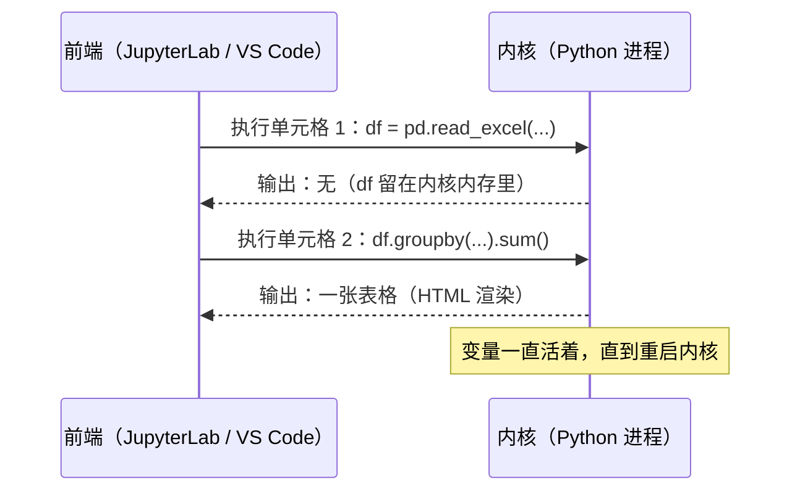
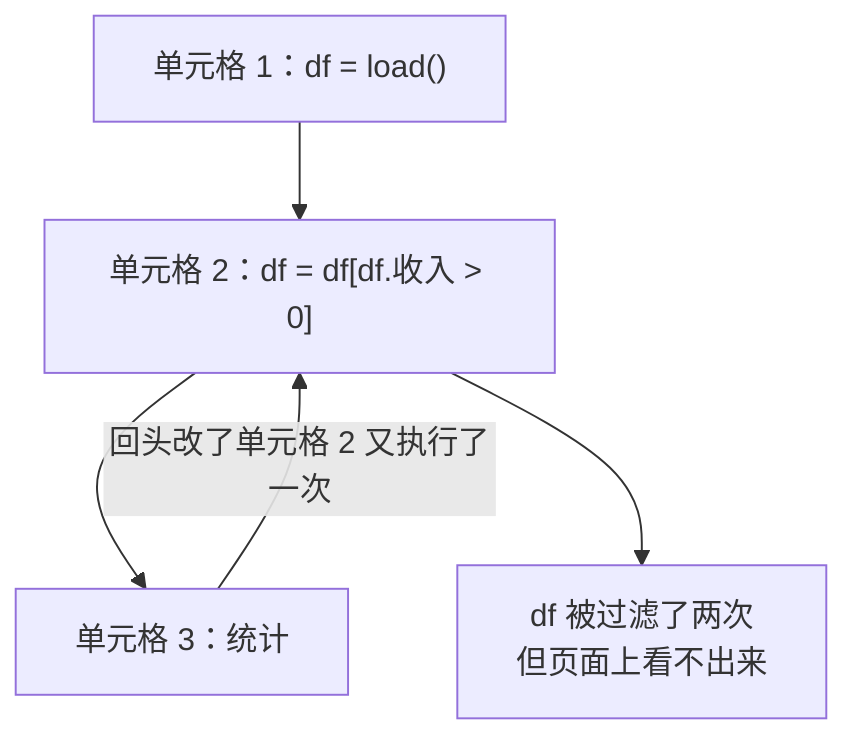

# Jupyter

上一章的分析，如果写成一个普通脚本，每改一个分组条件就要从头读一遍 Excel、重新跑全部代码。数据探索的节奏是「看一眼 → 改一点 → 再看一眼」，这正是 Jupyter Notebook 擅长的：代码分成一个个单元格（cell），每个单元格单独执行，变量留在内存里，输出（表格、图、日志）就显示在代码下面。

AI 领域的教程、论文附带的代码、模型的使用示例、Kaggle 竞赛，大量以 notebook 的形式发布。这一章讲 notebook 的运行原理、怎么用 uv 搭配 Jupyter、几个提高效率的用法，以及 notebook 最大的坑：隐藏状态。

## Notebook 是怎么运行的

一个 notebook 由两部分组成：

- **前端**：浏览器里的 JupyterLab，或者 VS Code / Cursor 的 notebook 编辑器，负责显示单元格和输出
- **内核**（kernel）：一个常驻的 Python 进程（ipykernel），真正执行代码、保存所有变量



`.ipynb` 文件本身是一个 JSON：存着每个单元格的源码，以及上一次运行的输出。所以 notebook 既是代码，也是「带结果的报告」，在 GitHub 上打开能直接看到图表。

如果用 Node 生态来类比：内核就像一个一直开着的 `node` REPL，前端是一个能把多段代码和输出排版在一起的编辑器。

## 用 uv 运行 Jupyter

### 方式一：在项目里临时启动 JupyterLab

```bash
cd hello-ai                      # 一个 uv 项目
uv run --with jupyter jupyter lab
```

`--with jupyter` 让 Jupyter 只在这次运行时加入环境，不写进 `pyproject.toml`；内核运行在项目的环境里，项目的依赖都能直接 `import`。命令会打开浏览器，在里面新建 notebook 即可。

### 方式二：在 VS Code / Cursor 里用

编辑器里的 notebook 体验通常更好：有补全、类型提示、Git 集成，也方便让编码 agent 一起改。只需要在项目里装上内核：

```bash
uv add --dev ipykernel
```

然后新建一个 `.ipynb` 文件，右上角「选择内核」选项目的 `.venv`。Claude Code 这类 agent 也能直接读写 `.ipynb`，可以让它帮你补单元格、解释输出。

### 方式三：在普通 .py 文件里分单元格

VS Code 和 Cursor 支持一种「百分号格式」：在普通 Python 文件里用 `# %%` 分隔单元格，每段可以单独发送到交互窗口执行：

```python
# %%
import numpy as np
x = np.arange(10)

# %%
x.reshape(2, 5).sum(axis=1)
```

它本质上是一个普通的 `.py` 文件，Git diff 干净、ruff 和 pyright 照常工作、`uv run` 也能直接跑。对于「主要是代码、偶尔看看输出」的场景，这比 `.ipynb` 更好维护。

## 基本操作

| 操作 | JupyterLab 快捷键 | 说明 |
|---|---|---|
| 运行当前单元格并跳到下一个 | `Shift + Enter` | 最常用 |
| 运行当前单元格不跳 | `Ctrl + Enter` | |
| 在下方插入单元格 | 命令模式下按 `B` | 按 `Esc` 进入命令模式 |
| 切换为 Markdown 单元格 | 命令模式下按 `M` | 写说明文字、公式 |
| 删除单元格 | 命令模式下按 `D D` | |
| 中断执行 | 工具栏的停止按钮 | 相当于 Ctrl+C |
| 重启内核 | 菜单 Kernel → Restart | 清空所有变量 |

单元格的**最后一个表达式**会自动显示，不需要 `print`。DataFrame 会被渲染成 HTML 表格，比终端里的文本好看得多。

## 魔法命令

以 `%` 开头的是 IPython 的「魔法命令」，只在 notebook / IPython 里有效，不是 Python 语法：

```python
%timeit x.sum()              # 自动多次运行并统计耗时，比手写 timeit 方便
%%time                       # 放在单元格第一行：统计整个单元格的耗时
!ls data/                    # ! 开头执行 shell 命令
%load_ext autoreload
%autoreload 2                # 自动重新加载修改过的 .py 模块
%who                         # 列出当前内核里的变量
```

`%autoreload` 很实用：把稳定的函数写在项目的 `.py` 模块里，notebook 只负责调用和展示；改了模块之后不用重启内核，下次执行时自动生效。这是「notebook 做探索、模块沉淀代码」的常见组合。

## 画图

Notebook 里画图最常用的是 matplotlib：

```bash
uv add matplotlib
```

```python
import matplotlib.pyplot as plt
import numpy as np

x = np.linspace(-3, 3, 200)
fig, ax = plt.subplots(figsize=(6, 3))
for t in (0.5, 1.0, 2.0):
    y = np.exp(-x**2 / t)
    ax.plot(x, y, label=f"t={t}")
ax.legend()
ax.set_title("same curve, different t")
plt.show()                   # notebook 里图会显示在单元格下方
```

几点提示：

- matplotlib 默认字体不含中文，标题写中文会显示成方框。要么用英文标签，要么在 `plt.rcParams["font.sans-serif"]` 里指定一个系统里有的中文字体
- Pandas 的 DataFrame 和 Series 自带 `.plot()` 方法，底层就是 matplotlib：`daily.plot()` 一行画出每日营收折线
- 需要交互（缩放、悬停看数值）时可以用 Plotly，体验接近前端的图表库

## 最大的坑：隐藏状态

Notebook 的自由也带来了它最大的问题：**执行顺序可以和书写顺序不一致**。



典型症状：

- 删掉了一个单元格，但它定义的变量还活在内核里，后面的代码照样能跑；换台机器从头运行就报 `NameError`
- 某个单元格被重复执行，数据被处理了两次
- 单元格左边的执行序号是 `[12] [5] [31]` 这样乱序的

应对规则只有一条：**交付或分享之前，重启内核并从头全部运行一遍**（Kernel → Restart Kernel and Run All Cells）。能从头跑通的 notebook 才算数。也可以在命令行里验证：

```bash
uv run --with jupyter jupyter execute analysis.ipynb
```

另外几个好习惯：

- 读数据、导入这类单元格放在最前面，后面的单元格不要修改前面定义的变量，而是生成新变量（`df_clean = ...`）
- 一个 notebook 只回答一个问题，不要无限追加
- 反复用到的函数挪到 `.py` 模块里，配合 `%autoreload`
- 涉及随机数时固定种子，保证重跑结果一致

## Notebook 与 Git

`.ipynb` 是 JSON，还带着输出和执行序号，直接提交会带来两个问题：diff 难以阅读，输出里可能夹带敏感数据或很大的图片。常见做法：

| 工具 | 做法 |
|---|---|
| nbstripout | 装成 Git 过滤器，提交时自动去掉输出，只留代码 |
| jupytext | 把 notebook 和一个 `.py`（百分号格式）或 `.md` 文件双向同步，提交文本版本 |
| 编辑器自带的 notebook diff | VS Code 能按单元格显示差异，适合偶尔查看 |

```bash
uvx nbstripout --install          # 在当前仓库安装 Git 过滤器
uvx jupytext --to py:percent analysis.ipynb   # 转成百分号格式的 .py
```

经验法则：**探索性的 notebook 可以不进 Git，结论写进文档；需要长期维护的分析，用百分号格式的 `.py` 或 jupytext 管理。**

## 其他选择

| 工具 | 特点 |
|---|---|
| marimo | 新一代 notebook，文件就是普通 `.py`；单元格之间有依赖关系，改一个会自动重算下游，从机制上消除了隐藏状态 |
| Google Colab | 托管在云端的 Jupyter，带免费的（有限的）GPU，适合跑别人发布的深度学习教程 |
| VS Code 交互窗口 | 前面讲的 `# %%` 方式，最轻量 |

如果你已经被 notebook 的隐藏状态坑过，marimo 值得一试；它的心智模型更接近前端的响应式框架：单元格像 `useMemo`，依赖变了就重新计算。

## 什么时候用 notebook，什么时候用脚本

| 用 notebook | 用脚本 / 模块 |
|---|---|
| 第一次看一份数据 | 需要定期重复运行的任务 |
| 试 prompt、比较几个模型的输出 | 要被别的代码调用的逻辑 |
| 画图、写分析报告 | 要写测试的代码 |
| 跟着教程一步步跑 | 命令行工具、服务 |

AI 工作中的典型流程是：在 notebook 里试验 prompt 和数据处理方式，效果满意之后，把代码整理成模块和命令行工具。第 8 章就是这样一个从探索到工具的例子。

## 本章要点

- Notebook = 前端 + 常驻的内核进程，变量在执行之间一直保留，`.ipynb` 是带输出的 JSON
- 用 uv 运行：`uv run --with jupyter jupyter lab`，或在编辑器里配合 `uv add --dev ipykernel`
- `# %%` 百分号格式让普通 `.py` 文件也能分单元格执行，对 Git 和工具链更友好
- `%timeit`、`%%time`、`%autoreload 2` 是最常用的魔法命令
- 隐藏状态是最大的坑：分享前一定「重启并全部运行」，或用 `jupyter execute` 验证
- 提交前用 nbstripout 去输出，或用 jupytext 管理文本版本；marimo 从机制上解决了隐藏状态

## 动手练习

1. **制造一次隐藏状态**：在 JupyterLab 里新建 notebook，单元格 1 写 `numbers = [1, 2, 3]` 并运行，单元格 2 写 `sum(numbers)` 并运行；然后把单元格 1 改成 `nums = [1, 2, 3]` 再运行一次，回到单元格 2 再运行。保存后在终端执行 `uv run --with jupyter jupyter execute 文件名.ipynb`，再看 `echo $?`。

   验证：在 JupyterLab 里单元格 2 仍然输出 `6`；命令行执行时报 `NameError: name 'numbers' is not defined`，退出码不是 0。

   参考答案：旧变量 `numbers` 还活在内核里，所以交互时看不出问题；`jupyter execute` 起的是全新内核，从头按顺序跑，暴露了隐藏状态。不想手动点，也可以写一个 `# %%` 格式的 `.py`，用 `uvx jupytext --to notebook demo.py` 转成 notebook 再执行。

2. **用 %timeit 重做第 4 章的对比**：在 notebook 里定义 `xs = list(range(1_000_000))` 和 `arr = np.arange(1_000_000, dtype=np.float64)`，分别运行 `%timeit sum(x * x for x in xs)` 和 `%timeit (arr * arr).sum()`。

   验证：两行都会输出「平均值 ± 标准差 per loop」以及运行了多少轮；NumPy 那一行的单位比纯 Python 小一到两个数量级（具体数字因机器而异）。

   参考答案：`%timeit` 自动决定重复次数并给出统计，比[第 4 章](04-numpy.md)手写的 `timeit.timeit(...) / 10` 省事，结论应该和那里一致。

3. **提交前去掉输出**：拿第 1 题能跑通的版本，`jupyter execute --inplace` 让输出写回文件，用 `grep -c '"output_type"' 文件名.ipynb` 数一下输出条数；再运行 `uvx nbstripout 文件名.ipynb` 后数一次。

   验证：第一次计数大于 0，nbstripout 之后是 0，文件里每个代码单元格的 `"outputs"` 都变成了 `[]`。

   参考答案：`.ipynb` 是把输出也存进去的 JSON，nbstripout 只保留源码，diff 才干净，也避免把数据带进 Git。`uvx nbstripout --install` 则是把同样的处理装成 Git 过滤器，每次提交自动执行。
