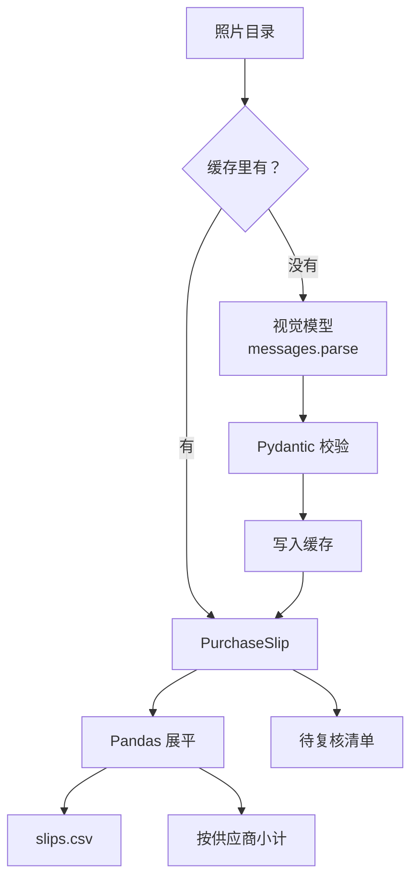

# 写个小工具

前面七章分别讲了语法、uv、类型与 Pydantic、NumPy、Pandas、Jupyter 和模型 API。这一章把它们组合起来，从零写一个真正能用的命令行工具：**slip2csv**，把一个目录里的进货单照片交给视觉模型识别，校验结果，汇总成一张 CSV，并按供应商出一个小计。

这正是 hatch-counter 拍照识别进货单功能的 Python 原型。重点不在功能本身，而在一个 Python 项目「该有的样子」：可安装的包结构、命令行入口、异步并发、结果缓存、测试、lint 和类型检查。做完这一章，你就有了一个可以照抄的 Python 工具模板。

## 从 notebook 到工具

第 6 章说过，AI 工作的典型流程是先在 notebook 里试，满意了再整理成代码。这个工具的前身就是第 7 章里那段 `read_slip` 函数：在 notebook 里拿几张单子试过 prompt 和 schema 之后，要变成一个能反复运行的工具，还需要补上这些东西：

| 需求 | 做法 |
|---|---|
| 一条命令就能跑，不用开 notebook | `[project.scripts]` 注册命令行入口，argparse 解析参数 |
| 几十张图片不能串行等 | `AsyncAnthropic` + 信号量控制并发 |
| 跑到一半崩了不想重新付费 | 按图片内容的哈希缓存每张的识别结果 |
| 先试几张再跑全量 | `--limit` 参数 |
| 模型输出不可全信 | Pydantic 校验；看不清的行单独列出，人工复核 |
| 改代码不怕改坏 | pytest 测试纯逻辑部分，ruff 和 pyright 把关 |

整体流程：



## 建项目

这次要做成可安装的命令行工具，用 `--package` 模式：

```bash
uv init --package slip2csv --python 3.12
cd slip2csv
uv add anthropic pydantic pandas
uv add --dev pytest ruff pyright
mkdir tests
```

最终的目录结构：

| 路径 | 内容 |
|---|---|
| `pyproject.toml` | 依赖、命令行入口、ruff 和 pyright 配置 |
| `src/slip2csv/__init__.py` | 空文件，标记这是一个包 |
| `src/slip2csv/models.py` | Pydantic 模型：识别结果的结构 |
| `src/slip2csv/extract.py` | 调模型、并发、缓存 |
| `src/slip2csv/report.py` | 用 Pandas 展平和汇总 |
| `src/slip2csv/cli.py` | 命令行参数和主流程 |
| `tests/test_report.py` | 测试 |

把代码放在 `src/` 下面（src 布局）是 Python 社区推荐的做法：测试时导入的一定是「安装后的包」，而不是碰巧在当前目录里的文件，可以避免很多「本地能跑、装上就坏」的问题。uv 会以可编辑模式（editable）把项目本身装进 `.venv`，改了源码立即生效，相当于 pnpm workspace 里的本地包链接。

## pyproject.toml

```toml
[project]
name = "slip2csv"
version = "0.1.0"
description = "把进货单照片识别成 CSV"
readme = "README.md"
requires-python = ">=3.12"
dependencies = [
    "anthropic>=2.3.0",
    "pandas>=3.1.0",
    "pydantic>=2.14.2",
]

[project.scripts]
slip2csv = "slip2csv.cli:main"

[build-system]
requires = ["uv_build>=0.12.16,<0.13.0"]
build-backend = "uv_build"

[dependency-groups]
dev = [
    "pyright>=1.1.414",
    "pytest>=9.2.0",
    "ruff>=0.17.3",
]

[tool.ruff]
line-length = 100

[tool.ruff.lint]
select = ["E", "F", "I", "UP", "B"]

[tool.pyright]
pythonVersion = "3.12"
```

`[project.scripts]` 相当于 `package.json` 的 `bin` 字段：`slip2csv = "slip2csv.cli:main"` 的意思是「安装后提供一个叫 `slip2csv` 的命令，执行 `slip2csv/cli.py` 里的 `main` 函数」，`main` 的返回值就是进程的退出码。`[build-system]` 由 `uv init` 生成，告诉打包工具怎么构建这个包，一般不用动。

## 数据模型：models.py

先定义「识别结果长什么样」，其余代码都围绕它展开：

```python
from typing import Literal

from pydantic import BaseModel, Field

type Unit = Literal["斤", "公斤", "克", "箱", "袋", "个", "瓶", "桶", "把"]


class LineItem(BaseModel):
    name: str = Field(description="品名，按单据原文")
    quantity: float = Field(gt=0, description="数量")
    unit: Unit = Field(description="单位，只能从枚举里选")
    unit_price_cents: int = Field(ge=0, description="单价，单位：分")


class PurchaseSlip(BaseModel):
    """一张进货单的识别结果。"""

    supplier: str = Field(description="供应商名称")
    slip_date: str = Field(description="单据日期，YYYY-MM-DD；看不清填空字符串")
    items: list[LineItem]
    unreadable: list[str] = Field(
        default_factory=list, description="看不清或无法确定的行，原样描述，不要猜"
    )
```

这和第 7 章的模型基本一样：单位用枚举、金额用分、留出 `unreadable` 让模型承认看不清。字段的 `description` 和类的 docstring 都会进入发给模型的 schema，它们就是 prompt 的一部分。

## 调模型：extract.py

```python
import asyncio
import base64
import hashlib
from pathlib import Path
from typing import Literal

import anthropic

from .models import PurchaseSlip

PROMPT = (
    "这是一张餐馆的进货单照片。逐行提取品名、数量、单位和单价（换算成分）。"
    "不确定的内容放进 unreadable，不要猜。"
)
type MediaType = Literal["image/jpeg", "image/png", "image/webp"]

MEDIA_TYPES: dict[str, MediaType] = {
    ".jpg": "image/jpeg",
    ".jpeg": "image/jpeg",
    ".png": "image/png",
    ".webp": "image/webp",
}


def cache_path(cache_dir: Path, image: Path) -> Path:
    digest = hashlib.sha256(image.read_bytes()).hexdigest()[:16]
    return cache_dir / f"{digest}.json"


async def extract_one(
    client: anthropic.AsyncAnthropic, model: str, image: Path, cache_dir: Path
) -> PurchaseSlip:
    cached = cache_path(cache_dir, image)
    if cached.exists():  # 同一张图片只花一次钱
        return PurchaseSlip.model_validate_json(cached.read_text(encoding="utf-8"))

    data = base64.standard_b64encode(image.read_bytes()).decode("ascii")
    media_type = MEDIA_TYPES[image.suffix.lower()]
    response = await client.messages.parse(
        model=model,
        max_tokens=4096,
        messages=[
            {
                "role": "user",
                "content": [
                    {
                        "type": "image",
                        "source": {"type": "base64", "media_type": media_type, "data": data},
                    },
                    {"type": "text", "text": PROMPT},
                ],
            }
        ],
        output_format=PurchaseSlip,
    )
    slip = response.parsed_output
    if slip is None:
        raise RuntimeError(f"没有拿到结构化结果，stop_reason={response.stop_reason}")

    cache_dir.mkdir(parents=True, exist_ok=True)
    cached.write_text(slip.model_dump_json(indent=2), encoding="utf-8")
    return slip


async def extract_all(
    images: list[Path], model: str, cache_dir: Path, concurrency: int
) -> dict[Path, PurchaseSlip | BaseException]:
    client = anthropic.AsyncAnthropic()
    limit = asyncio.Semaphore(concurrency)

    async def run(image: Path) -> PurchaseSlip:
        async with limit:
            return await extract_one(client, model, image, cache_dir)

    results = await asyncio.gather(*(run(p) for p in images), return_exceptions=True)
    return dict(zip(images, results, strict=True))
```

几个值得注意的地方：

- **缓存键用图片内容的哈希**，不用文件名。同一张图片换了名字也能命中缓存，图片换了内容则一定会重新识别
- `MediaType` 用 `Literal` 标注，pyright 才能确认传给 SDK 的 `media_type` 是它接受的几个值之一；如果写成普通的 `dict[str, str]`，类型检查会报错。这就是第 3 章说的「类型检查器真正在帮你」
- `extract_one` 拿不到结构化结果时直接抛异常；`extract_all` 用 `return_exceptions=True` 收集所有结果，一张失败不影响其他
- `zip(..., strict=True)` 在两个序列长度不同时报错而不是悄悄截断，这是 ruff 的 B905 规则要求的写法

## 汇总：report.py

```python
from pathlib import Path

import pandas as pd

from .models import PurchaseSlip


def to_frame(slips: dict[Path, PurchaseSlip]) -> pd.DataFrame:
    rows = [
        {
            "文件": path.name,
            "供应商": slip.supplier,
            "日期": slip.slip_date,
            "品名": item.name,
            "数量": item.quantity,
            "单位": item.unit,
            "单价": item.unit_price_cents / 100,
            "金额": round(item.quantity * item.unit_price_cents / 100, 2),
        }
        for path, slip in slips.items()
        for item in slip.items
    ]
    columns = ["文件", "供应商", "日期", "品名", "数量", "单位", "单价", "金额"]
    return pd.DataFrame(rows, columns=columns)


def supplier_summary(df: pd.DataFrame) -> pd.DataFrame:
    return (
        df.groupby("供应商")
        .agg(单据数=("文件", "nunique"), 行数=("品名", "count"), 金额=("金额", "sum"))
        .sort_values("金额", ascending=False)
    )
```

双层推导式把「每张单子的每一行」展平成一个列表，再交给 DataFrame。显式传 `columns` 是为了在一张单子都没识别成功时，也能得到一个列齐全的空表，而不是一个连列都没有的 DataFrame（测试里专门覆盖了这种情况）。`supplier_summary` 就是第 5 章的命名聚合。

## 入口：cli.py

```python
import argparse
import asyncio
import sys
from pathlib import Path

from .extract import MEDIA_TYPES, extract_all
from .models import PurchaseSlip
from .report import supplier_summary, to_frame


def parse_args(argv: list[str] | None = None) -> argparse.Namespace:
    p = argparse.ArgumentParser(prog="slip2csv", description="把进货单照片识别成 CSV")
    p.add_argument("folder", type=Path, help="存放进货单照片的目录")
    p.add_argument("-o", "--out", type=Path, default=Path("slips.csv"), help="输出 CSV 路径")
    p.add_argument("--model", default="claude-opus-5-5", help="模型 ID")
    p.add_argument("--limit", type=int, default=None, help="只处理前 N 张，先小样本试跑")
    p.add_argument("--concurrency", type=int, default=4, help="并发请求数")
    p.add_argument("--cache", type=Path, default=Path(".slip-cache"), help="结果缓存目录")
    return p.parse_args(argv)


def main(argv: list[str] | None = None) -> int:
    args = parse_args(argv)
    images = sorted(p for p in args.folder.iterdir() if p.suffix.lower() in MEDIA_TYPES)
    if args.limit is not None:
        images = images[: args.limit]
    if not images:
        print(f"{args.folder} 里没有图片", file=sys.stderr)
        return 1

    print(f"识别 {len(images)} 张图片……")
    results = asyncio.run(extract_all(images, args.model, args.cache, args.concurrency))

    ok: dict[Path, PurchaseSlip] = {}
    for path, result in results.items():
        if isinstance(result, BaseException):
            print(f"[失败] {path.name}: {result}", file=sys.stderr)
        else:
            ok[path] = result
            for line in result.unreadable:
                print(f"[待复核] {path.name}: {line}")

    df = to_frame(ok)
    df.to_csv(args.out, index=False, encoding="utf-8-sig")
    print(f"写入 {args.out}：{len(df)} 行")
    if not df.empty:
        print(supplier_summary(df).to_string())
    return 0 if len(ok) == len(images) else 2
```

`argparse` 是标准库自带的命令行解析器，大致相当于 Node 里的 `commander` 或 `yargs`，好处是零依赖。想要更好看的帮助信息和子命令，可以换成 Typer 或 Click。

`main` 接受一个可选的 `argv` 参数，测试时可以直接 `main(["photos", "--limit", "1"])` 调用，不用起子进程。退出码区分了三种情况：0 全部成功，1 没有输入，2 部分失败。这在脚本里串联调用、或者放进定时任务时很有用。

## 测试：tests/test_report.py

调模型的部分依赖网络和付费 API，不适合放进每次都跑的单元测试；纯逻辑的部分（模型校验、展平、汇总）则应该测：

```python
from pathlib import Path

import pytest
from pydantic import ValidationError

from slip2csv.models import LineItem, PurchaseSlip
from slip2csv.report import supplier_summary, to_frame


def make_slip(supplier: str, *items: tuple[str, float, int]) -> PurchaseSlip:
    return PurchaseSlip(
        supplier=supplier,
        slip_date="2026-07-01",
        items=[LineItem(name=n, quantity=q, unit="斤", unit_price_cents=c) for n, q, c in items],
    )


def test_to_frame_flattens_items() -> None:
    slips = {
        Path("a.jpg"): make_slip("老王蔬菜", ("土豆", 30, 180), ("青椒", 10, 450)),
        Path("b.jpg"): make_slip("顺发粮油", ("大米", 50, 260)),
    }
    df = to_frame(slips)
    assert len(df) == 3
    assert df.loc[df["品名"] == "土豆", "金额"].item() == 54.0


def test_supplier_summary_sorted_by_amount() -> None:
    slips = {
        Path("a.jpg"): make_slip("老王蔬菜", ("土豆", 30, 180)),
        Path("b.jpg"): make_slip("顺发粮油", ("大米", 50, 260)),
    }
    summary = supplier_summary(to_frame(slips))
    assert list(summary.index) == ["顺发粮油", "老王蔬菜"]
    assert summary.loc["顺发粮油", "金额"] == 130.0


def test_empty_input_gives_empty_frame() -> None:
    assert to_frame({}).empty


def test_model_rejects_unknown_unit() -> None:
    with pytest.raises(ValidationError):
        LineItem.model_validate(
            {"name": "啤酒", "quantity": 1, "unit": "吨", "unit_price_cents": 100}
        )
```

```bash
uv run pytest -q
```

```text
....                                                                     [100%]
4 passed in 0.74s
```

如果想测 `extract.py` 的缓存和异常处理而不真的调用 API，可以把 `ANTHROPIC_BASE_URL` 指向一个本地的假服务，或者用 pytest 的 `monkeypatch` 替换掉客户端的方法。原则和 TS 项目一样：**把有副作用的边界做薄，把逻辑放在能单独测的纯函数里**。

## 质量检查

```bash
uv run ruff format .
uv run ruff check .
uv run pyright
```

```text
All checks passed!
0 errors, 0 warnings, 0 informations
```

这三条加上 pytest，就是这个项目的 CI。

## 运行

先用 `--limit` 小样本试跑，看看识别质量和用量：

```bash
export ANTHROPIC_API_KEY=...
uv run slip2csv "mock-data/01-七月/进货单" --limit 3 -o july.csv
```

输出形如：

```text
识别 3 张图片……
[待复核] 07-08 老王蔬菜 进货单.jpg: 第 5 行字迹模糊，品名可能是「蒜苗」
写入 july.csv：27 行
      单据数  行数     金额
供应商
老王蔬菜    2  19  ……
顺发粮油    1   8  ……
```

（上面的行数、待复核内容只是示意，实际结果取决于图片和模型。）

确认没问题之后去掉 `--limit` 跑全量。已经识别过的图片会直接读缓存，不会重复付费；中途失败的图片重跑一次即可。

### 装成全局命令

```bash
uv tool install .
slip2csv --help
```

`uv tool install` 会为它建一个独立的环境，并把 `slip2csv` 命令放进 PATH（通常是 `~/.local/bin`），之后在任何目录都能用。改了代码要重新安装（加 `--reinstall`），或者开发期间继续用 `uv run slip2csv`。

## 可以继续做的

这个工具刻意保持简单，下面这些是很自然的扩展方向，都可以用前面学过的东西完成：

| 扩展 | 思路 |
|---|---|
| 识别 Excel 格式的送货单 | 有些供应商直接发表格（mock 数据里就有），用 `pd.read_excel` 读取，跳过模型 |
| 和食材档案对齐 | 模型读出的品名是单据原文，用 `merge` 和食材档案匹配，匹配不上的进待复核清单 |
| 评测识别准确率 | 人工标注十几张单子作为标准答案，逐字段比较，用 Pandas 统计准确率，见[《评测与质量》](../llm-evals/) |
| 降低成本 | 在标注集上对比不同型号和 `effort` 的准确率与花费，或改用批处理接口 |
| 并入正式系统 | 原型验证完，把 prompt 和 schema 搬进 NestJS 服务端；Pydantic 模型可以对照着改写成 zod schema |

## 全书回顾

| 章 | 你现在会了 |
|---|---|
| 1 | 用 TS 的知识读写 Python，知道哪里一样、哪里有坑 |
| 2 | 用 uv 管理 Python 版本、依赖、锁文件和命令行工具 |
| 3 | 写带类型标注的 Python，用 Pydantic 校验数据、生成 JSON Schema |
| 4 | 用 NumPy 做向量化计算，理解形状、轴和广播 |
| 5 | 用 Pandas 清洗、聚合、合并表格数据 |
| 6 | 在 Jupyter 里做探索，并避开隐藏状态的坑 |
| 7 | 用 Python SDK 调模型：流式、结构化输出、图片、并发、错误处理 |
| 8 | 把这些组合成一个有测试、有类型检查、可安装的工具 |

## 本章要点

- 做工具用 `uv init --package`，src 布局，`[project.scripts]` 注册命令，`main` 的返回值就是退出码
- 先定义 Pydantic 数据模型，它同时是模型的输出 schema、校验器和代码里的类型
- 批量调用模型的三件套：信号量控制并发、按内容哈希缓存结果、`--limit` 先小样本
- 有副作用的部分做薄，纯逻辑用 pytest 测；ruff 和 pyright 把关代码质量
- `uv tool install .` 把自己的项目装成全局命令

## 接下来读什么

这本书给了你读写 Python、处理数据和调用模型的基本功。按书架导读的 AI 原理线，下一本是[《动手学深度学习》](../deep-learning-basics/)：用 PyTorch 从感知机一路写到一个能生成文字的 mini-GPT，第 4 章的形状、轴和广播会在那里天天用到。如果你更想把模型用进产品，可以回到工程线：[《多模态应用》](../multimodal-ai/)会深入讲视觉模型和单据识别，[《RAG 与知识系统》](../rag-systems/)和《评测与质量》分别讲检索和评测，它们的示例代码里同样大量用到这本书讲的 Python 工具。
