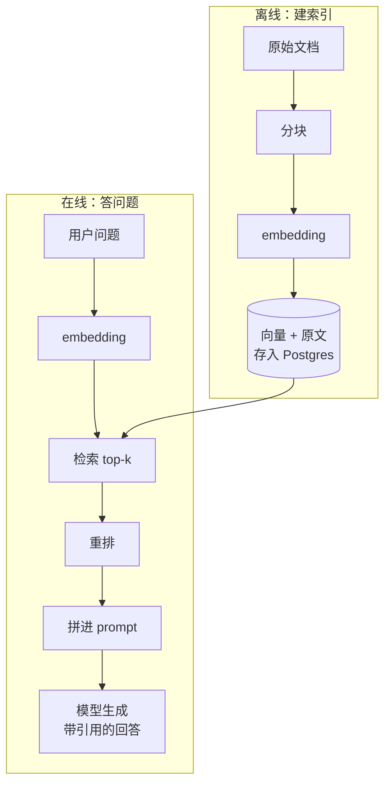
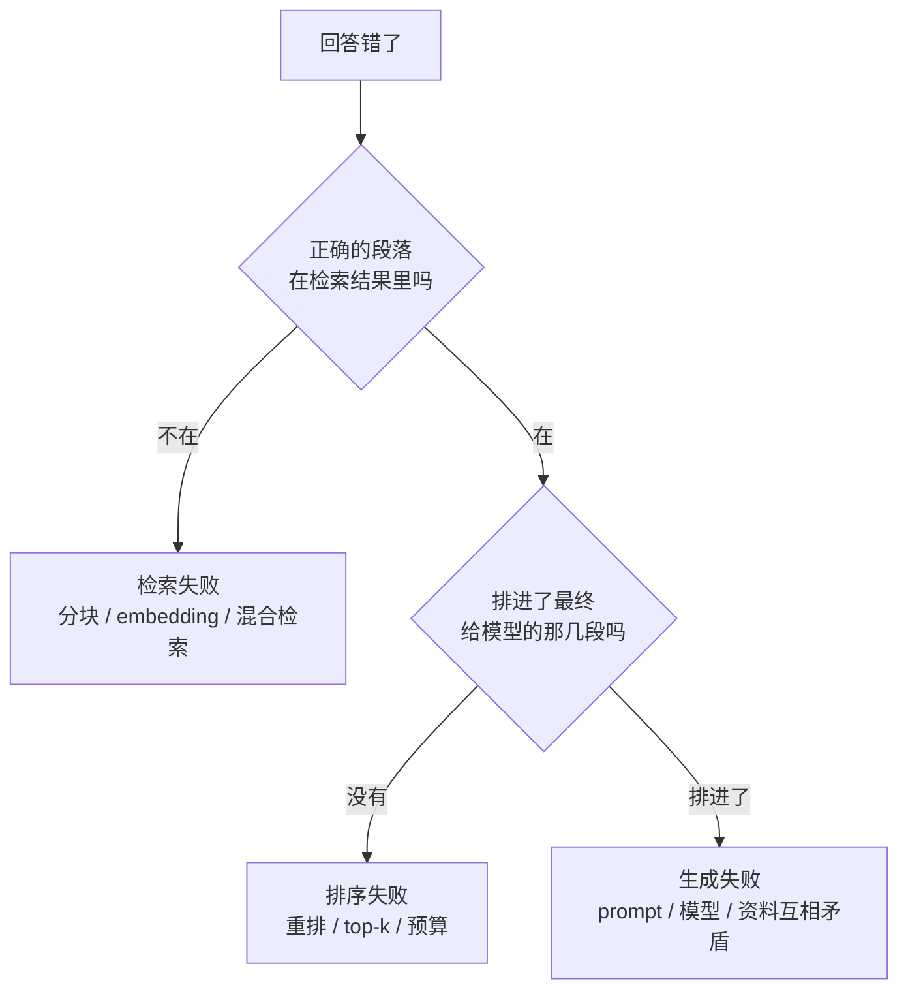

# RAG 解决什么问题

模型很聪明，但它没读过你的资料：你写的几十本书、产品文档、客服记录、上周刚改的退货规则。**RAG**（Retrieval-Augmented Generation，检索增强生成）的做法很朴素：用户提问时，先从你的资料里找出相关的几段，塞进 prompt，再让模型基于这几段回答。这一章先讲清楚它解决什么、不解决什么，再用不到一百行代码跑通一个最小版本，后面各章逐个替换其中的零件。

## 这本书讲什么、适合谁、怎么读

**讲什么**：怎样给自己的产品搭一个靠得住的「资料问答 / 资料检索」系统。八章依次是：RAG 解决什么问题、embedding 模型、向量库与 pgvector、分块策略、混合检索、重排、评测、RAG 与长上下文的取舍。

**适合谁**：读过[《大模型应用工程》](../llm-app-engineering/)、会用 TypeScript 调模型 API、日常用 PostgreSQL 的开发者。模型 API 的基本用法、结构化输出、重试这些不再重复，用到时会提一句出处；embedding 和余弦相似度的直觉在[《大模型原理科普》第 2 章](../llm-fundamentals/02-tokens-embeddings.md)讲过，这里从工程角度展开。

**怎么读**：第 1–3 章按顺序读，读完就能搭出一个能用的版本；第 4–6 章是提升效果的三个旋钮，可以按自己遇到的问题挑着读；第 7 章讲怎么知道改动有没有用，**动手调参之前**最好先读；第 8 章回答「上下文窗口都这么大了，还要不要 RAG」。

**几个约定**：

- 代码用 TypeScript + Node 22，数据库是 PostgreSQL 16 + pgvector 0.8 系列（写作时最新是 0.8.x），ORM 用 Drizzle，和 hatch-counter 的栈一致
- embedding 和重排模型不绑定某一家。Anthropic 本身不提供 embedding 模型，市面上可选的 API 和开源模型很多，书里用一个通用接口封装，具体模型名、维度、价格以各家官方文档为准
- 生成环节沿用《大模型应用工程》里的 `ask()` 封装
- 贯穿全书的例子叫 `shelf-rag`：把这个书架 `books/` 目录下的所有 Markdown 书建成索引，回答「pgvector 的 HNSW 参数怎么调」「我哪本书讲过 nginx 关闭缓冲」这类问题。书架 App 本身离线、不联网，`shelf-rag` 是放在电脑或服务器上的独立小工具

## 模型缺什么

把大模型直接用在「问我自己的资料」上，会撞上四堵墙：

| 问题 | 表现 | 根源 |
|---|---|---|
| 没见过 | 问公司内部规则，答得头头是道但全是编的 | 训练数据里没有你的私有资料 |
| 过时 | 问上周改的价格，答的是旧价格 | 训练有截止日期，之后的事一概不知 |
| 无出处 | 答对了也没法核对，答错了更没法发现 | 知识被「揉」进了参数，找不回原文 |
| 放不下 | 资料有几百万字，一次 prompt 塞不进去或者太贵 | 上下文窗口和费用都有上限 |

前三个问题有一个共同的解：**别让模型凭记忆答，把原文递给它看**。模型擅长的是「读懂给它的材料并组织语言」，不擅长的是「准确回忆没见过或记不清的事实」。RAG 就是把问题从后者变成前者。

第四个问题决定了「递原文」不能把全部资料一股脑递过去，得先**挑**。挑的那一步就是检索（retrieval），也是 RAG 工程里真正花力气的地方。

## RAG 的两条流水线

一个 RAG 系统由两条流水线组成：离线建索引，在线答问题。



每个方框都对应本书的一章：

| 环节 | 做什么 | 对应章节 |
|---|---|---|
| 分块 | 把长文档切成适合检索的片段 | 第 4 章 |
| embedding | 把文字变成向量，让「意思相近」可以计算 | 第 2 章 |
| 存储与检索 | 存向量，快速找最近的几个 | 第 3 章 |
| 混合检索 | 向量之外再加关键词检索，互相补漏 | 第 5 章 |
| 重排 | 用更精细的模型给候选重新排序 | 第 6 章 |
| 拼 prompt 与生成 | 控制预算、标注出处、要求模型只依据材料回答 | 第 6 章后半 |

## 先跑通一个最小版本

先不碰数据库，也不考虑性能：把文档按标题切开，全部算 embedding 放在内存里，提问时逐个算余弦相似度，取最高的 5 段交给模型。这几十行就是 RAG 的全部本质，后面的章节都是在把其中某一步做得更好。

```typescript
// src/naive-rag.ts —— 最小可用版本，只用于理解流程
import { readdir, readFile } from "node:fs/promises";
import { join } from "node:path";
import { embed } from "./embedding.js"; // 第 2 章实现：string[] -> number[][]
import { ask } from "./llm/client.js";  // 《大模型应用工程》第 1 章的封装

type Chunk = { source: string; text: string; vec: number[] };

function cosine(a: number[], b: number[]): number {
  let dot = 0, na = 0, nb = 0;
  for (let i = 0; i < a.length; i++) {
    dot += a[i] * b[i];
    na += a[i] * a[i];
    nb += b[i] * b[i];
  }
  return dot / (Math.sqrt(na) * Math.sqrt(nb));
}

// 粗暴分块：遇到 H2 就切一刀
function splitByH2(source: string, md: string): { source: string; text: string }[] {
  return md
    .split(/\n(?=## )/)
    .map((text) => ({ source, text: text.trim() }))
    .filter((c) => c.text.length > 0);
}

export async function buildIndex(booksDir: string): Promise<Chunk[]> {
  const pieces: { source: string; text: string }[] = [];
  for (const book of await readdir(booksDir, { withFileTypes: true })) {
    if (!book.isDirectory()) continue;
    const dir = join(booksDir, book.name);
    for (const file of await readdir(dir)) {
      if (!file.endsWith(".md")) continue;
      const md = await readFile(join(dir, file), "utf8");
      pieces.push(...splitByH2(`${book.name}/${file}`, md));
    }
  }
  const vecs = await embed(pieces.map((p) => p.text), { inputType: "document" });
  return pieces.map((p, i) => ({ ...p, vec: vecs[i] }));
}

export async function answer(index: Chunk[], question: string): Promise<string> {
  const [qv] = await embed([question], { inputType: "query" });
  const top = index
    .map((c) => ({ c, score: cosine(qv, c.vec) }))
    .sort((x, y) => y.score - x.score)
    .slice(0, 5);

  const context = top
    .map(({ c }, i) => `<doc id="${i + 1}" source="${c.source}">\n${c.text}\n</doc>`)
    .join("\n");

  const { text } = await ask({
    feature: "shelf-rag",
    system:
      "你根据 <docs> 里的资料回答问题。只使用资料里的信息；资料不足以回答时直接说不知道。" +
      "每个论断后用 [id] 标出依据的资料。",
    messages: [{ role: "user", content: `<docs>\n${context}\n</docs>\n\n问题：${question}` }],
  });
  return text;
}
```

几个值得注意的地方，后面会反复出现：

- **问题和文档分开 embed**（`inputType`）：很多 embedding 模型对「查询」和「文档」用不同的处理方式，第 2 章细讲
- **资料放在前面，问题放在最后**，用标签把资料和指令隔开，这是[《大模型应用工程》第 2 章](../llm-app-engineering/02-prompt-engineering.md)讲过的长文档写法
- **要求标注出处**：用户能核对，你也能在评测时检查模型有没有「编」
- **允许说不知道**：检索失败时，宁可不答，也不要让模型自由发挥

这个版本在几十个文件上完全够用。它的问题会随着资料变多逐个暴露：每次启动都要重新算全部 embedding、逐个比较太慢、按 H2 切出来的块有的几千字有的一行、搜「`ef_search`」这种精确术语时向量反而找不到……这些就是后面七章要解决的。

## RAG 失败的三种方式

RAG 答错时，原因几乎总在这三类里，排查时也按这个顺序：



这张图也说明了为什么评测要**分层**：只看最终答案对不对，你不知道该去调哪一层。第 7 章会把它变成可以自动跑的指标。

## RAG 不是唯一的答案

遇到「模型不知道我的东西」时，还有几条路，各有适用场景：

| 方案 | 适合 | 不适合 |
|---|---|---|
| 全部塞进上下文 | 资料总量小（一本书、一份合同），配合 prompt 缓存 | 资料量大、频繁变化、并发高 |
| RAG | 资料量大、要出处、要随时更新 | 需要「通读全部」才能回答的问题，如「总结这 50 本书的共同主题」 |
| 让 Agent 自己搜 | 资料有天然结构（代码库、文件系统），可以用 grep、目录逐步定位 | 对延迟敏感、问题简单的场景 |
| 微调 | 教模型一种**风格、格式或技能** | 教模型**事实**：更新难、无出处、仍会编 |

最后一行是最常见的误解：微调更像是让模型「学会怎么说话」，而不是「记住一本手册」。要让模型知道事实并且能给出出处，RAG 或直接放进上下文几乎总是更好的选择。微调的细节在[《开源模型：部署、量化与微调》](../open-models/)里。

第三行值得多说一句。Claude Code 这类编码 agent 在代码库里找东西，用的不是向量索引，而是 `grep`、`glob`、读文件，一边看结果一边决定下一步搜什么。对结构清晰、关键词明确的资料，这种「agentic search」常常比一次性向量检索更准。它和 RAG 并不对立：你完全可以把第 5 章的混合检索包装成一个工具，交给 agent 多次调用。第 8 章会再回到这个话题。

## 什么时候值得做 RAG

动手之前先问自己三个问题：

1. **资料能不能全塞进上下文？** 如果总量只有几万字，直接放进 system prompt 并开启缓存，比搭一套检索系统简单得多，效果往往更好
2. **用户的问题是不是「查找型」的？** 「某个参数默认值是多少」「退货期限几天」这类答案落在一两段原文里的问题，RAG 最擅长；「对比这三本书的观点」这类要通读的问题，RAG 很吃力
3. **有没有办法判断答得对不对？** 没有评测集，后面的分块、重排、换模型都只能凭感觉调

`shelf-rag` 三个条件都满足：书架几十本书、上百万字，塞不进一次请求；大部分问题是「哪本书讲过 X」「X 怎么配」；每本书的章节结构清晰，很容易从中出题做评测集。

## 本章要点

- 模型的短板是**没见过、会过时、无出处、放不下**；RAG 的思路是不让模型凭记忆答，而是先检索原文再让它读
- RAG 由**离线建索引**（分块 → embedding → 存储）和**在线答问题**（检索 → 重排 → 拼 prompt → 生成）两条流水线组成
- 最小版本只要几十行：内存里算余弦相似度、取 top-5、要求模型带引用回答、允许说不知道
- 答错时按「检索失败 → 排序失败 → 生成失败」三层排查，评测也要分层
- 资料小就直接塞上下文；教事实用 RAG，教风格才考虑微调；结构清晰的资料也可以让 agent 自己搜
