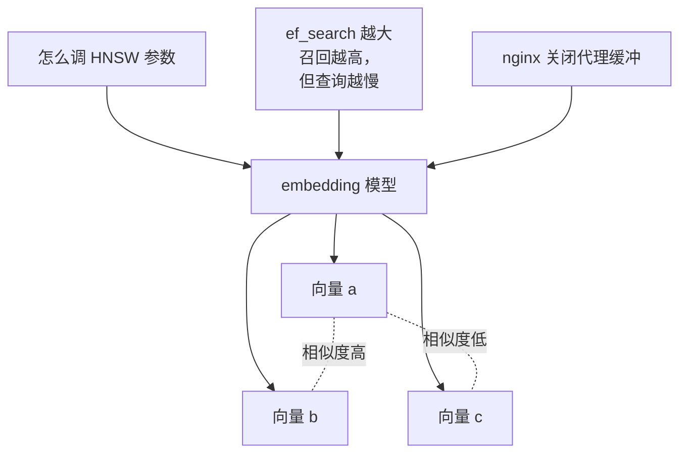
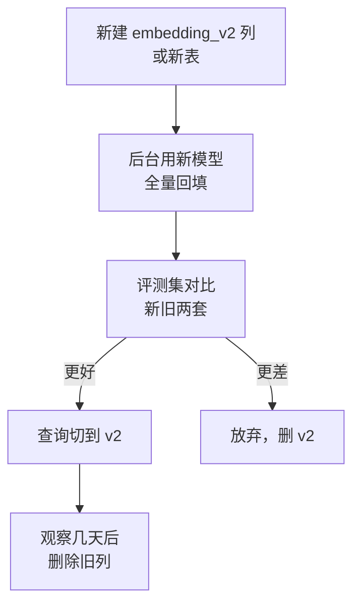

# embedding 模型

上一章的最小版本里，`embed()` 是一个黑盒：塞进去一段文字，吐出来一串数字。整个检索的质量上限就由这个黑盒决定：如果它认为「HNSW 怎么调参」和「ef_search 设多大」不相近，后面再怎么优化也找不回来。这一章打开黑盒：embedding 模型是什么、怎么挑、怎么调用，以及最容易踩的坑：换模型。

## 从 token embedding 到文本 embedding

[《大模型原理科普》第 2 章](../llm-fundamentals/02-tokens-embeddings.md)讲过 token embedding：词表里每个 token 对应一个向量，意思相近的 token 向量也相近。RAG 用的是另一种东西：**整段文字**对应一个向量。

| | token embedding | 文本 embedding（RAG 用的） |
|---|---|---|
| 粒度 | 一个 token 一个向量 | 一段文字（一句到几千字）一个向量 |
| 来源 | 大模型内部的第一层 | 专门训练的 embedding 模型 |
| 训练目标 | 预测下一个 token 的副产品 | 直接训练「相关的文本靠近，不相关的远离」 |
| 用法 | 模型内部计算 | 存进向量库，做相似度检索 |

文本 embedding 模型通常也是 Transformer，但它只做一件事：读完整段文字，把所有 token 的表示**汇聚**（pooling）成一个固定长度的向量。训练时用大量「问题—答案」「标题—正文」这样的配对数据做**对比学习**：让配对的两段向量靠近，和随机抽来的其他文本远离。所以它学到的「相近」，不是字面相同，而是「一个能回答另一个」「两者在讲同一件事」。



这种「把问题和文档各自独立编码成向量，再比较」的结构叫 **bi-encoder**（双塔）。它的好处是文档向量可以提前算好存起来，查询时只算一次问题的向量；代价是问题和文档在编码时「互相看不见」，精度有上限。第 6 章的重排模型用的是另一种结构，正好补上这块短板。

## 选模型看哪几项

| 指标 | 含义 | 怎么看 |
|---|---|---|
| 维度 | 向量有多少个数 | 常见几百到几千。维度越高存储越大、检索越慢，效果不一定越好 |
| 最大输入长度 | 一次能编码多少 token | 超出部分通常被截断，**而且很多接口不报错**。决定了分块的上限 |
| 语言 | 对中文、中英混排、代码的效果 | 只在英文上训练的模型处理中文很差，必须选多语言或中文模型 |
| 查询 / 文档区分 | 是否要求给查询和文档加不同的前缀或参数 | 用错了效果会明显下降 |
| 可截断维度 | 能否只取前 N 维 | 支持的模型（Matryoshka 训练）可以用更少维度换存储 |
| 部署方式 | API 还是自己跑 | 影响成本、延迟和数据是否出境 |

### 中文是第一道筛子

`shelf-rag` 的书全是中文，夹杂大量英文术语和代码。挑模型时先排除只支持英文的，再在多语言模型里比较。开源这边，BGE-M3、Qwen3-Embedding 系列、multilingual-e5 系列都是常被拿来处理中文的选择；商用 API 方面，主流厂商的新一代 embedding 模型基本都支持多语言。具体型号迭代很快，以各家文档为准。

公开排行榜 **MTEB** 和它的中文子集 **C-MTEB** 可以帮你缩小范围，但排行榜的数据集和你的数据不是一回事：榜上前十名在你的书上的表现可能完全换个顺序。**最终一定要用自己的评测集比**，方法在第 7 章。

### 查询和文档不对称

用户的问题很短（「HNSW 怎么调」），文档段落很长、陈述句居多。很多模型针对这种不对称做了训练，使用时要明确告诉它当前编码的是哪一种：

| 方式 | 典型做法 |
|---|---|
| 参数 | 请求里带类似 `input_type: "query"` / `"document"` 的字段 |
| 前缀 | 查询前加 `query: `，文档前加 `passage: `（e5 系列的约定） |
| 指令 | 查询前加一句任务描述，如「为这个问题检索相关段落：」 |

这类约定每个模型都不一样，写在模型卡或 API 文档里。最常见的错误是**建索引时用了文档模式，查询时忘了切换**，或者反过来；效果下降但不报错，很难察觉。所以在封装里把 `inputType` 设为必填参数。

### 维度与可截断

一些模型用 Matryoshka 方式训练：向量的前 256 维、前 512 维单独拿出来也是一个可用的 embedding，信息按重要程度排在前面。这让你可以在效果和存储之间选一个点。存储量很好算，一个 `float32` 是 4 字节：

| 维度 | 每个向量（float32） | 100 万个向量 | 换成 halfvec（2 字节） |
|---|---|---|---|
| 384 | 1.5 KB | 约 1.5 GB | 约 0.77 GB |
| 1024 | 4 KB | 约 4.1 GB | 约 2 GB |
| 1536 | 6 KB | 约 6.1 GB | 约 3.1 GB |
| 3072 | 12 KB | 约 12.3 GB | 约 6.1 GB |

这还没算索引的额外开销。`shelf-rag` 的规模是几万个块，用哪一档都无所谓；但如果你的产品要给每个用户建索引，维度直接决定数据库机器的内存大小。另外 pgvector 的 HNSW 索引对 `vector` 类型最多支持 2000 维，3072 维的模型要用 `halfvec` 或截断，第 3 章细讲。

注意截断后的向量**要重新归一化**（除以自身长度），否则余弦相似度和内积的结果会不一致。

## API 还是自己跑

| | 调 API | 自己部署（Ollama、TEI 等） |
|---|---|---|
| 上手 | 一个 HTTP 请求 | 要机器，CPU 能跑但慢，批量建索引最好有 GPU |
| 成本 | 按 token 计费，embedding 通常比生成便宜得多 | 机器固定成本 |
| 延迟 | 一次网络往返 | 本地更快，取决于硬件 |
| 数据 | 文本要发给第三方 | 不出机器 |
| 可控 | 模型可能下线或被替换 | 版本完全固定 |

对一人公司，默认建议是**先用 API**：建索引是一次性成本，查询时每次只编码一个短问题，费用通常很低。算一笔账（价格为**假设**，真实价格以官方定价页为准）：

- 书架目前约 1000 万字符（含代码），粗略按 1 字符 ≈ 1 token 估算（实际比例因分词器差异很大，以接口返回的 usage 为准），全部编码一次约 1000 万 token
- 假设 embedding 单价是每百万 token 0.1 美元，建一次全量索引约 1 美元
- 每次查询编码一个 30 token 左右的问题，一万次查询约 30 万 token，约 0.03 美元

数据不能出境、或者要离线运行时，再考虑自己部署开源模型。Ollama 可以直接跑 BGE-M3 这类模型，并提供 OpenAI 兼容接口，下面的封装不用改就能接上。部署细节在[《开源模型：部署、量化与微调》](../open-models/)里。

## 一个通用的 embed 封装

很多厂商和本地推理服务都提供 **OpenAI 兼容**的 `/v1/embeddings` 接口：请求里给 `model` 和 `input`（字符串数组），返回 `data[].embedding`。下面按这个形状写一个薄封装，换提供商只改环境变量；对于不兼容的提供商，只需另写一个实现同样签名的函数。

```typescript
// src/embedding.ts
export type InputType = "query" | "document";

const BASE_URL = process.env.EMBED_BASE_URL!;   // 厂商 OpenAI 兼容接口的 /v1 地址，或本地 Ollama 的 /v1 地址
const API_KEY = process.env.EMBED_API_KEY ?? "";
export const EMBED_MODEL = process.env.EMBED_MODEL!;
export const EMBED_DIM = Number(process.env.EMBED_DIM ?? 1024);

// 查询 / 文档前缀：按所选模型的文档填写，不需要就留空
const PREFIX: Record<InputType, string> = {
  query: process.env.EMBED_QUERY_PREFIX ?? "",
  document: process.env.EMBED_DOC_PREFIX ?? "",
};

const BATCH = 64; // 单次请求的条数上限，各家不同

export async function embed(
  texts: string[],
  opts: { inputType: InputType },
): Promise<number[][]> {
  const out: number[][] = [];
  for (let i = 0; i < texts.length; i += BATCH) {
    const batch = texts.slice(i, i + BATCH).map((t) => PREFIX[opts.inputType] + t);
    out.push(...(await embedBatch(batch)));
  }
  return out;
}

async function embedBatch(input: string[]): Promise<number[][]> {
  const res = await fetch(`${BASE_URL}/embeddings`, {
    method: "POST",
    headers: {
      "content-type": "application/json",
      ...(API_KEY ? { authorization: `Bearer ${API_KEY}` } : {}),
    },
    body: JSON.stringify({ model: EMBED_MODEL, input }),
    signal: AbortSignal.timeout(60_000),
  });
  if (!res.ok) {
    throw new Error(`embedding ${res.status}: ${(await res.text()).slice(0, 300)}`);
  }
  const json = (await res.json()) as {
    data: { index: number; embedding: number[] }[];
  };
  // 按 index 排序，不依赖返回顺序
  const vecs = json.data.sort((a, b) => a.index - b.index).map((d) => d.embedding);
  for (const v of vecs) {
    if (v.length !== EMBED_DIM) {
      throw new Error(`维度不符：期望 ${EMBED_DIM}，实际 ${v.length}，检查 EMBED_MODEL`);
    }
  }
  return vecs.map(normalize);
}

function normalize(v: number[]): number[] {
  const n = Math.hypot(...v);
  return n === 0 ? v : v.map((x) => x / n);
}
```

几处设计说明：

- **校验维度**：数据库列是 `vector(1024)`，模型要是悄悄换成了别的维度，插入会报错；在这里提前拦下，报错信息更清楚
- **统一归一化**：归一化之后余弦相似度等于内积，换哪种距离结果都一致，也不怕某个模型不返回单位向量
- **超时**：沿用[《大模型应用工程》第 9 章](../llm-app-engineering/09-errors-retries.md)的思路，任何外部调用都要有时限；重试可以套用那一章的退避函数，这里省略
- **`Math.hypot(...v)`** 对几千维的数组没有问题；维度极大时改成循环累加，避免参数个数过多

### 别为同一段文字付两次钱

建索引会反复执行：改了分块规则要重跑，书更新了要重跑。大部分段落其实没变。用「模型名 + 文本」的哈希做缓存键，命中就不再请求：

```typescript
// src/embed-cache.ts
import { createHash } from "node:crypto";
import { embed, EMBED_MODEL, type InputType } from "./embedding.js";

const cache = new Map<string, number[]>(); // 生产中可换成 Postgres 表或磁盘文件

const key = (t: string, type: InputType) =>
  createHash("sha256").update(`${EMBED_MODEL}\0${type}\0${t}`).digest("hex");

export async function embedCached(texts: string[], inputType: InputType) {
  const missing = texts.filter((t) => !cache.has(key(t, inputType)));
  const unique = [...new Set(missing)];
  if (unique.length > 0) {
    const vecs = await embed(unique, { inputType });
    unique.forEach((t, i) => cache.set(key(t, inputType), vecs[i]));
  }
  return texts.map((t) => cache.get(key(t, inputType))!);
}
```

键里一定要包含模型名和输入类型：同一段文字在不同模型、不同模式下的向量不能混用。第 4 章的增量索引会用文档级哈希进一步减少重算。

## 换模型等于重建索引

这是 embedding 最重要的一条规则：**不同模型产生的向量不在同一个空间里，不能互相比较**。哪怕维度相同，模型 A 的向量和模型 B 的向量算出来的相似度也是没有意义的数字。同一个模型的不同版本也一样。

所以：

1. 每个块都记下它是用哪个模型算的（第 3 章的表里有 `embedding_model` 列）
2. 查询时只和同模型的向量比较
3. 换模型时走「新列 / 新表并行建 → 评测对比 → 切换读路径 → 删旧数据」的流程，而不是原地覆盖



这和数据库加列迁移的思路完全一样：先双写或回填，验证之后再切读，最后清理。好处是任何一步出问题都能退回去。

## 相似度分数不是概率

最后一个常见误解：余弦相似度 0.8 并不意味着「80% 相关」。不同模型的分数分布差别很大：有的模型随便两段中文都在 0.6 以上，有的模型相关文档也只有 0.5 左右。所以：

- **不要拍一个固定阈值**（比如「低于 0.7 就算没找到」）然后在所有模型上通用
- 要用阈值，就在评测集上看相关和不相关两组的分数分布，找一个能分开它们的点；换模型后重新找
- 更稳妥的做法是不依赖向量分数判断「有没有找到」，而交给第 6 章的重排模型或者生成阶段的「资料不足就说不知道」

## 本章要点

- RAG 用的是**文本 embedding**：专门用对比学习训练的模型，把整段文字编码成一个向量，「相近」意味着「讲同一件事」或「一个能回答另一个」
- 挑模型先看**中文能力**，再看最大输入长度、维度、查询 / 文档区分方式；排行榜只能缩小范围，最终用自己的评测集比
- 查询和文档模式**用错不会报错**，封装里把 `inputType` 设为必填
- 默认先用 API，数据不能出境再自己部署；用 OpenAI 兼容接口做一层薄封装，校验维度、统一归一化、加超时
- 用「模型名 + 类型 + 文本」哈希缓存 embedding，避免重复付费
- **换模型等于重建索引**：记录每个向量的模型，走「回填 → 评测 → 切读 → 清理」流程
- 相似度分数不是概率，不同模型分布不同，不要跨模型使用固定阈值
