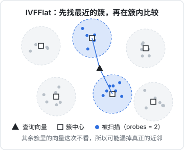
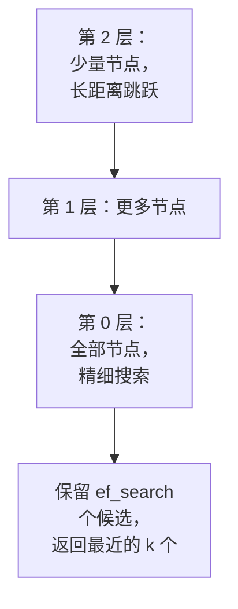

# 向量库与 pgvector

有了向量，接下来要把它们存起来，并且能快速回答「离这个向量最近的 20 个是谁」。专门的向量数据库有很多，但如果你已经在用 PostgreSQL，**pgvector** 扩展几乎总是最省事的选择：向量和原文、元数据、用户权限在同一张表里，一条 SQL 就能把「语义相近」和「属于这个用户、是最新版本」一起过滤，备份、迁移、监控全部沿用现有的那一套。这一章从启动容器讲到索引调参。

本章的 SQL 基于 **PostgreSQL 16 + pgvector 0.8 系列**。pgvector 的特性按版本逐步加入：HNSW 索引从 0.5.0 开始，`halfvec` / `sparsevec` 和 L1 距离从 0.7.0 开始，迭代索引扫描从 0.8.0 开始。用之前先确认 `SELECT extversion FROM pg_extension WHERE extname = 'vector';` 的结果。

## 启动一个带 pgvector 的 Postgres

官方镜像 `postgres` 不带 pgvector，要么自己装扩展，要么直接用 pgvector 团队维护的镜像。hatch-counter 的 `deploy/docker-compose.yml` 用的是 `postgres:16-alpine`，换成下面这样即可，数据卷格式兼容（同一个 Postgres 大版本）：

```yaml
# docker-compose.yml（片段）
services:
  db:
    image: pgvector/pgvector:pg16   # 生产环境建议钉到带 pgvector 版本号的标签，以 Docker Hub 上的标签列表为准
    environment:
      POSTGRES_USER: shelf
      POSTGRES_PASSWORD: ${DB_PASSWORD}
      POSTGRES_DB: shelf
    volumes:
      - pgdata:/var/lib/postgresql/data
    ports:
      - "127.0.0.1:5432:5432"       # 只监听本机
volumes:
  pgdata:
```

扩展要在**每个数据库里**启用一次：

```sql
CREATE EXTENSION IF NOT EXISTS vector;
SELECT extversion FROM pg_extension WHERE extname = 'vector';
```

用托管数据库的话，主流云厂商的 PostgreSQL 大多已经内置 pgvector，在控制台或用上面的 SQL 启用，但版本可能落后于最新版，记得查一下。

## 类型与距离运算符

pgvector 提供四种类型：

| 类型 | 每维存储 | 存储上限 | 可建索引上限 | 用途 |
|---|---|---|---|---|
| `vector(n)` | 4 字节（float32） | 16000 维 | 2000 维 | 默认选择 |
| `halfvec(n)` | 2 字节（float16） | 16000 维 | 4000 维 | 省一半空间；高维模型 |
| `bit(n)` | 1 位 | — | 64000 维 | 二值量化，粗筛 |
| `sparsevec(n)` | 只存非零项 | 16000 个非零项 | 1000 个非零项 | 稀疏向量（如 BGE-M3 的稀疏输出） |

距离用运算符表示，**值越小越近**：

| 运算符 | 距离 | 索引操作符类（vector） | 说明 |
|---|---|---|---|
| `<->` | L2（欧氏）距离 | `vector_l2_ops` | |
| `<#>` | **负**内积 | `vector_ip_ops` | 取负是为了「越小越近」；要内积本身就乘 -1 |
| `<=>` | 余弦距离 | `vector_cosine_ops` | 余弦距离 = 1 − 余弦相似度 |
| `<+>` | L1 距离 | `vector_l1_ops` | 0.7.0 起，仅 HNSW |
| `<~>` / `<%>` | 汉明 / Jaccard | `bit_hamming_ops` / `bit_jaccard_ops` | 用于 `bit` 类型 |

第 2 章的封装已经把向量归一化了。对单位向量，余弦距离、内积、L2 距离给出的**排序完全相同**，选哪个都行。本书统一用余弦距离 `<=>`，最直观；如果追求一点点速度，单位向量上用内积 `<#>` 计算量更小。**关键是建索引用的操作符类和查询用的运算符必须对应**，否则索引不会被使用。

## 表结构

`shelf-rag` 用两张表：`documents` 记录每个源文件，`chunks` 存分块、向量和全文检索用的分词结果（第 5 章用）。

```sql
CREATE TABLE documents (
  id           bigserial PRIMARY KEY,
  source       text NOT NULL UNIQUE,       -- 'rag-systems/03-pgvector.md'
  book_id      text NOT NULL,
  title        text NOT NULL,
  content_hash text NOT NULL,              -- 第 4 章的增量索引用
  updated_at   timestamptz NOT NULL DEFAULT now()
);

CREATE TABLE chunks (
  id              bigserial PRIMARY KEY,
  document_id     bigint NOT NULL REFERENCES documents(id) ON DELETE CASCADE,
  ord             int NOT NULL,            -- 在文档里的顺序，拼上下文时用
  heading_path    text NOT NULL,           -- '向量库与 pgvector > 索引 > HNSW'
  content         text NOT NULL,
  token_count     int NOT NULL,
  embedding       vector(1024) NOT NULL,
  embedding_model text NOT NULL,
  seg             text NOT NULL DEFAULT '', -- 分好词的文本，第 5 章
  tsv             tsvector GENERATED ALWAYS AS (to_tsvector('simple', seg)) STORED,
  UNIQUE (document_id, ord)
);

CREATE INDEX chunks_embedding_hnsw ON chunks
  USING hnsw (embedding vector_cosine_ops);
CREATE INDEX chunks_tsv_gin ON chunks USING gin (tsv);
CREATE INDEX chunks_document_id ON chunks (document_id);
```

几个选择的理由：

- **原文和向量放在一起**：检索出来直接拿到 `content`，不用再去别处取；文件仍是真相，这张表随时可以从 `books/` 重建
- **`ON DELETE CASCADE`**：文档删了，它的块跟着删，不会留下孤儿向量
- **`embedding_model` 列**：第 2 章说过，向量必须知道自己出自哪个模型
- **`ord`**：检索命中一块时，可以顺手把前后相邻的块取出来补上下文（第 4 章）

### 用 Drizzle 定义

hatch-counter 用的是 Drizzle。`drizzle-orm/pg-core` 自带 `vector`、`halfvec` 等列类型和 HNSW 索引写法；`tsvector` 没有内置类型，用 `customType` 补一个：

```typescript
// src/db/schema.ts
import { sql, type SQL } from "drizzle-orm";
import {
  bigint, bigserial, customType, index, integer, pgTable, text, timestamp, unique, vector,
} from "drizzle-orm/pg-core";

const tsvector = customType<{ data: string }>({ dataType: () => "tsvector" });

export const documents = pgTable("documents", {
  id: bigserial("id", { mode: "number" }).primaryKey(),
  source: text("source").notNull().unique(),
  bookId: text("book_id").notNull(),
  title: text("title").notNull(),
  contentHash: text("content_hash").notNull(),
  updatedAt: timestamp("updated_at", { withTimezone: true }).notNull().defaultNow(),
});

export const chunks = pgTable(
  "chunks",
  {
    id: bigserial("id", { mode: "number" }).primaryKey(),
    documentId: bigint("document_id", { mode: "number" })
      .notNull()
      .references(() => documents.id, { onDelete: "cascade" }),
    ord: integer("ord").notNull(),
    headingPath: text("heading_path").notNull(),
    content: text("content").notNull(),
    tokenCount: integer("token_count").notNull(),
    embedding: vector("embedding", { dimensions: 1024 }).notNull(),
    embeddingModel: text("embedding_model").notNull(),
    seg: text("seg").notNull().default(""),
    tsv: tsvector("tsv").generatedAlwaysAs((): SQL => sql`to_tsvector('simple', ${chunks.seg})`),
  },
  (t) => [
    unique().on(t.documentId, t.ord),
    index("chunks_embedding_hnsw").using("hnsw", t.embedding.op("vector_cosine_ops")),
    index("chunks_tsv_gin").using("gin", t.tsv),
    index("chunks_document_id").on(t.documentId),
  ],
);
```

`drizzle-kit` 不会替你执行 `CREATE EXTENSION`。先生成一个空的自定义迁移，把启用扩展的语句写进去，并保证它排在建表迁移之前：

```bash
pnpm drizzle-kit generate --custom --name enable-pgvector
# 在生成的 SQL 文件里写：CREATE EXTENSION IF NOT EXISTS vector;
pnpm drizzle-kit generate   # 再生成建表迁移
```

Drizzle 的 API 在 0.x 版本间变化较多，上面按 drizzle-orm 0.45 前后的写法，升级时对照官方文档里的 pgvector 指南。

## 写入与查询

数据库连接沿用 hatch-counter 的组合：`postgres`（postgres.js）驱动加 Drizzle。

```typescript
// src/db/client.ts
import postgres from "postgres";
import { drizzle } from "drizzle-orm/postgres-js";
import * as schema from "./schema.js";

export const pg = postgres(process.env.DATABASE_URL!, { max: 5 });
export const db = drizzle(pg, { schema });
```

向量在 SQL 里的文本格式是 `'[0.1,0.2,0.3]'`，恰好就是 `JSON.stringify(number[])` 的输出。用 Drizzle 插入时直接传数组即可；写原生 SQL 时把字符串转成 `vector`：

```typescript
// src/search/vector.ts
import { sql } from "drizzle-orm";
import { db } from "../db/client.js";
import { embed, EMBED_MODEL } from "../embedding.js";

export type Hit = { id: string; source: string; headingPath: string; content: string; distance: number };
// id 是 bigint，postgres.js 默认把 int8 读成字符串，避免超出 JS 安全整数范围

export async function vectorSearch(question: string, k = 20): Promise<Hit[]> {
  const [qv] = await embed([question], { inputType: "query" });
  const q = JSON.stringify(qv);
  const rows = await db.execute<Hit>(sql`
    SELECT c.id, d.source, c.heading_path AS "headingPath", c.content,
           c.embedding <=> ${q}::vector AS distance
    FROM chunks c
    JOIN documents d ON d.id = c.document_id
    WHERE c.embedding_model = ${EMBED_MODEL}
    ORDER BY c.embedding <=> ${q}::vector
    LIMIT ${k}
  `);
  return [...rows]; // postgres.js 驱动下 execute 直接返回行数组
}
```

Drizzle 也提供 `cosineDistance()` 这类辅助函数，适合简单查询；混合检索那种带 CTE 的复杂语句，直接写 `sql` 模板更清楚，参数照样是绑定变量，不会有注入问题。

**排序方式决定能不能用上索引**。pgvector 的索引只服务于 `ORDER BY 向量 <运算符> 常量 LIMIT n` 这个形状（升序）。有人习惯写 `ORDER BY 1 - (embedding <=> q) DESC` 按相似度降序，结果完全一样，但索引用不上，会退化成全表扫描。要展示相似度，在 `SELECT` 里算，`ORDER BY` 保持距离升序。

## 精确检索与近似检索

没有索引时，Postgres 会把查询向量和每一行逐个比较，这是**精确最近邻**：结果一定对，耗时随行数线性增长。几万行时只要几十毫秒，`shelf-rag` 的规模其实完全可以不建索引。

行数上到几十万、几百万，就需要**近似最近邻**（ANN）索引：不保证找到真正最近的那几个，换来数量级的提速。衡量 ANN 的指标是**召回率**：索引返回的 top-k 里，有多少是精确检索的 top-k。pgvector 提供两种 ANN 索引。

### IVFFlat：先分簇，再在簇里找

建索引时用 k-means 把所有向量分成 `lists` 个簇；查询时先找离查询最近的 `probes` 个簇中心，只在这些簇里逐个比较。



```sql
-- 建索引前表里要已经有数据，簇中心是从现有数据里学出来的
CREATE INDEX ON chunks USING ivfflat (embedding vector_cosine_ops) WITH (lists = 100);
SET ivfflat.probes = 10;  -- 默认 1；越大召回越高、越慢
```

pgvector 文档给的起点是：行数在 100 万以内时 `lists` 取「行数 / 1000」，以上取「行数的平方根」；`probes` 从 `lists` 的平方根开始试。IVFFlat 建得快、占内存少，但有两个硬伤：必须先有数据再建索引；数据分布大变之后簇中心过时，需要重建。

### HNSW：分层的「邻居图」

HNSW 把向量组织成多层图：上层节点少、连线跨度大，用来快速逼近目标区域；下层节点多、连线密，用来精细搜索。查询时从顶层入口出发，每层贪心地走向离查询更近的邻居，再下降一层继续。



```sql
CREATE INDEX ON chunks USING hnsw (embedding vector_cosine_ops)
  WITH (m = 16, ef_construction = 64);   -- 这两个就是默认值
SET hnsw.ef_search = 100;                -- 默认 40
```

| 参数 | 默认 | 作用 | 调大的效果 |
|---|---|---|---|
| `m` | 16 | 每个节点在每层最多连几条边 | 召回更高，索引更大，建得更慢 |
| `ef_construction` | 64 | 建索引时的候选列表长度 | 图质量更好，建得更慢 |
| `hnsw.ef_search` | 40 | 查询时的候选列表长度 | 召回更高，查询更慢 |

`ef_search` 是唯一可以在查询时调整的参数，也是最常调的那个。还有一个容易忽略的约束：**`ef_search` 决定了一次索引扫描最多返回多少行**，`LIMIT 100` 配默认的 `ef_search = 40`，最多只能拿到 40 行。混合检索每路取 40 到 50 个候选，`ef_search` 至少要设到这个数。

### 怎么选

| | IVFFlat | HNSW |
|---|---|---|
| 查询速度与召回的权衡 | 较差 | 较好 |
| 建索引速度 | 快 | 慢（大表可能要很久） |
| 内存占用 | 小 | 大 |
| 空表上建 | 不行 | 可以，随插入增长 |
| 数据持续变化 | 需要定期重建 | 不需要 |

默认选 **HNSW**：它能在空表上建、随数据增长、调参只有一个 `ef_search`。只有在数据量大、内存紧张、数据基本不变时才考虑 IVFFlat。

### 建索引的实操

```sql
SET maintenance_work_mem = '2GB';            -- 图放不进内存时建索引会显著变慢
SET max_parallel_maintenance_workers = 4;    -- HNSW 支持并行构建（0.6.0 起）
CREATE INDEX CONCURRENTLY chunks_embedding_hnsw ON chunks
  USING hnsw (embedding vector_cosine_ops);
```

`CONCURRENTLY` 不阻塞写入，生产环境建索引都应该加上。另外，大批量导入时**先导数据、后建索引**比边插边维护索引快得多。

## 带过滤条件的查询

真实场景几乎总有过滤：只搜某本书、只搜这个用户的文档。问题在于 ANN 索引先按距离取出 `ef_search` 个候选，**然后**才应用 `WHERE`。如果过滤条件很严（比如只要某本书，而它只占全部块的 2%），40 个候选里可能一个都不剩。

pgvector 0.8.0 引入了**迭代索引扫描**来解决这个问题：过滤后结果不够时，自动继续扫描索引。

```sql
BEGIN;
SET LOCAL hnsw.iterative_scan = relaxed_order;  -- 或 strict_order；默认 off
SET LOCAL hnsw.max_scan_tuples = 20000;         -- 最多扫描多少个元组，默认 20000
SELECT c.id, c.content
FROM chunks c JOIN documents d ON d.id = c.document_id
WHERE d.book_id = 'nginx-gateway'
ORDER BY c.embedding <=> $1::vector
LIMIT 10;
COMMIT;
```

`relaxed_order` 允许结果稍微乱序，换来更好的性能；需要严格有序时，把查询包进一个 `MATERIALIZED` 的 CTE，在外层再按距离排一次。其他手段：

- 过滤值种类少、查询频繁时，给每个值建**部分索引**：`CREATE INDEX ... WHERE book_id = 'xxx'`
- 多租户场景按租户**分区**，每个分区单独建索引
- 过滤后剩下的行本来就不多时，Postgres 可能直接选择 B-tree 过滤再精确比较，这其实是最好的结果。用 `EXPLAIN ANALYZE` 确认执行计划

```sql
EXPLAIN ANALYZE
SELECT id FROM chunks ORDER BY embedding <=> '[...]'::vector LIMIT 10;
-- 看到 Index Scan using chunks_embedding_hnsw 说明用上了索引
```

## 高维模型与 halfvec

`vector` 类型的索引最多 2000 维。用 3072 维的模型时有两条路：

```sql
-- 1. 整列存成 halfvec，存储和索引都减半
ALTER TABLE chunks ALTER COLUMN embedding TYPE halfvec(3072);
CREATE INDEX ON chunks USING hnsw (embedding halfvec_cosine_ops);

-- 2. 原列保持 vector，只在索引上转换（表达式索引），查询时用同样的表达式
CREATE INDEX ON chunks USING hnsw ((embedding::halfvec(3072)) halfvec_cosine_ops);
SELECT id FROM chunks ORDER BY embedding::halfvec(3072) <=> $1::halfvec(3072) LIMIT 10;
```

float16 的精度损失对检索排序的影响通常很小，但「通常」要用你的评测集来确认。支持截断维度的模型，也可以直接请求更少的维度。

## 什么时候需要专门的向量数据库

pgvector 的天花板比大多数一人公司会碰到的高得多。可以这样判断：

| 情况 | 建议 |
|---|---|
| 百万级以内的向量，已有 Postgres | pgvector，不用犹豫 |
| 需要和业务数据联表、按权限过滤、事务一致 | pgvector 的主场 |
| 上亿向量、要求毫秒级、需要分布式水平扩展 | 考虑 Qdrant、Milvus 这类专门系统 |
| 跑在边缘（Cloudflare Workers） | 平台自带的向量服务，如 Vectorize |

多一个数据库，就多一套备份、监控、升级和数据同步，还多了一个「向量库和主库不一致」的故障来源。在 pgvector 真正成为瓶颈之前，不要提前付这笔代价。

## 本章要点

- 已经用 Postgres 就用 **pgvector**：向量、原文、元数据、权限在同一张表，一条 SQL 搞定；镜像用 `pgvector/pgvector:pg16`
- 四种类型 `vector` / `halfvec` / `bit` / `sparsevec`；距离运算符 `<->` `<#>` `<=>` 越小越近；**索引操作符类要和查询运算符对应**
- 查询要写成 `ORDER BY 距离 LIMIT n`（升序）才能用上索引，相似度在 `SELECT` 里算
- 几万行精确检索就够；更大时默认用 **HNSW**，主要调 `hnsw.ef_search`，它同时限制单次扫描返回的行数
- 带过滤的查询用 0.8.0 起的**迭代索引扫描**，或部分索引、分区；用 `EXPLAIN ANALYZE` 确认执行计划
- 超过 2000 维用 `halfvec` 或表达式索引；上亿规模再考虑专门的向量数据库

## 动手练习

以下三题都在一次性容器里做：`docker run --rm -d --name pgv -e POSTGRES_PASSWORD=pw -p 5432:5432 pgvector/pgvector:pg16`，用 `docker exec -it pgv psql -U postgres` 进入，做完 `docker stop pgv` 即可清掉。先准备数据：

```sql
CREATE EXTENSION vector;
CREATE TABLE items (id bigserial PRIMARY KEY, embedding vector(3));
INSERT INTO items (embedding)
  SELECT ARRAY[random(), random(), random()]::vector FROM generate_series(1, 100000);
CREATE INDEX ON items USING hnsw (embedding vector_cosine_ops);
```

1. **排序写法决定能否用索引**：分别对 `ORDER BY embedding <=> '[1,0,0]' LIMIT 10` 和 `ORDER BY 1 - (embedding <=> '[1,0,0]') DESC LIMIT 10` 两种写法执行 `EXPLAIN ANALYZE`。

   验证：第一种的计划里有 `Index Scan using items_embedding_idx`；第二种没有索引扫描，而是对全表做 `Seq Scan` 后再排序，耗时明显更长。

   参考答案：pgvector 的索引只服务于「距离升序 + LIMIT」这个形状。要展示相似度，在 `SELECT` 里算 `1 - 距离`，`ORDER BY` 仍按距离升序。

2. **操作符类要对得上**：索引建的是 `vector_cosine_ops`，现在用 L2 距离 `<->` 查询：`EXPLAIN SELECT id FROM items ORDER BY embedding <-> '[1,0,0]' LIMIT 10;`

   验证：计划里看不到 HNSW 索引，走的是全表扫描。再建一个 `vector_l2_ops` 的索引后重新 `EXPLAIN`，就能看到它被用上。

   参考答案：每种距离对应一个操作符类，建索引和查询必须用同一种。对归一化过的向量，三种距离排序一样，统一用一种就不会踩这个坑。

3. **`ef_search` 限制返回行数**：执行 `SET hnsw.ef_search = 40;` 后运行 `SELECT count(*) FROM (SELECT id FROM items ORDER BY embedding <=> '[1,0,0]' LIMIT 100) t;`，再把 `ef_search` 设为 200 重跑。

   验证：第一次的结果不超过 `40`，第二次是 `100`。如果第一次就是 100，用 `EXPLAIN` 确认这条查询是否真的走了索引。

   参考答案：一次 HNSW 索引扫描最多返回 `ef_search` 个候选。混合检索每一路取 40–50 个候选时，`ef_search` 至少要设到这个数，否则候选会被悄悄截短。
