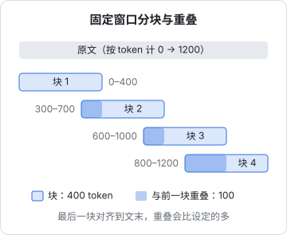
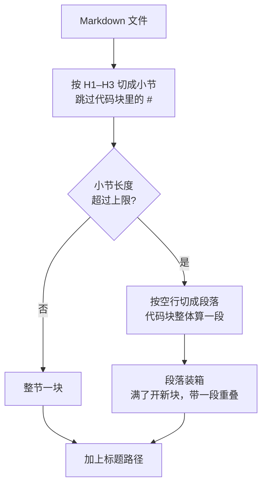

# 分块策略

检索的单位不是文档，是**块**（chunk）。块切得好不好，直接决定了两件事：检索时能不能命中，命中之后递给模型的内容够不够用。分块是 RAG 里最不起眼、但最常见的效果瓶颈：很多「检索不准」的问题，换 embedding 模型、加重排都救不回来，改一下分块就好了。这一章讲为什么要分块、块该多大，然后给 `shelf-rag` 写一个按 Markdown 结构切分的分块器，并实现增量索引。

## 为什么不直接按文档检索

一章书一两万字，为什么不把整章编码成一个向量？

| 原因 | 说明 |
|---|---|
| 输入长度有限 | embedding 模型有最大输入长度，超出部分常被**静默截断**，后半章等于没索引 |
| 语义被稀释 | 一个向量要代表一整章十几个话题，跟任何一个具体问题都只是「有点像」 |
| 上下文预算 | 命中之后要把内容塞进 prompt，整章塞 5 份就是十万字 |
| 出处不精确 | 回答引用「第 3 章」不如引用「第 3 章 · HNSW 参数」有用 |

反过来，块也不能太小：一句话一块，「它默认是 40」这种句子脱离上下文后，没人知道「它」是什么。

## 块多大合适

块的大小是在「检索精度」和「上下文完整」之间找平衡：

| | 块小（如 100–200 token） | 块大（如 800–1500 token） |
|---|---|---|
| 向量 | 话题集中，和具体问题匹配度高 | 话题混杂，匹配度被稀释 |
| 内容 | 常常缺上下文，模型读不懂 | 自带上下文，模型好理解 |
| 数量 | 多，索引大 | 少 |
| 拼 prompt | 要取更多块才够 | 几块就占满预算 |

没有放之四海皆准的数字。比较稳妥的起点是 **300–600 token 一块**，然后用第 7 章的评测集在几个候选值之间比较。不同类型的内容也可以用不同大小：FAQ 一问一答天然就是一块，API 参考按函数切，长篇叙述按小节切。

## 固定窗口加重叠

最简单的做法是按固定长度切，相邻块之间留一段重叠，避免一句话恰好被切成两半、两边都不完整：



它的优点是实现简单、对任何文本都适用；缺点是完全不看内容，会从段落中间、代码块中间、表格中间切开。对纯文本、OCR 结果、聊天记录这类没有结构的内容，它是合理的默认选择。重叠一般取块长的 10%–20%，太大会让索引膨胀，检索结果里也会出现大量内容重复的块。

## 按结构切分

有结构的文档应该**顺着结构切**。`shelf-rag` 的书是 Markdown，每章一个 H1，小节用 H2 / H3，这就是现成的切分点：

1. 按 H1–H3 把文档切成小节，记下每节的**标题路径**（「向量库与 pgvector > 索引 > HNSW」）
2. 小节不超过上限的，整节一块
3. 超过上限的，在段落边界处切成几块，**代码块、表格、Mermaid 图不切开**
4. 每块带上标题路径，让脱离原文的块也知道自己在讲什么



### 分块器

```typescript
// src/chunk/markdown.ts
export type RawChunk = { headingPath: string; content: string; tokenCount: number };

export const CHUNKER_VERSION = "md-v1"; // 改了分块规则就改这里，触发全量重建
const MAX_TOKENS = 500;

// 粗略估算：CJK 字符按 1 token，其余按 4 字符 1 token。只用于控制块大小，不用于计费
const CJK = /[㐀-鿿豈-﫿]/g;
export function estimateTokens(s: string): number {
  const cjk = s.match(CJK)?.length ?? 0;
  return Math.ceil(cjk + (s.length - cjk) / 4);
}

const FENCE = /^\s*(```|~~~)/;

type Section = { path: string[]; lines: string[] };

// 第一步：按 H1–H3 切成小节，代码块里的 # 不算标题
function toSections(md: string): Section[] {
  const out: Section[] = [];
  const stack: string[] = [];
  let cur: Section = { path: [], lines: [] };
  let inFence = false;
  for (const line of md.split("\n")) {
    if (FENCE.test(line)) inFence = !inFence;
    const m = inFence ? null : /^(#{1,3})\s+(.+?)\s*#*$/.exec(line);
    if (m) {
      if (cur.lines.join("").trim()) out.push(cur);
      const level = m[1].length;
      stack.length = level - 1; // 丢掉同级和更深的标题
      stack[level - 1] = m[2];
      cur = { path: stack.filter(Boolean), lines: [] };
    } else {
      cur.lines.push(line);
    }
  }
  if (cur.lines.join("").trim()) out.push(cur);
  return out;
}

// 第二步：把小节正文切成段落，空行分段，代码块整体算一段
function toParagraphs(lines: string[]): string[] {
  const paras: string[] = [];
  let buf: string[] = [];
  let inFence = false;
  const flush = () => {
    const p = buf.join("\n").trim();
    if (p) paras.push(p);
    buf = [];
  };
  for (const line of lines) {
    if (FENCE.test(line)) inFence = !inFence;
    if (!inFence && line.trim() === "") flush();
    else buf.push(line);
  }
  flush();
  return paras;
}

// 第三步：段落装箱，超长时开新块，并把上一块的最后一段（若不太长）带过来作为重叠
export function chunkMarkdown(md: string): RawChunk[] {
  const chunks: RawChunk[] = [];
  for (const sec of toSections(md)) {
    const headingPath = sec.path.join(" > ");
    let box: string[] = [];
    let size = 0;
    const emit = () => {
      if (box.length === 0) return;
      const content = box.join("\n\n");
      chunks.push({ headingPath, content, tokenCount: estimateTokens(content) });
    };
    for (const p of toParagraphs(sec.lines)) {
      const t = estimateTokens(p);
      if (size + t > MAX_TOKENS && box.length > 0) {
        emit();
        const last = box[box.length - 1];
        const lastT = estimateTokens(last);
        box = lastT < MAX_TOKENS / 4 ? [last] : [];
        size = box.length ? lastT : 0;
      }
      box.push(p); // 单个段落超过上限（大代码块）也整体保留，不从中间切
      size += t;
    }
    emit();
  }
  return chunks;
}
```

几个刻意的选择：

- **代码块不切**：半个函数对检索和生成都没用。超长的代码块宁可单独成一块，只要不超过 embedding 模型的最大输入长度；真超了，再按函数或空行切
- **只认 H1–H3**：和阅读器目录一致；更深的标题通常太细，并到上级小节里
- **重叠以段落为单位**：比按 token 硬切的重叠更自然，不会出现半句话
- **`CHUNKER_VERSION`**：分块规则一改，所有块都要重算；把版本号放进文档哈希里，下面的增量索引会自动处理

### 给块加上下文

单独看一个块，常常缺少关键信息。比如「默认是 40，调大召回更高」，脱离标题后连说的是什么参数都不知道。最便宜的补救是**编码时把标题路径拼在正文前面**：

```typescript
const embedText = (bookTitle: string, c: RawChunk) =>
  `${bookTitle} > ${c.headingPath}\n\n${c.content}`;
```

注意数据库里 `content` 存的还是原文，标题路径单独存在 `heading_path`；拼接只发生在送去 embedding 的那一刻。这样既让向量带上了上下文，又不会在拼 prompt 时重复标题。

更进一步的做法是 Anthropic 在 2024 年提出的 **Contextual Retrieval**：建索引时让一个便宜的模型读完整篇文档，为每个块写一两句「这一块在全文中讲什么」，拼在块前面再编码（也拼进第 5 章的关键词索引）。原文报告检索失败率明显下降，具体数字见原文。代价是建索引时每个块都要调用一次模型，而每次调用都带着整篇文档；配合《大模型应用工程》第 6 章的 prompt 缓存，同一篇文档的多个块可以复用缓存的前缀，成本会低很多。对 `shelf-rag` 这种本身结构清晰、标题信息丰富的书，标题路径已经能拿到大部分收益，可以先不做。

## 检索小块，返回大块

「块小检索准」和「块大上下文全」不一定要二选一：可以**用小块检索，把它所在的大块交给模型**。常见的两种做法：

| 做法 | 检索单位 | 交给模型的 |
|---|---|---|
| 邻居扩展 | 普通块 | 命中块加上前后各一块 |
| 父子块 | 小的子块（如 150 token） | 子块所属的父块（整个小节） |

`chunks` 表里的 `ord` 就是为邻居扩展准备的。命中一批块之后，把相邻的块一起取出来，再按文档和顺序合并：

```sql
-- $1：命中块的 id 数组（bigint[]）
SELECT n.document_id, n.ord, n.heading_path, n.content
FROM chunks h
JOIN chunks n
  ON n.document_id = h.document_id
 AND n.ord BETWEEN h.ord - 1 AND h.ord + 1
WHERE h.id = ANY($1::bigint[])
GROUP BY n.id
ORDER BY n.document_id, n.ord;
```

`GROUP BY n.id` 用来去重：两个相邻的块都命中时，它们的邻居会重复出现（`n.id` 是主键，所以其他列可以直接出现在 `SELECT` 里）。合并后同一文档的连续块拼成一段，第 6 章组装上下文时用。

## 特殊内容

| 内容 | 处理 |
|---|---|
| 表格 | 整表一块；表太长时按行切，**每块都重复表头**，否则后面的块不知道每列是什么 |
| 代码块 | 不从中间切；对代码库建索引时按函数 / 类切，并带上文件路径 |
| Mermaid / 图片 | 图本身没法被 embedding「看懂」，保留源码，但检索主要靠周围的文字和 alt |
| 前言、目录、页眉页脚 | 建索引前去掉，否则它们会在大量查询里「有点相关」地混进来 |
| 重复内容 | 多处出现的模板段落（版权声明、导航）去重，或者只保留一份 |

## 增量索引

书会不断更新，不可能每次都全量重建。思路是给每个文档算一个哈希，**哈希不变就跳过**，变了就删掉这个文档的全部旧块、写入新块。哈希里除了文件内容，还要包含分块器版本和 embedding 模型名：这两个变了，所有块都该重算。

```typescript
// src/index/sync.ts
import { createHash } from "node:crypto";
import { eq, notInArray } from "drizzle-orm";
import { db } from "../db/client.js";
import { chunks, documents } from "../db/schema.js";
import { chunkMarkdown, CHUNKER_VERSION } from "../chunk/markdown.js";
import { embedCached } from "../embed-cache.js";
import { EMBED_MODEL } from "../embedding.js";
import { toSearchText } from "../search/segment.js"; // 第 5 章实现

type SourceFile = { source: string; bookId: string; bookTitle: string; title: string; md: string };

export async function syncFile(f: SourceFile): Promise<"skipped" | "indexed"> {
  const hash = createHash("sha256")
    .update(`${CHUNKER_VERSION}\0${EMBED_MODEL}\0${f.bookTitle}\0${f.md}`)
    .digest("hex");
  const [old] = await db
    .select({ hash: documents.contentHash })
    .from(documents)
    .where(eq(documents.source, f.source));
  if (old?.hash === hash) return "skipped";

  const raw = chunkMarkdown(f.md);
  const texts = raw.map((c) => `${f.bookTitle} > ${c.headingPath}\n\n${c.content}`);
  const vecs = await embedCached(texts, "document"); // 在事务外调用外部 API

  await db.transaction(async (tx) => {
    const [doc] = await tx
      .insert(documents)
      .values({ source: f.source, bookId: f.bookId, title: f.title, contentHash: hash })
      .onConflictDoUpdate({
        target: documents.source,
        set: { title: f.title, contentHash: hash, updatedAt: new Date() },
      })
      .returning({ id: documents.id });
    await tx.delete(chunks).where(eq(chunks.documentId, doc.id));
    if (raw.length > 0) {
      await tx.insert(chunks).values(
        raw.map((c, i) => ({
          documentId: doc.id,
          ord: i,
          headingPath: c.headingPath,
          content: c.content,
          tokenCount: c.tokenCount,
          embedding: vecs[i],
          embeddingModel: EMBED_MODEL,
          seg: toSearchText(texts[i]),
        })),
      );
    }
  });
  return "indexed";
}

// 源目录里已经没有的文件，从索引中删掉（块随 ON DELETE CASCADE 一起删除）
export async function pruneMissing(existingSources: string[]) {
  if (existingSources.length === 0) return; // 防止误删全部
  await db.delete(documents).where(notInArray(documents.source, existingSources));
}
```

两个细节：

- **embedding 在事务外调用**：外部 API 可能要几秒甚至失败重试，不能让数据库事务一直开着、持有锁。先算好向量，再开一个短事务一次性替换
- **整文档替换而不是逐块比对**：逐块 diff 能省一点 embedding 费用，但有上面的 `embedCached`，内容没变的块本来就不会重复请求；整文档替换的逻辑简单得多，也不会出现新旧块混在一起的中间状态

## 本章要点

- 块是检索的单位：整篇编码会被截断、语义被稀释；块太小又缺上下文。起点是 **300–600 token**，用评测集比较
- 无结构文本用**固定窗口 + 10%–20% 重叠**；有结构的文档**顺着结构切**，代码块、表格不切开
- 编码时把**标题路径拼在块前面**，原文和标题分开存；更进一步可以做 Contextual Retrieval
- **检索小块、返回大块**：用 `ord` 取相邻块，或父子块结构
- 表格每块重复表头；去掉目录、页眉页脚这类噪声
- 增量索引：文档哈希包含**内容 + 分块器版本 + 模型名**，变了就在一个短事务里整文档替换；外部调用放在事务外
