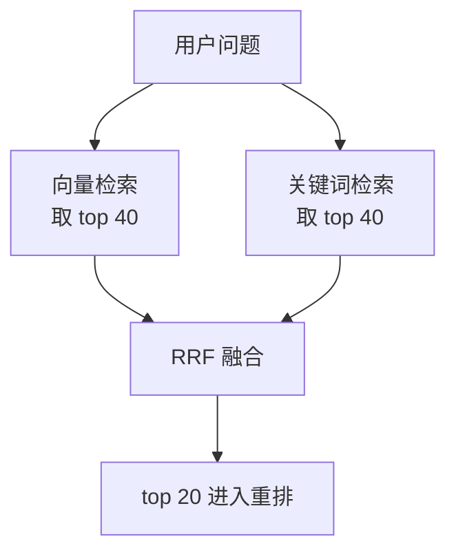
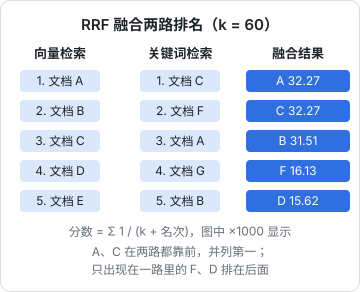

# 混合检索

向量检索擅长「意思相近」：问「怎么让检索更准」，能找到讲重排的段落，哪怕两边一个字都不一样。但它有一个出人意料的弱点：**精确的词**。搜 `ef_search`、`ERR_STREAM_PREMATURE_CLOSE`、「hatch-counter」、「0.8.0」，向量检索经常把一堆「语义上差不多」的段落排在真正包含这个词的段落前面。关键词检索正好相反。把两路结果合起来，就是**混合检索**（hybrid search），它是提升 RAG 召回率性价比最高的一步。

## 向量检索在哪里失手

| 查询类型 | 例子 | 向量检索的问题 |
|---|---|---|
| 标识符、参数名 | `hnsw.ef_search`、`maintenance_work_mem` | 被切成几个零碎 token，语义很弱 |
| 错误码、版本号 | `ECONNRESET`、`pg16`、`0.8.0` | 数字和代号对 embedding 来说几乎没有「意思」 |
| 专有名词 | 自己的项目名、人名、产品名 | 模型没见过，向量落在一个模糊的位置 |
| 罕见术语 | 某个冷门库的名字 | 训练数据里少，表示不准 |
| 精确短语 | 「不要使用 EAS Update」 | 否定和精确措辞容易被忽略 |

这些恰好是技术资料里最常见的查询。`shelf-rag` 的用户（也就是你自己）问的往往就是「`proxy_buffering` 在哪本书里讲过」这种问题。

关键词检索的问题则在另一边：同义词和换个说法就找不到（「向量库」搜不到「向量数据库」之外的「embedding 存储」），对口语化的长问题也很吃力。两者的失手区域几乎不重叠，所以合并的收益很大。



## Postgres 里的全文检索

Postgres 自带全文检索：`tsvector` 是分好词、归一化过的文档，`tsquery` 是查询，`@@` 判断是否匹配，`ts_rank` / `ts_rank_cd` 打分，GIN 索引加速。不需要另起一个 Elasticsearch。

### 中文要先分词

麻烦在中文。Postgres 的全文检索按空格和标点切词，而中文句子里没有空格：

```sql
SELECT to_tsvector('simple', '向量数据库的索引参数');
-- 结果：'向量数据库的索引参数':1   整句被当成一个词
```

这样只有一字不差地搜整句才能命中，等于没有索引。常见的解决办法：

| 方案 | 做法 | 取舍 |
|---|---|---|
| 应用层分词 | 写入前在 Node 里分好词，用空格连起来存进 `seg` 列 | 不用装扩展，托管数据库也能用；分词逻辑和数据库解耦 |
| 中文分词扩展 | zhparser、pg_jieba 等，在数据库里分词 | 要自己编译安装，托管数据库通常不支持 |
| 三元组 | `pg_trgm` 按字符片段匹配 | 适合模糊匹配和短文本，排序质量一般 |
| BM25 扩展 | ParadeDB 的 pg_search 等，提供真正的 BM25 打分 | 更接近搜索引擎的效果，引入新扩展的运维成本，以各自文档为准 |

`shelf-rag` 选第一种。Node 22 内置的 `Intl.Segmenter` 基于 ICU 词典，支持中文按词切分，不需要任何依赖。第 3 章表结构里的 `seg` 列和由它生成的 `tsv` 列就是为此准备的。

### 分词函数

```typescript
// src/search/segment.ts
const segmenter = new Intl.Segmenter("zh", { granularity: "word" });

// 切成纯字母 / 数字的词：中文按词典切，英文标识符按非字母数字字符再拆开
export function tokens(text: string): string[] {
  const out: string[] = [];
  for (const s of segmenter.segment(text.toLowerCase())) {
    if (!s.isWordLike) continue;
    for (const part of s.segment.split(/[^\p{L}\p{N}]+/u)) {
      if (part) out.push(part);
    }
  }
  return out;
}

// 写入时：分好的词用空格连接，存进 chunks.seg
export const toSearchText = (text: string): string => tokens(text).join(" ");

// 查询时：词之间用 OR 连接，交给 to_tsquery；没有可用的词时返回 null
export function toTsQuery(question: string): string | null {
  const terms = [...new Set(tokens(question))];
  return terms.length > 0 ? terms.join(" | ") : null;
}
```

试一下效果：

```text
> toSearchText("pgvector 的 hnsw.ef_search 默认是 40")
'pgvector 的 hnsw ef search 默认 是 40'
```

（ICU 词典的切分结果可能随 Node 版本里的 ICU 数据略有不同，以实际输出为准。）

设计上的几个考虑：

- **只保留纯字母、数字的词**：标点、下划线、点号都拆掉，这样每个词交给 Postgres 的 `simple` 配置后恰好是一个词位，不会被它的解析器再切一次；查询拼进 `to_tsquery` 时也不会混进 `&`、`|`、`!` 这类运算符字符
- **查询用 OR**：`plainto_tsquery` 会把所有词用 AND 连起来，问题里只要有一个词文档里没有就整条不命中，对自然语言问题太严格。用 OR 召回，靠打分排序
- **`的`、`是` 这类停用词**：在 OR 查询里它们会匹配几乎所有文档，但出现得太普遍，对 `ts_rank_cd` 的排序影响有限。需要更干净时，在 `tokens()` 里过滤一个小的停用词表
- 数据库要是 UTF8 编码（官方镜像默认就是），否则中文字符可能不被当作字母

写入时用的是第 4 章拼好标题路径的那段文本，所以标题里的词也能被搜到。验证一下：

```sql
SELECT to_tsvector('simple', 'pgvector 的 hnsw ef search 默认 是 40');
```

结果里应该能看到 `'pgvector'`、`'hnsw'`、`'ef'`、`'search'`、`'默认'`、`'40'` 等独立的词位，每个后面跟着它的位置编号（输出顺序由 Postgres 内部决定，不必在意）。关键是中文词、英文词、数字都被分开了。

### 关键词查询

```sql
SELECT c.id, ts_rank_cd(c.tsv, q) AS score
FROM chunks c, to_tsquery('simple', $1) q      -- $1 形如 'hnsw | ef | search | 默认'
WHERE c.tsv @@ q
ORDER BY score DESC
LIMIT 40;
```

`ts_rank_cd` 考虑匹配词之间的距离（cover density），几个查询词挨得越近分越高，这正好奖励了「`ef` 和 `search` 相邻出现」的段落。它不是 BM25：没有按词的稀有程度加权，也不做文档长度归一化（可以通过第三个参数开启几种归一化方式）。对个人规模的知识库够用；要更好的关键词排序，再考虑上面表里的 BM25 扩展。

## 两路结果怎么合并

两路检索各自给出一个排好序的列表，但分数完全不可比：一边是余弦距离（0 到 2），一边是 `ts_rank_cd`（没有固定上限）。直接加权相加，需要先归一化，而归一化方式本身又很难选。

**RRF**（Reciprocal Rank Fusion，倒数排名融合）绕开了这个问题：**只看名次，不看分数**。每个文档的融合分是它在各路列表里名次的倒数之和：

$$
\text{RRF}(d) = \sum_{i} \frac{1}{k + \text{rank}_i(d)}
$$

其中 $\text{rank}_i(d)$ 是文档 $d$ 在第 $i$ 路里的名次（从 1 开始），没出现就不计这一项；$k$ 是一个平滑常数，常用 60，这个值来自提出 RRF 的原始论文。$k$ 越大，名次之间的差距被压得越平，「两路都出现」比「某一路排第一」更重要。



图里的分数可以手算验证：A 在向量路第 1、关键词路第 3，得分 $\frac{1}{61} + \frac{1}{63} \approx 0.03227$；F 只在关键词路第 2，得分 $\frac{1}{62} \approx 0.01613$。两路都靠前的文档稳居前列，这正是我们想要的：**被两种完全不同的方法同时认可，比被一种方法高度认可更可靠**。

## 一条 SQL 完成混合检索

两路检索和融合可以写在一条 SQL 里，一次往返：

```typescript
// src/search/hybrid.ts
import { sql } from "drizzle-orm";
import { db } from "../db/client.js";
import { embed, EMBED_MODEL } from "../embedding.js";
import { toTsQuery } from "./segment.js";

export type Candidate = {
  id: string; documentId: string; ord: number; source: string;
  headingPath: string; content: string; score: number;
};

export async function hybridSearch(
  question: string,
  opts: { perRoute?: number; limit?: number; bookId?: string } = {},
): Promise<Candidate[]> {
  const perRoute = opts.perRoute ?? 40;
  const limit = opts.limit ?? 20;
  const [qv] = await embed([question], { inputType: "query" });
  const q = JSON.stringify(qv);
  const tsq = toTsQuery(question) ?? ""; // 空字符串：关键词路不返回任何行
  const book = opts.bookId ?? null;

  return db.transaction(async (tx) => {
    // ef_search 要不小于每路取的条数，否则向量路最多只返回 40 行（默认值）
    await tx.execute(sql.raw(`SET LOCAL hnsw.ef_search = ${Math.max(perRoute, 40)}`));
    await tx.execute(sql`SET LOCAL hnsw.iterative_scan = relaxed_order`);
    const rows = await tx.execute<Candidate>(sql`
      WITH semantic AS (
        SELECT c.id, row_number() OVER (ORDER BY c.embedding <=> ${q}::vector) AS rank
        FROM chunks c JOIN documents d ON d.id = c.document_id
        WHERE c.embedding_model = ${EMBED_MODEL}
          AND (${book}::text IS NULL OR d.book_id = ${book})
        ORDER BY c.embedding <=> ${q}::vector
        LIMIT ${perRoute}
      ),
      keyword AS (
        SELECT c.id, row_number() OVER (ORDER BY ts_rank_cd(c.tsv, tq) DESC) AS rank
        FROM chunks c JOIN documents d ON d.id = c.document_id,
             to_tsquery('simple', ${tsq}) tq
        WHERE c.tsv @@ tq
          AND (${book}::text IS NULL OR d.book_id = ${book})
        ORDER BY ts_rank_cd(c.tsv, tq) DESC
        LIMIT ${perRoute}
      ),
      fused AS (
        SELECT coalesce(s.id, k.id) AS id,
               coalesce(1.0 / (60 + s.rank), 0) + coalesce(1.0 / (60 + k.rank), 0) AS score
        FROM semantic s FULL OUTER JOIN keyword k ON s.id = k.id
      )
      SELECT c.id, c.document_id AS "documentId", c.ord, d.source,
             c.heading_path AS "headingPath", c.content, f.score::float8 AS score
      FROM fused f
      JOIN chunks c ON c.id = f.id
      JOIN documents d ON d.id = c.document_id
      ORDER BY f.score DESC
      LIMIT ${limit}
    `);
    return [...rows];
  });
}
```

要点：

- **`SET LOCAL` 只在当前事务内生效**，不会影响连接池里其他请求。`SET` 语句不接受绑定参数，所以这里用 `sql.raw` 拼一个由代码计算出的整数，不要把用户输入拼进去
- **`FULL OUTER JOIN`**：只在一路出现的文档也要保留，缺的那一路记 0 分
- **过滤条件写在两路里面**，而不是融合之后：否则每路的 40 个名额会被不相关的书占掉
- `to_tsquery('simple', '')` 会返回空查询并发出一条 NOTICE，不匹配任何行，向量路照常工作
- 融合分用 `numeric` 计算，最后转成 `float8`，postgres.js 才会把它读成 JS 数字而不是字符串

### 调整两路的权重

如果评测发现某一路更可靠，可以给 RRF 加权：

```sql
0.7 * coalesce(1.0 / (60 + s.rank), 0) + 0.3 * coalesce(1.0 / (60 + k.rank), 0)
```

权重和 $k$ 都是要在评测集上比较的超参数，不要凭感觉定。实践中「等权 + k = 60」是一个很难被明显超越的起点。

## 其他补漏手段

混合检索之外，还有几种在**查询侧**提升召回的办法，按投入从小到大：

| 手段 | 做法 | 适合 |
|---|---|---|
| 元数据过滤 | 从问题里识别出书名、时间、产品线，直接作为 `WHERE` 条件 | 问题里经常带范围限定 |
| 查询改写 | 让快模型把口语化、带指代的问题改成适合检索的完整问句 | 多轮对话：「那它的默认值呢？」 |
| 多查询 | 让模型生成 3 个不同角度的问法，分别检索后用 RRF 合并 | 问题含糊、可以有多种理解 |
| HyDE | 让模型先写一段「假想的答案」，用它的向量去检索 | 问题很短、和文档措辞差距大 |
| 稀疏向量 | 用能输出稀疏权重的模型（如 BGE-M3），存进 `sparsevec` | 想要「学出来的关键词检索」 |

多轮对话里的**查询改写几乎是必需的**：用户第二句问「那 IVFFlat 呢？」，直接拿这句去检索什么也找不到。用[《大模型应用工程》](../llm-app-engineering/)里的 `ask()` 加结构化输出，把对话历史和最新问题交给快模型，让它输出一个独立完整的检索问句即可。其余几种每多一步就多一次模型调用的延迟和费用，先用评测证明有效再加。

## 本章要点

- 向量检索在**标识符、错误码、版本号、专有名词**上容易失手，关键词检索正好互补，混合检索是提升召回性价比最高的一步
- Postgres 自带全文检索；中文要先分词。`shelf-rag` 在应用层用 Node 内置的 **`Intl.Segmenter`** 分词，存进 `seg` 列，由它生成 `tsvector`
- 分词结果只保留纯字母数字的词，查询用 **OR** 连接，`ts_rank_cd` 排序；它不是 BM25，需要时再上 BM25 扩展
- 两路分数不可比，用 **RRF** 只按名次融合，$k = 60$、等权是好的起点
- 一条 SQL 完成两路检索 + 融合；`SET LOCAL hnsw.ef_search` 不小于每路条数；过滤条件放进每一路里
- 多轮对话要做**查询改写**；多查询、HyDE 等手段先用评测证明有效再加

## 动手练习

1. **看分词结果**：把本章的 `tokens`、`toTsQuery` 复制出来，在 Node 22 里分别处理 `pgvector 的 hnsw.ef_search 默认是 40`、`proxy_buffering 在哪本书里讲过` 和 `!!!`。

   验证：第一条连起来是 `pgvector 的 hnsw ef search 默认 是 40`；第二条的查询里有 `proxy | buffering`，后面跟着一串单字或词；`!!!` 得到空数组，`toTsQuery` 返回 `null`（具体切分以你的 Node 自带的 ICU 数据为准）。

   参考答案：标识符按非字母数字字符拆开，查询时 `proxy` 和 `buffering` 就能分别匹配到存进去的词位。整句没有可用的词时返回 `null`，避免把空字符串之外的奇怪内容交给 `to_tsquery`。

2. **手算 RRF**：$k = 60$，运行 `node -p 'const r = (...x) => x.reduce((s, n) => s + 1 / (60 + n), 0); [r(1, 3), r(2), r(1), r(40, 40)].map(v => v.toFixed(5))'`。

   验证：输出 `[ '0.03227', '0.01613', '0.01639', '0.02000' ]`。前两个和本章配图里 A、F 的分数一致。

   参考答案：最后一项说明，两路都只排第 40 的文档，也比只在一路排第 1 的文档分高。RRF 奖励「被两种方法同时认可」；如果评测显示某一路明显更可靠，再给它加权，而不是改成按原始分数相加。

3. **中文全文检索要先分词**：在 pgvector 容器里依次执行 `SELECT to_tsvector('simple', '向量数据库的索引参数');` 和 `SELECT to_tsvector('simple', '向量 数据库 的 索引 参数') @@ to_tsquery('simple', '索引 | 召回');`，再试 `SELECT to_tsvector('simple', '向量数据库的索引参数') @@ to_tsquery('simple', '索引');`。

   验证：第一条只得到一个词位 `'向量数据库的索引参数':1`；第二条返回 `t`；第三条返回 `f`。

   参考答案：`simple` 配置按空格和标点切词，不认识中文词边界。在应用层分好词、用空格连起来存进 `seg`，再由它生成 `tsvector`，中文关键词才能匹配。
