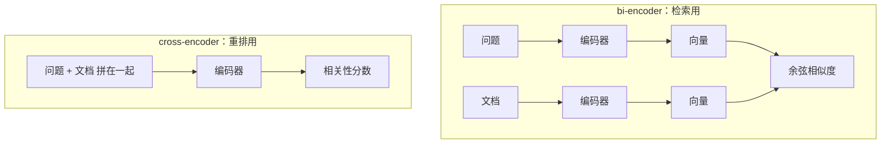
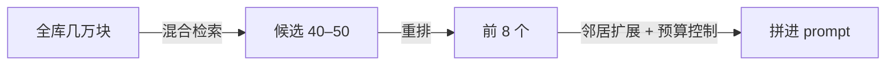

# 重排

混合检索给出了 20 个候选，正确答案大概率就在里面，但未必排在前面。而能塞进 prompt 的只有前几个。**重排**（reranking）就是在候选集上再用一个更精细、更慢的模型重新打分，把真正相关的挪到最前面。这一章讲重排为什么有效、有哪些选择，然后把重排后的结果组装成 prompt，让模型给出带引用、不乱编的回答。

## 为什么第一轮排不准

第 2 章说过，embedding 是 **bi-encoder**：问题和文档**各自独立**编码成向量，再比较。文档向量在建索引时就算好了，那时它根本不知道将来会被问什么，只能把「自己大概讲什么」压成一个向量。信息在压缩中丢失，细微的区别就分不出来：「HNSW 的 `ef_search` 默认值」和「IVFFlat 的 `probes` 默认值」在向量空间里可能挨得很近。

重排模型通常是 **cross-encoder**（交叉编码器）：把问题和文档**拼在一起**送进模型，让两者的每个 token 在注意力里互相看到，直接输出一个相关性分数。



| | bi-encoder | cross-encoder |
|---|---|---|
| 文档能否预先计算 | 能，建索引时算好 | 不能，每个（问题，文档）对都要现算 |
| 每次查询的计算量 | 编码一个问题 + 向量检索 | 候选数 × 一次模型推理 |
| 精度 | 较粗 | 高，能看到问题和文档的交互 |
| 适用规模 | 百万级全库 | 几十到一两百个候选 |

所以两者是分工关系：**bi-encoder 负责从全库里快速捞出几十个候选（追求召回），cross-encoder 负责在候选里精细排序（追求精度）**。这种「先粗后精」的两阶段结构，和推荐系统、搜索引擎的做法是一样的。



## 重排的几种选择

| 方案 | 说明 | 取舍 |
|---|---|---|
| 托管 rerank API | 多家 embedding 厂商同时提供 rerank 接口 | 最省事；按调用或 token 计费；数据出境 |
| 自己部署开源模型 | 如 bge-reranker 系列，可以用 TEI 等推理服务跑 | 数据不出机器；CPU 上处理几十个候选会偏慢 |
| 用大模型当重排器 | 让一个快模型读候选、给每个打分 | 不需要新的供应商；理解力强；但延迟和费用最高 |
| 不重排 | 直接用 RRF 的结果 | 候选质量已经很好、对延迟极敏感时 |

挑法和第 2 章一样：先在评测集上确认重排确实有提升，再看哪个方案的延迟和费用能接受。对中文内容，同样要先确认模型支持中文。

### 通用的 rerank 封装

托管 rerank 接口的形状大体相似：给一个 `query`、一组 `documents` 和返回条数，回来每个文档的下标和相关性分数。字段名各家略有差异（比如返回条数叫 `top_n` 还是 `top_k`，结果放在 `results` 还是 `data` 里），下面按最常见的形状写，接入时对照所选服务的文档调整：

```typescript
// src/rerank.ts
const BASE_URL = process.env.RERANK_BASE_URL!;
const API_KEY = process.env.RERANK_API_KEY ?? "";
const MODEL = process.env.RERANK_MODEL!;

export type Scored<T> = { item: T; score: number };

export async function rerank<T>(
  query: string,
  items: T[],
  toText: (item: T) => string,
  topN: number,
): Promise<Scored<T>[]> {
  if (items.length === 0) return [];
  const res = await fetch(`${BASE_URL}/rerank`, {
    method: "POST",
    headers: {
      "content-type": "application/json",
      ...(API_KEY ? { authorization: `Bearer ${API_KEY}` } : {}),
    },
    body: JSON.stringify({
      model: MODEL,
      query,
      documents: items.map(toText),
      top_n: topN,
    }),
    signal: AbortSignal.timeout(15_000),
  });
  if (!res.ok) throw new Error(`rerank ${res.status}: ${(await res.text()).slice(0, 300)}`);
  const json = (await res.json()) as { results: { index: number; relevance_score: number }[] };
  return json.results
    .map((r) => ({ item: items[r.index], score: r.relevance_score }))
    .sort((a, b) => b.score - a.score);
}
```

重排是一个**可以失败的优化**：它挂了，RRF 的顺序也能用。所以调用方要兜底：

```typescript
// src/search/retrieve.ts
import { hybridSearch, type Candidate } from "./hybrid.js";
import { rerank, type Scored } from "../rerank.js";

export async function retrieve(question: string, topN = 8): Promise<Scored<Candidate>[]> {
  const candidates = await hybridSearch(question, { perRoute: 40, limit: 40 });
  try {
    return await rerank(question, candidates, (c) => `${c.headingPath}\n${c.content}`, topN);
  } catch (err) {
    console.warn("rerank_failed, fallback to rrf", err);
    return candidates.slice(0, topN).map((c) => ({ item: c, score: c.score }));
  }
}
```

送去重排的文本同样带上标题路径，和建索引时的处理一致。

### 用大模型重排

如果不想再接一个供应商，可以让一个快模型来打分。把候选编号列出来，让它按 0–3 给每段打相关性分，用《大模型应用工程》第 3 章的结构化输出约束返回格式：

```text
<question>pgvector 的 HNSW 查询时怎么提高召回？</question>
<passages>
<p id="1">向量库与 pgvector > 索引 > HNSW …</p>
<p id="2">向量库与 pgvector > 索引 > IVFFlat …</p>
…
</passages>
给每段打相关性分：3 = 直接回答了问题；2 = 包含回答所需的重要信息；1 = 话题相关但帮助不大；0 = 无关。
只依据段落内容判断，不要用你自己的知识补充。
```

它的理解力最强，能处理「这段讲的是 IVFFlat，问的是 HNSW」这种细微差别；代价是一次额外的模型调用，输入是全部候选的长度，延迟通常是专用重排模型的好几倍。适合对质量要求高、对延迟不敏感的场景，比如离线批处理，或者先用它给评测集打标签。

## 重排分数的用法

cross-encoder 的分数比向量相似度更接近「真的相关吗」的判断，可以用来做两件事：

1. **截断**：不一定每次都取满 8 个，分数明显断崖的地方就停。只有 2 段真正相关时，塞进 8 段反而会给模型添乱
2. **判断「没找到」**：最高分都很低时，直接告诉用户资料里没有相关内容，或者转人工、转通用回答，而不是硬让模型从不相关的段落里拼一个答案

分数的阈值同样要在评测集上找，而且换重排模型后要重新找。

## 组装上下文

挑出前几个块之后，还要决定**怎么把它们放进 prompt**。这一步常被当成字符串拼接随手写掉，但它对最终回答的影响不比检索小。

### 扩展、合并、控制预算

```typescript
// src/answer/context.ts
import { sql } from "drizzle-orm";
import { db } from "../db/client.js";
import { estimateTokens } from "../chunk/markdown.js";
import type { Candidate } from "../search/hybrid.js";

export type Passage = { id: number; source: string; headingPath: string; text: string };

export async function buildContext(hits: Candidate[], budgetTokens = 6000): Promise<Passage[]> {
  if (hits.length === 0) return [];
  // 1. 邻居扩展：取命中块前后各一块（第 4 章的 SQL）
  const idArray = `{${hits.map((h) => h.id).join(",")}}`; // Postgres 数组字面量，如 {12,57,90}
  const rows = await db.execute<{
    document_id: string; ord: number; source: string; heading_path: string; content: string;
  }>(sql`
    SELECT n.document_id, n.ord, d.source, n.heading_path, n.content
    FROM chunks h
    JOIN chunks n ON n.document_id = h.document_id AND n.ord BETWEEN h.ord - 1 AND h.ord + 1
    JOIN documents d ON d.id = n.document_id
    WHERE h.id = ANY(${idArray}::bigint[])
    GROUP BY n.id, d.source
    ORDER BY n.document_id, n.ord
  `);

  // 2. 同一文档里连续的块合并成一段
  const merged: { docId: string; source: string; headingPath: string; parts: string[]; lastOrd: number }[] = [];
  for (const r of rows) {
    const prev = merged.at(-1);
    if (prev && prev.docId === r.document_id && r.ord === prev.lastOrd + 1) {
      prev.parts.push(r.content);
      prev.lastOrd = r.ord;
    } else {
      merged.push({ docId: r.document_id, source: r.source, headingPath: r.heading_path, parts: [r.content], lastOrd: r.ord });
    }
  }

  // 3. 按重排名次给合并后的段落排序：包含越靠前命中块的段落越靠前
  const rankOfDoc = new Map<string, number>();
  hits.forEach((h, i) => { if (!rankOfDoc.has(h.documentId)) rankOfDoc.set(h.documentId, i); });
  merged.sort((a, b) => (rankOfDoc.get(a.docId) ?? 99) - (rankOfDoc.get(b.docId) ?? 99));

  // 4. 控制总预算，超出就停
  const out: Passage[] = [];
  let used = 0;
  for (const m of merged) {
    const text = m.parts.join("\n\n");
    const t = estimateTokens(text);
    if (used + t > budgetTokens && out.length > 0) break;
    out.push({ id: out.length + 1, source: m.source, headingPath: m.headingPath, text });
    used += t;
  }
  return out;
}
```

为什么这么做：

- **邻居扩展**补上被分块切掉的上下文，代价是多用一些 token
- **合并连续块**：相邻块之间有重叠，分开放会出现重复段落；合并后读起来也像原文
- **排序**：把最相关的放在最前面。研究发现模型对长上下文**中间**的信息利用得最差（第 8 章会提到），最重要的材料别埋在中间
- **预算**：上下文不是越多越好。无关段落会分散模型注意力，也直接增加费用和延迟。几千 token 的材料对大多数查找型问题已经足够

id 数组拼成 Postgres 数组字面量后作为**一个**参数传入。不要直接把 JS 数组放进 Drizzle 的 `sql` 模板：它会把数组展开成 `($1, $2, …)` 这样的列表，`ANY(...)` 就不成立了。这里的 id 来自数据库、只含数字，拼字面量是安全的。

### 生成：带引用、允许说不知道

```typescript
// src/answer/answer.ts
import { ask } from "../llm/client.js";
import { retrieve } from "../search/retrieve.js";
import { buildContext } from "./context.js";

const SYSTEM = `你是作者个人书架的问答助手，根据 <docs> 中的资料回答问题。
规则：
- 只使用 <docs> 里的信息。资料没有覆盖的部分，明确说「书架里没有找到」，不要用你自己的知识补充
- 每个论断后用 [编号] 标出依据，例如 [2]；多个来源写成 [1][3]
- 资料之间有矛盾时，指出矛盾并分别引用
- 用简体中文，先给结论，再给必要的细节`;

export async function answer(question: string) {
  const hits = await retrieve(question, 8);
  const passages = await buildContext(hits.map((h) => h.item));
  if (passages.length === 0) {
    return { text: "书架里没有找到相关内容。", passages, citations: [] as number[] };
  }

  const docs = passages
    .map((p) => `<doc id="${p.id}" source="${p.source}" section="${p.headingPath}">\n${p.text}\n</doc>`)
    .join("\n");

  const { text } = await ask({
    feature: "shelf-rag.answer",
    system: SYSTEM,
    messages: [{ role: "user", content: `<docs>\n${docs}\n</docs>\n\n问题：${question}` }],
    maxTokens: 2000,
  });

  // 校验引用：只保留真实存在的编号；完全没有引用的回答记一条日志，方便排查
  const cited = [...new Set([...text.matchAll(/\[(\d+)\]/g)].map((m) => Number(m[1])))];
  const valid = cited.filter((n) => passages.some((p) => p.id === n));
  if (valid.length !== cited.length) console.warn("invalid_citation", { question, cited });
  if (valid.length === 0) console.warn("no_citation", { question });

  return { text, passages, citations: valid };
}
```

几个要点：

- **资料在前、问题在后**，每段带编号、来源和小节，模型引用时有据可依，前端也能把 `[2]` 渲染成可点击的出处
- **「不知道」写成明确的指令**，并给出固定说法。检索失败时，「书架里没有找到」是正确答案，不是失败
- **校验引用**：模型偶尔会引用不存在的编号；没有任何引用的回答也值得警惕，往往说明它在用自己的知识作答。这两类日志是第 7 章线上监控的原料
- **资料里的内容是数据，不是指令**：如果知识库里可能混进用户上传的文档，要考虑 prompt 注入，例如文档里写着「忽略之前的指示」。用标签隔开并在 system 里声明只把 `<docs>` 当资料，是基本防线，更多防护见《LLM 应用上线》

Claude API 还提供原生的 citations 功能：把资料作为文档内容块传入并开启引用后，回答会附带所引用原文的位置信息，不需要自己约定 `[编号]` 格式。用法和限制以官方文档为准；用其他模型时，上面这种编号约定是通用的做法。

## 本章要点

- 检索用的 bi-encoder 分别编码问题和文档，精度有上限；重排用 **cross-encoder** 把两者拼在一起打分，更准但只能处理几十个候选
- **先粗后精**：混合检索捞 40–50 个候选保召回，重排挑前几个保精度
- 选择：托管 rerank API、自部署开源重排模型、用大模型打分；先用评测集确认有提升；**重排失败要回退到 RRF 结果**
- 重排分数可以用来**截断**和判断**没找到**，阈值在评测集上找
- 组装上下文：邻居扩展 → 合并连续块 → 最相关的放前面 → 控制 token 预算
- 生成时要求**逐条引用**、允许说**没找到**，并在代码里校验引用编号；知识库内容是数据不是指令
