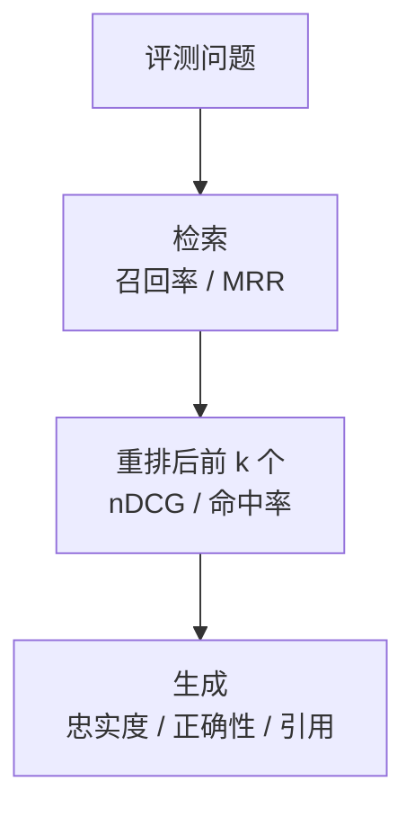

# 评测

前面几章留下了一长串旋钮：块多大、重叠多少、用哪个 embedding 模型、`ef_search` 设多少、RRF 的权重、要不要重排、取前几个、上下文预算多少……每个都能凭感觉调，而凭感觉调的结果通常是：改完试三个问题，觉得「好像好了点」，上线后另外一批问题变差了。这一章给 RAG 建一套**能自动跑、能比较**的评测：分层的指标、评测集怎么来、脚本怎么写、结果怎么读。

## 分层评测

第 1 章把 RAG 的失败分成三层：检索失败、排序失败、生成失败。评测也照这个分层，每层用不同的指标，这样一个数字变差时，你立刻知道该去调哪里。



| 层 | 问的是 | 指标 | 评测成本 |
|---|---|---|---|
| 检索 | 正确的段落有没有被捞出来 | Recall@k、命中率 | 便宜，不调大模型，几秒跑完 |
| 排序 | 正确的段落排得够不够靠前 | MRR、nDCG@k | 便宜（重排 API 的费用除外） |
| 生成 | 回答对不对、有没有编、引用准不准 | 忠实度、正确性、引用准确率 | 贵，要调模型生成和评判 |

**大部分调参只需要跑前两层**。分块、embedding、混合检索、重排这些改动，影响的都是检索和排序；只要检索指标变好，生成通常不会变差。生成层的评测留给改 prompt、换生成模型的时候。

## 评测集从哪来

评测集是一组「问题 + 应该被检索到的资料（+ 参考答案）」。没有它，后面的一切都无从谈起。

### 标注「哪段资料」，而不是「哪个块」

一个关键设计：**相关资料用「文件 + 小节标题」标注，不要用块 id**。块 id 在每次重新分块后都会变，用它标注的评测集，改一次分块规则就作废了；而「`rag-systems/03-pgvector.md` 的『HNSW：分层的邻居图』这一节」在分块规则怎么变都不会失效。判断命中时，检索到的块只要来自这个文件、标题路径包含这个小节，就算命中。

```json
{"id":"q017","question":"pgvector 的 HNSW 查询时怎么提高召回？","relevant":[{"source":"rag-systems/03-pgvector.md","section":"HNSW：分层的「邻居图」"}],"answer":"调大 hnsw.ef_search（默认 40），代价是查询变慢","tags":["参数","精确术语"]}
{"id":"q031","question":"书架 App 支持在线同步吗？","relevant":[],"answer":"书架里没有找到","tags":["无答案"]}
```

存成 JSONL，一行一条，放在代码仓库里，和代码一起版本管理。

### 三个来源

| 来源 | 做法 | 优点 | 缺点 |
|---|---|---|---|
| 模型出题 | 随机抽块，让模型写一个「这一块能回答」的问题 | 快，能批量造几百条 | 问题偏书面、和原文用词太像，偏简单 |
| 自己写 | 回想自己真会问的问题，查书标出答案所在 | 最贴近真实需求 | 慢，一次只能写几十条 |
| 线上日志 | 从真实查询里抽样，人工标注 | 分布最真实 | 要先上线才有 |

建议的节奏：先用模型出题快速造出 100–200 条起步，**人工过一遍删掉质量差的**，再补 30–50 条自己写的难题；上线后定期从日志里补充，尤其是答错的。

### 用模型出题

```typescript
// scripts/gen-questions.ts
import { readFile, appendFile } from "node:fs/promises";
import { z } from "zod";
import { ask } from "../src/llm/client.js";
import { chunkMarkdown } from "../src/chunk/markdown.js";

const Out = z.object({
  question: z.string(),
  answer: z.string(),
  usable: z.boolean(), // 这一块是否有足够具体的内容可以出题
});

export async function genFor(source: string, path: string) {
  const md = await readFile(path, "utf8");
  for (const c of chunkMarkdown(md)) {
    if (c.tokenCount < 120 || Math.random() > 0.3) continue; // 太短的跳过，按比例抽样
    const { text } = await ask({
      feature: "eval.gen-questions",
      system:
        "你在为一个技术书问答系统出评测题。根据给定的段落，写一个读者真实会问、并且这段内容能回答的问题。" +
        "要求：用口语化的说法，不要照抄段落里的句子和标题；问题要具体，答案应该在段落里能找到。" +
        "段落内容太泛、没法出具体问题时，usable 设为 false。只输出 JSON：{question, answer, usable}",
      messages: [{ role: "user", content: `<section>${c.headingPath}</section>\n<passage>\n${c.content}\n</passage>` }],
      maxTokens: 500,
    });
    const parsed = Out.safeParse(JSON.parse(text));
    if (!parsed.success || !parsed.data.usable) continue;
    const section = c.headingPath.split(" > ").at(-1)!;
    await appendFile(
      "eval/questions.generated.jsonl",
      JSON.stringify({ question: parsed.data.question, relevant: [{ source, section }], answer: parsed.data.answer, tags: ["generated"] }) + "\n",
    );
  }
}
```

这里为简洁直接 `JSON.parse`；正式使用时套上[《大模型应用工程》第 3 章](../llm-app-engineering/03-structured-output.md)的结构化输出，避免偶发的格式问题。

模型出的题有两个系统性偏差，要心里有数：

- **用词和原文太像**：即使要求「不要照抄」，问题里仍会带着原文的关键词，这会让关键词检索显得特别好。人工审核时，把明显照抄的问题改写成口语
- **单块可答**：每道题都恰好由一个块回答，而真实问题常常需要综合几处。自己写的那部分题要特意补上这类问题

### 别忘了「没有答案」的题

评测集里要有 10% 左右**资料里确实没有答案**的问题（上面的 `q031`）。它们检验的是系统会不会老实说「没找到」。只用有答案的题评测，会把系统调成「无论如何都要找点什么塞给模型」。

## 检索指标

设评测集有 $N$ 道题，对每道题，检索系统返回一个排好序的结果列表。

**Recall@k**（召回率）：前 $k$ 个结果里，覆盖了多少条应该被找到的资料。

$$
\text{Recall@}k = \frac{|\text{前 } k \text{ 个结果命中的相关资料}|}{|\text{全部相关资料}|}
$$

每道题通常只有一两条相关资料，所以它很接近**命中率**（Hit@k：前 $k$ 个里至少命中一条的题目比例）。检索阶段（重排之前）最该看的就是 Recall@40 这类大 $k$ 的召回：重排只能在候选里挑，候选里没有，后面全白费。

**MRR**（Mean Reciprocal Rank，平均倒数排名）：第一个命中结果排在第几位，取倒数再平均。

$$
\text{MRR} = \frac{1}{N} \sum_{i=1}^{N} \frac{1}{\text{rank}_i}
$$

排第 1 得 1 分，排第 2 得 0.5，排第 5 得 0.2，没命中得 0。它直观反映「正确答案平均排多靠前」，是看重排效果的主要指标。

**nDCG@k**：考虑多条相关资料、以及相关程度分级（「直接回答」比「相关背景」更重要）时用。它按名次对每个命中打折扣再求和，并除以理想排序下的得分做归一化。相关资料只有一条、不分级时，它和 MRR 的趋势基本一致，个人项目用 Recall 和 MRR 就够了。

### 评测脚本

```typescript
// scripts/eval-retrieval.ts
import { readFile } from "node:fs/promises";
import { hybridSearch, type Candidate } from "../src/search/hybrid.js";
import { retrieve } from "../src/search/retrieve.js";

type Item = { id?: string; question: string; relevant: { source: string; section: string }[]; tags?: string[] };

const isHit = (c: Candidate, r: Item["relevant"][number]) =>
  c.source === r.source && c.headingPath.split(" > ").includes(r.section);

function score(results: Candidate[], item: Item, k: number) {
  const top = results.slice(0, k);
  const found = item.relevant.filter((r) => top.some((c) => isHit(c, r))).length;
  const firstRank = results.findIndex((c) => item.relevant.some((r) => isHit(c, r)));
  return {
    recall: found / item.relevant.length,
    rr: firstRank >= 0 && firstRank < k ? 1 / (firstRank + 1) : 0,
  };
}

async function main() {
  const lines = (await readFile(process.argv[2] ?? "eval/questions.jsonl", "utf8")).trim().split("\n");
  const items = lines.map((l) => JSON.parse(l) as Item).filter((it) => it.relevant.length > 0);

  const acc = { r40: 0, r8: 0, mrrRrf: 0, mrrRerank: 0 };
  const misses: string[] = [];
  for (const it of items) {
    const cands = await hybridSearch(it.question, { perRoute: 40, limit: 40 });
    const reranked = (await retrieve(it.question, 8)).map((s) => s.item);
    const a = score(cands, it, 40);
    const b = score(cands, it, 8);
    const c = score(reranked, it, 8);
    acc.r40 += a.recall; acc.r8 += b.recall; acc.mrrRrf += b.rr; acc.mrrRerank += c.rr;
    if (a.recall === 0) misses.push(it.question);
  }
  const n = items.length;
  console.table({
    "Recall@40（融合后）": (acc.r40 / n).toFixed(3),
    "Recall@8（融合后）": (acc.r8 / n).toFixed(3),
    "MRR@8（融合后）": (acc.mrrRrf / n).toFixed(3),
    "MRR@8（重排后）": (acc.mrrRerank / n).toFixed(3),
  });
  console.log(`候选里完全没找到的 ${misses.length} 题：`, misses.slice(0, 20));
}

main();
```

（`retrieve` 内部会再跑一次混合检索，评测脚本里多花一点时间无所谓；想省的话可以把候选作为参数传进去。）

**比指标更有用的是那份「完全没找到」的清单**。逐条看：是分块把答案切碎了？是术语没被关键词检索覆盖？还是评测题本身标错了？大部分改进点都是从这份清单里发现的。

## 怎么做对比实验

每次只改一个变量，在同一个评测集上跑，记录在一张表里：

| 实验 | 改了什么 | Recall@40 | Recall@8 | MRR@8 | 每次查询耗时 | 结论 |
|---|---|---|---|---|---|---|
| baseline | 纯向量，块上限 500 | | | | | |
| exp-1 | + 关键词检索（RRF） | | | | | |
| exp-2 | exp-1 + 重排 | | | | | |
| exp-3 | exp-2，块上限改 300 | | | | | |

几条纪律：

- **一次只改一个变量**，否则不知道是谁的功劳
- **看分组，不只看总分**：按 `tags` 分组统计。加关键词检索后总分只涨一点，但「精确术语」组可能大涨、「口语化」组略降，这比一个平均数有用得多
- **评测集小的时候，差几个百分点可能只是噪声**。100 道题的评测集，1 个百分点就是 1 道题。差距小于几道题时，去看具体哪几道题变了，而不是相信数字
- **把耗时和费用一起记下来**。重排带来的提升值不值它增加的延迟，要放在一起看

## 生成层评测

检索指标好了之后，生成层主要看三件事：

| 指标 | 问的是 | 怎么评 |
|---|---|---|
| 忠实度 | 回答里的每个论断，资料里都有依据吗 | 让评判模型拿着资料逐条核对回答 |
| 正确性 | 回答和参考答案一致吗 | 让评判模型对比回答和参考答案 |
| 引用准确率 | 标了 [2] 的论断，第 2 段真的支持它吗 | 抽查，或让评判模型逐条核对 |
| 拒答正确率 | 无答案的题，是否说了「没找到」 | 规则判断，看是否包含固定说法 |

忠实度是 RAG 特有的、也最重要的：**答错了但忠实于资料**，说明是资料或检索的问题；**资料是对的但回答不忠实**，说明模型在用自己的知识编，要改 prompt 或换模型。这两种情况的修法完全不同。

用一个模型去评判另一个模型的输出，就是 LLM-as-judge。它有自己的偏差和校准方法：评判 prompt 怎么写、怎么验证评判本身可靠、怎么做成回归测试，这些在[《评测与质量》](../llm-evals/)里系统地讲，这里不展开。

## 线上的信号

上线后，评测集之外还有几个可以持续盯着的信号，第 6 章的日志就是为这个准备的：

| 信号 | 含义 |
|---|---|
| 「没找到」比例突然升高 | 新内容没索引上，或者用户开始问新类型的问题 |
| 无引用回答的比例 | 模型在脱离资料作答 |
| 无效引用编号 | prompt 或模型行为有问题 |
| 最高重排分数的分布 | 整体变低说明检索质量在下降 |
| 用户的点踩、追问 | 最直接的不满意信号 |

每周抽 20 条日志人工看一遍，把答错的加进评测集。评测集就这样跟着真实使用一起长大，越来越能代表你真正关心的问题。

## 本章要点

- 评测按**检索 → 排序 → 生成**分层，大部分调参只需要跑便宜的前两层
- 评测集用「**文件 + 小节标题**」标注相关资料，不用块 id，这样改分块规则后评测集仍然有效
- 评测集来源：模型出题起步（注意用词太像、单块可答两个偏差）+ 自己写难题 + 线上日志；**加 10% 左右的无答案题**
- 检索看 **Recall@k**（候选阶段用大 k），排序看 **MRR**；最有价值的是「完全没找到」的清单
- 对比实验一次只改一个变量，**按标签分组看**，小评测集上的小差距要看具体题目
- 生成层看**忠实度、正确性、引用、拒答**；忠实度区分了「检索错」和「模型编」；LLM-as-judge 见《评测与质量》
- 线上盯「没找到」比例、无引用回答、重排分数分布和用户反馈，答错的持续补进评测集
