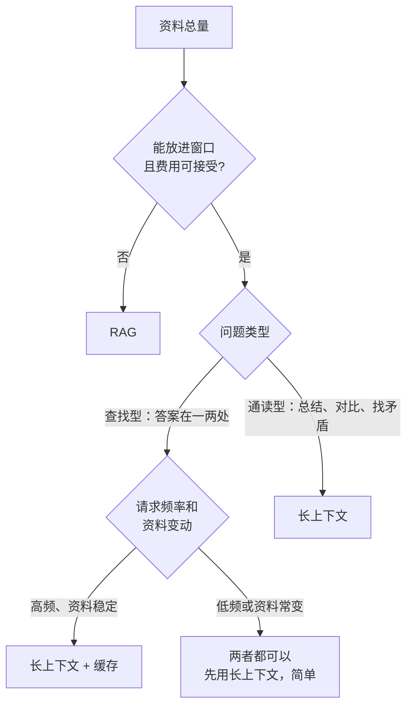

# RAG 与长上下文的取舍

几年前，模型的上下文窗口只有几千 token，RAG 是唯一的选择。现在主流旗舰模型的窗口普遍在二十万 token 以上，有的到了百万级（具体以各家官方文档为准），再加上 prompt 缓存让重复的长前缀变便宜，一个很自然的问题是：**直接把资料全塞进去不就行了，还要 RAG 干什么？** 这一章回答这个问题：两种方式各自的代价，怎么按场景选，以及介于两者之间的几种做法。

## 先看规模：书架有多大

用 `shelf-rag` 的真实数据算一下。写作时书架上已完成的书，每本正文大约 5 万到 11 万字符（`wc -m` 统计），全部加起来接近 100 万字符；规划里一共 52 本，写完之后大约是现在的三到四倍。

| 范围 | 字符量（约） | 能否一次塞进上下文 |
|---|---|---|
| 一章 | 1 万左右 | 轻松 |
| 一本书 | 5–11 万 | 可以，占窗口的相当一部分 |
| 整个书架（现在） | 100 万 | 超出大部分模型的窗口，或者非常贵 |
| 整个书架（写完） | 三四百万 | 不可能 |

中文字符和 token 的换算因分词器差异很大，这里不给精确比例，按自己用的模型实测 `usage` 为准。但量级已经很清楚：**一本书塞得进去，整个书架塞不进去**。这条分界线，就是本章讨论的核心。

## 长上下文的代价

塞得进去，不等于应该塞。全量放进上下文有四个代价：

### 费用

每次请求都要为全部输入付费。用一个**假设**的价格算：输入单价每百万 token 3 美元，资料 10 万 token。

| 方式 | 每次输入 | 每次输入费用（假设单价） | 相对 RAG |
|---|---|---|---|
| RAG（约 6000 token 资料） | 约 6000 token | 约 0.018 美元 | 1× |
| 全量，无缓存 | 10 万 token | 0.3 美元 | 约 17× |
| 全量，缓存命中 | 10 万 token 按缓存价 | 取决于缓存读取的折扣 | 见下文 |

《大模型应用工程》第 6 章讲过，缓存命中时读取部分按大幅折扣计费（以 Anthropic 为例，缓存读取是基础输入价的十分之一左右，以官方定价页为准）。按十分之一算，全量缓存命中后每次约 0.03 美元，和 RAG 已经是同一个量级。但缓存有前提：前缀完全不变、在有效期内被频繁命中；资料一改，缓存全部失效，第一次写入还要额外付费。

### 延迟

模型处理输入也要时间。10 万 token 的输入，首 token 延迟明显比 6000 token 长，缓存能缩短这段时间，但缩不到短 prompt 的水平。对交互式问答，这是体感上最明显的差别。

### 注意力被稀释

2023 年一篇题为《Lost in the Middle》的论文发现：相关信息放在长上下文的**开头或结尾**时，模型利用得最好；放在**中间**时，效果明显下降。之后的新模型在长上下文上改进了很多，但「材料越长，越容易漏掉其中某个细节」这个趋势并没有完全消失。更麻烦的是，大量无关内容还可能把模型带偏：它会把一段不相关但看起来相似的内容当成依据。

RAG 递给模型的是经过筛选、排好序的几段材料，本质上是在帮模型**集中注意力**。

### 没有出处的边界

全量放进去时，模型回答「根据资料……」，但资料有一百万字，核对起来很难。RAG 的引用天然落在少数几段上，用户点一下就能看到原文。

## 长上下文的优势

反过来，长上下文也有 RAG 做不到的事：

| 场景 | 为什么 RAG 吃力 |
|---|---|
| 「总结这本书的主要观点」 | 需要通读全书，检索只能拿到片段 |
| 「第 3 章和第 7 章的说法有没有矛盾」 | 要同时看两处完整内容，还要先知道去看哪两处 |
| 「这份合同里有哪些对我不利的条款」 | 相关条款分散，且「不利」很难写成检索问题 |
| 答案依赖散落在各处的很多小细节 | 检索的 top-k 装不下 |

此外，长上下文**没有检索失败这一层**：只要资料在里面，就不会因为分块切坏、关键词没覆盖而找不到。系统也简单得多：没有索引、没有同步、没有评测检索的负担。

## 怎么选



| 条件 | 倾向 |
|---|---|
| 资料几万字以内 | 长上下文，别折腾检索 |
| 资料远超窗口 | RAG，没得选 |
| 查找型问题为主、要出处 | RAG |
| 通读、总结、对比型问题 | 长上下文 |
| 资料频繁变动 | RAG（增量索引），长上下文的缓存会频繁失效 |
| 每个用户有自己的资料，且很小 | 长上下文，省掉每用户一套索引 |
| 对延迟敏感 | RAG |

hatch-counter 里如果要做「问问这家店的操作手册」，手册只有几十页，直接放进 system prompt 加缓存就好；`shelf-rag` 面对的是整个书架，只能用 RAG。

## 介于两者之间

实际系统往往不是二选一，而是组合使用。

### 检索定位，整章阅读

先用 RAG 找到最相关的**章节**，然后把整章（而不是几个块）放进上下文。一章一万字左右，长上下文模型处理起来毫无压力，既避免了块切得太碎导致的上下文缺失，又不用塞整个书架。

```typescript
// src/answer/read-chapter.ts
import { eq } from "drizzle-orm";
import { readFile } from "node:fs/promises";
import { join } from "node:path";
import { db } from "../db/client.js";
import { documents } from "../db/schema.js";
import { retrieve } from "../search/retrieve.js";

export async function topChapters(question: string, maxChapters = 2) {
  const hits = await retrieve(question, 8);
  const sources: string[] = [];
  for (const h of hits) {
    if (!sources.includes(h.item.source)) sources.push(h.item.source);
    if (sources.length === maxChapters) break;
  }
  // 文件即真相：整章内容直接从 books/ 读，不从块拼回去
  return Promise.all(
    sources.map(async (s) => {
      const [doc] = await db.select().from(documents).where(eq(documents.source, s));
      return { source: s, title: doc?.title ?? s, text: await readFile(join("books", s), "utf8") };
    }),
  );
}
```

这种做法对技术书特别合适：一章本身就是一个完整的话题单元，作者已经替你做好了最好的「分块」。

### 把检索交给模型：agentic search

另一种思路是不在代码里固定「检索一次 → 生成」的流程，而是把检索做成**工具**交给模型，让它自己决定搜什么、搜几次、要不要读全文。这就是《大模型应用工程》第 4 章的工具调用循环：

```typescript
// src/agent/tools.ts —— Anthropic Messages API 的工具定义
export const shelfTools = [
  {
    name: "search_shelf",
    description:
      "在书架的全部书里做混合检索（向量 + 关键词），返回最相关的段落摘要和出处。" +
      "适合查找某个概念、参数、命令在哪里讲过。精确术语请原样放进 query。",
    input_schema: {
      type: "object" as const,
      properties: {
        query: { type: "string", description: "检索问句或关键词" },
        book_id: { type: "string", description: "可选，只在这本书里搜，如 nginx-gateway" },
      },
      required: ["query"],
    },
  },
  {
    name: "read_chapter",
    description: "读取一章的完整 Markdown。在 search_shelf 找到相关章节、需要完整上下文时使用。",
    input_schema: {
      type: "object" as const,
      properties: {
        source: { type: "string", description: "search_shelf 返回的 source，如 rag-systems/03-pgvector.md" },
      },
      required: ["source"],
    },
  },
];
```

模型拿到问题后，可能先搜一次，发现结果不够具体，换个关键词再搜，最后读一整章再作答。这和 Claude Code 在代码库里用 grep、读文件逐步定位的方式是一回事。

| | 固定流程 RAG | agentic search |
|---|---|---|
| 延迟 | 一次检索 + 一次生成，可预测 | 多轮工具调用，慢且不固定 |
| 费用 | 低、稳定 | 每轮都带着完整历史，高且波动 |
| 复杂问题 | 一次检索不中就失败 | 能换说法重试、组合多处信息 |
| 可控性 | 高 | 要设轮数上限，防止兜圈子 |

固定流程适合高频、简单的查找；agentic search 适合低频、复杂、值得多花几秒和几分钱的问题。两者共用同一套索引和检索函数，前面七章做的工作在两种模式下都用得上。Agent 循环的设计和失败方式，在《Agent 原理与设计》里讲得更系统。

### 小资料常驻，大资料检索

还有一种常见组合：把体量小、几乎每次都用得到的内容（产品说明、术语表、写作规范）常驻在 system prompt 里，开启缓存；体量大的资料走 RAG。常驻部分提供「背景知识」，检索部分提供「具体细节」。

## 窗口还会变大，RAG 会消失吗

窗口会继续变大，价格会继续下降，「几万字以内直接塞」的分界线会不断往上移。但几个结构性的理由让检索不会消失：

- **资料增长得比窗口快**：一个人的笔记、一家公司的文档、一个产品的用户数据，体量没有上限
- **每次请求都为全部资料付费，在经济上不合理**：哪怕单价降到很低，「每个问题都读一遍一百万字」和「读六千字」之间仍然差着两个数量级
- **出处和可控性**：知道答案来自哪一段，在很多产品里是硬需求
- **权限**：不同用户能看的资料不同，检索时按权限过滤是天然的做法，全量塞进去就得为每个用户拼一份

更可能的未来是边界变得模糊：检索粒度从「块」变成「章节」甚至「整本书」，由模型自己决定什么时候搜、搜什么、读多少。但「先找到相关的，再仔细读」这个基本结构会一直在。

## 本章要点

- 判断的第一步是算规模：**一本书塞得进上下文，整个书架塞不进去**；中文 token 换算以实测为准
- 全量塞进上下文的代价：**费用、延迟、注意力被稀释（Lost in the Middle）、出处难核对**；缓存能大幅降低费用，但要求前缀稳定
- 长上下文的优势：**通读型问题、没有检索失败、系统简单**
- 资料小、通读型问题、每用户小资料 → 长上下文；资料大、查找型、要出处、常变动、延迟敏感 → RAG
- 组合方式：**检索定位 + 整章阅读**、**agentic search**（把检索做成工具交给模型）、**小资料常驻 + 大资料检索**
- 窗口会变大，但资料增长、成本、出处和权限让「先找再读」的结构长期存在

## 接下来读什么

这本书反复提到同一件事：没有评测，一切调参都是凭感觉。按导读的顺序，下一本是《评测与质量》，它把第 7 章的思路推广到所有 LLM 功能：怎么构建测试集、规则评分和 LLM-as-judge 各自适合什么、怎么做成回归测试、怎么建立线上的反馈闭环。如果你准备把 `shelf-rag` 这样的系统真正上线给别人用，再接着读《LLM 应用上线》，它讲模型网关、限流、成本监控、prompt 注入防护和数据合规。
