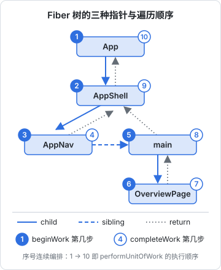
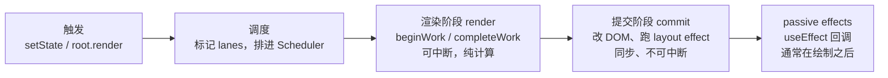

# 从 JSX 到 Fiber 树

天天写 React，很容易把它当成「状态一变、界面就跟着变」的黑盒。黑盒用久了，遇到问题只能靠试：为什么这个 effect 跑了两次？为什么改了 key 子组件的状态就没了？为什么列表一长输入框就卡？这本书把黑盒拆开，讲 React 19 在你写下 `setState` 之后到底做了什么，再落到 Actions、Compiler、状态管理和性能排查这些日常决策上。

本章先建立整本书的骨架：JSX 编译成什么、React 内部用什么数据结构表示组件树、一次更新分成哪几个阶段。

## 这本书讲什么、适合谁、怎么读

> [!WARNING]
> 本书的公开 API 按 React 19.2 整理，内部实现（Fiber 字段、lanes、hooks 链表）以 React 19 前后的源码为参照，截至 2026-11；React 19.3 与 19.2 在本书涉及内容上的差异未逐项核对。以 react.dev 官方文档和 React 仓库的 CHANGELOG / 发布说明为准。

**适合谁**：已经在用 React 写业务（函数组件、hooks、React Router、Vite 都熟），想知道「为什么」的人。不讲 JSX 语法入门，也不讲 class 组件。

**讲什么**：

| 章 | 内容 | 解决的问题 |
|---|---|---|
| 1–3 | Fiber、调和、hooks 链表 | 一次渲染内部发生了什么，hooks 规则从哪来 |
| 4–5 | 并发渲染、lanes、Suspense、`use` | 为什么有的更新能被打断，等待态怎么组织 |
| 6–7 | Actions、表单、React Compiler | React 19 的新写法，和它们背后的设计 |
| 8–9 | 状态管理选型、性能排查 | 落到项目里怎么选、怎么查 |

**怎么读**：前三章是后面所有章节的基础，建议按顺序读。第 6 章以后可以按需跳读。

**关于「实现细节」**：本书会讲到 Fiber 节点的字段、lanes 的位运算、hooks 的链表这些 React 源码里的东西。它们**不是公开 API**，每个大版本都可能调整，只用来帮你建立心智模型，不要在业务代码里依赖它们。

案例来自仓库所有者的「掌柜眼」网页端（hatch-counter 的 `apps/web`）：Vite 8 + React 19.2 + React Router 7 + Tailwind 4 的薄客户端，后面会反复引用它的 `useAsync`、推送订阅、懒加载页面等代码。仓库所有者的 hatch-shelf（Expo SDK 58）已经在 React 19.3，[《React Native 与 Expo》](../rn-expo/)按 19.3 写；本书示例按 19.2 写。19.3 是同一大版本内的小版本，书里用到的 API（hooks、Actions 与表单、Suspense 与 `use`、`useEffectEvent`、Compiler）在 19.3 上照常可用，就本书涉及的内容两者没有需要区别对待的地方。

## JSX 编译成什么

JSX 不是 React 运行时的一部分，它在构建阶段就被编译掉了。React 17 起使用「新 JSX 转换」，Vite 的 `@vitejs/plugin-react` 默认就是这种：

```tsx
// 你写的
function Badge({ count }: { count: number }) {
  return <span className="badge">{count}</span>;
}
```

```js
// 编译后（简化）
import { jsx as _jsx } from "react/jsx-runtime";

function Badge({ count }) {
  return _jsx("span", { className: "badge", children: count });
}
```

`jsx()` 返回的是一个普通对象，叫 **React 元素**（element）：

```js
{
  $$typeof: Symbol.for("react.transitional.element"), // React 19 的标记
  type: "span",          // 字符串是宿主组件，函数是你的组件
  key: null,
  props: { className: "badge", children: 3 },
}
```

几个要点：

- 元素是**不可变的描述**，「这一刻界面应该长这样」。每次渲染都会生成一棵新的元素树，生成它很便宜
- `$$typeof` 用 Symbol 是为了防 XSS：JSON 里没法伪造 Symbol，服务端返回的恶意 JSON 冒充不了元素
- React 19 里 `ref` 变成了普通 prop（函数组件可以直接从 props 里拿 `ref`，不再需要 `forwardRef`），`ref` 跟着放进了 `props`（读 `element.ref` 在开发模式下会得到弃用警告）

元素只是描述。真正「记住」组件状态、知道上次渲染了什么的，是下一层的 Fiber。

## Fiber：每个组件实例一个工作单元

React 内部为每个组件实例、每个 DOM 节点维护一个 **Fiber 节点**。元素每次渲染都重新生成，Fiber 则跨渲染持续存在，状态就挂在它上面。

一个 Fiber 节点（简化，字段名取自 React 源码，属于实现细节）：

| 字段 | 含义 |
|---|---|
| `tag` | 节点类型：函数组件、宿主组件（DOM 元素）、文本、Suspense、Context 等 |
| `type` / `key` | 来自元素，用来判断「是不是同一个东西」 |
| `stateNode` | 宿主组件对应的真实 DOM 节点 |
| `return` / `child` / `sibling` | 父、第一个子、下一个兄弟，三个指针串成整棵树 |
| `pendingProps` / `memoizedProps` | 这次要用的 props、上次渲染用的 props |
| `memoizedState` | 函数组件的 hooks 链表头（第 3 章） |
| `updateQueue` | 待处理的更新、effect 列表 |
| `lanes` / `childLanes` | 自己和子树里有哪些优先级的待处理更新（第 4 章） |
| `flags` / `subtreeFlags` | 提交阶段要做什么：插入、更新、删除、有 effect |
| `alternate` | 指向另一棵树上对应的节点（双缓冲，见下文） |

### 为什么是链表而不是递归

React 16 之前的调和器（Stack Reconciler）用递归遍历组件树。递归的问题是**停不下来**：调用栈一旦开始展开，就要一口气走完整棵树，树大时主线程被占几十上百毫秒，输入、动画全部卡住。

Fiber 把树改成 `child` / `sibling` / `return` 三个指针串起来的链表，遍历变成一个循环：

```js
// 渲染阶段的主循环（概念示意，非源码原文）
function workLoop(shouldYield) {
  while (workInProgress !== null && !shouldYield()) {
    workInProgress = performUnitOfWork(workInProgress);
  }
}

function performUnitOfWork(fiber) {
  const next = beginWork(fiber);     // 处理自己，返回第一个子节点
  if (next !== null) return next;    // 有子节点就往下走
  let node = fiber;
  while (node !== null) {
    completeWork(node);              // 没有子节点了，完成自己
    if (node.sibling) return node.sibling; // 有兄弟就去兄弟
    node = node.return;              // 否则回到父节点，继续完成
  }
  return null;
}
```

每处理完一个 Fiber，循环都可以检查一次「该不该让出主线程」。当前进度就保存在 `workInProgress` 这个变量里，下次接着从这里干。**可中断**是 Fiber 架构存在的根本理由，并发渲染（第 4 章）全靠它。

遍历顺序是深度优先。拿一棵五个节点的小树按上面的 `performUnitOfWork` 走一遍，下图标出了三种指针，以及每个节点在第几步执行 `beginWork`、第几步执行 `completeWork`：



注意 AppShell 只有一个 `child` 指针指向第一个子节点 AppNav，main 是顺着 AppNav 的 `sibling` 找到的。AppNav 没有子节点，所以第 3 步 begin 之后紧接着第 4 步就 complete 它，再去兄弟 main；OverviewPage complete 之后没有兄弟，循环沿 `return` 一路往上，依次完成 main、AppShell、App。

`beginWork` 在「往下走」时调用：调用函数组件拿到新元素，和旧 Fiber 比较，生成或复用子 Fiber。`completeWork` 在「往回走」时调用：宿主组件在这里创建 DOM 节点（还不挂到页面上）、收集要提交的副作用标记。

## 双缓冲：current 树和 workInProgress 树

React 同时维护两棵 Fiber 树：

- **current 树**：屏幕上正在显示的那一版
- **workInProgress 树**：正在构建的下一版

两棵树的对应节点通过 `alternate` 互相指着。渲染时 React 尽量复用 `current.alternate` 作为新的 workInProgress 节点，避免每次都分配新对象。提交完成后，根节点的 `current` 指针一换，workInProgress 树就变成了 current 树，旧的 current 树留着下次复用。

这和游戏渲染里的双缓冲是同一个思路：在后台缓冲区画完整的一帧，再一次性换上来，用户永远看不到「画了一半」的界面。它也是渲染可以被丢弃的前提：workInProgress 树画到一半发现有更紧急的更新，直接扔掉重来，current 树和屏幕都没被碰过。

## 一次更新的三个阶段



| 阶段 | 做什么 | 能否中断 | 你的代码在这里跑什么 |
|---|---|---|---|
| 渲染 | 调用组件函数，比较新旧，算出要改什么 | 并发模式下可以 | 组件函数体、`useMemo` 计算、`useState` 初始化函数 |
| 提交 | 把变更应用到 DOM | 不可以 | ref 赋值和清理、`useLayoutEffect`、`useInsertionEffect` |
| 被动 effect | 执行 `useEffect` | 不可以，但会推迟 | `useEffect` 回调和清理函数 |

**这张表是 React 一大半规则的来源**：

- 渲染阶段可能执行多次、可能被丢弃，所以组件函数必须是**纯的**：不能改外部变量、不能发请求、不能写 ref
- 副作用只能放进 effect 或事件处理函数，因为只有那里保证「这一版真的上屏了」
- `useLayoutEffect` 在 DOM 改完、浏览器绘制前同步执行，可以读布局、同步改样式而不闪烁，但它会阻塞绘制

### StrictMode 为什么让组件渲染两次

开发模式下 `<StrictMode>` 会把组件函数、`useState` 初始化函数、updater 函数各调用两次，并在挂载后额外执行一轮 effect 的「清理再建立」。目的就是把「渲染阶段不纯」的 bug 提前暴露：如果组件跑两次结果不一样，说明它依赖了渲染阶段的副作用。

掌柜眼的 `useViewState` 是一个值得看的边界例子：

```ts
const set = useCallback<Dispatch<SetStateAction<T>>>(
  (u) =>
    setValue((prev) => {
      const next = typeof u === "function" ? (u as (p: T) => T)(prev) : u;
      views.set(key, next); // updater 里写了模块级 Map
      return next;
    }),
  [key],
);
```

updater 里写外部 Map 严格说是副作用，StrictMode 下会执行两次。它之所以没出问题，是因为这个写入是**幂等**的：同一个 key 写两遍同一个值，结果一样。写渲染阶段代码时可以用这个标准自查：重复执行一次，世界有没有变化？

## 根节点与入口

React 19 的客户端入口只有 `createRoot`（`ReactDOM.render` 已在 19 中移除）：

```tsx
// main.tsx
import { StrictMode } from "react";
import { createRoot } from "react-dom/client";
import { App } from "./App";

createRoot(document.getElementById("root")!).render(
  <StrictMode>
    <App />
  </StrictMode>,
);
```

`createRoot` 创建一个 `FiberRoot`（整个应用的容器，记录 current 树、待处理 lanes 等）和一个 `HostRoot` 类型的根 Fiber。之后无论哪个组件调用 `setState`，React 都会从那个 Fiber 沿 `return` 指针一路往上，把更新的优先级标记到每个祖先的 `childLanes` 上，最后从根节点开始调度这次渲染。

从根开始不代表整棵树都要重新渲染。下一章会讲到，`childLanes` 标记让 React 能跳过没有更新的子树，这就是 bailout。

## 本章要点

- JSX 编译成 `jsx()` 调用，返回不可变的**元素**对象；元素描述「应该长什么样」，每次渲染重新生成
- **Fiber** 是跨渲染存在的工作单元，状态、hooks、待处理更新都挂在它上面；字段名属于实现细节
- Fiber 用 `child` / `sibling` / `return` 把树变成可循环遍历的链表，使渲染**可中断**
- **双缓冲**：current 树对应屏幕，workInProgress 树在后台构建，提交时整体切换，没画完的版本可以直接丢弃
- 一次更新分**渲染**（纯计算、可中断）、**提交**（改 DOM、同步）、**被动 effect** 三段；组件必须纯、副作用进 effect，都源于这个划分
- StrictMode 的双重调用是在检查渲染是否纯，判断标准是「重复执行一次有没有改变外部世界」
