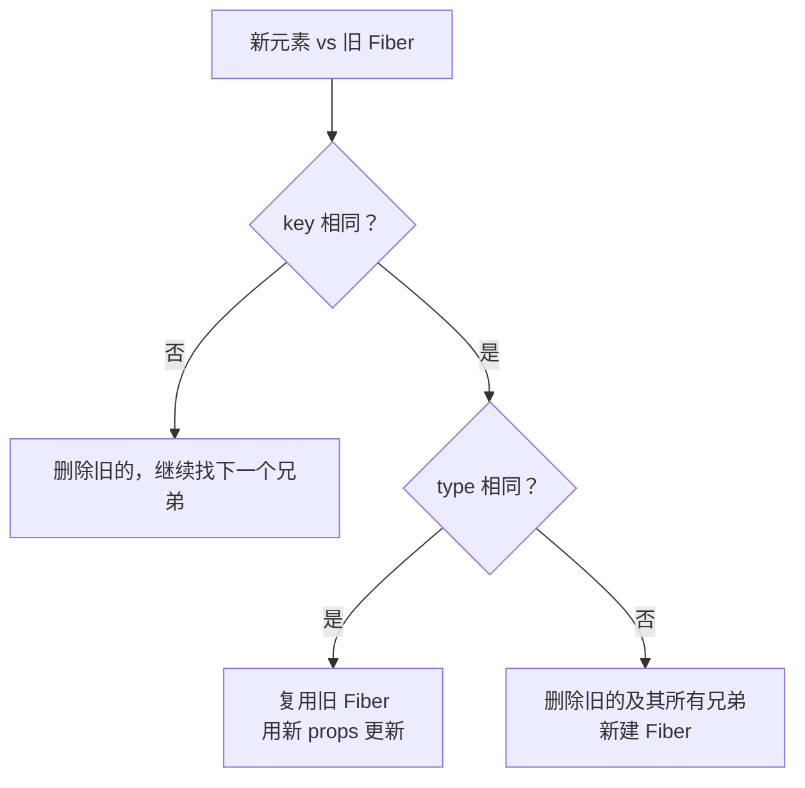
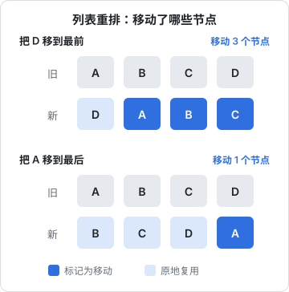

# 调和与 diff

上一章讲了 React 每次渲染都会生成一棵新的元素树。把新元素树和旧 Fiber 树对比、算出最少的 DOM 改动，这个过程叫**调和**（reconciliation），对比算法俗称 diff。本章讲 diff 依赖的两个假设、单节点和列表各怎么比、什么情况下 React 会整棵子树跳过（bailout），以及这些机制对日常写法的直接影响：key 怎么选、组件能不能定义在组件里、怎么「重置」一个组件。

## 为什么不做通用的树 diff

两棵任意树之间求最小编辑距离，已知较好的通用算法复杂度是 $O(n^3)$。一个中等页面几千个节点，$n^3$ 是百亿级运算，每次 setState 都跑一遍不可接受。

React 用两条启发式假设把复杂度降到 $O(n)$：

1. **类型不同，就是不同的东西**：`<div>` 变 `<span>`、`<ListA>` 变 `<ListB>`，直接销毁旧子树、新建一棵，不再往下比
2. **同一层的子节点用 key 标识身份**：开发者用 key 告诉 React「这个元素就是上次那个」，React 不尝试跨层级移动节点

这两条在真实界面里几乎总是成立：很少有人把一个组件从一个父节点挪到另一个父节点还指望保留状态。代价是：一旦违反，React 不会报错，只会**悄悄重建**，状态丢失、DOM 重挂、effect 重跑。

## 状态绑定在「树中的位置」上

理解 diff 最重要的一句话：**React 按「父节点 + 位置（或 key）+ 类型」来认组件实例，状态跟着这个身份走，不跟着 JSX 变量走**。

```tsx
function Editor({ isAdmin }: { isAdmin: boolean }) {
  return isAdmin ? <Form role="admin" /> : <Form role="staff" />;
}
```

两个分支渲染的是同一位置、同一类型的 `<Form>`，React 认为是同一个实例，切换 `isAdmin` 时 `Form` 内部的 state **保留**。反过来：

```tsx
function Editor({ isAdmin }: { isAdmin: boolean }) {
  return (
    <div>
      {isAdmin && <Banner />}
      <Form />
    </div>
  );
}
```

这里 `{isAdmin && <Banner />}` 在 `false` 时占位是 `false`，位置仍然存在，所以 `<Form>` 始终是第二个子节点，状态不会丢。条件渲染用 `&&` 和三元表达式不会挪动兄弟的位置，这是 React 刻意保证的。

### 不要在组件里定义组件

```tsx
function ItemList({ items }: { items: Item[] }) {
  // 错误：每次渲染 Row 都是一个新函数
  function Row({ item }: { item: Item }) {
    const [editing, setEditing] = useState(false);
    return <li onClick={() => setEditing(true)}>{item.name}</li>;
  }
  return <ul>{items.map((it) => <Row key={it.id} item={it} />)}</ul>;
}
```

每次 `ItemList` 渲染，`Row` 都是一个新的函数对象，`type` 不相等，按假设 1，React 认为这是「另一种组件」，于是每一行都销毁重建，`editing` 状态永远停在 `false`，输入框会丢焦点。

掌柜眼的 ESLint 配置把 `react-hooks/static-components` 留在 error 档，配置注释里写得很直白：「在组件里定义组件（子树每次重挂，state 全丢）」。这条规则来自 `eslint-plugin-react-hooks` v6 起带的 Compiler 系列规则，即使不上 React Compiler 也值得开。

## 单个子节点怎么比

当新的子元素只有一个时（`return <Foo />`），React 拿它和旧 Fiber 的子节点比：



没写 key 时 key 是 `null`，`null === null` 也算相同。复用 Fiber 意味着保留 `memoizedState`（hooks 状态）和 `stateNode`（DOM 节点），只是用新 props 再走一遍。

## 列表怎么比

列表是 diff 的难点：元素可能新增、删除、换顺序。React 的多子节点算法分两轮（以下是对源码 `reconcileChildrenArray` 逻辑的概括，属于实现细节）：

**第一轮：按位置顺序比**。新旧列表从头开始一一对比，key 相同就复用，继续下一个；一旦遇到 key 不同就停下。这一轮覆盖了最常见的情况：只改了内容、只在末尾追加或删除。

**第二轮：用 Map 找**。把旧列表剩下的节点放进 `Map<key, Fiber>`，遍历新列表剩下的元素，按 key 去 Map 里找：找到就复用，找不到就新建；遍历完 Map 里还剩的就是要删除的。

**判断谁要移动**：React 维护一个 `lastPlacedIndex`，表示「已经确定不用动的节点里，在旧列表中最靠后的位置」。对每个复用的节点：

- 旧位置 `oldIndex >= lastPlacedIndex`：不用动，更新 `lastPlacedIndex = oldIndex`
- 旧位置 `oldIndex < lastPlacedIndex`：说明它在旧列表里排在某个「不动的节点」前面，现在要排到后面，标记为**移动**

这个策略只往右移，不往左移。后果是：把最后一项移到最前面，比把第一项移到最后，要多移很多节点。



对 4 个节点来说差别无所谓，但一个几百行、每行都是复杂组件的表格，频繁「把新项插到最前面」就会触发大量 DOM 移动。如果业务上新数据总是出现在顶部，一般也不是问题：插入新节点（Placement）本身不触发其他节点移动，只有「已有节点相对顺序改变」才会。

### key 的三条规则

| 写法 | 问题 |
|---|---|
| `key={index}` | 列表头部插入或删除时，所有后续项的 key 都错位，状态和 DOM 张冠李戴（输入框内容跑到别的行） |
| `key={Math.random()}` | 每次渲染 key 都变，所有行每次都销毁重建 |
| `key={item.id}` | 正确：稳定、唯一、来自数据本身 |

`index` 作为 key 只在一种情况下安全：列表永远不会重排、不会在中间增删，且行内没有状态（没有输入框、没有展开态）。

## bailout：整棵子树跳过

调和最大的性能来源不是 diff 算得快，而是**根本不算**。在 `beginWork` 里，React 会检查一个 Fiber 能否跳过：

1. 新旧 `props` 是**同一个对象引用**（不是浅比较，是 `===`）
2. 没有用到的 context 发生变化
3. 这个 Fiber 自己没有待处理的更新（`lanes` 里没有本次渲染的优先级）

三条都满足，就不调用组件函数。再看 `childLanes`：如果子树里也没有待处理更新，整棵子树直接跳过；如果有，就复用当前 Fiber，只往下处理有更新的那条路径。

关键在第 1 条：父组件一渲染，它 return 的 JSX 就是新生成的元素，`props` 是新对象，所以**父组件渲染，子组件默认跟着渲染**。下面这种写法例外：

```tsx
function Layout({ children }: { children: React.ReactNode }) {
  const [collapsed, setCollapsed] = useState(false);
  return (
    <div className={collapsed ? "w-16" : "w-60"}>
      <button onClick={() => setCollapsed((c) => !c)}>切换</button>
      {children}
    </div>
  );
}
```

`Layout` 自己 setState 时，`children` 是它的父组件创建的元素，引用没变，所以 `children` 那棵子树会 bailout。这就是常说的「把状态往下放、把内容往上提」：状态放在小组件里，昂贵的部分通过 `children` 传进来。

### memo：把引用相等放宽为浅比较

`memo(Component)` 把条件 1 从「props 引用相同」放宽为「props 每个字段 `Object.is` 相同」。它只有在**props 真的稳定**时才有效：

```tsx
const Row = memo(function Row({ item, onEdit }: RowProps) { /* ... */ });

// 父组件里
<Row item={item} onEdit={() => edit(item.id)} />  // 每次新函数，memo 白做
```

所以要配合 `useCallback` / `useMemo` 稳定 props。掌柜眼的网页端里 `useMemo` 出现两百多次、`useCallback` 八十多次，大部分都在做这件事。手动维护这些引用稳定性既繁琐又容易漏，React Compiler（第 7 章）就是为了自动做这件事。

### 数据层的引用稳定

还有一种更上游的做法：让**数据本身**在没变时保持引用不变。掌柜眼 `useAsync` 里的 `replaceEqualDeep` 就是这么做的：

```ts
// 取回来的跟摆着的一样，就还用摆着的那一份（连同里面没变的每一行）
setDataState((prev) => replaceEqualDeep(prev, res));
```

推送一来，页面会在后台重取数据。新 JSON 解析出来的对象全是新引用，如果直接 setState，所有 `memo` 的行组件都会重新渲染。`replaceEqualDeep` 递归比较新旧数据，没变的子树沿用旧对象：整份没变就返回 `prev` 本身（新旧 state `Object.is` 相同时，React 通常会跳过这次更新），只变了一行就只有那一行是新对象。TanStack Query 的「structural sharing」是同一个思路。

## 用 key 重置组件

既然状态跟着身份走，那么**改变 key 就是换一个身份**，React 会销毁旧实例、创建新实例，状态全部回到初始值。这是官方推荐的「重置组件状态」方式：

```tsx
<ProfileForm key={userId} userId={userId} />
```

切换用户时整个表单重来，不用在 effect 里手动清空每个字段。

掌柜眼外壳里的错误边界用的是同一思路的变体：

```tsx
<ErrorBoundary resetKey={pathname}>
  <Suspense fallback={null}>
    <Outlet />
  </Suspense>
</ErrorBoundary>
```

一页出错只塌这一页，换一个路由（`pathname` 变了）错误边界就复位。

### 「渲染期调整 state」：key 的轻量替代

有时你只想在某个 prop 变化时调整部分状态，而不是整个重来。`useAsync` 里有这样一段：

```ts
const [shownKey, setShownKey] = useState(memoKey);
if (shownKey !== memoKey) {
  setShownKey(memoKey);
  if (memoKey && memory.has(memoKey)) {
    setDataState(recall<T>(memoKey));
    setLoading(false);
    setError(null);
  }
}
```

这是 React 文档里「在渲染期间根据 props 调整 state」的标准写法：在渲染时发现 key 变了，立刻 setState。React 会**丢弃这次渲染的输出，马上用新 state 重新执行这个组件**，不会先把旧数据画到屏幕上再在 effect 里改（那样会闪一帧）。它比 effect 方案少一次提交，比 key 重置保留了更多状态。注意条件判断必不可少，否则就是无限循环。

## 本章要点

- 通用树 diff 是 $O(n^3)$，React 用「类型不同就重建」「同层用 key 认身份」两条假设降到 $O(n)$
- **状态绑定在树中的位置（或 key）+ 类型上**；组件定义在组件里会导致每次重建、状态全丢
- 列表 diff 先按位置比，再用 key 的 Map 找；`lastPlacedIndex` 策略只往右移，把末尾项挪到最前代价最大（算法细节属于实现，可能调整）
- key 要稳定、唯一、来自数据；`index` 只在列表不重排、行内无状态时安全
- **bailout** 的前提是 props 引用相同、context 没变、自身无更新；父组件渲染时子组件默认跟着渲染
- 提升性能的三层手段：`children` 传入内容、`memo` + 稳定引用、数据层结构共享（如 `replaceEqualDeep`）
- 改 key 是重置组件的正规方式；只需调整部分状态时可以在渲染期 setState（要有条件守卫）
