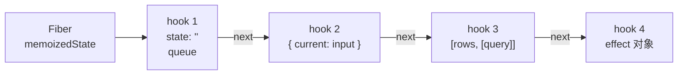

# Hooks 的链表实现

函数组件每次渲染都是一次普通的函数调用，局部变量用完即弃。那 `useState` 返回的值存在哪？为什么 hooks 不能写在 `if` 里，`use` 却可以？为什么 effect 里读到的总是「旧值」？本章打开 hooks 的实现：它们是挂在 Fiber 上的一条链表，按调用顺序一一对应。理解了这条链表，hooks 的所有规则都能自己推出来。

> 本章涉及的数据结构（hook 对象字段、dispatcher、更新队列）都是 React 内部实现，名称和细节以 React 19 前后的源码为参照，会随版本变化。规则本身（调用顺序、依赖比较、快照语义）是稳定的公开行为。

## 状态存在 Fiber 上

上一章说过 Fiber 跨渲染存在。函数组件的 Fiber 有个 `memoizedState` 字段，指向一条**单向链表**，链表里每个节点对应组件里一次 hook 调用：

```tsx
function StockCount() {
  const [query, setQuery] = useState("");         // hook 1
  const inputRef = useRef<HTMLInputElement>(null); // hook 2
  const rows = useMemo(() => filter(query), [query]); // hook 3
  useEffect(() => { inputRef.current?.focus(); }, []); // hook 4
  // ...
}
```



每个 hook 节点大致长这样：

```ts
// 概念示意
interface Hook {
  memoizedState: unknown; // 这个 hook 存的东西，不同 hook 含义不同
  baseState: unknown;     // 跳过低优先级更新时用的基准状态
  baseQueue: Update | null;
  queue: UpdateQueue | null; // useState / useReducer 的待处理更新
  next: Hook | null;
}
```

不同 hook 在 `memoizedState` 里存的东西：

| Hook | `memoizedState` 里存什么 |
|---|---|
| `useState` / `useReducer` | 当前 state 值 |
| `useRef` | `{ current }` 对象本身，永远是同一个 |
| `useMemo` | `[计算结果, deps]` |
| `useCallback` | `[函数, deps]` |
| `useEffect` / `useLayoutEffect` | effect 对象（同时也挂进 Fiber 的 effect 列表） |
| `useContext` | 不占位，见后文 |

`useRef` 就是一个不触发渲染的盒子，`useCallback(fn, deps)` 等价于 `useMemo(() => fn, deps)`，从存储结构上一目了然。

## 为什么必须按顺序调用

React 渲染组件时，有一个全局指针指向「当前该处理第几个 hook」。每调用一次 hook，指针沿 `next` 前进一格。**hook 没有名字，React 只靠调用顺序把这次的调用和上次的链表节点对上**。

```tsx
function Bad({ show }: { show: boolean }) {
  if (show) {
    const [a, setA] = useState(0); // 有时是第 1 个，有时不存在
  }
  const [b, setB] = useState("");  // 有时是第 1 个，有时是第 2 个
}
```

`show` 从 `true` 变 `false` 时，`b` 的 `useState` 会拿到上次 `a` 的节点，读出数字 `0` 当字符串用。React 在开发模式下会检测 hook 数量和类型的变化并报错，但根本原因就是这条链表没有键。

这也解释了为什么 hooks 只能在组件和自定义 hook 的顶层调用：自定义 hook 只是一个普通函数，它内部的 hook 调用直接接在调用者的链表上，没有独立的存储。

### mount 和 update 是两套实现

React 内部有一个「当前 dispatcher」，`useState` 实际调用的是 `dispatcher.useState`。首次渲染时它指向 mount 版本：创建 hook 节点、追加到链表尾部。之后的渲染指向 update 版本：沿着旧链表复制出新节点，读取并处理更新。在组件函数之外调用 hook 时，dispatcher 是一个只会抛错的版本，这就是 "Invalid hook call" 的来源。

### 为什么 `use` 和 `useContext` 可以不按顺序

`useContext` 读的不是 hook 链表，而是沿着 Fiber 树往上找最近的 Provider 取值，同时把这个 context 记进 Fiber 的依赖列表（context 变化时用它找到要更新的组件）。它不占用链表槽位，所以从实现上讲即使条件调用也不会错位。

React 19 的 `use(context)` 正是利用了这一点，官方明确允许在 `if` 和循环里调用。`use(promise)` 也不在 hook 链表里，它的状态记在单独的结构中（第 5 章）。`useContext` 仍然按 hooks 规则对待，lint 也会这么检查；需要条件读取 context 时用 `use`。

## useState 的更新队列

`setState` 不会立刻改值。它创建一个更新对象，挂进这个 hook 的 `queue`：

```ts
// 概念示意
interface Update<S> {
  lane: Lane;                       // 这次更新的优先级（第 4 章）
  action: S | ((prev: S) => S);     // 你传给 setState 的东西
  next: Update<S>;                  // 环形链表
}
```

然后从这个 Fiber 往上标记 lanes，请调度器安排一次渲染。真正计算新 state 是在下一次渲染执行到这个 `useState` 时：取出队列里所有更新，从旧 state 开始依次应用。

```tsx
function Counter() {
  const [n, setN] = useState(0);
  const onClick = () => {
    setN(n + 1);          // action = 1
    setN(n + 1);          // action = 1（n 还是 0）
    setN((p) => p + 1);   // action = p => p + 1
  };
  // 点一次后 n 是 2：0 → 1 → 1 → 2
}
```

`useState` 其实就是 `useReducer` 的特例，reducer 是「是函数就调用，否则直接替换」。

### 快照语义

组件函数里的 `n` 是这次渲染时从 hook 节点读出来的值，被事件处理函数的闭包捕获。setState 之后，这个闭包里的 `n` 永远不会变，新值只会出现在**下一次渲染**创建的新闭包里。所以说每次渲染的 props 和 state 都是一张快照。

### 自动批处理

React 18 起，所有更新默认批处理：同一个事件循环任务里的多次 setState（包括 `setTimeout`、Promise 回调、原生事件里的）只触发一次渲染。实现上就是多次 setState 都只往队列里加更新，调度只安排一次。

### eager state：有时连渲染都省了

如果这个 Fiber 当前没有任何待处理更新，`setState` 会**立即**用当前的 reducer 算出新值，和旧值 `Object.is` 比较。相同就直接返回，不安排渲染。这是一个优化，不是保证：有待处理更新时 React 仍会进入渲染，在渲染中发现 state 没变再 bailout。所以不要依赖「setState 相同值一定不渲染」。

### 跳过的更新与 baseState

并发渲染下，一个队列里可能同时有高优先级和低优先级的更新。高优先级渲染时，低优先级的更新会被**跳过但保留**：React 把第一个被跳过的更新之前的结果记为 `baseState`，把它及之后的更新都留在 `baseQueue`。等轮到低优先级渲染时，从 `baseState` 开始按原顺序全部重放一遍。这样保证了最终结果和「按顺序同步执行所有更新」一致，只是中间状态可以先看到高优先级的部分。

## effect 的存储与依赖比较

`useEffect` 创建的 effect 对象除了存在 hook 节点上，还会串进 Fiber 的 `updateQueue` 里一条**环形链表**，提交阶段遍历这条链表执行：

```ts
// 概念示意
interface Effect {
  tag: number;             // 是 layout 还是 passive，这次是否需要执行（HasEffect）
  create: () => (() => void) | void;
  inst: { destroy?: () => void }; // 上次 create 返回的清理函数
  deps: unknown[] | null;
  next: Effect;
}
```

每次渲染执行到 `useEffect` 时，React 把新 deps 和上次的 deps **逐项 `Object.is` 比较**：

- 全部相同：创建 effect 对象但不打 `HasEffect` 标记，提交时跳过
- 有任何一项不同（或没传 deps）：打上标记，提交后先执行上次的 `destroy`，再执行新的 `create`

`useLayoutEffect` 和 `useEffect` 用同一套结构，只是 tag 不同：layout effect 在提交阶段改完 DOM 后同步执行，passive effect 安排在之后（通常在浏览器绘制之后）执行。

### 闭包陷阱就是快照语义

```tsx
useEffect(() => {
  const id = setInterval(() => {
    console.log(count); // 永远打印挂载时的 count
  }, 1000);
  return () => clearInterval(id);
}, []); // deps 是空的，effect 只建立一次
```

effect 的 `create` 函数是挂载那次渲染创建的闭包，捕获的是那一刻的 `count`。这不是 bug，是快照语义的直接后果。解决办法有三种：把 `count` 写进 deps（每次变都重建定时器）、用函数式 updater 不读外部值、或者把「要读最新值」的逻辑抽出来。

## 读最新值：从 useLatest 到 useEffectEvent

第三种办法以前的通用写法是「latest ref」。掌柜眼里有一个：

```ts
export function useLatest<T>(value: T): RefObject<T> {
  const ref = useRef(value);
  // eslint-disable-next-line react-hooks/refs -- 见上：这就是这个 hook 存在的理由
  ref.current = value;
  return ref;
}
```

它的注释说明了为什么需要它：滚轮、快捷键、focus 这类 window 监听只想挂一次，回调里又要读最新的值；把值写进 deps 会导致每次变化都摘掉再挂，中间那一帧没人听。

问题在于 `ref.current = value` 发生在**渲染阶段**。渲染可能被执行多次、被丢弃（并发渲染下尤其如此），一个被丢弃的渲染也会把 ref 改掉。在这个特定用法里，同一次渲染写同一个值、写两遍也无害，所以掌柜眼把它限定为全仓唯一一处、并关掉对应 lint。但一般情况下，渲染期写 ref 是 React Compiler 明确禁止的（第 7 章）。

React 19.2 把这个模式做成了正式 API：`useEffectEvent`。

```tsx
import { useEffect, useEffectEvent } from "react";

function useLiveChanged(fn: () => void) {
  const onChange = useEffectEvent(fn); // 总是调用到最新的 fn
  useEffect(() => onLiveChanged(() => onChange()), []); // 不需要也不能写进 deps
}
```

对比掌柜眼当前的 `useLiveChanged`：

```ts
export function useLiveChanged(fn: () => void): void {
  const latest = useLatest(fn);
  useEffect(() => onLiveChanged(() => latest.current()), [latest]);
}
```

两者行为相同，区别是 `useEffectEvent` 由 React 在提交阶段更新引用，不碰渲染阶段的纯度；lint 也认识它（需要较新的 `eslint-plugin-react-hooks`，19.2 发布说明要求升级到 `@latest`）。约束是：Effect Event 只能在 effect 内部调用，不能传给子组件，也不能写进 deps 数组。

### 渲染期读 ref 的另一个例子

```ts
export function useFrozenWhenClosed<T>(open: boolean, value: T): T {
  const last = useRef(value);
  if (open) last.current = value;
  return open ? value : last.current;
}
```

它解决的是 Radix 弹窗关闭动画期间内容塌掉的问题：父组件关弹窗时顺手把选中项置空，弹窗还在淡出，内容却已经没了。这个 hook 在渲染期又读又写 ref。它在实践中工作正常，但严格说渲染结果依赖了「上一次被提交的那次渲染」，在并发渲染丢弃中间结果的场景下，`last.current` 可能是一个从未上屏的值。用 state 实现（打开时 setState 记住最后一份）在语义上更干净，代价是多一次渲染。这类取舍在第 7 章讨论 Compiler 迁移时还会遇到。

## 稳定实例：useState 初始化函数

```ts
export function useSubmission(): Submission {
  const [submission] = useState(() => new Submission());
  return submission;
}
```

这是「每个组件实例一份、跨渲染不变的对象」的惯用写法。初始化函数只在 mount 时执行（StrictMode 下开发环境会执行两次，丢弃一份），之后直接从 hook 节点读。它比 `useRef(new Submission())` 好在不会每次渲染都 `new` 一个再丢掉，比 `useMemo` 好在 React 保证不会丢弃它（`useMemo` 的缓存在官方文档里被定义为性能优化，React 保留丢弃它的权利）。

## 本章要点

- 函数组件的 hooks 状态存在 Fiber 的 `memoizedState` 上，是一条**按调用顺序排列的链表**（实现细节，结构会变）
- hook 没有名字，只靠顺序对应，这是「不能条件调用 hooks」的根本原因；`useContext` 和 `use` 不占链表槽位，`use` 因此被允许条件调用
- `setState` 只是往环形队列里追加带优先级的更新，下次渲染时才计算；state 是每次渲染的**快照**
- 自动批处理合并同一任务里的多次更新；eager state 优化有时能直接跳过渲染，但不是保证
- effect 的 deps 逐项 `Object.is` 比较；闭包读到旧值是快照语义的直接结果
- 读最新值的老写法是渲染期写 ref（如 `useLatest`），React 19.2 起用 `useEffectEvent` 代替
- 需要每个实例一份的稳定对象，用 `useState(() => new X())`，不要依赖 `useMemo` 的缓存
