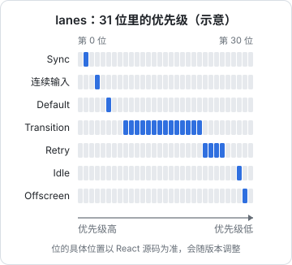
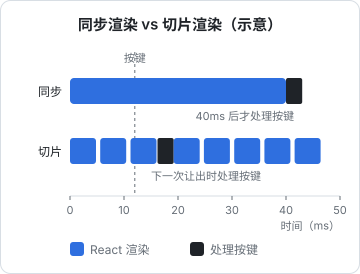
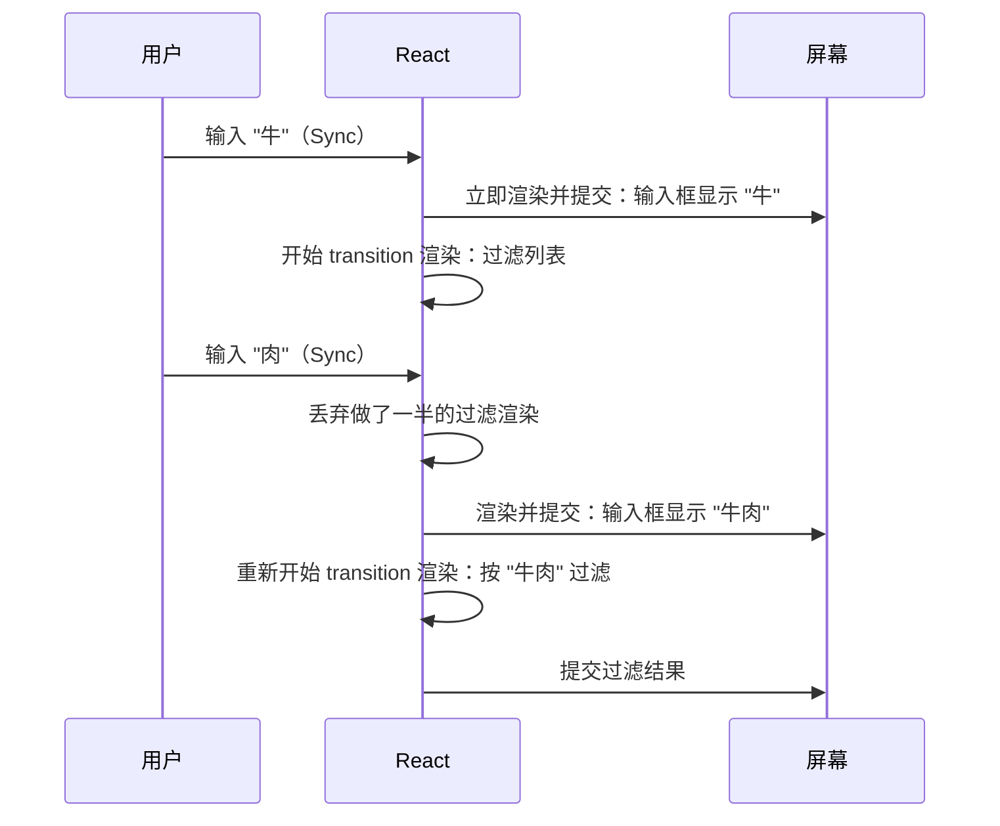

# 并发渲染与优先级

前三章的渲染都是「开始了就一口气做完」。这在大多数时候够用，但碰上大列表过滤、复杂图表切换时，一次渲染占住主线程几十毫秒，用户敲的字要等它算完才出现在输入框里。React 18 引入、19 继续完善的**并发渲染**解决的就是这个问题：渲染可以被打断、可以分优先级、可以在后台准备好再一次性换上。本章讲它的三块核心机制：用位掩码表示优先级的 **lanes**、负责切片和让出主线程的 **Scheduler**、以及在应用层使用它们的 `useTransition` / `useDeferredValue`，最后讲并发带来的副作用「撕裂」和 `useSyncExternalStore`。

> [!WARNING]
> lanes 的具体位布局、Scheduler 的切片时长、各种事件对应哪个 lane，都属于实现细节，本章数字以 React 19 前后源码为参照，会随版本调整，以 React 仓库对应版本的源码为准。公开 API（transition、deferred value、`useSyncExternalStore`）的行为是稳定的，以 react.dev 为准。

## 并发不是多线程

「并发渲染」里的并发指的是**可以同时存在多个进行中的渲染任务，并在它们之间切换**，而不是并行。JavaScript 仍然是单线程，React 的做法是：

1. 渲染被切成一个个 Fiber 单元（第 1 章的 `workLoop`），每做完一个单元检查一下时间
2. 时间片用完就让出主线程，浏览器趁机处理输入、绘制
3. 回来时如果出现了更紧急的更新，就丢掉做了一半的低优先级渲染，先做紧急的

整个过程能成立，靠的是第 1 章的两个设计：渲染阶段是纯计算、workInProgress 树可以随时丢弃。

## lanes：用位掩码表示优先级

每个更新都带一个 **lane**（车道）。lane 是 31 位整数里的某一位，越靠低位优先级越高。



几组常见的 lane 和触发它们的来源：

| lane 组 | 典型来源 | 渲染时能否被切片 |
|---|---|---|
| Sync | 点击、按键、输入等离散事件里的 setState | 否 |
| InputContinuous | 滚动、鼠标移动、拖拽等连续事件里的 setState | 否 |
| Default | 不在 React 事件里的更新：`setTimeout`、fetch 回调、`root.render` | 否 |
| Transition | `startTransition` / `useTransition` 包裹的更新 | 是 |
| Retry | Suspense 边界数据就绪后的重试 | 是 |
| Idle / Offscreen | 空闲任务、`<Activity mode="hidden">` 里的内容 | 是 |

注意第三列：**只有 transition 及更低优先级的渲染才会切片让出主线程**。Sync、连续输入、Default 这类「阻塞型」lane 的渲染依然一口气做完，因为它们代表用户正在等的反馈。所以光升级到 React 18/19 不会让任何东西自动变快，必须显式把不紧急的更新标成 transition。

### 为什么用位掩码

React 16 时代用过「过期时间」（expirationTime）表示优先级，一个数字只能表达「先后」。lanes 改成位掩码，是因为调度需要表达**集合**：

```js
// 概念示意：常见的 lanes 运算
const merged = laneA | laneB;              // 合并：两个更新一起处理
const included = (set & lane) !== 0;       // 判断：这批里有没有某个 lane
const remaining = set & ~finishedLanes;    // 去除：渲染完的从待处理里删掉
const highest = set & -set;                // 取最低位：找出最紧急的那个 lane
```

用集合可以自然地表达「这次渲染处理 Sync 和 Default 两种更新」「这几个 transition 要一起提交（entangle）」「Fiber 子树里有哪些优先级的待处理工作」（第 1 章的 `childLanes`），全是一两条位运算。

### lanes 在树上的传播

`setState` 时：

1. 根据当前上下文决定 lane：在 `startTransition` 回调里就取一个 transition lane，在点击事件里就是 Sync，等等
2. 把 lane 记到更新对象上（第 3 章的 `Update.lane`），合并进这个 Fiber 的 `lanes`
3. 沿 `return` 往上，把 lane 合并进每个祖先的 `childLanes`
4. 合并进根节点的 `pendingLanes`，请 Scheduler 安排一个任务

渲染开始时，React 从 `pendingLanes` 里挑出这次要处理的 lanes（通常是最高优先级那一组）。遍历时，一个 Fiber 自己的 `lanes` 与本次 lanes 没有交集、`childLanes` 也没有交集，就整棵 bailout；有交集才往下走。处理 `useState` 队列时，lane 不在本次范围内的更新被跳过（第 3 章的 baseState 机制）。

### 饥饿与过期

如果高优先级更新源源不断，低优先级的 transition 岂不是永远轮不到？React 给每个待处理 lane 记一个过期时间，超过之后这个 lane 被标为「已过期」，下次渲染当作同步任务处理，不再切片、不再被打断。具体时长是实现细节，你只需要知道 transition 不会无限期饿死。

## Scheduler：切片与让出

React 的任务调度由独立的 `scheduler` 包负责，它维护一个按优先级和过期时间排序的最小堆，用 `MessageChannel` 发宏任务来执行（比 `setTimeout(0)` 延迟低，又不像微任务那样阻塞绘制）。

可切片的渲染跑的是这个循环：

```js
// 概念示意
function workLoopConcurrent() {
  while (workInProgress !== null && !shouldYield()) {
    performUnitOfWork(workInProgress);
  }
}
// shouldYield：本次任务开始后是否已经超过一个时间片（默认约 5ms）
```

时间片用完时 `workLoopConcurrent` 退出，Scheduler 安排下一个宏任务继续。两次任务之间，浏览器可以处理排队的输入事件、跑 `requestAnimationFrame`、绘制一帧。



图中的数字是示意：真实的切片时长会随实现调整，每个 Fiber 单元的耗时也不均匀（一个慢组件本身就超过 5ms 时，切片也帮不了它，因为检查只发生在单元之间）。

### 打断与重来

切片期间如果来了一个 Sync 更新（比如用户在输入框里又敲了一个字），下一次回到调度时 React 发现有更高优先级的 lane：



被打断的 transition 渲染**不会续做，而是从头重来**（以最新的 state）。这意味着中间那次「按『牛』过滤」的结果从来没有上屏过，对用户来说这恰好是想要的。

## useTransition 与 startTransition

```tsx
import { useState, useTransition } from "react";

function DishFilter({ dishes }: { dishes: Dish[] }) {
  const [category, setCategory] = useState("全部");
  const [isPending, startTransition] = useTransition();

  return (
    <>
      <CategoryTabs
        value={category}
        onChange={(c) => startTransition(() => setCategory(c))}
      />
      <div className={isPending ? "opacity-60" : ""}>
        <DishTable dishes={dishes} category={category} />
      </div>
    </>
  );
}
```

`startTransition` 里的 setState 拿到 transition lane。React 会先用原来的 state 再渲染一次（把 `isPending` 变成 `true`，这是个 Sync 更新），然后在后台渲染新分类。新分类没渲染完之前，**屏幕上一直是旧内容**，不会出现半成品。

不需要 `isPending` 时，可以直接从 `react` 导入 `startTransition`，它在组件外也能用。

### 不能用于受控输入

```tsx
// 错误：输入框会卡顿、丢字
<input value={text} onChange={(e) => startTransition(() => setText(e.target.value))} />
```

受控输入框的 value 必须同步更新，否则浏览器里的 DOM 值和 React 的 state 对不上。正确做法是输入框用普通 state，把**依赖它的昂贵渲染**推迟，这就是 `useDeferredValue` 的用处。

### 路由导航也是 transition

React Router 7 默认把导航包在 `startTransition` 里。掌柜眼外壳的注释记录了这件事带来的好处：页面都是 `lazy()` 按需加载的，切到「经营分析」这种大包时需要一点时间，但因为导航是 transition，**旧页面会一直留在屏幕上**直到新页面准备好，而不是先闪一下 Suspense 的 fallback。这部分在第 5 章展开。

## useDeferredValue

```tsx
import { useDeferredValue, useMemo, useState } from "react";

function CommandPalette({ entries }: { entries: Entry[] }) {
  const [query, setQuery] = useState("");
  const deferredQuery = useDeferredValue(query);
  const results = useMemo(() => search(entries, deferredQuery), [entries, deferredQuery]);
  const stale = query !== deferredQuery;

  return (
    <>
      <input value={query} onChange={(e) => setQuery(e.target.value)} />
      <ResultList items={results} dimmed={stale} />
    </>
  );
}
```

`useDeferredValue(query)` 在紧急渲染中返回**旧值**，同时安排一次低优先级渲染，在那次渲染里返回新值。效果是：输入框随键入立即更新，结果列表稍后跟上；连续敲字时，中间的低优先级渲染不断被打断重来，只有最后一次真正完成。

掌柜眼的命令面板用拼音首字母匹配菜品、食材、页面（`lib/pinyin-match.ts`），条目多起来后每次按键全量匹配加渲染会有可感知的延迟，正是这个模式的典型场景。要点是**被推迟的部分必须能 bailout**：上面的 `ResultList` 如果不是 `memo` 组件（或 `results` 每次都是新数组），紧急渲染时它也会跟着重新渲染，推迟就没有意义了。

React 19 给 `useDeferredValue` 加了第二个参数 `initialValue`：首次渲染时先返回它，再在后台渲染真实值。适合首屏先出一个轻量版本。

### 和防抖的区别

| | 防抖 / 节流 | `useDeferredValue` |
|---|---|---|
| 延迟多久 | 固定毫秒数 | 不固定，设备快就几乎没有延迟 |
| 渲染期间能否响应输入 | 不能，渲染一开始就是阻塞的 | 能，低优先级渲染可被打断 |
| 适合 | 减少**网络请求**次数 | 减少**渲染**造成的卡顿 |

两者可以同时用：输入框的值 deferred 给本地过滤，同一个值防抖后再去请求服务端。

## 撕裂与 useSyncExternalStore

并发渲染带来一个新问题。如果组件在渲染时直接读一个 React 之外的可变数据源（模块级变量、全局 store），而渲染被切片了：前半棵树读到的是旧值，让出期间数据源变了，后半棵树读到新值。同一次提交里，界面的两部分显示了不一致的数据，这叫**撕裂**（tearing）。

`useSyncExternalStore` 是 React 为外部数据源提供的官方接口：

```ts
const value = useSyncExternalStore(subscribe, getSnapshot);
```

它的保证是：渲染过程中 React 会检查快照有没有变，如果变了，放弃并发渲染，**用同步方式重新渲染**，确保整棵树读到同一个快照。代价是这类更新失去了 transition 的可打断性。

掌柜眼推送连接的状态就是这么接入的：

```ts
let snapshot: Snapshot = { state: "off", since: Date.now() };

function setState(state: LiveState): void {
  if (state === snapshot.state) return;
  snapshot = { state, since: Date.now() }; // 变了才换新对象
  for (const fn of stateListeners) fn();
}

export function useLiveState(): Snapshot {
  return useSyncExternalStore(
    (fn) => {
      wire();
      stateListeners.add(fn);
      return () => stateListeners.delete(fn);
    },
    () => snapshot,
  );
}
```

两个必须遵守的规则，这段代码都做到了：

- **`getSnapshot` 在数据没变时必须返回同一个引用**。React 用 `Object.is` 比较快照，如果每次都返回新对象（比如 `() => ({ state, since })`），React 会认为一直在变，导致无限重新渲染并报错
- **快照必须不可变**：变化时整体换一个新对象，而不是改旧对象的字段

`subscribe` 函数最好是稳定引用，否则每次渲染都会退订再重新订阅。上面的写法每次渲染都传入新的箭头函数，会导致重复订阅；把它提到组件外的模块级常量更好。第 8 章会看到，Zustand 这类状态库的 React 绑定就是建立在 `useSyncExternalStore` 之上的。

## 本章要点

- 并发渲染是**可打断、分优先级**的渲染，不是多线程；依赖 Fiber 的可中断遍历和可丢弃的 workInProgress 树
- **lanes** 用 31 位位掩码表示优先级，便于合并、判断、批量处理；具体位布局是实现细节
- 只有 transition、Retry、Idle 等低优先级渲染会切片让出主线程；Sync、连续输入、Default 依然阻塞执行
- Scheduler 用 `MessageChannel` 调度，按时间片（约 5ms，实现细节）检查是否让出；被打断的低优先级渲染**从头重来**
- `useTransition` / `startTransition` 标记不紧急的 state 更新，期间旧界面保持；不能用于受控输入
- `useDeferredValue` 推迟昂贵的派生渲染，配合 `memo` 才有效；它和防抖解决的是不同问题
- 外部可变数据源要用 `useSyncExternalStore` 接入以避免撕裂；`getSnapshot` 必须在不变时返回同一引用

## 动手练习

以下练习去掉 `<StrictMode>` 观察更清楚（否则每次渲染的日志会出现两遍）。

1. **transition 先渲染一次旧值**：

   ```tsx
   export default function App() {
     const [category, setCategory] = useState("全部");
     const [isPending, startTransition] = useTransition();
     console.log("render", isPending, category);
     return <button onClick={() => startTransition(() => setCategory("热菜"))}>热菜</button>;
   }
   ```

   点一次按钮，预测点击后打印的两行。

   验证：依次是 `render true 全部` 和 `render false 热菜`。

   参考答案：React 先用 Sync 优先级渲染一次，只把 `isPending` 变成 `true`，分类仍是旧值；新分类在 transition lane 上另外渲染，完成后两者一起变成最终状态。这就是「旧界面保持、加一个 pending 提示」的来源。

2. **deferred 值慢一拍**：

   ```tsx
   export default function App() {
     const [q, setQ] = useState("");
     const deferred = useDeferredValue(q);
     console.log(`render q="${q}" deferred="${deferred}"`);
     return <input value={q} onChange={(e) => setQ(e.target.value)} />;
   }
   ```

   在输入框里一次粘贴进 `niu`，预测日志。再做一个慢组件：`const SlowList = memo(function SlowList({ q }: { q: string }) { const end = performance.now() + 100; while (performance.now() < end); return <p>{q}</p>; })`，分别传入 `q` 和 `deferred`，连续快速打字比较输入框的跟手程度。

   验证：粘贴后先打印 `q="niu" deferred=""`，再打印 `q="niu" deferred="niu"`。慢组件接 `q` 时每敲一个字输入框都卡约 100 ms；接 `deferred` 时输入框跟手，列表在停手后才更新。

   参考答案：紧急渲染里 `useDeferredValue` 返回旧值，`memo` 的 `SlowList` 因 props 没变而 bailout；新值在可打断的低优先级渲染里处理，连续输入时中间那些渲染被丢弃重来。去掉 `memo`，延迟就失效了。

3. **getSnapshot 每次返回新对象**：

   ```tsx
   const store = { state: "off" };
   function Bad() {
     const s = useSyncExternalStore(() => () => {}, () => ({ state: store.state }));
     return <i>{s.state}</i>;
   }
   ```

   渲染它，预测控制台。

   验证：先出现 `The result of getSnapshot should be cached to avoid an infinite loop`，随后抛出 `Maximum update depth exceeded`，页面渲染失败。把快照改成模块级的不可变对象（`let snapshot = { state: "off" }`，`getSnapshot` 返回 `snapshot`）后恢复正常。

   参考答案：React 用 `Object.is` 比较快照，每次新对象就意味着「数据一直在变」，于是不断重渲染。快照必须在数据不变时返回同一个引用。
