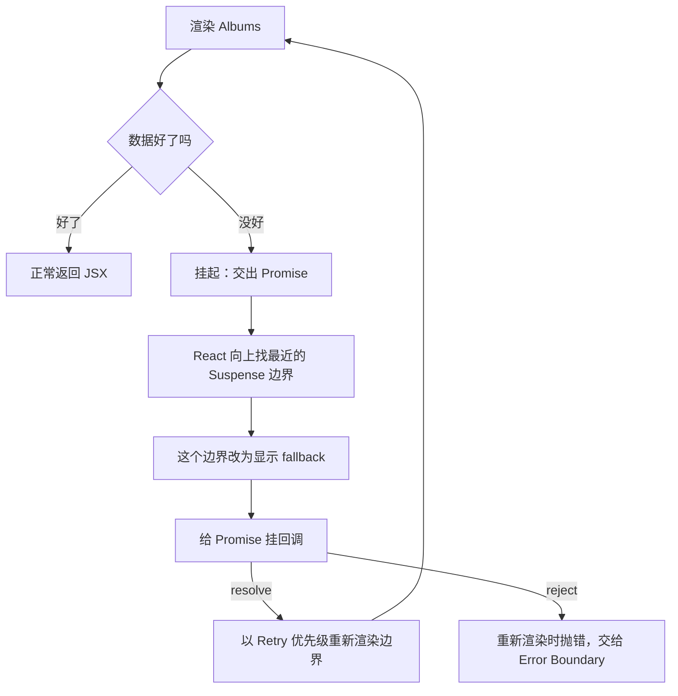

# Suspense 与 use

每个取数的组件都要处理「还没好」这个状态：`loading` 布尔值、骨架屏、`if (!data) return null`。写多了会发现两个问题：等待态散落在每个组件里，彼此没有协调，页面上一块一块地跳出来；而且数据和组件生命周期绑在 effect 上，先渲染一次空的、再在 effect 里取、再渲染一次。**Suspense** 把「等待」从组件内部提到树上的边界，**`use`** 让组件可以直接「读」一个 Promise。本章讲它们的运行机制、在 React 19 里的行为变化、和 transition 的配合，以及掌柜眼为什么至今用的是 effect 取数，迁移要过哪几关。

## Suspense 的机制：抛出与重试

Suspense 的核心机制在 React 16 就有了：组件在渲染时如果需要的东西还没准备好，就**中断渲染**，告诉 React「等这个 Promise」。



几个要点：

- 挂起时，组件这次渲染**的所有中间结果都被丢弃**，包括 hooks 里本次新建的状态。数据好了以后是从头重新渲染，不是从挂起的那一行继续。所以挂起前不能做任何副作用
- 被挂起的 Suspense 边界整体切换成 fallback；边界之外的部分照常渲染和提交
- Promise 完成后的重试用的是 Retry lane（第 4 章），可以切片

以前「交出 Promise」是靠直接 `throw promise` 实现的，各个数据库（Relay、早期的 SWR suspense 模式）各自约定。React 19 的 `use` 把它变成了正式 API。

### React 19 的行为变化：先提交 fallback，再预热兄弟

React 18 中，一个组件挂起后，React 会继续渲染同一边界内的兄弟组件，然后才提交 fallback。好处是兄弟组件里的请求能提前发出，坏处是 fallback 出现得晚。

React 19 改为：一个组件挂起，**立即提交最近边界的 fallback**，然后在后台「预热」（pre-warm）被挂起的兄弟树，让它们的懒加载和数据请求尽早开始。如果你的数据请求是在渲染时才发起的（render-as-you-fetch 的反面：fetch-on-render），同一边界里的多个组件可能变成**瀑布**：第一个挂起后，第二个要等预热时才开始请求。这也是官方一直推荐「请求尽早发起、渲染时只读」的原因。

## 和 transition 的配合

Suspense 单独用会有一个体验问题：已经显示着内容的区域，因为一次更新又挂起，内容被替换成 fallback，再换回新内容，页面跳两次。

React 的规则是：

| 更新类型 | 已显示内容的边界挂起时 |
|---|---|
| 普通更新（Sync / Default） | 切换回 fallback |
| transition 更新 | **保留旧内容**，等新内容准备好再整体替换 |

transition 期间新挂载的 Suspense 边界仍然会显示自己的 fallback，因为那块区域原本就是空的，没有「旧内容」可保留。

掌柜眼外壳的 `Suspense` 摆放就利用了这条规则：

```tsx
{/* 页面是按需加载的（App.tsx 那排 lazy）。等待边界摆在内容区里，不摆在外面包着整个 <Routes> */}
<ErrorBoundary resetKey={pathname}>
  <Suspense fallback={null}>
    <Outlet context={{ session, setSession }} />
  </Suspense>
</ErrorBoundary>
```

这段代码的注释讲了三层考虑：

1. **边界放在内容区里，不包住整个路由**。包在外面的话，取页面包的几十毫秒里侧边栏也会消失，回来时整屏重新落位，看起来像启动时抖了一下
2. **fallback 给 `null` 不给骨架**。从本机缓存取一个 JS 包是瞬间的事，一闪而过的灰块比空着更像坏了
3. **慢的情况根本走不到 fallback**。切到经营分析这类大包时，React Router 的导航是 transition，旧页面留在屏幕上，直到新页面准备好

这是 Suspense 设计里最容易被忽略的一点：**fallback 主要服务首次加载，后续切换应该由 transition 兜住**。

### lazy 与预加载

```tsx
const loadOverview = () => import("@/pages/overview");
const OverviewPage = lazy(loadOverview);
const ItemsPage = lazy(() => import("@/pages/items"));

// 落地页那一包最大，不等渲染就先去取，和登录态检查并行
void loadOverview();
```

`lazy` 返回的组件第一次渲染时调用加载函数、挂起，模块加载完后重试。掌柜眼把落地页的加载函数单独提出来，在模块顶层就调用一次：浏览器开始下载那一包，与「问服务端登没登录」那一次请求并行。等会话回来要渲染 `OverviewPage` 时，`lazy` 再调用 `loadOverview()`，动态 `import()` 对同一模块返回已缓存的结果，几乎不用等。这是「尽早发起、渲染时只读」在代码分割上的应用。

### 显示节流

多个边界陆续就绪时，如果每个都立即替换 fallback，页面会频繁跳动。React 对 fallback 到内容的切换做了节流（源码里约 300ms），让相近时间就绪的边界一起显示。React 19.2 起服务端渲染的 Suspense 边界也采用类似的批量显示。具体时长是实现细节。

## use：在渲染中读 Promise 和 Context

```tsx
import { use, Suspense } from "react";

function SupplierName({ supplierPromise }: { supplierPromise: Promise<Supplier> }) {
  const supplier = use(supplierPromise); // 没好就挂起，好了直接返回值
  return <span>{supplier.name}</span>;
}

<ErrorBoundary fallback={<p>供应商加载失败</p>}>
  <Suspense fallback={<span>…</span>}>
    <SupplierName supplierPromise={promise} />
  </Suspense>
</ErrorBoundary>
```

`use` 的规则（以 react.dev 为准）：

- 接受 Promise 或 Context
- 可以在 `if`、循环里调用，但必须在组件或 hook 内部调用
- **不能放在 `try/catch` 里**：它通过抛出来和 Suspense 协作，错误要交给 Error Boundary
- Promise reject 时，最近的 Error Boundary 显示 fallback
- **客户端组件里传给 `use` 的 Promise 必须是缓存的**，同一份数据跨渲染复用同一个 Promise 实例

最后一条是最容易踩的坑：

```tsx
// 错误：每次渲染都是一个新 Promise，永远挂起
function SupplierName({ id }: { id: string }) {
  const supplier = use(fetchSupplier(id));
  return <span>{supplier.name}</span>;
}
```

挂起后重试时，组件重新执行，又调用 `fetchSupplier` 得到一个新的 Promise，又挂起。官方文档明确说在渲染中创建的 Promise 会导致反复显示 fallback。

### Promise 从哪来

Promise 必须在渲染之外创建，或者由一个跨渲染的缓存负责去重。常见来源：

| 来源 | 例子 |
|---|---|
| 事件处理函数 | 点击「查看详情」时 `setPromise(fetchDetail(id))` |
| 路由 loader | React Router 的 data 模式在导航时调用 loader，组件读取 |
| 模块级缓存 | 按 key 缓存 Promise 的 Map |
| 框架 | Server Components 把 Promise 传给客户端组件；TanStack Query 的 `useSuspenseQuery` |

一个最小的按 key 缓存：

```ts
const cache = new Map<string, Promise<unknown>>();

export function load<T>(key: string, fn: () => Promise<T>): Promise<T> {
  let p = cache.get(key) as Promise<T> | undefined;
  if (!p) {
    p = fn();
    cache.set(key, p);
    p.catch(() => cache.delete(key)); // 失败了允许重试
  }
  return p;
}

export function invalidate(key: string): void {
  cache.delete(key);
}
```

```tsx
function SupplierName({ id }: { id: string }) {
  const supplier = use(load(`supplier:${id}`, () => fetchSupplier(id)));
  return <span>{supplier.name}</span>;
}
```

这能跑，但一上真实需求就会发现缺很多东西：缓存什么时候失效、数据变了怎么通知正在显示的组件、内存上限、并发请求合并。这些正是数据请求库要解决的问题。

### use(context)

```tsx
function PriceTag({ showCost }: { showCost: boolean }) {
  if (!showCost) return null;
  const perms = use(PermsContext); // 条件读取 context，useContext 不允许
  return perms.canSeeCost ? <CostCell /> : null;
}
```

第 3 章解释过它为什么可以条件调用：读 context 不占 hook 链表槽位。React 19 起 `<Context>` 本身就可以当 Provider 用，不再需要写 `<Context.Provider>`。

## 掌柜眼为什么还在用 effect 取数

掌柜眼的数据层是自己写的 `useAsync`：effect 里发请求、`loading` / `error` / `data` 三个 state、用递增的序号丢弃过期响应（`if (id === seq.current)`），加上一层按 key 的内存缓存和推送触发的静默重取。它的 ESLint 配置里关掉了 `react-hooks/set-state-in-effect`，注释写明了原因：

> 按规则改要换成 useSyncExternalStore 和 Suspense——那是架构决定，不是 lint 能推着走的。

为什么说是架构决定？把 `useAsync` 换成 Suspense 风格，要过这几关：

1. **缓存归属**。`use` 需要一个跨渲染的 Promise 缓存，`useAsync` 现在的 `memory` Map 存的是结果值，要改成存 Promise（或者「已完成的值 + 进行中的 Promise」）
2. **失效与推送**。服务端推送说「库存这一块换版了」时，现在的做法是让所有挂着的 `useAsync` 静默重取，取回来用 `replaceEqualDeep` 无声替换。换成 Suspense 后，失效意味着换一个新 Promise，如果不包在 transition 里，正在显示的页面会**塌回 fallback**。每次推送触发的重取都必须走 `startTransition`
3. **加载态的位置**。现在每个页面自己决定 `loading` 时画骨架还是保留旧数据（有缓存就不出骨架）。换成 Suspense，加载态由边界决定，要重新规划边界放在哪
4. **离线语义**。`useAsync` 遇到「连不上」的后台重取会保留旧数据、不报错。Suspense 风格下要在缓存层实现同样的语义，否则 reject 会把页面交给错误边界

所以对一个已经成形的应用，更现实的路径是：引入 TanStack Query 这类库（它同时支持普通 hook 和 `useSuspenseQuery`、有 `invalidateQueries` 和结构共享），先替换缓存层，再逐页决定要不要 Suspense 化。第 8 章讨论选型时还会回到这里。

## Activity：隐藏但保留

React 19.2 加入了 `<Activity>`：

```tsx
import { Activity } from "react";

<Activity mode={tab === "stock" ? "visible" : "hidden"}>
  <StockPage />
</Activity>
```

`hidden` 模式下：子树在 DOM 里被隐藏（`display: none`），**state 保留**，effect 被卸载（清理函数执行），对它的更新以最低优先级（Offscreen）延后处理。切回 `visible` 时重新建立 effect，状态还是离开时的样子。

掌柜眼有一个反复出现的需求叫「记得住」：离开一页再回来，上次的筛选、上次的数据当场画出来。现在的实现是两块模块级 Map，`useViewState` 记筛选这类「看法」，`useAsync` 的 `memory` 记数据。`<Activity>` 提供了另一条路：不卸载页面，只是隐藏。它的代价是隐藏的页面仍然占内存和 DOM 节点，适合少量、切换频繁的视图（比如几个 tab），不适合把几十个路由全挂着。两种方案也可以组合：常用的两三个 tab 用 Activity，其他页面继续用缓存。

## 本章要点

- Suspense 让组件在渲染中**挂起**，最近的边界显示 fallback；Promise 完成后从头重新渲染，挂起前不能有副作用
- React 19 起挂起后**立即提交 fallback**，再预热兄弟；在渲染中才发起的请求更容易形成瀑布
- transition 更新不会让已显示的内容退回 fallback；**fallback 服务首次加载，后续切换靠 transition**
- 边界的位置决定等待的范围：掌柜眼把边界放在内容区里，侧边栏不跟着消失
- `use(promise)` 要求 Promise 跨渲染缓存；不能放在 `try/catch` 里，错误交给 Error Boundary
- `use(context)` 可以条件调用；React 19 起 `<Context>` 可直接作为 Provider
- 从 effect 取数迁到 Suspense 牵涉缓存、失效、加载态和离线语义，是架构决定，通常借助数据请求库分步完成
- React 19.2 的 `<Activity>` 隐藏子树但保留状态，是实现「离开再回来还在」的另一种方式

## 动手练习

1. **没缓存的 Promise 永远挂起**：

   ```tsx
   function Uncached() {
     const v = use(new Promise<string>((r) => setTimeout(() => r("ok"), 10)));
     return <b>{v}</b>;
   }
   // <Suspense fallback="loading"><Uncached /></Suspense>
   ```

   渲染后等几秒，看页面；再把 Promise 提到模块顶层（`const cached = new Promise(...)`，组件里 `use(cached)`）重试。

   验证：第一种写法页面一直停在 `loading`；第二种 10 ms 后显示 `ok`。

   参考答案：每次重试都会重新执行组件，又得到一个新的、尚未完成的 Promise，于是再次挂起。`use` 读的 Promise 必须在渲染之外创建，或由按 key 去重的缓存提供。

2. **普通更新塌回 fallback，transition 不会**：用本章的 `load` 缓存写一个按页码取数的 `Page`（每页 `setTimeout` 500 ms 后返回 `第 n 页`），外面包 `<Suspense fallback="loading">`。加两个按钮：一个直接 `setN(n + 1)`，一个 `startTransition(() => setN(n + 1))`。各点一次，观察点击后的那 500 ms。

   验证：直接 `setN` 时，旧页面立刻消失，显示 `loading`，然后出现新页（DOM 里旧内容还在，只是被设成了 `display: none`）；用 `startTransition` 时，旧页面一直留在屏幕上，500 ms 后直接换成新页。

   参考答案：已显示内容的边界在普通更新里挂起，只能切回 fallback；在 transition 里挂起，React 保留旧内容等新内容准备好。这就是「fallback 服务首次加载，后续切换靠 transition」的依据。

3. **Activity 隐藏时保留状态、卸载 effect**：

   ```tsx
   function Counter() {
     const [c, setC] = useState(0);
     useEffect(() => {
       console.log("effect");
       return () => console.log("cleanup");
     }, []);
     return <button onClick={() => setC(c + 1)}>{c}</button>;
   }
   // <Activity mode={visible ? "visible" : "hidden"}><Counter /></Activity>
   ```

   把计数点到 2，切到 hidden，再切回 visible（关掉 StrictMode 看得更清楚）。

   验证：切到 hidden 时打印 `cleanup`，按钮在 DOM 里还在但 `style.display` 为 `none`；切回 visible 时打印 `effect`，按钮仍显示 `2`。如果改成条件渲染 `{visible && <Counter />}`，切回来时显示 `0`。

   参考答案：`<Activity mode="hidden">` 不卸载组件，只隐藏 DOM、清理 effect；条件渲染会卸载组件，状态随 Fiber 一起丢掉。
