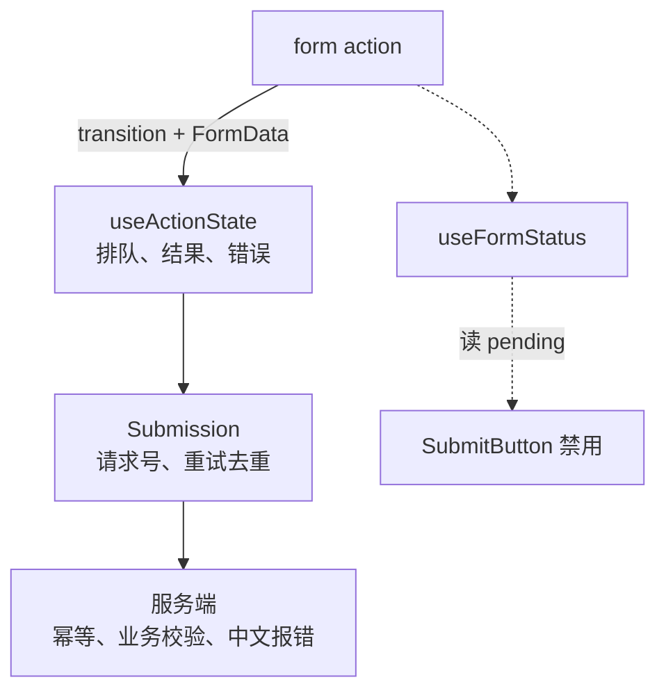

# Actions 与表单

提交一个表单，前端要做的事几乎每次都一样：防重复点击、显示「提交中」、请求失败时把错误显示出来并保留用户输入、成功时清空或跳转、有时还要先乐观地把结果画上去。React 19 把这套流程收拢成一个概念：**Action**，并围绕它提供了 `<form action>`、`useActionState`、`useFormStatus`、`useOptimistic`。本章讲 Action 和 transition 的关系、这几个 API 各管哪一段、它们不替你做什么（比如幂等），最后用掌柜眼「记一笔账」的提交改写一遍。

## Action 就是异步的 transition

第 4 章的 `startTransition` 在 React 18 里只接受同步函数。React 19 允许传入**异步函数**：

```tsx
const [isPending, startTransition] = useTransition();

function onSave() {
  startTransition(async () => {
    const saved = await api.expenses.create(draft); // isPending 从这里一直为 true
    startTransition(() => {
      setList((l) => [saved, ...l]); // await 之后的更新要再包一层
    });
  });
}
```

React 把「在 transition 里执行的函数」统称为 **Action**。异步 Action 期间 `isPending` 一直为 `true`，直到函数返回的 Promise 结束。

注意那层嵌套的 `startTransition`：`await` 之后，代码已经离开了外层 transition 的同步执行上下文，React 无法知道后面的 setState 属于这个 transition（JavaScript 没有可靠的异步上下文传播机制）。官方文档把它列为当前的已知限制，要求 await 之后的状态更新再包一次 `startTransition`，否则它们会以普通优先级执行。

## form action：把函数交给表单

> [!WARNING]
> 本节的自动重置行为按 2026 年 11 月 react.dev `<form>` 文档和 React v19.3.1 源码整理，属于可能随版本调整的细节，以 react.dev 和 React 仓库的 CHANGELOG 为准。

```tsx
function RenameForm({ id }: { id: string }) {
  async function rename(formData: FormData) {
    await api.items.rename(id, String(formData.get("name")));
  }
  return (
    <form action={rename}>
      <input name="name" />
      <button type="submit">保存</button>
    </form>
  );
}
```

`<form action>` 接受一个函数时（而不是 URL 字符串），React 会：

1. 阻止浏览器默认的整页提交
2. 收集表单字段为 `FormData`，在 **transition 里**调用你的函数
3. 函数结束后，**自动重置表单里的非受控字段**

第 3 点要特别留意：重置发生在 Action 结束之后，不管你在函数里认为它是成功还是失败。react.dev 的 `<form>` 文档写的是「action 成功后」重置，容易让人以为业务失败时不会重置；但按 2026 年 11 月 React v19.3.1 源码（`ReactFiberHooks.js` 的 `startHostTransition`），React 在调用你的函数**之前**就已经在同一个 transition 里排好了重置，它不看返回值。所以只要函数正常返回（包括 `useActionState` 返回一个「名字重复」的错误 state），字段都会被清空；函数抛错时错误交给最近的 Error Boundary。React 19.3 起，这次自动重置还会触发表单的 `onReset` 事件。如果校验失败时希望保留用户的输入，要么用受控组件，要么把提交的值放进返回的 state，作为 `defaultValue` 回填（见下一节的例子）。需要在其他时机手动重置时可以用 `react-dom` 导出的 `requestFormReset(form)`。

`<button formAction={fn}>` 可以让同一个表单的不同按钮执行不同的 Action。

## useActionState：Action 的结果和状态

```ts
const [state, dispatchAction, isPending] = useActionState(reducerAction, initialState);
```

- `reducerAction(prevState, payload)`：可以是 async，返回值成为新的 `state`。用在 `<form action>` 上时 `payload` 是 `FormData`
- `dispatchAction`：引用稳定，可以直接传给 `<form action>`
- `isPending`：有 Action 在执行时为 `true`

它的名字里有 reducer 是有原因的：React **按顺序排队执行**每次 dispatch，每个调用拿到的 `prevState` 是上一个调用的结果。官方文档明确写着 React 会等前一个 Action 完成再开始下一个。

这直接影响防重复提交：用户手快连点两下，`useActionState` **不会帮你去重**，第二次提交会排在第一次后面也执行一遍。所以按钮仍然要用 `isPending` 禁用，服务端仍然要做幂等。

### 错误处理的约定

| 错误类型 | 怎么处理 |
|---|---|
| 预期内的错误：校验失败、余额不足、名字重复 | 在 `reducerAction` 里 catch，作为 state 的一部分返回，界面渲染出来 |
| 预期外的错误 | 直接抛出，React 取消队列里剩余的 Action，交给最近的 Error Boundary |

抛出会让队列里还没执行的 dispatch 全部作废，所以凡是用户能修正后重试的错误，都应该返回而不是抛出。

### 在表单外调用

`dispatchAction` 必须在 Action 上下文里调用，否则开发模式下会报错、`isPending` 也不会更新。三种合法方式：传给 `<form action>`、传给会自动包 transition 的 action 类 prop、或者手动 `startTransition(() => dispatchAction(payload))`。在渲染中调用会导致无限循环。

## useFormStatus：子组件读表单状态

```tsx
import { useFormStatus } from "react-dom";

function SubmitButton({ children }: { children: React.ReactNode }) {
  const { pending } = useFormStatus();
  return (
    <button type="submit" disabled={pending}>
      {pending ? "提交中…" : children}
    </button>
  );
}
```

`useFormStatus` 返回**它所在的那个父 `<form>`** 的提交状态：`pending`、`data`（提交的 FormData）、`method`、`action`。几个容易错的地方：

- 必须在 `<form>` 的**子组件**里调用，在渲染 `<form>` 的那个组件里调用拿不到状态
- 只反映 `<form action={fn}>` 触发的提交
- 它从 `react-dom` 导出，不是 `react`

它的价值在于设计系统：一个通用的 `SubmitButton` 放进任何表单都能自动禁用，不需要层层传 `isPending`。

## useOptimistic：先画上去，失败再撤回

```ts
const [optimisticState, addOptimistic] = useOptimistic(state, updateFn);
```

`useOptimistic` 返回一个「在 Action 进行期间」可以临时覆盖的 state：

- 没有 Action 在进行时，`optimisticState` 就等于传入的 `state`
- Action 期间调用 `addOptimistic(x)`，React 用 `updateFn(currentState, x)` 算出临时值并立即渲染
- Action 结束后，临时值被丢弃，回到（可能已经更新的）真实 `state`

```tsx
function PaidToggle({ expense }: { expense: Expense }) {
  const [paid, setPaid] = useState(expense.paid);
  const [optimisticPaid, setOptimisticPaid] = useOptimistic(paid);
  const [, startTransition] = useTransition();

  function toggle() {
    startTransition(async () => {
      setOptimisticPaid(!paid); // 立刻显示为已付
      try {
        const next = await api.expenses.markPaid(expense.id, !paid);
        startTransition(() => setPaid(next.paid));
      } catch (err) {
        toast.error(errorMessage(err)); // 失败：Action 结束后自动回到 paid 原值
      }
    });
  }

  return <Switch checked={optimisticPaid} onCheckedChange={toggle} />;
}
```

失败时不需要手写回滚：Action 一结束，乐观值自然消失。这是 `useOptimistic` 相比「先 setState、失败再 setState 回去」的主要优势，也避免了多个并发请求交错时回滚到错误的值。

乐观更新适合**成功率很高、失败了用户也容易理解**的操作：标已付、点赞、改排序。涉及金额计算、库存扣减这类以服务端为准的结果，不要乐观地显示服务端才能算出来的数字。掌柜眼的约定是「数据只在服务端一份」，界面上的金额、库存都应该以回包为准，乐观更新只用在开关、勾选这类纯粹反映用户意图的地方。

## 这些 API 不替你做什么：幂等

Action 解决的是**界面状态**的管理，它不管网络。断网、超时、服务端慢，用户点了「保存」没反应，再点一次，请求到底执行了一次还是两次？这需要服务端幂等。

掌柜眼的做法是请求号（idempotency key），封装在 `lib/submit.ts` 的 `Submission` 类里：

```ts
export class Submission {
  private pending: { fingerprint: string; key: string } | null = null;

  async run<B, T>(body: B, send: (body: B) => Promise<T>): Promise<T> {
    const fingerprint = JSON.stringify(body) ?? "";
    if (!this.pending || this.pending.fingerprint !== fingerprint) {
      this.pending = { fingerprint, key: crypto.randomUUID() };
    }
    try {
      const value = await withRequestKey(this.pending.key, () => send(body));
      this.pending = null; // 交成了，下次是新的一次
      return value;
    } catch (err) {
      const code = errorCode(err);
      if (code === "idempotency_unknown" || code === "idempotency_mismatch") this.pending = null;
      throw err;
    }
  }
}
```

规则是：同一次提交重试时，只要请求体没变，就带同一个请求号，服务端识别出是同一次、只记一笔；请求体改了任何一格就是新的一次。比较的是请求体本身，不依赖界面记「改没改过」。

## 组合起来：记一笔账

把上面几样组合起来，一个开支录入表单可以这样写：

```tsx
import { useActionState } from "react";
import { useFormStatus } from "react-dom";
import { useSubmission } from "@/lib/submit";
import { getApi, errorMessage } from "@/lib/api";

type FormState =
  | { status: "idle" }
  | { status: "error"; message: string; values: { amount: string; note: string } }
  | { status: "saved"; id: string };

function ExpenseForm({ onSaved }: { onSaved: (id: string) => void }) {
  const submission = useSubmission();

  const [state, formAction] = useActionState<FormState, FormData>(async (_prev, formData) => {
    const values = {
      amount: String(formData.get("amount") ?? ""),
      note: String(formData.get("note") ?? ""),
    };
    const body = { amountCents: Math.round(Number(values.amount) * 100), note: values.note };
    try {
      const saved = await submission.run(body, (b) => getApi().expenses.create(b));
      onSaved(saved.id);
      return { status: "saved", id: saved.id };
    } catch (err) {
      // 报错文案在服务端写，原样显示；把输入放回去，表单重置后还能回填
      return { status: "error", message: errorMessage(err), values };
    }
  }, { status: "idle" });

  const values = state.status === "error" ? state.values : { amount: "", note: "" };

  return (
    // key 随结果变化：字段按回填的 defaultValue 重建，不依赖表单重置和提交的先后
    <form action={formAction} key={state.status === "error" ? state.message + values.amount : state.status}>
      <input name="amount" inputMode="decimal" defaultValue={values.amount} />
      <input name="note" defaultValue={values.note} />
      {state.status === "error" && <p role="alert">{state.message}</p>}
      <SubmitButton>记一笔</SubmitButton>
    </form>
  );
}

function SubmitButton({ children }: { children: React.ReactNode }) {
  const { pending } = useFormStatus();
  return <button type="submit" disabled={pending}>{children}</button>;
}
```

各自的分工：



这个例子也展示了 form action 的一个现实摩擦：自动重置和「失败保留输入」是冲突的，要靠回填 `defaultValue`（加 `key` 强制重建字段）来补。掌柜眼现有的表单大多是受控组件加手写提交函数，对这类「字段多、要实时校验、要拍板」的表单，受控写法 + `useTransition` 往往比 form action 更直接。form action 最舒服的场景是字段少、校验在服务端、提交后整个表单清空的情况。

## 本章要点

- React 19 的 **Action** 是在 transition 中执行的（可以是异步的）函数；`await` 之后的 setState 需要再包一层 `startTransition`
- `<form action={fn}>` 在 transition 里调用 `fn(formData)`，结束后**自动重置非受控字段**，失败也会重置
- `useActionState` 管理 Action 的结果，**按顺序排队执行**，不会对重复提交去重；预期内的错误应作为 state 返回
- `useFormStatus`（来自 `react-dom`）让表单内的子组件读到提交状态，适合通用提交按钮
- `useOptimistic` 在 Action 期间显示临时值，结束后自动回到真实 state，失败无需手写回滚；只用于反映用户意图的操作
- Action 只管界面状态，**重复提交的正确性靠服务端幂等**，客户端用请求号配合
- 字段多、要实时校验的表单，受控组件 + `useTransition` 往往比 form action 更合适

## 动手练习

1. **失败也会清空输入**：

   ```tsx
   function RenameForm() {
     const [msg, action] = useActionState(async (_prev: string, fd: FormData) => {
       await new Promise((r) => setTimeout(r, 300));
       return "名字重复：" + fd.get("name"); // 模拟服务端校验失败
     }, "");
     return (
       <form action={action}>
         <input name="name" />
         <button type="submit">保存</button>
         <p>{msg}</p>
       </form>
     );
   }
   ```

   输入「牛肉」后提交，预测 300 ms 后输入框里还剩什么。

   验证：下方显示 `名字重复：牛肉`，输入框被清空。给 `useActionState` 的返回值加上 `values`，按本章「记一笔账」的写法用 `defaultValue` 加 `key` 回填后，失败时输入框保留「牛肉」。

   参考答案：`<form action={fn}>` 在 Action 结束后无条件重置非受控字段，它不知道你返回的是成功还是失败。

2. **连点两次会执行两次**：给 `useActionState` 的函数加上日志：

   ```tsx
   const [n, dispatch, isPending] = useActionState(async (prev: number) => {
     console.log("start", prev + 1);
     await new Promise((r) => setTimeout(r, 1000));
     console.log("end", prev + 1);
     return prev + 1;
   }, 0);
   // <form action={dispatch}><button>提交 {n}</button></form>
   ```

   一秒内快速点两下按钮，预测日志顺序和最终的 `n`。

   验证：日志依次为 `start 1`、`end 1`、`start 2`、`end 2`，最终显示 `2`。给按钮加上 `disabled={isPending}` 后，快速连点只会执行一次。

   参考答案：`useActionState` 按顺序排队执行每次 dispatch，后一次拿到前一次的结果，它不去重。防重复提交要靠禁用按钮，最终的正确性要靠服务端幂等。

3. **乐观值自动撤回**：按本章的 `PaidToggle` 写一个开关，把 `api.expenses.markPaid` 换成 `await new Promise((_, rej) => setTimeout(() => rej(new Error("网络断了")), 1000))`，在 `catch` 里 `console.log` 错误。点一次开关并盯住它。

   验证：开关立刻变成「已付」，1 秒后自动跳回「未付」，控制台打印错误；代码里没有任何一行把它设回去。

   参考答案：乐观值只在 Action 进行期间生效，Action 一结束（无论成败）就回到真实的 `paid`，而 `paid` 从来没被改过。
